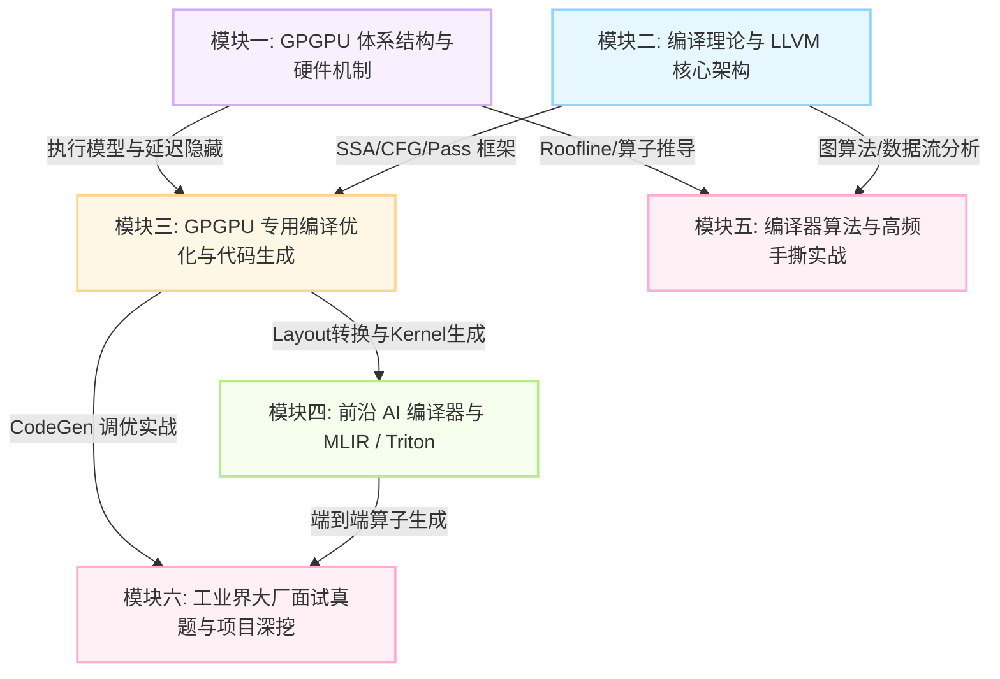

> 本专栏面向准备投递 **GPGPU 编译器开发、异构计算底层优化、AI 编译器后端** 方向的工程师与校招同学，致力于打破“只懂理论不通硬件、只懂 CUDA 不识编译”的断层，提供系统化、工业级、可落地的通关知识体系。

{: .notice--primary}
**专栏定位**：聚焦 **体系结构硬件机制 + LLVM/MLIR 编译优化 + GPU CodeGen + 工业界大厂高频面试真题深挖**。

---

## 🗺️ 专栏知识全景图谱

---

## 📚 专栏模块与文章更新追踪

> 💡 状态标记：✅ **已发布** ｜ 🔄 **编写中** ｜ ⏳ **待更新**

### 🌟 每日精选题打卡合集（Daily Interview Practice）

| 序号 | 题目专刊 | 核心考察领域与考点 | 状态 |
| :---: | :--- | :--- | :---: |
| **Day 1** | [**精选 Day 1：体系结构、控制流、LLVM 优化与内存模型**](/gpu-compiler/gpgpu-compiler-interview-day-1/) | 寄存器压力与 Occupancy、SIMT 分支发散与 Structurization、Address Space 降级、LoadStoreVectorizer 安全性、GPU 内存模型与 Fence 调度约束 | ✅ **已发布** |

### 模块一：GPGPU 体系结构与硬件机制（地基篇）

深入理解硬件执行管线是写出高质量 GPU 优化 Pass 的前提。

| 序号 | 题目 / 核心主题 | 核心考察点 | 状态 |
| :---: | :--- | :--- | :---: |
| 1.1 | **SIMT 并行模型与 Warp 调度机制** | SIMD vs SIMT、Warp/Wavefront 调度、Scoreboard、双发射 | ⏳ 待更新 |
| 1.2 | **控制流与分支分化（Branch Divergence）** | 分支分化机理、Reconvergence Stack、Independent Thread Scheduling | ⏳ 待更新 |
| 1.3 | **GPU 存储层次与瓶颈定位** | Global/Shared/LDS/Constant/Local 存储特性、Bank Conflict、访存合并 | ⏳ 待更新 |
| 1.4 | **Occupancy 与延迟隐藏（Latency Hiding）** | 寄存器与 LDS 资源约束、Roofline 模型、Compute-bound vs Memory-bound | ⏳ 待更新 |
| 1.5 | **现代 GPU 专用硬件单元** | Tensor Core / Matrix Core (MMA/MFMA)、异步拷贝机制 (TMA / cp.async) | ⏳ 待更新 |

---

### 模块二：经典编译器原理与 LLVM 核心架构（基础篇）

掌握编译器经典中间表示、数据流分析与 LLVM 工业级基础设施。

| 序号 | 题目 / 核心主题 | 核心考察点 | 状态 |
| :---: | :--- | :--- | :---: |
| 2.1 | **SSA 形式与控制流分析** | SSA 构造与消除、Dominator Tree、Dominance Frontier、自然循环识别 | ⏳ 待更新 |
| 2.2 | **LLVM 核心对象模型与 New Pass Manager** | Module/Function/BasicBlock/Instruction 继承树、Use-Def 链、Pass 依赖管理 | ⏳ 待更新 |
| 2.3 | **经典中端优化 Pass 剖析** | LICM、GVN/CSE、DCE、循环展开（Unroll）、循环剥离（Peeling） | ⏳ 待更新 |

---

### 模块三：GPGPU 专用编译优化与后端生成（核心王牌篇）

专栏最硬核部分：聚焦 GPU 平台特有的编译挑战与代码生成策略。

| 序号 | 题目 / 核心主题 | 核心考察点 | 状态 |
| :---: | :--- | :--- | :---: |
| 3.1 | **分支发散分析与控制流规整化** | Divergence Analysis、StructurizeCFG Pass、不可约流图处理 | ⏳ 待更新 |
| 3.2 | **GPU 专用访存优化与向量化** | 自动合并访存 Pass、Shared Memory Padding、128-bit 宽字向量化加载 | ⏳ 待更新 |
| 3.3 | **指令调度策略：延迟隐藏 vs 寄存器压力** | MachineScheduler 在 GPU 后端的实现、高延迟访存提升与跨 BasicBlock 调度 | ⏳ 待更新 |
| 3.4 | **GPU 寄存器分配与 Spill 治理** | 贪心寄存器分配、GPU Spill 灾难排查、重计算（Rematerialization）策略 | ⏳ 待更新 |
| 3.5 | **异构驱动交互与 Fat Binary 机制** | Clang Offload 架构、ELF/HSACO 格式、Kernel Descriptor 与 Runtime 加载 | ⏳ 待更新 |

---

### 模块四：前沿 AI 编译器与 MLIR / Triton 体系（前沿篇）

打通从高层 DSL（Triton/PyTorch）到硬件底层指令的编译映射路径。

| 序号 | 题目 / 核心主题 | 核心考察点 | 状态 |
| :---: | :--- | :--- | :---: |
| 4.1 | **MLIR 设计哲学与核心概念** | Dialect、Operation、Region、Block、Interface、Pattern Rewrite 机制 | ⏳ 待更新 |
| 4.2 | **Triton 编译器核心架构解析** | AST -> Triton-IR -> TritonGPU-IR 流程、Block-level 抽象优势 | ⏳ 待更新 |
| 4.3 | **Triton 中的 Layout 转换与自动优化** | Blocked / DotOperand / Shared Layout 转换、多级流水线（Pipelining）生成 | ⏳ 待更新 |

---

### 模块五：编译器算法与高频手撕实战（实战篇）

针对现场面试手撕代码环节，兼顾经典算法、编译 Pass 与并行算子。

| 序号 | 题目 / 核心主题 | 核心考察点 | 状态 |
| :---: | :--- | :--- | :---: |
| 5.1 | **图算法与数据流分析手撕** | 支配树构建算法、拓扑排序、活跃变量分析（Liveness Analysis） | ⏳ 待更新 |
| 5.2 | **LLVM 简易 Pass 手写实战** | 常量折叠 Pass、死代码消除、冗余访存消除（Redundant Load Elimination） | ⏳ 待更新 |
| 5.3 | **经典高性能 GEMM 算子优化演进** | Naive -> Tiling -> Shared Memory -> 消除 Bank Conflict -> Register Tiling | ⏳ 待更新 |

---

### 模块六：大厂面试真题复盘与项目呈现（求职攻略篇）

模拟大厂面试追问场景，传授项目亮点挖掘与排错实战经验。

| 序号 | 题目 / 核心主题 | 核心考察点 | 状态 |
| :---: | :--- | :--- | :---: |
| 6.1 | **主流大厂高频连环追问与避坑指南** | 动态指令减少但运行变慢的原因排查、RA 质量衡量指标、Miscompilation 定位 | ⏳ 待更新 |
| 6.2 | **编译器工程师专属项目包装（STAR 原则）** | 成果指标量化（Throughput / Latency / Code Size）、Bugpoint 与工具链赋能 | ⏳ 待更新 |

---

## 🎯 备战与学习心法

1. **“向下看一层”**：写 LLVM Pass 时心中必须有 GPU 硬件的物理形态；分析 CUDA/HIP 代码时脑中必须能还原出对应发射的 LLVM IR 与汇编。
2. **“软硬协同”**：牢记“编译器优化不是无中生有”，本质上是在**有限的寄存器/内存带宽资源与并发度（Occupancy）之间寻找最佳 Pareto 最优解**。
3. **“动手实操”**：不仅要读代码，更要配合 `opt`、`llc`、`rocminfo`、`ncu` / `rocprof` 观察真实编译与分析产物。

---

{: .notice--success}
💬 **专栏更新通知**：专栏将持续连载更新。如果你在面试备战过程中遇到疑难问题或有想深入探讨的技术点，欢迎在文末留言交流！
