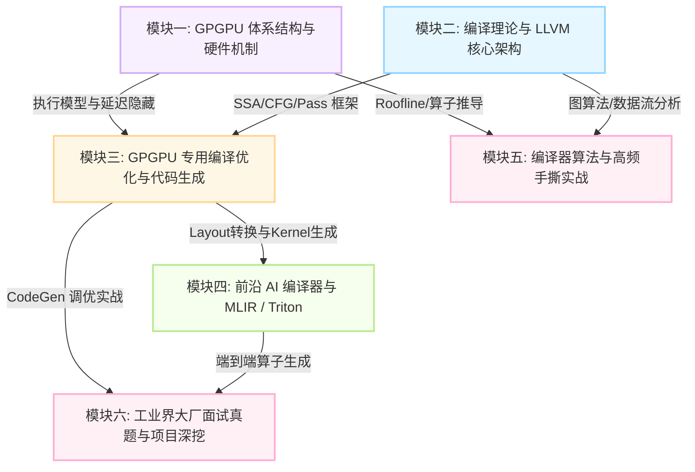

> 本专栏面向准备投递 **GPGPU 编译器开发、异构计算底层优化、AI 编译器后端** 方向的工程师与校招同学，致力于打破“只懂理论不通硬件、只懂 CUDA 不识编译”的断层，提供系统化、工业级、可落地的通关知识体系。

{: .notice--primary}
**专栏定位**：聚焦 **体系结构硬件机制 + LLVM/MLIR 编译优化 + GPU CodeGen + 工业界大厂高频面试真题深挖**。

---

## 🗺️ 专栏知识全景图谱

---

## 📚 专栏模块与文章更新追踪

> 💡 状态标记：✅ **已发布** ｜ 🔄 **编写中** ｜ ⏳ **待更新**

### 🌟 每日精选题打卡合集（Daily Interview Practice）

| 序号 | 题目专刊 | 核心考察领域与考点 | 状态 |
| :---: | :--- | :--- | :---: |
| **Day 1** | [**精选 Day 1：体系结构、控制流、LLVM 优化与内存模型**](/gpu-compiler/2026-10-16-gpgpu-compiler-interview-day-1/) | 寄存器压力与 Occupancy、SIMT 分支发散与 Structurization、Address Space 降级、LoadStoreVectorizer 安全性、GPU 内存模型与 Fence 调度约束 | ✅ **已发布** |
| **Day 2** | [**精选 Day 2：标量优化、Bank Conflict、软流水与指令发射**](/gpu-compiler/2026-10-17-gpgpu-compiler-interview-day-2/) | Uniformity 标量通道与控制发散、Shared Memory Bank 冲突与 Swizzling、软流水与异步拷贝演进、寄存器 Bank 冲突与操作数收集器、Scoreboard 与 Waitcnt | ✅ **已发布** |
| **Day 3** | [**精选 Day 3：算子融合、One-Shot Bufferize、寄存器溢出与集群同步**](/gpu-compiler/2026-10-18-gpgpu-compiler-interview-day-3/) | 循环融合依赖合法性判定、MLIR One-Shot Bufferization 别名分析与就地复用、寄存器溢出与 Rematerialization、Cluster Barrier 调度约束、弱内存模型与缓存一致性 | ✅ **已发布** |
| **Day 4** | [**精选 Day 4：GlobalISel、Fragment 布局、发散展开与异步流水**](/gpu-compiler/2026-10-19-gpgpu-compiler-interview-day-4/) | GlobalISel 架构演进与合法化、Tensor Core Fragment 寄存器布局与 RA 防打乱、发散循环展开与 Warp Vote 谓词化、异步拷贝流水线（TMA）依赖调度、Post-RA 延迟掩盖与 Scoreboard 槽位管理 | ✅ **已发布** |
| **Day 5** | [**精选 Day 5：发散不变式、I-Cache 抖动、Spill 代价与显存规划**](/gpu-compiler/2026-10-20-gpgpu-compiler-interview-day-5/) | MachineLICM 发散不变式过滤陷阱、I-Cache Thrashing 与激进内联博弈、Live Range Splitting 与 GPU 专属 Spill Cost、Tensor 生命周期调度与显存复用、GPU 异常（Trap/Assert）与全局 Error Ring Buffer | ✅ **已发布** |
| **Day 6** | [**精选 Day 6：Hazard Recognizer、分布式共享内存、标量化与自动调优**](/gpu-compiler/2026-10-21-gpgpu-compiler-interview-day-6/) | TargetHazardRecognizer 流水线冲突判定、Hopper 分布式共享内存 (DSMem) 跨块通信、标量化与宽向量动态博弈、AI 编译器 Auto-Tuning 代价模型、Warp 原语与 Mask 传播消除 | ✅ **已发布** |
| **Day 7** | [**精选 Day 7：参数传递、发射端口饥饿、动态调用与内存布局**](/gpu-compiler/2026-10-22-gpgpu-compiler-interview-day-7/) | Kernel 参数传递与 Parameter Space 映射、Issue Port Starvation 与异构管线交织、间接函数调用与动态并行编译挑战、atomicrmw 弱内存模型硬件 Qualifier 生成、Layout Propagation 与 Smem 暂存转置 | ✅ **已发布** |
| **Day 8** | [**精选 Day 8：MLIR 降级、共享内存映射、循环变换与混合架构分工**](/gpu-compiler/2026-10-23-gpgpu-compiler-interview-day-8/) | MLIR Dialect 渐进降级与硬件属性透传、One-Shot Bufferization 与动态/静态共享内存映射、SCF/Affine 循环到 GPU 线程拓扑映射、GreedyPatternRewriter 硬件原语匹配与 Fallback、MLIR 与 LLVM 后端职责边界 | ✅ **已发布** |
| **Day 9** | [**精选 Day 9：TMA 分块、别名分析、Shuffle 原语与复合指令**](/gpu-compiler/2026-10-24-gpgpu-compiler-interview-day-9/) | TMA Block-Level Tiling 协同优化、GPU 指针别名分析与 MemorySSA、Warp Shuffle 与 Butterfly All-Reduce、Peephole 复合指令融合 (FMA/MAD/BFI)、GPU Lock-Free 算法 ABA 与弱内存模型 | ✅ **已发布** |
| **Day 10** | [**精选 Day 10：寄存器别名、Linalg 降级、mbarrier 与立即数冲突**](/gpu-compiler/2026-10-25-gpgpu-compiler-interview-day-10/) | 物理寄存器别名 (Super/Sub-Reg) 与碎片化、linalg.generic 到 vector.contract 降级链、mbarrier 异步屏障编译调度、变长指令编码与立即数冲突 (Literal Hazards)、动态步长访存与 L2 穿透 | ✅ **已发布** |
| **Day 11** | [**精选 Day 11：Loop Skewing、SMS 软流水、死锁验证与低比特编译**](/gpu-compiler/2026-10-26-gpgpu-compiler-interview-day-11/) | Affine Loop Skewing 与非平凡依赖消除、MachinePipeliner (SMS) 与 Modulo Variable Expansion、Warp 发散死锁与重汇聚静态验证、非连续 Atomic Reduction 编译聚合、低比特 (FP8/INT4) Scale 传播与截断 | ✅ **已发布** |
| **Day 12** | [**精选 Day 12：MachineLICM、OneShotBufferize、RAGreedy 与机制对比**](/gpu-compiler/2026-10-27-gpgpu-compiler-interview-day-12/) | MachineLICM 发散不变式过滤与压力感知、OneShotBufferize RaW 冲突与内存复用、RAGreedy Live Range Splitting 与 Spill Cost、Triton/MLIR Layout 传播与转置消除、AMDGPU Hazard 识别与 5 大核心机制对比矩阵 | ✅ **已发布** |
| **Day 13** | [**精选 Day 13：LegalizerHelper、寄存器提示、Hazard 仲裁与 TMA 重构**](/gpu-compiler/2026-10-28-gpgpu-compiler-interview-day-13/) | LegalizerHelper 向量解构与窄类型合法化、TargetRegisterInfo 寄存器提示注入、AMDGPUHazardRecognizer SMRD/VALU 冲突仲裁、GPU 转 NVVM 内置索引与动态 LDS、TMA 异步屏障代数重构与 5 深度技术对比 | ✅ **已发布** |
| **Day 14** | [**精选 Day 14：VectorCombine、指令级活跃区间切分、SASS 控制码与 Memref 逃逸**](/gpu-compiler/2026-10-29-gpgpu-compiler-interview-day-14/) | VectorCombine 向量标量化与代数洗牌穿透、RAGreedy 单指令级别生命周期切分与 Spill 权衡、NVIDIA SASS 控制码静态延迟与硬件记分牌仲裁、MLIR BufferDeallocation 所有权逃逸与克隆提升、Triton 分布式张量布局转换与 Shuffle 消除 | ✅ **已发布** |
| **Day 15** | [**精选 Day 15：循环向量化、Sethi-Ullman 调度、除法展开与 Bank 冲突**](/gpu-compiler/2026-10-30-gpgpu-compiler-interview-day-15/) | LoopVectorize 非均匀指针与 SCEV 仿射步长判别、ScheduleDAGRRList Sethi-Ullman 标号与寄存器减压调度、TargetLowering 整数除法魔数乘法与 IEEE-754 精度合规、AffineStructures 多面体 Fourier-Motzkin 依赖测试与 GCD 检验、Triton/IREE Bank-Aware 共享内存布局分配器 | ✅ **已发布** |
| **Day 16** | [**精选 Day 16：发散出口规约、子区间干涉、寻址偏移折叠与内存复用**](/gpu-compiler/2026-10-31-gpgpu-compiler-interview-day-16/) | AMDGPUUnifyDivergentExitNodes 发散控制流出口规约与统一汇聚块、LiveInterval advanceTo 跨步推进与 LaneBitmask 子区间干涉检测、AMDGPUISelDAGToDAG Flat/Global 寻址模式与偏移折叠、ConvertVectorToNVVM 向量降级与寄存器切片、Triton/IREE 跨算子共享内存 Buffer 别名复用 | ✅ **已发布** |
| **Day 17** | [**精选 Day 17：子寄存器消除、地址空间推导、全局原子降级与三级缓冲**](/gpu-compiler/2026-11-01-gpgpu-compiler-interview-day-17/) | RegisterCoalescer LaneBitmask 宽向量子寄存器合并与死锁防范、InferAddressSpaces 格模型（Lattice）与 Flat/Generic 消除克隆降级、AMDGPUISelDAGToDAG 平面原子累加降级与 Cache Coherence 一致性、ConvertVectorToGPU Warp Shuffle 归约、Triton/IREE 异步预取与共享内存三级缓冲 | ✅ **已发布** |
| **Day 18** | [**精选 Day 18：跨通道别名、微槽位模型、硬件位段提取与指针代数**](/gpu-compiler/2026-11-02-gpgpu-compiler-interview-day-18/) | BasicAliasAnalysis 跨通道 GEP 线性化分解与发散别名推导、SlotIndexes 四分槽位微粒度模型与虚拟寄存器死区精准刻画、SelectionDAGISel 硬件位段提取（BFE）匹配与 INT4/FP8 解包、ConvertGPUToROCDL Wave 广播降级与硬件原语、Triton/AI 编译器流水线指针代数折叠与常量寻址吸收 | ✅ **已发布** |
| **Day 19** | [**精选 Day 19：Alloca 栈提升、饱和算术合法化、SMS 软流水 RecMII 与矩阵转置**](/gpu-compiler/2026-11-03-gpgpu-compiler-interview-day-19/) | AMDGPUPromoteAlloca 私有栈提升至 LDS/向量与动态回退、SelectionDAGLegalize 饱和算术合法化与硬件 Clamp/MED3 单周期融合、MachinePipeliner RecMII 循环依赖最小间隔求解、ConvertLinalgToLoops 动态边界剥离（Bound Peeling）、Triton/IREE 片上 LDS 矩阵转置与双向无冲突 Bank Swizzling | ✅ **已发布** |
| **Day 20** | [**精选 Day 20：Sync Divergence、SelectionDAG 耗时裁剪、waitcnt 记分牌与尾块谓词**](/gpu-compiler/2026-11-04-gpgpu-compiler-interview-day-20/) | DivergenceAnalysis 同步发散与非结构化循环出口判定、SelectionDAG 巨大基本块分块与早筛回退、AMDGPU SIInsertWaitcnts 记分牌精确推导、MLIR 动态共享内存符号降级与对齐、Triton 谓词折叠优化 | ✅ **已发布** |
| **Day 21** | [**精选 Day 21：RegBankSelect、SDIVREM 折叠、EXEC 掩码短路与 WMMA/MFMA 降级**](/gpu-compiler/2026-11-05-gpgpu-compiler-interview-day-21/) | GlobalISel RegBankSelect 标量/向量寄存器库映射与跨 Bank 拷贝、SelectionDAG 除法取模公共子表达式折叠、SIPreEmitPeephole EXEC 全零短路消除、Subgroup WMMA/MFMA 矩阵降级、Triton 非连续访存合并重排 | ✅ **已发布** |

### 模块一：GPGPU 体系结构与硬件机制（地基篇）

深入理解硬件执行管线是写出高质量 GPU 优化 Pass 的前提。

| 序号 | 题目 / 核心主题 | 核心考察点 | 状态 |
| :---: | :--- | :--- | :---: |
| 1.1 | **SIMT 并行模型与 Warp 调度机制** | SIMD vs SIMT、Warp/Wavefront 调度、Scoreboard、双发射 | ⏳ 待更新 |
| 1.2 | **控制流与分支分化（Branch Divergence）** | 分支分化机理、Reconvergence Stack、Independent Thread Scheduling | ⏳ 待更新 |
| 1.3 | **GPU 存储层次与瓶颈定位** | Global/Shared/LDS/Constant/Local 存储特性、Bank Conflict、访存合并 | ⏳ 待更新 |
| 1.4 | **Occupancy 与延迟隐藏（Latency Hiding）** | 寄存器与 LDS 资源约束、Roofline 模型、Compute-bound vs Memory-bound | ⏳ 待更新 |
| 1.5 | **现代 GPU 专用硬件单元** | Tensor Core / Matrix Core (MMA/MFMA)、异步拷贝机制 (TMA / cp.async) | ⏳ 待更新 |

---

### 模块二：经典编译器原理与 LLVM 核心架构（基础篇）

掌握编译器经典中间表示、数据流分析与 LLVM 工业级基础设施。

| 序号 | 题目 / 核心主题 | 核心考察点 | 状态 |
| :---: | :--- | :--- | :---: |
| 2.1 | **SSA 形式与控制流分析** | SSA 构造与消除、Dominator Tree、Dominance Frontier、自然循环识别 | ⏳ 待更新 |
| 2.2 | **LLVM 核心对象模型与 New Pass Manager** | Module/Function/BasicBlock/Instruction 继承树、Use-Def 链、Pass 依赖管理 | ⏳ 待更新 |
| 2.3 | **经典中端优化 Pass 剖析** | LICM、GVN/CSE、DCE、循环展开（Unroll）、循环剥离（Peeling） | ⏳ 待更新 |

---

### 模块三：GPGPU 专用编译优化与后端生成（核心王牌篇）

专栏最硬核部分：聚焦 GPU 平台特有的编译挑战与代码生成策略。

| 序号 | 题目 / 核心主题 | 核心考察点 | 状态 |
| :---: | :--- | :--- | :---: |
| 3.1 | **分支发散分析与控制流规整化** | Divergence Analysis、StructurizeCFG Pass、不可约流图处理 | ⏳ 待更新 |
| 3.2 | **GPU 专用访存优化与向量化** | 自动合并访存 Pass、Shared Memory Padding、128-bit 宽字向量化加载 | ⏳ 待更新 |
| 3.3 | **指令调度策略：延迟隐藏 vs 寄存器压力** | MachineScheduler 在 GPU 后端的实现、高延迟访存提升与跨 BasicBlock 调度 | ⏳ 待更新 |
| 3.4 | **GPU 寄存器分配与 Spill 治理** | 贪心寄存器分配、GPU Spill 灾难排查、重计算（Rematerialization）策略 | ⏳ 待更新 |
| 3.5 | **异构驱动交互与 Fat Binary 机制** | Clang Offload 架构、ELF/HSACO 格式、Kernel Descriptor 与 Runtime 加载 | ⏳ 待更新 |

---

### 模块四：前沿 AI 编译器与 MLIR / Triton 体系（前沿篇）

打通从高层 DSL（Triton/PyTorch）到硬件底层指令的编译映射路径。

| 序号 | 题目 / 核心主题 | 核心考察点 | 状态 |
| :---: | :--- | :--- | :---: |
| 4.1 | **MLIR 设计哲学与核心概念** | Dialect、Operation、Region、Block、Interface、Pattern Rewrite 机制 | ⏳ 待更新 |
| 4.2 | **Triton 编译器核心架构解析** | AST -> Triton-IR -> TritonGPU-IR 流程、Block-level 抽象优势 | ⏳ 待更新 |
| 4.3 | **Triton 中的 Layout 转换与自动优化** | Blocked / DotOperand / Shared Layout 转换、多级流水线（Pipelining）生成 | ⏳ 待更新 |

---

### 模块五：编译器算法与高频手撕实战（实战篇）

针对现场面试手撕代码环节，兼顾经典算法、编译 Pass 与并行算子。

| 序号 | 题目 / 核心主题 | 核心考察点 | 状态 |
| :---: | :--- | :--- | :---: |
| 5.1 | **图算法与数据流分析手撕** | 支配树构建算法、拓扑排序、活跃变量分析（Liveness Analysis） | ⏳ 待更新 |
| 5.2 | **LLVM 简易 Pass 手写实战** | 常量折叠 Pass、死代码消除、冗余访存消除（Redundant Load Elimination） | ⏳ 待更新 |
| 5.3 | **经典高性能 GEMM 算子优化演进** | Naive -> Tiling -> Shared Memory -> 消除 Bank Conflict -> Register Tiling | ⏳ 待更新 |

---

### 模块六：大厂面试真题复盘与项目呈现（求职攻略篇）

模拟大厂面试追问场景，传授项目亮点挖掘与排错实战经验。

| 序号 | 题目 / 核心主题 | 核心考察点 | 状态 |
| :---: | :--- | :--- | :---: |
| 6.1 | **主流大厂高频连环追问与避坑指南** | 动态指令减少但运行变慢的原因排查、RA 质量衡量指标、Miscompilation 定位 | ⏳ 待更新 |
| 6.2 | **编译器工程师专属项目包装（STAR 原则）** | 成果指标量化（Throughput / Latency / Code Size）、Bugpoint 与工具链赋能 | ⏳ 待更新 |

---

## 🎯 备战与学习心法

1. **“向下看一层”**：写 LLVM Pass 时心中必须有 GPU 硬件的物理形态；分析 CUDA/HIP 代码时脑中必须能还原出对应发射的 LLVM IR 与汇编。
2. **“软硬协同”**：牢记“编译器优化不是无中生有”，本质上是在**有限的寄存器/内存带宽资源与并发度（Occupancy）之间寻找最佳 Pareto 最优解**。
3. **“动手实操”**：不仅要读代码，更要配合 `opt`、`llc`、`rocminfo`、`ncu` / `rocprof` 观察真实编译与分析产物。

---

{: .notice--success}
💬 **专栏更新通知**：专栏将持续连载更新。如果你在面试备战过程中遇到疑难问题或有想深入探讨的技术点，欢迎在文末留言交流！
