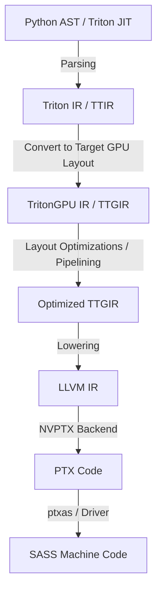

## 1. 异构计算的痛点

在 GPGPU 算子开发领域，开发人员长期面临着**高吞吐量**与**低开发成本**之间的双重折磨。

传统的开发模式主要分为两类：
*   **Thread-level SPMD (以 CUDA/HIP 为代表)**: 开发者需要精细控制每一个 Thread。为了实现极致的性能，必须手动管理 Shared Memory 的分配、处理数据对齐与访存合并 (Memory Coalescing)、使用 Warp-level shuffle 原语，以及处理繁琐的 Thread 同步 (`__syncthreads()`)。这种模式下，心智负担极高，且代码的可维护性极差。
*   **High-level DSL/Compiler (以 TVM/Halide/OpenMP 为代表)**: 通过将算法描述与调度优化分离（Separation of Concerns），大大降低了开发难度。但在实际生产中，由于其底层生成逻辑较为通用，在面对如 FlashAttention 等复杂非规则访存/高度定制化算法时，往往无法生成最优的代码。

**Triton** 的出现提供了一条全新的通路。它摒弃了 Thread-level 的微观控制，引入了 **Block-level dataflow 编程模型**。

---

## 2. Triton 的核心概念：Block-Level Dataflow

在 CUDA 中，我们编写的 Kernel 是**针对单个线程 (Thread)** 的，然后通过 `threadIdx`、`blockIdx` 确定当前线程处理的数据指针：

```cuda
// CUDA 元素相加：每个线程处理一个元素
__global__ void vector_add(float* a, float* b, float* c, int n) {
    int idx = blockIdx.x * blockIdx.x + threadIdx.x;
    if (idx < n) {
        c[idx] = a[idx] + b[idx];
    }
}
```

而在 Triton 中，我们编写的 Kernel 是**针对一个数据块 (Block/Tile)** 的。整个计算被表述为 Block 在各个寄存器、共享内存和全局内存之间的流动与操作：

```python
# Triton 元素相加：每个 Kernel 实例处理一个 Block（包含多个元素）
@triton.jit
def vector_add_kernel(a_ptr, b_ptr, c_ptr, n_elements, BLOCK_SIZE: tl.constexpr):
    # 1. 获取当前 Block 的 ID
    pid = tl.program_id(axis=0)
    # 2. 确定当前 Block 处理的数据范围 (Offsets)
    block_start = pid * BLOCK_SIZE
    offsets = block_start + tl.arange(0, BLOCK_SIZE)
    # 3. 创建掩码，防止越界访存
    mask = offsets < n_elements
    # 4. 加载整个 Block 的数据
    a = tl.load(a_ptr + offsets, mask=mask)
    b = tl.load(b_ptr + offsets, mask=mask)
    # 5. Block 级别的向量加法
    c = a + b
    # 6. 将结果写回内存
    tl.store(c_ptr + offsets, c, mask=mask)
```

### 为什么 Block-Level 编程更具优势？

1.  **隐式内存管理**：在 Triton 中，你**不需要手动声明和分配 Shared Memory**。Triton 编译器在进行中间表示分析（TritonGPU IR）时，会自动推导数据流的生命周期，并在合适的时间节点分配共享内存、插入同步指令（如 `bar.sync`）。
2.  **自动流水线优化 (Pipelining)**：Triton 编译器支持在多缓冲（Multi-buffering）架构下自动重排指令，实现全局内存加载（Global Load）、共享内存加载（Shared Load）与 Tensor Core 计算（MMA）之间的流水线交叠，最大限度隐藏访存延迟。
3.  **向量化与合并访存 (Coalescing)**：Triton 在编译阶段会自动分析 Block 的偏置和跨步（Stride），自动推导最优的向量化加载指令（如 `LDG.E.128`），无需开发者手动对齐指针。

---

## 3. Triton 编译器流水线 (Compilation Pipeline)

作为一个编译器工程师，我们需要理解 Triton 是如何将这段 Python 代码转换为高效的机器码的。

Triton 的核心是一个专用编译器，它的编译流水线如下所示：



### 编译的关键步骤：

*   **TTIR (Triton IR)**：这是 Triton 编译器的前端表示，它保留了硬件无关的 Block 操作语义，类似于普通的静态单赋值 (SSA) 形式。
*   **TTGIR (TritonGPU IR)**：这一步引入了硬件相关的特征。编译器会分析不同的 Block 布局（Layouts），如 `BlockedLayout`、`SharedLayout`、`MmaLayout`（对应 Tensor Core 布局）。在这一层，Triton 进行了最核心的优化：分配 Shared Memory 缓冲区、优化寄存器溢出、实现计算与访存流水线。
*   **LLVM IR**：TTGIR 会被翻译为 LLVM IR，主要是为了利用 LLVM 强大的优化器和后端的代码生成能力。
*   **PTX/SASS**：最终通过 NVIDIA 的 NVPTX 目标生成虚拟汇编 PTX，再经由驱动或 `ptxas` 汇编成在 GPU 上执行的机器码 SASS。

---

## 4. CUDA 与 Triton 核心概念对比

为了方便大家从 CUDA 开发无缝切换到 Triton，下表总结了两者在概念上的映射：

| 维度 | CUDA / HIP | Triton |
| :--- | :--- | :--- |
| **执行模型** | SPMD (Single Program Multiple Data)，针对 Thread 编程 | Block-level Dataflow，针对 Block/Tile 编程 |
| **共享内存** | 手动分配 `__shared__`，手动同步 `__syncthreads()` | 编译器自动分析分配与插入同步（隐式） |
| **内存对齐** | 手动保证 (128-byte alignment) 或使用向量类型 (如 `float4`) | 编译器分析 offset 自动进行向量化合并访存 |
| **Tensor Core** | 通过 WMMA API 或 `mma.sync` 汇编指令精细控制 | 使用 `tl.dot(A, B)` 自动生成硬件 MMA 指令 |
| **并发度控制** | 手动设计 Grid & Block 维度 | 自动计算 Warp 数量，提供 `num_warps` 等超参数微调 |

---

## 5. 下一步规划

在接下来的章节中，我们将通过动手编写实际代码来加深理解。

第二章我们将实现一个完整的 **Vector Addition (向量加法) 算子**。除了学习如何调用 Triton JIT 执行计算外，我们还将**把 Triton 的 JIT 编译器剖开**，一步步导出并阅读它在编译过程中生成的 **TTIR**、**LLVM IR** 以及 **PTX 代码**，揭开 Triton 神秘的面纱。

敬请期待！

---

> **作者简介**：Jing Zhou，资深 LLVM GPGPU 编译器工程师，专注于 GPU 编译器后端代码优化与高性能异构计算。欢迎在下方留言讨论！
