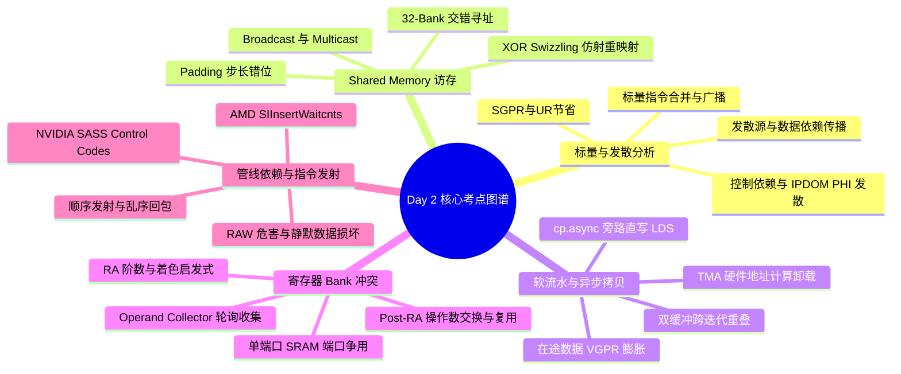
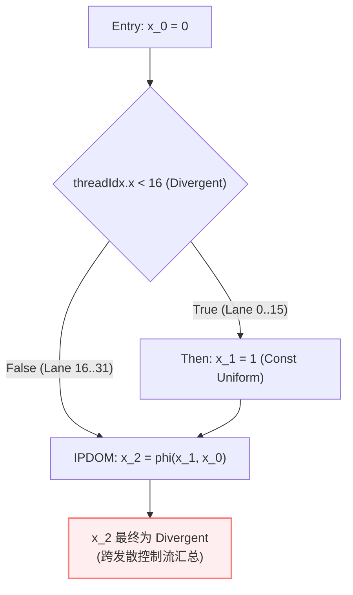
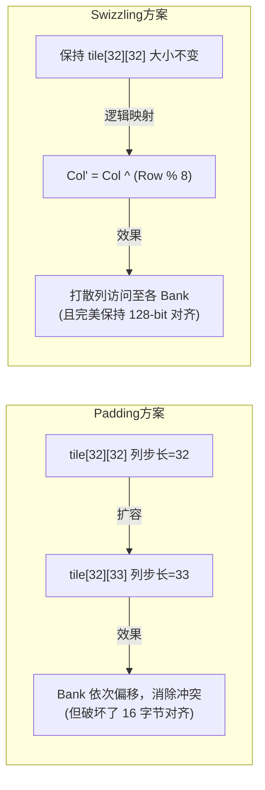
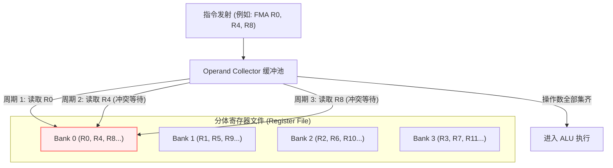

> 本文为 **[GPGPU 编译器工程师面试通关指南](/gpgpu-interview/)** 系列第二期（Day 2）。
> 建议在阅读“面试官参考解析”前，先独立思考每道题目的考察意图与答题脉络（每题思考 3~5 分钟）。

> 💡 **核心考察维度**：标量/向量双套硬件管线协同（UniformityAnalysis）、片上共享内存（Shared Memory / LDS）Bank 冲突与 Swizzling 消除、软流水（Software Pipelining）与异步拷贝（Async Copy）硬件演进、物理寄存器体冲突（Register Bank Conflict）与操作数收集器（Operand Collector）、非确定延迟指令的记分牌（Scoreboard）与 Waitcnt 编译下发。

---

## 📝 今日高频面试题清单

### 【Q1 · LLVM 核心分析与双执行单元】Divergence Analysis（发散分析）与 Uniformity（一致性）优化
现代 GPGPU 架构（如 AMD CDNA/RDNA 的 SALU/VALU + SGPR/VGPR，以及 NVIDIA Turing 之后的 Uniform Datapath + UR 寄存器）都引入了专门的标量/Uniform 硬件单元。
1. 请详细说明 LLVM 中的 `UniformityAnalysis`（或旧版的 `DivergenceAnalysis`）是如何判断一个变量是 Uniform 还是 Divergent 的？
2. 当存在发散的控制流（Divergent Branch）时，为什么一个由常量赋值的变量也可能变成 Divergent？
3. 将变量识别为 Uniform 对后端指令选择和寄存器分配有什么巨大收益？

---

### 【Q2 · GPGPU 体系结构与访存优化】Shared Memory (LDS) Bank Conflict 的产生机理与编译期消除
Shared Memory / LDS 是实现高性能算子（如 GEMM、Reduction）的核心，但如果访问模式不当触发 Bank Conflict，带宽会成倍下降。
1. 请从硬件底层解释什么是 $N$-way Bank Conflict？
2. 哪些情况下同一 Warp 内多个线程访问同一个 Bank 却不会发生冲突？
3. 在编译器（如 LLVM 后端或 MLIR/Triton）中，有哪些常见的自动优化手段（如 Padding、Swizzling）可以用来静态消除 Bank Conflict？

---

### 【Q3 · 编译优化与延迟隐藏】GPU 上的 Software Pipelining（软流水）与异步拷贝（Async Copy）
在算力密度极高的现代 GPU（含 Tensor Core / Matrix Core）上，仅靠硬件 Warp 切换（TLP）往往不足以完全掩盖显存（Global Memory）到寄存器/Shared Memory 的长延迟，编译器必须引入软件流水（Software Pipelining / Modulo Scheduling）。
1. 请解释双缓冲（Double Buffering）或多级流水在循环编译中是如何展开与重排读写依赖的？
2. 这会给寄存器生命周期（Live Range）带来什么负面影响？
3. NVIDIA Ampere+ 引入的 `cp.async`（或 Hopper TMA）从硬件和编译器角度是如何缓解这一痛点的？

---

### 【Q4 · LLVM 后端与底层硬件】Register Bank Conflict（寄存器体冲突）与 Operand Collector
除了 Shared Memory 有 Bank，GPU SM 内部庞大的物理寄存器文件（Register File，每个 SM 高达 256KB）为了节省面积和功耗，通常并不是全相联的多端口 SRAM，而是采用分 Bank 的单端口/少端口 SRAM 设计。
1. 什么是 Register Bank Conflict？硬件中的 Operand Collector（操作数收集器）是如何工作的？
2. LLVM 后端在 Register Allocation（寄存器分配）和 Post-RA Scheduling（分配后调度）阶段是如何规避寄存器 Bank 冲突的？

---

### 【Q5 · 计算机底层原理与指令发射】Scoreboarding（记分牌）、Waitcnt 插入与 Control Stalls
GPU 采用顺序发射（In-Order Issue）、乱序完成（Out-of-Order Completion）的管线设计。对比 NVIDIA 架构（PTX 虚拟 ISA vs SASS 物理 ISA 中的 Control Code / Stall Counts）和 AMD GCN/CDNA 架构（显式的 `s_waitcnt` 指令）：
1. 编译器在最后生成机器码（MC 层或 Post-RA 阶段）时，是如何处理非确定性长延迟指令（如 Global Load, Shared Load）的数据依赖的？
2. 如果编译器漏插了等待计数或算错了 Stall 周期，硬件会发生什么？

---

## 🎯 面试官深度解析与追问点



---

### 题 1 深度解析：Uniformity Analysis（一致性分析）与标量通道

#### 1. 发散源（Sources of Divergence）的界定
LLVM 的 `UniformityAnalysis` 采用基于数据流图的前向标记与不动点迭代。在内核入口处：
* **天然发散源（Divergent Sources）**：线程私有 ID（如 `threadIdx.x`、Lane ID）、依赖线程执行结果的原子操作返回值（如 `atomicAdd`）、特定硬件内建函数等。
* **天然一致源（Uniform Sources）**：内核参数（Kernel Arguments）、网格/线程块维度（`blockIdx.x`、`gridDim.x`）、字面常量（Constant Literals）。

#### 2. 数据依赖 vs 控制依赖（Temporal / Sync Divergence）
* **数据依赖（Data Dependency）**：若指令 $I$ 的操作数中包含 Divergent 变量，则 $I$ 的计算结果也是 Divergent（除非属于特殊的 Warp 级规约原语，如 `__all_sync` 将结果统一广播）。
* **控制依赖（Sync Divergence，高频考点）**：
  看下面这段极其经典的代码：
  

```cpp
  int x = 0;
  if (threadIdx.x < 16) {
      x = 1;
  }
  // 汇聚点：x = phi(1, 0)
  

```
  * 变量 `x` 在两个分支被赋的值都是常量（`1` 和 `0` 本身皆为 Uniform）。
  * 但因为判断条件 `threadIdx.x < 16` 是发散的，导致 Warp 内部前 16 个线程走了 `Then` 块，后 16 个线程走了默认路径。
  * 在紧邻后支配节点（IPDOM）处的 $\phi$ 节点（`phi [1, %then], [0, %entry]`）汇总时，**不同线程在不同时间/空间获得了不同的值**。
  * **编译器处理逻辑**：`UniformityAnalysis` 结合 Dominator Tree 与 Post-Dominator Tree 计算发散分支的**影响区间（Influence Region）**。凡是在该区间内被赋值并在区间外汇聚点使用的变量（即穿过汇聚边界的 $\phi$ 节点），均必须被**强制标记为 Divergent**。



#### 3. 识别为 Uniform 的巨大编译收益
1. **寄存器分流（节省 VGPR）**：
   * **AMDGPU**：Uniform 变量分配至 **SGPR（Scalar GPR）**。一个 Wavefront（32 或 64 线程）只需占用 1 个 32-bit SGPR 物理单元，极大减少 VGPR 消耗，避免触发 Occupancy 阶梯暴跌。
   * **NVIDIA**（Turing+）：分配至专属的 **UR（Uniform Register）**，减轻主通用寄存器文件压力。
2. **利用标量执行单元（SALU / Uniform Datapath）**：
   * 循环迭代变量累加、基地址偏移计算全部旁路到 SALU 执行，完全不挤占向量算术单元（VALU / Tensor Core）的发射槽。
3. **标量访存与单次广播（Scalar Load / Broadcast）**：
   * 当指针被证明为 Uniform 时，直接生成标量加载（如 AMD `s_buffer_load_dword` 或 NV `LDC` 指令）。
   * 硬件只需发起 **1 次** 32 字节或 64 字节的标量 Cache 访问并向所有线程**硬件广播（Broadcast）**，彻底绕过了复杂的向量地址生成和访存合并（Coalescing）单元。

---

### 题 2 深度解析：Shared Memory Bank Conflict 与 Swizzling

#### 1. 硬件机理：$N$-way Bank Conflict
* **物理划分**：以主流架构为例，Shared Memory 被均匀切分为 **32 个 Banks**，每个 Bank 单周期提供 4 Bytes（32-bit）的访问吞吐。
* **地址映射公式**：
  $$\text{Bank ID} = \left(\frac{\text{Byte Address}}{4}\right) \pmod{32}$$
* **冲突产生**：当同一 Warp 的 32 个线程在同一周期并发访存时，若有 $N$ 个线程访问了**同一个 Bank 内的不同字地址（Row）**，硬件片上交叉开关（Crossbar）无法在一个周期内并发出数，只能强制将该请求拆解为 $N$ 个周期串行执行。此时发生 **$N$-way Bank Conflict**，有效带宽跌至原先的 $1/N$。

#### 2. 无冲突特例：Broadcast 与 Multicast
* 若同一 Warp 内的多个线程访问的是同一个 Bank 内的**完全相同的数据地址**，硬件仲裁器不会串行化，而是激活**片上广播（Broadcast）或多播（Multicast）网络**，在单周期内将同一份数据分发给所有请求线程，**耗时依然为 1 周期**。

#### 3. 编译期消除手段（Padding vs XOR Swizzling）

| 优化技术 | 原理与操作 | 优势 | 劣势与瓶颈 |
| :--- | :--- | :--- | :--- |
| **Memory Padding** | 将二维分配 `tile[32][32]` 改写为 `tile[32][33]`，将跨行步长变为 33（与 32 互质） | 实现简单，完全错开列访问的 Bank 投影 | 额外浪费 Shared Memory 容量；破坏了 128-bit 向量化（如 `ldmatrix`）的对齐边界 |
| **XOR Swizzling** *(主流方案)* | 不扩充内存，通过仿射重排改变逻辑索引到物理 Bank 的映射：$\text{new\_col} = \text{col} \oplus (\text{row} \pmod K)$ | 零内存浪费；严格保持行内存的 16 字节自然对齐；硬件位异或开销极低 | 地址计算引入微量位运算；需要编译期精确分析形状与访存模式 |



> 💡 **Triton / MLIR 实践**：在 Triton 的 `TritonGPUToLLVM` 或 MLIR 的 `VectorToGPU` 转换管线中，通常会在将数据从 Global Load 存入 Shared Memory 时直接下发 `triton_gpu.swizzle` 属性，通过一条 `xor` 指令完成地址混淆，使得后续从 Shared Memory 进行 `Dot`（矩阵乘）操作读取时天然零冲突。

---

### 题 3 深度解析：Software Pipelining（软流水）与异步拷贝

#### 1. 软件流水与双缓冲（Double Buffering）循环重组
以典型的 GEMM 主循环为例，朴素执行流为：
$$\text{Load Global} \longrightarrow \text{Store Shared} \longrightarrow \text{Sync} \longrightarrow \text{Load Shared} \longrightarrow \text{Compute}$$
为了掩盖从 Global 显存到片上 SRAM 的数百个周期的高延迟，编译器采用**软件流水（Software Pipelining / Modulo Scheduling）**将跨迭代操作重叠：

```mermaid
sequenceDiagram
    participant Prologue as 序言 (Prologue)
    participant Loop as 稳态主循环 (Steady State)
    participant Epilogue as 尾声 (Epilogue)

    Note over Prologue: 发射 Load Global(0)<br/>预取第 0 块数据
    Note over Loop: 迭代 i: 边算边取<br/>- 发射 Load Global(i+1)<br/>- 基于第 i 块数据执行 Compute(i)
    Note over Epilogue: 处理最后一块数据 Compute(N-1)<br/>收尾不发射多余 Load
```

#### 2. 负面影响：寄存器生命周期（Live Range）急剧膨胀
* **在途数据（In-flight Data）的占用**：
  在传统硬件路径下，数据通路为：$\text{Global Memory} \xrightarrow{\text{LDG}} \mathbf{VGPR} \xrightarrow{\text{STS}} \text{Shared Memory}$。
* 当编译器将预取提前 1 级、2 级甚至 4 级时，这些尚未消费的中间数据**必须全天候驻留在通用寄存器（VGPR）中**。
* **连锁反应**：Live Range 大幅横跨整个循环体，导致单线程寄存器配额剧增，极易触发 **Occupancy 断崖式下跌** 或直接引发恶性的 **Register Spilling**。

#### 3. 硬件与编译演进：`cp.async` 与 TMA 的技术革命
1. **NVIDIA Ampere (`cp.async`) / AMD Direct-to-LDS**：
   * **硬件旁路（Bypass VGPR）**：硬件在 L1/Crossbar 处开辟通路，数据从显存直通写入 Shared Memory，**完全不占用任何 VGPR**！
   * **非阻塞流水控制**：编译器生成 `cp.async.commit_group` 与 `cp.async.wait_group N`，使得编译器能够轻松实现 3~5 级的极深软流水（Multi-stage Pipeline）而无需担心寄存器爆炸。
2. **NVIDIA Hopper (TMA - Tensor Memory Accelerator)**：
   * **地址计算卸载**：传统 `cp.async` 仍需要线程执行指令来计算每次加载的多维张量地址；Hopper TMA 将多维 Tensor 切片计算直接交由专用硬件单元完成，进一步释放了大量标量与通用寄存器。

---

### 题 4 深度解析：Register Bank Conflict 与 Operand Collector

#### 1. 产生根因：单端口 SRAM 端口争用
* GPU 的每个 SM 拥有高达 256KB 的寄存器文件。若做成多端口（Multi-port）SRAM，芯片面积和静态漏电将无法承受。
* 因此工业界通常采用 **Banked 单端口/双端口 SRAM**（如 4 个 Bank，按寄存器编号 $R_{\text{id}} \pmod 4$ 分布）。
* 考虑一条三操作数指令：`FMA R0, R1, R2, R3`：
  * 若分配器碰巧给源操作数分配了物理寄存器 `R1, R5, R9`（全在 Bank 1），单端口 Bank 在同一周期只能读出 1 个数据，硬件必须**强制停顿（Stall）3 个周期**才能把 3 个源操作数读齐。

#### 2. 硬件机制：Operand Collector（操作数收集器）
* 位于发射单元（Instruction Dispatch）与执行单元（ALU）之间。
* **收集池（Collector Units）**：接收指令后，将操作数读取请求分发到各个 Bank 的读队列。收集器跨多个周期分别从不同 Bank 读取数据，待所有源操作数就绪后才允许指令进入 ALU 执行管道。



#### 3. 编译器的规避策略
1. **RegAlloc 阶段的 Bank 启发式着色**：
   * 在 LLVM 的 `RAGreedy` 分配器中，目标后端通过定制 `AllocationOrder`：在为当前虚拟寄存器选择物理寄存器时，**探测同条指令中已分配的兄弟操作数所在 Bank**，惩罚同 Bank 物理寄存器的权重，优先选择落在不同 Bank 的物理编号。
2. **Post-RA 指令级微调与操作数交换（Commuting）**：
   * 利用算术对称律交换操作数位置（如将 `ADD R0, R1, R2` 交换为 `ADD R0, R2, R1`）。
   * **复用缓存（Operand Reuse Cache）利用**：硬件通常维护一个极小的 Reuse Cache。若相邻两条指令在同一槽位复用同一个寄存器，硬件可直接命中缓存而无需访问 Bank。编译器通过重排指令或交换操作数槽位，最大化该缓存命中率。

---

### 题 5 深度解析：Scoreboarding、Waitcnt 与指令发射

#### 1. 为什么 GPU 必须采用轻量化依赖追踪？
* CPU 采用庞大的重排序缓冲区（ROB）和寄存器重命名（Tomasulo 算法），硬件开销极大；
* GPU 核心数极多，硬件管线设计为 **顺序发射（In-Order Issue）、乱序完成（Out-of-Order Completion）**。
* 固定延迟指令（如 VALU 算术运算通常 4~8 周期）与非确定长延迟指令（如 Global Load 命中 30 周期、Miss 达 400 周期）混杂，必须在**编译器与极简硬件记分牌**之间达成协同。

#### 2. AMD 架构：LLVM 编译期显式插入 `s_waitcnt`
* **硬件维护计数器**：
  * `vmcnt`：在途向量显存读取（Vector Memory）的请求计数。
  * `lgkmcnt`：在途 LDS、GDS、常量（K）以及标量（M）访存计数。
* **LLVM `SIInsertWaitcnts` Pass**：
  * 该 Pass 位于 CodeGen 的尾声。它在基本块内维护数据流跟踪，记录每个寄存器的写入指令及其在途状态。
  * 当一条指令即将使用（Use）某个由 `global_load` 写入的寄存器时，编译器计算从该 Load 到当前指令之间还积压了多少条未返回的访存，**精准插入等待指令**：
    

```nasm
    global_load_dword v1, v0, s[0:1] ; 发起访存 1 (vmcnt 增加)
    global_load_dword v2, v0, s[0:1] ; 发起访存 2 (vmcnt 增加)
    ; ... 执行其他不相关的算术指令 ...
    s_waitcnt vmcnt(1)               ; 仅需等待访存 1 回包，允许访存 2 继续在途！
    v_add_f32 v3, v1, 1.0            ; 安全消费 v1
    s_waitcnt vmcnt(0)               ; 等待所有访存全部回包
    v_mul_f32 v4, v2, 2.0            ; 安全消费 v2
    

```

#### 3. NVIDIA 架构：SASS 物理指令控制码（Control Codes）与记分牌
* PTX 是虚拟指令集，不暴露硬件细节。在底层汇编（`ptxas` 生成的 SASS）中，每条 128 位指令捆绑了专门的 **Control Codes（控制字）**：
  * **Stall Counts**：静态写入当前指令发射后必须等待的固定时钟周期数（0~15）。
  * **Hardware Scoreboards (`sb0` ~ `sb5`)**：
    * 当发射一条异步长延迟指令（如 `LDG`）时，编译器指定其置位某个记分牌的 **Write Barrier**（例如设置 `sb0`）。
    * 在后续第一条消费该结果的指令控制字中，设置对应的 **Wait Barrier Mask**（要求流水线在 `sb0` 清除前暂停发射该指令）。

#### 4. 漏插或算错的灾难后果
* 在 CPU 上依赖硬件自动保证正确性，算错只会影响流水线效率；
* 在 GPU 底层物理 ISA 上，如果编译器算错了 Stall Count，或漏插了 `s_waitcnt` / Barrier Mask，**硬件不会报异常，而是会直接拿寄存器中的旧数据（旧值/脏数据）进行后续计算**！
* 这会引发极其致命且极难定位的 **RAW（Read-After-Write）数据竞争与静默数据错误（Silent Data Corruption）**。

---

## 💡 面试实战总结（复盘金句）

> 1. **谈发散分析时**：*"常量赋值之所以会发散，本质是控制依赖在 IPDOM 处的空间/时间投影；LLVM 的 UniformityAnalysis 通过识别发散分支的影响区间，精准捕捉跨边界 PHI 节点，这是驱动 SGPR 和标量加载广播优化的核心基石。"*
> 2. **谈 Bank 冲突时**：*"Memory Padding 是以空间换时间，但往往破坏了 128-bit 向量化对齐；而现代编译器首选的 XOR Swizzling 则是利用线性空间仿射变换，在保证极致对齐的前提下彻底打散地址投影。"*
> 3. **谈软流水时**：*"传统多级流水的最大杀手是中转在途数据导致的 VGPR 爆炸；现代架构通过 cp.async / TMA 实现显存到片上共享内存的硬件直通，让编译器能够在零寄存器压力惩罚下构建极深的微流水。"*
> 4. **谈指令发射与依赖时**：*"GPU 顺序发射的极简硬件哲学，把非确定延迟的依赖解析全权交给了编译器；从 AMD 的 SIInsertWaitcnts 到 NVIDIA 的 SASS 记分牌控制字，漏算一个周期就是静默数据损坏的灾难。"*

---

> 👈 **上一期回顾**：**[Day 1：体系结构、控制流、LLVM 优化与内存模型](/gpu-compiler/2026-10-16-gpgpu-compiler-interview-day-1/)**
> 👉 **下一期推荐**：**[Day 3：算子融合、One-Shot Bufferize、寄存器溢出与集群同步](/gpu-compiler/2026-10-18-gpgpu-compiler-interview-day-3/)**
> 👉 **专栏返回**：查看更多模块内容与更新计划，请访问 **[GPGPU 编译器面试通关指南目录](/gpgpu-interview/)**。
