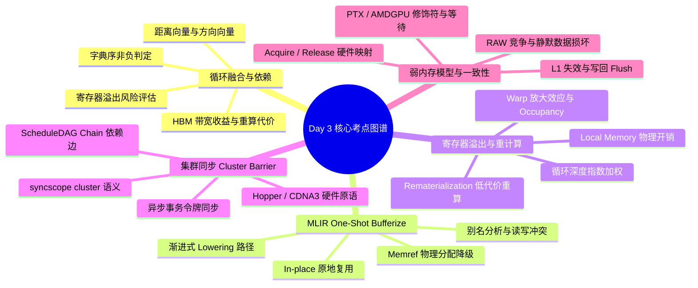

> 本文为 **[GPGPU 编译器工程师面试通关指南](/gpgpu-interview/)** 系列第3期（Day 3）。
> 建议在阅读“面试官参考解析”前，先独立思考每道题目的考察意图与答题脉络（每题思考 3~5 分钟）。

> 💡 **核心考察维度**：循环融合依赖合法性判定（Distance/Direction Vector）、MLIR One-Shot Bufferize 别名与就地复用分析、GPU 寄存器溢出惩罚与 Rematerialization 重计算博弈、Hopper/CDNA3 集群同步（Cluster Barrier）调度约束、GPU 弱内存模型与 Release-Acquire 缓存一致性下发。

---

## 📝 今日高频面试题清单

### 【Q1 · 图优化与循环变换】算子融合与 Loop Fusion 依赖合法性分析
在深度学习框架与 AI 编译器（如 TVM, XLA, MLIR）中，算子融合（Operator Fusion）是消除 HBM（High Bandwidth Memory）访问开销、提升访存密集型算子性能的关键技术。算子融合在底层通常体现为循环融合（Loop Fusion）。

1. **合法性分析**：请说明编译器如何借助 Distance Vector（距离向量）和 Direction Vector（方向向量）严谨证明两个嵌套循环融合（Loop Fusion）的合法性？如果融合颠倒了依赖方向，会导致什么错误？  
2. **代价权衡**：当算子融合引入多余计算（如冗余重算/Recomputation）或导致局部缓存/寄存器压力剧增时，编译器应建立怎样的 Cost Model 来做出 Fusion 决策？

---

### 【Q2 · MLIR 体系与内存规划】MLIR Dialect 体系与 One-Shot Bufferization 机制
MLIR（Multi-Level Intermediate Representation）通过多级 Dialect 降低了端到端编译 AI 模型的复杂度。

1. **Lowering 路径**：请详细说明 MLIR 中计算密集型算子从高层 `linalg` / `tensor` Dialect 降级（Lowering）到硬件相关 `gpu` / `nvvm` / `amdgpu` Dialect 的典型流水线过程。  
2. **In-place Bufferization**：详细阐述 MLIR 的 One-Shot Bufferize 机制如何通过 Alias Analysis（别名分析）与 Memory Effect Analysis（内存效应分析）实现 Tensor 到 MemRef 的内存复用（In-place Write），以最大限度减少内存分配开销。

---

### 【Q3 · 寄存器分配与代价模型】Register Pressure 驱动的 Spill 与 Rematerialization
GPU 架构（如 NVIDIA H100, AMD MI300）依靠庞大的 Register File 来隐藏内存访问延迟。然而，高级编译优化（如 Loop Unrolling、Instruction Scheduling、Software Pipelining）极易大幅增加寄存器压力（Register Pressure），触发寄存器溢出（Register Spilling）。

1. **重计算 vs. 溢出**：编译器在处理严重寄存器压力时，如何权衡 Spill 到 Local Memory 与 Rematerialization（重计算）？  
2. **GPU Cost Model 特殊性**：相比于 CPU 编译器，GPU 编译器在建立 Rematerialization 与 Spill 代价模型时有哪些特殊的硬件考量？

---

### 【Q4 · GPGPU 协作模型与并发控制】Cooperative Groups 与跨块同步（Cluster Barrier）
随着 NVIDIA Hopper 架构引入 Thread Block Cluster 以及 AMD CDNA3 架构引入 Workgroup Coalition，GPU 编程模型已经从单纯的 Block 内同步扩展到了跨 Block 集群同步（Cluster-level Synchronization）。

1. **LLVM IR 中文表征**：编译器如何在 LLVM IR 层级表征 Cooperative Groups 及 Cluster 级别的同步原语？  
2. **指令调度约束**：Cluster Barrier 对编译器的 ScheduleDAG（指令调度有向无环图）会产生哪些强约束？如何防止访存指令跨屏障非法重排？

---

### 【Q5 · 弱内存模型与缓存一致性】GPU 弱内存模型与 Release Consistency 编译
现代化 GPU 架构采用高度宽松的弱内存模型（Weak Memory Model）。

1. **内存序映射**：编译器如何将高级语言中的 C++11 Memory Order（如 `memory_order_acquire`, `memory_order_release`）与 SyncScope 映射到 PTX / AMDGPU 硬件指令修饰符？

2. **缓存一致性履行**：对于硬件级的 L1/L2 Cache 一致性，编译器需要在机器码生成阶段插入哪些特定的缓存失效（Invalidate）与写回（Writeback/Flush）指令，以履行 Release-Acquire 语义？

---

## 🎯 面试官深度解析与追问点

---

### 题 1 深度解析：算子融合与 Loop Fusion 依赖合法性分析

#### 1. 循环融合的依赖合法性分析

循环融合是将两个具有相同迭代域的循环合并为一个循环的过程。设原程序存在两个相邻循环 Loop $L_1$ 和 Loop $L_2$，融合后的循环为 $L_{12}$。

* **依赖向量表征**：  
  * **距离向量（Distance Vector, $\\vec{d}$）**：定义为依赖源迭代与依赖目标迭代之间的索引差值，$\\vec{d} = \\vec{i}*{target} - \\vec{i}*{source}$。  
  * **方向向量（Direction Vector, $\\vec{\\sigma}$）**：定义为距离向量元素的符号，$\\vec{\\sigma} = (\\text{sign}(d_1), \\text{sign}(d_2), \\dots, \\text{sign}(d_n))$，其中包含 `<`, `=`, `>`。  
* **依赖合法性条件**：  
  * 融合前，若存在跨循环的数据依赖（如 $L_1$ 写入数据 $A[i]$， $L_2$ 读取 $A[i]$），此时 $L_1$ 的计算严格先于 $L_2$ 执行，该依赖属于 Loop-Independent Dependency 或正常的跨循环 RAW 依赖（距离向量在融合维度上为正或零）。  
  * 融合后，两个循环体在同一迭代步内交叉执行。如果融合导致某个数据依赖的方向向量在最外层融合循环上变为 **负数（`<`）**，这意味着依赖目标（Target）在依赖源（Source）之前被执行，颠倒了因果关系（写后读变成了读后写，或使用了未初始化的数据）。  
  * **法则**：融合合法当且仅当融合后产生的循环依赖向量字典序非负（Lexicographically Non-negative），即最左侧的非零分量必须为正（`>`）。

非法融合示例：

原代码：                          融合后（若逻辑错误）：

for (i = 0; i < N; i++)            for (i = 0; i < N; i++) {

  A[i] = B[i] + 1; (L1)              A[i] = B[i] + 1;

for (i = 0; i < N; i++)              C[i] = A[i+1] * 2; // 尝试读取未更新的 A[i+1]

  C[i] = A[i+1] * 2; (L2)          }

#### 2. Cost Model 权衡与决策机制

算子融合并非百利而无一害，编译器需通过多维度代价模型评估以下冲突：

| 维度 | 融合收益（Benefit） | 融合代价/风险（Cost） |
| :---- | :---- | :---- |
| **访存 (Memory)** | 消除中间 Tensor 写入/读取 HBM，提升访存带宽利用率 | 无明显负面（通常极大降低 HBM 带宽） |
| **计算 (Compute)** | 消除循环 Overhead，提高 Instruction-Level Parallelism | 引入元素级重复计算（如 Reduce/Conv 融合后的多重展开） |
| **片上资源 (Resource)** | 提高数据局部性（Temporal Locality），利用 Register/SRAM 传输 | 活范围（Live Range）延长，剧烈增加寄存器压力，引发 Register Spilling |

**编译器的决策算法框架**：

$$\\Delta \\text{Cost} = \\text{Cost}*{\\text{fused}} - (\\text{Cost}*{L1} + \\text{Cost}_{L2})$$

1. **HBM 带宽收益评估**：  
   $$\\text{Benefit}*{\\text{HBM}} = \\text{Volume}(\\text{Intermediate_Tensor}) \\times \\text{Latency}*{\\text{HBM_Access}}$$  
2. **计算冗余开销**：  
   $$\\text{Cost}*{\\text{Compute}} = \\Delta \\text{FLOPs} \\times \\text{Latency}*{\\text{ALU}}$$  
3. **寄存器溢出惩罚**：  
   $$\\text{Cost}*{\\text{Spill}} = \\text{Predicted_Spill_Slots} \\times \\text{Latency}*{\\text{Local_Memory}}$$

当 $\\Delta \\text{Cost} < 0$ 且预测的 Register Count $\\le \\text{Threshold}_{\\text{MaxReg}}$ 时，才允许执行融合。对于包含元素级重算与高寄存器压力的场景，编译器可选用 **Partial Fusion（部分融合）** 或 **Tile-level Fusion**（通过 Shared Memory 缓冲而非纯 Register 展开）。

---

### 题 2 深度解析：MLIR Dialect 体系与 Bufferization 机制

#### 1. MLIR Dialect 下降（Lowering）典型流水线

MLIR 采用渐进式下降（Progressive Lowering）设计，从抽象的高层图语义逐步转换为贴近硬件特性的机器码生成方言：+------------------------------------+

|   linalg / tensor Dialect          | (高层：表达 Tensor 形状、表达无侧副作用的数据流)

+------------------------------------+

                  |

                  |  1. One-Shot Bufferization (Tensor -> MemRef)

                  v

+------------------------------------+

|   linalg / memref / scf Dialect    | (中层：结构化控制流 scf.for/parallel，显示内存访问)

+------------------------------------+

                  |

                  |  2. Tiling & Thread/Block Mapping (分块并映射到 GPU 网格)

                  v

+------------------------------------+

|   gpu / nvvm / rocdl / llvm        | (底层：GPU 线程索引, NVVM IR / ROCDL IR)

+------------------------------------+

* **Step 1: Tensor 到 MemRef 的转换（Bufferization）**：将 Value-based 的抽象 Tensor 操作转化为 Pointer-based 的显示内存读写操作（`memref`）。  
* **Step 2: Loop Tiling & Distribution**：使用 `linalg.tile_to_forall_op` 或 `scf.tile` 将高维矩阵运算划分为 Block 级与 Thread 级块，将循环轴映射为 `gpu.block_id` 和 `gpu.thread_id`。  
* **Step 3: Vectorization & Local Memory Promotion**：将 Thread 级别的计算向量化为 `vector` Dialect 指令，并将共享数据提升（Promote）到 `gpu.address_space<workgroup>`（即 Shared Memory）。  
* **Step 4: Lowering to GPU/LLVM Target**：`scf` 转换为 `cf`（Control Flow），`vector` 和 `gpu` 翻译为针对特定硬件的 `nvvm`（Nvidia PTX 抽象）或 `rocdl`（AMD HSAIL 抽象），最终通过 LLVM Backend 导出 PTX 或 HSA Code Object。

#### 2. One-Shot Bufferization 与 In-place 内存复用

在高层 `tensor` 语义中，数据是不可变的（Value Semantics），任何修改都会产生新的 Tensor。Bufferization 的核心目标是将其映射到物理内存 `memref`，并极力避免额外的内存分配（`memref.alloc`）。

MLIR 的 **One-Shot Bufferization** 采用基于 SSA 的依赖图分析，决定一个 Tensor 操作能否在原位置写（In-place）：

1. **读后写检查（Read-Before-Write Conflict Analysis）**：  
   * 分析 Tensor 的生命周期。如果张量 $T$ 的某块内存在步 $K$ 被写入，但在步骤 $K$ 之后，仍有其他指令需要读取 $T$ 在步 $K$ 之前的值，则发生冲突。  
2. **别名分析与关系图 (Alias Analysis & Origin Tracking)**：  
   * 建立 Tensor 之间的追溯树（Find Root Tensor）。追踪两个 Tensor 操作数是否指向同一块底层物理内存缓冲区（Equivalent / Aliasing）。  
3. **In-place 决定逻辑**：  
   * 如果通过冲突检查证明：在写入 Tensor 时，原有数据不再有任何后续读取操作（No Read-After-Write Hazard），则允许 **In-place Bufferize**。  
   * 此时直接复用输入 Tensor 的 `memref` 指针，将其转换成目标读写操作，避免分配新内存。  
   * 若冲突成立，则必须 **Out-of-place**，插入 `memref.alloc()`，并生成拷贝指令（`memref.copy`）。

---

### 题 3 深度解析：Register Pressure 驱动的 Spill 与 Rematerialization

#### 1. Spill 与 Rematerialization 权衡策略

在寄存器分配（Register Allocation, RA）阶段，当某点活活跃变量（Live Ranges）数量超过 GPU 硬件限制（如每个 Warp 最大 255 个寄存器）时，编译器必须采取措施削减活跃变量。              寄存器压力过高 (Live Range > Hardware Limits)

                                   |

                  +----------------+----------------+

                  |                                 |

         [Rematerialization]                  [Register Spill]

    (代价低/无内存访问操作)               (代价高/涉及 Local Memory)

                  |                                 |

    * 重新计算基地址偏移                    * 将寄存器内容写回

    * 常量 / 简单算术逻辑                  * L1/L2 缓存及 Local Memory

    * 重新生成 Thread ID 逻辑              * 产生显存流量与延迟

* **Rematerialization（重计算）原理**：  
  * 若某个活跃变量的值可以通过低成本计算轻松重新得到（例如：常量加载、简单的指针偏移计算、`threadIdx.x * stride` 等），编译器会在该变量被使用的地方**丢弃（Kill）** 该寄存器，并在需要该值的位置重新插入计算指令。  
  * **优势**：消除了对该变量的全局活跃期维持，完全避免了内存读写。  
* **Register Spill（寄存器溢出）原理**：  
  * 若活跃变量是通过高成本计算得到（例如矩阵乘中间累加值、复杂 Transcendental 函数），无法低成本重算，编译器会为其在 Local Memory（实际上是 HBM/DRAM 划出的区域，依靠 L1/L2 缓存）分配空间，插入 `Store` 指令写回，并在后续使用点插入 `Load` 指令。

#### 2. GPU 架构下 Cost Model 的特殊考量

GPU 编译器的 Cost Model 极其严苛地惩罚 Spill，理由如下：

1. **Local Memory 的真实物理属性**：  
   * GPU 没有单独的"物理 Local Memory 硬件"，Local Memory 实际上位于高延迟的 Global Memory（HBM）中。一旦 L1 Cache 缺失，Spill 将带来数百个 Clock Cycles 的停顿。  
2. **Warp Divergence 与 Thread-Private 放大效应**：  
   * 一个 Warp 有 32 个线程。一个单寄存器溢出意味着 $32 \\times 4 \\text{ Bytes} = 128 \\text{ Bytes}$ 的数据读写。如果存在 Bank Conflict 或未对齐访问，性能将指数级下降。  
3. **Occupancy（线程块占用率）跌落**：  
   * GPU 依靠多线程并发隐藏延迟。如果一个 Kernel 要求的寄存器数量超出临界点（如从 32 个跳升至 64 个），将直接导致 SM 上能同时调度的 Active Warps 数量减半，大幅降低 GPU 的整体吞吐能力。

**决策公式**：

$$\\text{Cost}*{\\text{Remat}} = \\text{Latency}*{\\text{ALU_Insts}}$$

$$\\text{Cost}*{\\text{Spill}} = \\text{Latency}*{\\text{Local_Store}} + \\text{Latency}*{\\text{Local_Load}} + \\text{Penalty}*{\\text{Occupancy_Drop}}$$

在 GPU 编译器中，几乎优先选择一切可能的 Rematerialization，甚至宁愿在 Loop Preheader 中进行复杂的地址计算重算，也极力避免在循环体内部发生 Spill。

---

### 题 4 深度解析：Cooperative Groups 与跨块同步（Cluster Barrier）

#### 1. LLVM IR 中的 Cluster Barrier 表征

在 LLVM IR 中，硬件屏障被表征为目标特定的 **Intrinsic 指令**，并结合内存屏障（Memory Fence）及同步作用域（SyncScope）属性。

对于 NVIDIA Hopper 架构的 Cluster Barrier，LLVM IR 通常表征为：m  
; 显式 Cluster 级别 barrier 指令  
call void @llvm.nvvm.barrier.cluster.wait()

; 带 SyncScope 的硬件屏障与内存屏障组合  
fence syncscope("cluster") release  
call void @llvm.nvvm.barrier.cluster.arrive()  
fence syncscope("cluster") acquire

* **`syncscope("cluster")`**：告诉编译器分析 pass（如 Alias Analysis, LICM），该内存屏障的作用域限定在同一个 Cluster 内部的所有 Thread Blocks 之间，超越了传统的 `syncscope("block")`（即 `__syncthreads()`），但小于 `syncscope("agent")` 或 `syncscope("system")`。

#### 2. 对 ScheduleDAG 与指令重排的约束

在 LLVM 后端编译阶段，指令调度器（Instruction Scheduler）将基本块中的指令构建为 ScheduleDAG（Node 表示指令，Edge 表示依赖关系）。

    前序访存指令 (Global Store A)

               |

         [ Chain Edge ] (内存/控制依赖)

               v

Cluster Barrier (屏障指令 Node)

               |

         [ Chain Edge ] (内存/控制依赖)

               v

    后续访存指令 (Global Load B)

1. **构建 Chain 依赖边（Chain Edges）**：

   * ScheduleDAG 使用特殊的 **Chain 边**（非数据流依赖，而是序依赖）来约束有侧副作用（Side-effect）的指令。

   * Cluster Barrier 被标记为具有 `hasSideEffects` 和 `isBarrier` 属性。调度器在构建 DAG 时，必须在 Barrier 节点与之前所有的 Memory Load/Store 节点之间建立一条 Chain 边，同时在 Barrier 节点与之后所有的 Memory Load/Store 节点之间建立另一条 Chain 边。

2. **禁止跨屏障重排**：

   * 在 DAG 进行拓扑排序（Topological Sort）生成物理指令序列时，Chain 边形成了严格的依赖前驱关系。Barrier 之后的指令拓扑排序值必然大于 Barrier，阻断了指令越过 Barrier 的任何可能性。

3. **防止 Vector / Tensor Core 异步指令漏同步**：

   * 对于异步拷贝指令（如 `TMA` - Tensor Memory Accelerator 或 `cp.async`），Barrier 还必须绑定异步事务令牌（Transaction Barrier）。编译器必须在 ScheduleDAG 中将 `async_commit` 和 `async_wait` 绑定到 Barrier 节点，确保流水线在屏障处彻底清空（Flush）。

---

### 题 5 深度解析：GPU 弱内存模型与 Release Consistency 编译

#### 1. Memory Order 与 SyncScope 的硬件映射

GPU 内存模型是分层级的，包含了 **Memory Model**（如 Acquire/Release, Sequentially Consistent）与 **Scope**（Workgroup, Device, System）两个维度。

在 NVPTX 与 AMDGPU 后端中，LLVM 将 C++ 语义转换为带修饰符的硬件指令：

| C++11 内存序 + 作用域 | PTX 指令 (NVIDIA) | Inst. Modifier (AMD GFX9/GFX10) |

| :--- | :--- | :--- |

| **Acquire (CTA Scope)** | `ld.acquire.cta.b32` | `ds_read_b32` (LDS 隐式保证) |

| **Release (GPU Scope)** | `st.release.gpu.b32` | `buffer_store_dword ... sc0 sc1` |

| **Acquire (System Scope)** | `ld.acquire.sys.b32` | `global_load_dword ... sc0` + `s_waitcnt` |

* **NVIDIA PTX 映射**：PTX 引入了显式的 `.acquire` 和 `.release` 语义修饰符，以及 `.cta` (Block)、`.gpu` (Device)、`.sys` (System) 作用域限定符。

* **AMD ROCm 映射**：AMD 使用指令位标志（如 `sc0` - System Coherency, `sc1` - Warp Coherency）结合显式的等待计数器指令（`s_waitcnt vmcnt(0)`）来实现。

#### 2. 缓存一致性履行的底层机制

GPU 的 L1 Cache 通常是 **Non-coherent（不保证硬件一致性）** 或采用 Write-Through / Write-back 混合策略。因此，Release-Acquire 语义不能仅靠普通的 Store/Load 指令完成，编译器必须插入缓存控制指令。

Thread A (Release Side)                      Thread B (Acquire Side)

---

1. Write Data to Memory                      1. Loop until Flag == 1  
2. Store-Release (Flag = 1)                  2. Load-Acquire (Data)  
   ├── Write-back L1 Cache (Flush)              ├── Invalidate L1 Cache  
   └── Memory Barrier                           └── Memory Barrier

1. **Release 语义（发送端）**：

   * **目标**：保证在 Release 操作之前的所有内存写操作，对其他 Thread 可见。

   * **编译器动作**：

     * 插入 Store 指令，并附加 Release 标志（如 `st.release`）。

     * 在硬件层面，这会强制将 Thread 所在 SM 的 L1 Cache 中脏数据（Dirty Lines）**写回（Flush / Writeback）** 到 L2 Cache 甚至 Global Memory。

     * 防止编译器将 Store-Release 之前的写指令重排到其之后。

2. **Acquire 语义（接收端）**：

   * **目标**：保证 Acquire 操作之后的所有内存读写，都能读取到最新写入的数据，而非旧的缓存副本。

   * **编译器动作**：

     * 插入 Load 指令，并附加 Acquire 标志（如 `ld.acquire`）。

     * 在硬件层面，这会触发 Thread 所在 SM 的 **L1 Cache 失效（Invalidate L1）**。

     * 强制后续的 Read 操作绕过当前 L1 脏缓存，直接从 L2 Cache 或 HBM 中重新拉取最新数据。

     * 在 AMD 架构下，编译器还必须紧跟插入 `s_waitcnt vmcnt(0)` 和 `buffer_wbinvl1_vol` 指令，以显式清空 L1 缓存管道。

---

## 💡 面试实战总结（复盘金句）

> 1. **谈算子融合时**：*"循环融合绝非简单的代码合并，核心在于方向向量的字典序非负性检验；Cost Model 必须在 HBM 访存消除收益与单线程活范围膨胀引发的 Spill 之间寻求平衡。"*
> 2. **谈 Bufferization 时**：*"One-Shot Bufferization 改变了传统内存分配范式；通过生命周期与别名图分析消除 RaW 冲突，实现 Tensor 值语义到 Memref 指针就地复用的零拷贝跳跃。"*
> 3. **谈寄存器溢出时**：*"GPU 上的 Local Memory 本质是戴着缓存面具的高延迟 Global Memory；面对寄存器瓶颈，宁可在循环预头块甚至循环体内进行复杂的 Remat 重计算，也绝不能轻易放任 Spill。"*
> 4. **谈集群屏障时**：*"Thread Block Cluster 打破了单 CTA 的物理壁垒；编译器在 ScheduleDAG 中必须建立双向 Chain 内存依赖并绑定 Transaction Barrier，才能筑牢跨 SM 异步数据交互的安全防线。"*
> 5. **谈内存模型时**：*"GPU 弱内存模型依赖显式软硬件协同；从 syncscope 范围限定到 L1 Cache 失效与写回，漏插一条 barrier 或 waitcnt 就是静默数据错误的灾难。"*

---

> 👈 **上一期回顾**：**[Day 2：标量优化、Bank Conflict、软流水与指令发射](/gpu-compiler/2026-10-17-gpgpu-compiler-interview-day-2/)**
> 👉 **下一期推荐**：**[Day 4：GlobalISel、Fragment 布局、发散展开与异步流水](/gpu-compiler/2026-10-19-gpgpu-compiler-interview-day-4/)**
> 👉 **专栏返回**：查看更多模块内容与更新计划，请访问 **[GPGPU 编译器面试通关指南目录](/gpgpu-interview/)**。
