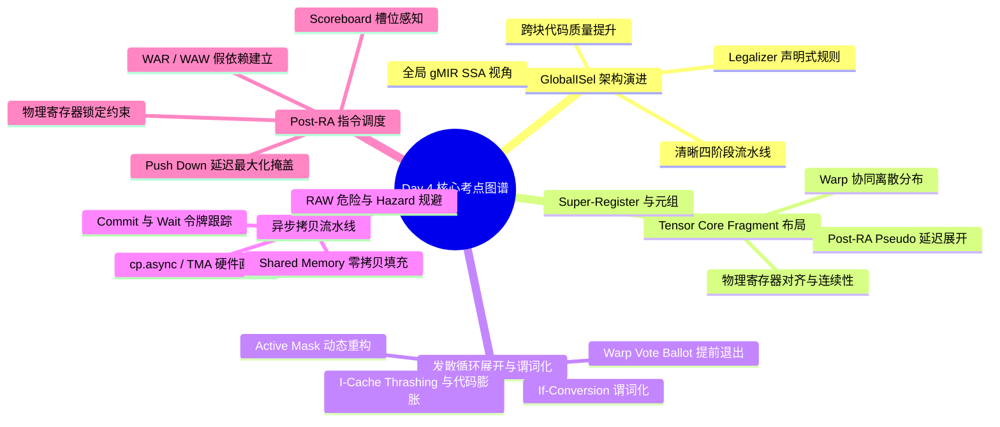

> 本文为 **[GPGPU 编译器工程师面试通关指南](/gpgpu-interview/)** 系列第4期（Day 4）。
> 建议在阅读“面试官参考解析”前，先独立思考每道题目的考察意图与答题脉络（每题思考 3~5 分钟）。

> 💡 **核心考察维度**：GlobalISel 与 SelectionDAG 在复杂 GPU 后端上的架构演进、Tensor Core / Matrix Core Fragment 物理寄存器连续对齐与 RA 防打乱保护、发散循环展开权衡与 Warp Vote 谓词化重构、异步拷贝流水线（TMA / Async Group）依赖令牌调度、Post-RA 物理寄存器锁定下的 Scoreboard 感知与延迟掩盖。

---

## 📝 今日高频面试题清单

### 【Q1 · LLVM 代码生成与指令选择】GlobalISel 与 SelectionDAG 在 GPU 后端的设计差异
请深入对比 GlobalISel 与 SelectionDAG 在指令选择阶段的核心架构差异。请结合现代 GPU 架构的特点，详细说明：

1. 为什么复杂的 GPU 后端（如 AMDGPU、NVPTX）正在全面转向 GlobalISel？传统 SelectionDAG 在应对大规模 GPU 指令集时遇到了哪些无法克服的瓶颈？  
2. GlobalISel 在处理 GPU 常见的窄类型合法化（Narrow-type Legalization，如 `i1` 谓词、`i16`/`fp16`）以及非常规向量类型（如 `v3f32`、`v5i16`）时具有哪些机制优势？

---

### 【Q2 · 硬件专用计算单元】Tensor Core / Matrix Core 的 Fragment 寄存器布局与 RA 防打乱策略
Tensor Core (NVIDIA) 和 Matrix Core (AMD) 要求数据在 Warp/Wavefront 内部线程间进行特定模式的离散分布（Fragment）。请回答：

1. 硬件层面上，MMA（Matrix Multiply-Accumulate）指令对输入/输出矩阵 Fragment 的寄存器编号、线程对齐与数据打包有哪些严苛约束？

2. 编译器在 LLVM IR 阶段如何表征这类高维 Fragment 操作？在后端编译过程（尤其是寄存器分配 RA）中，采取了哪些关键技术防止贪心寄存器分配器（Greedy RA）破坏硬件所需的特定寄存器对齐与线程间物理绑定关系？

---

### 【Q3 · SIMT 控制流优化】发散循环展开（Divergent Loop Unrolling）与谓词化
在 GPU 编程中，发散循环（Divergent Loop，即不同 Thread/Lane 的循环迭代次数不一致）是性能优化的难点。请回答：

1. 循环展开（Loop Unrolling）在面对发散边界和内部发散跳转时，如何权衡完全展开（Full Unrolling）与部分展开（Partial Unrolling）？为什么盲目展开会导致指令缓存（I-Cache）失效与寄存器压力暴增？  
2. 编译器如何通过控制流流形变换，将包含发散 break/continue 的循环转换为谓词化（Predication）执行？在遇到全员退出（Early Exit）场景时，如何利用 Warp Vote（如 Ballot / Any / All）进行控制流重构？

---

### 【Q4 · 访存流水与硬件加速】异步拷贝流水线（TMA / Async Group）与依赖调度
现代 GPU 引入了硬件级异步数据传输机制（如 NVIDIA Ampere/Hopper 的 `cp.async` / TMA，AMD CDNA 的 async_copy）。指令调度器（Instruction Scheduler）必须精准控制异步拷贝与后续计算指令之间的依赖关系。请回答：

1. 编译器指令调度器在处理异步拷贝提交（Commit Group）与等待令牌（Wait Group / Wait Barrier）时，必须遵守哪些特殊的依赖约束？  
2. 如果调度器错误地重排了异步拷贝指令、Wait 指令以及 Shared Memory 消费指令的顺序，在底层硬件执行时会导致什么后果？请结合 RAW（Read-After-Write）冲突与 Hazard 机制进行详细分析。

---

### 【Q5 · 后端指令调度与延迟掩盖】Post-RA 调度器与 GPU 延迟掩盖博弈
在物理寄存器已固定的 Post-RA（Post Register Allocation）指令调度阶段，调度器面临着隐藏访存/计算延迟与防止物理寄存器冲突的双重博弈。请回答：

1. Post-RA 调度器如何在拉开高延迟指令（如 Global Load）与其使用者（Use）之间间距以提升 ILP，与避免因生存期拉长导致物理寄存器被意外重用（Hazard/Anti-dependence）之间进行博弈？  
2. 面对 GPU 复杂的 Stall Cycle 机制（如 Scoreboard、DEPBAR），Post-RA 调度器如何实现"压力感知调度（Scoreboard-Aware Scheduling）"以最大化延迟掩盖？

---

## 🎯 面试官深度解析与追问点



---

### 题 1 深度解析：GlobalISel 与 SelectionDAG 在 GPU 后端的设计差异

#### 1.1 架构差异与 GPU 后端演进驱动力

SelectionDAG 与 GlobalISel 的底层设计理念存在本质区别，主要体现在数据结构表示、作用域以及选择流水线的组织上：

* ** SelectionDAG 的局限性**：  
  * **作用域限制（BasicBlock 局限）**：SelectionDAG 严格作用于基本块（BasicBlock）级别。为了进行跨基本块的优化，必须依赖 IR 级的 CodeGenPrepare 或在 SSA 映射阶段引入大量冗余的 `CopyFromReg`/`CopyToReg` 节点，这导致控制流边界处的代码生成质量显著下降。  
  * **内存开销与编译时间暴涨**：SelectionDAG 为每个基本块构建完整的 DAG（Directed Acyclic Graph）节点树。在 GPU 编译场景下（例如经由深度展开的 Tensor 内核或高阶宏展开代码），单个基本块可能包含数万条指令。DAG 节点的频繁创建、销毁、Legalize 轮询与 Combiner 迭代会导致内存占用呈指数级增长，编译时间极度恶化。  
  * **Phase Ordering 问题**：SelectionDAG 将 Legalize、DAGCombine 和 Instruction Selection 深度耦合。在反复运行 `DAGCombine(Unoptimized) -> Legalize -> DAGCombine(Optimized) -> InstructionSelect` 的过程中，组合规则的触发顺序极易导致匹配失败或产生次优代码。  
* **GlobalISel 的 GPU 适配优势**：  
  * **全局 MIR 视角（Global/SSA-based）**：GlobalISel 完全基于通用机器指令（Generic Machine IR, gMIR）运行，天然保留了跨基本块的全局 SSA 形式。指令选择器可以在全局范围内感知值流向，优化跨块的寄存器分配和比较/分支组合。  
  * **清晰且可扩展的流水线设计**：GlobalISel 将复杂的选择过程拆分为四个职责单一的 Pass：  
    1. **IRTranslator**：将 LLVM IR 快速直译为 Generic MIR (gMIR)，保持 1:1 的映射，开销极低。  
    2. **Legalizer**：基于 TableGen 定义的规则集对 gMIR 进行类型与操作码合法化。  
    3. **RegBankSelect**：根据 GPU 的寄存器映射需求（如 SGPR vs VGPR），为通用虚拟寄存器分配 Register Bank。  
    4. **InstructionSelect**：将合法化的 gMIR 逐条替换为具体的 Target Instruction（利用 C++ 匹配或 TableGen Import 模式）。

#### 1.2 窄类型与非常规向量处理机制

GPU 架构包含大量非标准的标量与向量类型，例如用于控制流掩码的 `i1` 谓词寄存器、用于深度学习加速的 i16/fp16 packed 类型，以及图形/计算管线中频繁出现的 `v3f32`（RGB/XYZ 坐标）或 `v5i16` 向量。

| 特性 | SelectionDAG 处理机制 | GlobalISel 处理机制 |
| :---- | :---- | :---- |
| **规则定义** | 隐式依赖 DAG 类型节点拓扑，扩展需要修改复杂的 C++ 多项选择逻辑 | 声明式 `LegalizerInfo` API，提供高度精细的 Predicate Matcher |
| **`i1` 谓词处理** | 强制提升（Promote）为 `i32`，引发大量掩码截断与符号扩展节点 | 明确区分 Scalar Code (SGPR) 与 Vector Mask (VCC/Exec)，按 RegBank 精确扩展 |
| **窄类型 (`i16`/`fp16`)** | 容易生成冗余的 Bitcast 和 Type-cast 节点，依赖反复 Combine 清除 | 支持 `widenScalar`、`narrowScalar`、`lower` 等规则链，原生成打包指令 |
| **非 2 的幂次向量 (`v3f32`)** | 强制 Split 为 `v2f32` + `f32` 或 Expand 为 4 元素向量，造成寄存器浪费 | 支持 `moreElements` / `clampNumElements` 直接解构为原生 Load/Store 支持的 Shape |

在 GlobalISel 的 `LegalizerInfo` 中，后端开发者可以通过简洁的 Fluent API 精确定义合法化行为。例如针对 AMDGPU 后端：

```cpp
// 示例：GlobalISel 中对窄类型与向量的精准合法化规则定义
getActionDefinitionsBuilder(G_ADD)
    .legalFor({{s32, s32}, {s64, s64}})
    .clampMinNumElements(0, s32, 2)            // 将 v3f32 等向量提升或分解
    .widenScalarToNextPow2(0, /*MinSize=*/16)  // 将 i12/i24 提升至 i16/i32
    .legalForTypesWithScalar(1, s32);
```

这种机制避免了 SelectionDAG 中类型转换导致的节点爆炸，使 GPU 后端能够生成更加紧凑且符合硬件原生的打包计算指令（如 `V_PK_ADD_F16`）。

---

### 题 2 深度解析：Tensor Core / Matrix Core 的 Fragment 寄存器布局

#### 2.1 硬件约束与 Fragment 分布架构

Tensor Core / Matrix Core 并非独立的标量/向量执行单元，而是由 Warp（32 线程）或 Wavefront（64/32 线程）协同驱动的阵列计算单元。以 NVIDIA Tensor Core `mma.sync.aligned.m16n8k16`（HMMA）为例：

*   **线程协同与空间分布**：16x8x16 的矩阵乘法分布在 Warp 的 32 个线程中。矩阵 A（16x16）的 256 个元素被均匀切割，每个线程持有 8 个 `fp16` 元素（即 4 个 32 位物理寄存器）。

*   **寄存器连续性与对齐约束**：

    *   **输入 Operand A/B**：要求每个线程的 4 个 `fp16` 值成对打包在 2 个连续的 32 位寄存器（`R2n`, `R2n+1`）中。

    *   **累加器 Accumulator C/D**：对于 `fp32` 累加器，要求每个线程持有 4 个 32 位寄存器，且物理编号通常必须满足 4-Register Alignment（如 `R0..R3`、`R4..R7`）。

*   **线程间隐式交换**：MMA 指令的执行依赖于 Warp 内部线程间的网格拓扑。若某个线程的 Fragment 寄存器被分配到了不满足硬件对齐要求的物理寄存器（如非偶数起始编号），将直接导致 HW Exception 或未定义计算结果。

#### 2.2 LLVM IR 表征与寄存器分配防打乱策略

为在通用的编译器架构中容纳如此严苛的硬件约束，编译器采取了自顶向下的分层表征与约束保留策略：

LLVM IR: Intrinsic (@llvm.nvvm.mma.m16n8k16...)  
│  
▼  
SelectionDAG / GlobalISel: Target Specific Node / Generic Instruction  
│  
▼  
Post-ISel MIR: Super-Register (如 %0:v4f32) + Register Class Constraint  
│  
▼  
Register Allocation: Reserve / Constraint Matching / Inline Spilling  
│  
▼  
MC Layer: Strictly Aligned Physical Register Pair (如 R4..R7)

##### 1. LLVM IR 层面的表征

在 LLVM IR 中，Fragment 无法用标准的 Vector Type（如 `<8 x half>`）直接表达，因为标准向量允许任意的 `extractelement` / `insertelement` 标量化（Scalarization）。编译器采用 **Target Specific Intrinsics** 或 **Struct of Vectors** 进行强封装：

```llvm

; NVIDIA PTX MMA Intrinsic 示例

%res = call { double, double, double, double } @llvm.nvvm.mma.m16n8k16.row.col.f64(

    i32 %a0, i32 %a1, 

    i32 %b0, 

    double %c0, double %c1, double %c2, double %c3

)

#### 2. 后端寄存器分配（RA）防打乱机制

贪心寄存器分配器（Greedy Register Allocator）倾向于将向量拆分为独立标量，或在寄存器压力高时进行 Split 和 Rematerialization。为了防止物理布局被破坏，后端实施了以下三重防护：

1. 超寄存器类（Super-Register Classes）与物理寄存器元组（Register Tuples）：  
   后端将 MMA 指令的输入输出定义为不可分割的 Register Tuple（例如 AMDGPU 的 RegisterOperand(VReg_128) 或 NVPTX 的 RegPair）。分配器将整个 128 位/256 位结构视为单一分配实体，确保物理编号的绝对连续。  
2. 子寄存器索引与强约束（Subregister Indexes & Allocation Orders）：  
   在 TableGen 中，为对应 Register Class 指定严格的 AllocationOrder。要求物理分配器必须从满足 N % 2 == 0 或 N % 4 == 0 的物理寄存器池中进行选择。  
3. Pseudos 延迟展开（Late Pseudo Expansion）：  
   在 Register Allocation 之前，MMA 指令始终保持为 Pseudo Instruction，将多个 Fragment 寄存器打包为单个虚拟超寄存器；直到 Post-RA 阶段（物理寄存器已确定分配且满足对齐后），才由 ExpandPostRAPseudos Pass 展开为具体的硬件机器指令，彻底杜绝了 RA 期间破坏寄存器结构的可能。

---

### 题 3 深度解析：发散循环展开（Divergent Loop Unrolling）与谓词化

#### 3.1 发散循环展开的权衡与负面效应

GPU 的 SIMT 架构要求 Warp 内所有线程共享同一个程序计数器（PC）。当循环边界发散（如 for (int i = 0; i < threadIdx.x; ++i)）时，循环控制流的展开面临极高的代价。[发散循环展开决策树]

               ┌─────────────────────────┐

               │    分析循环迭代边界     │

               └────────────┬────────────┘

                            │

              ┌─────────────┴─────────────┐

              ▼                           ▼

      【静态已知 / 统一】          【动态发散 (Divergent)】

              │                           │

      ┌───────┴───────┐           ┌───────┴───────┐

      ▼               ▼           ▼               ▼

   全展开          部分展开    受限部分展开       禁止展开

 (Full Unroll)  (Factor N)   (Peeling+Unroll) (Keep Loop)

* **完全展开 vs 部分展开的权衡**：  
  * **完全展开（Full Unrolling）**：仅适用于迭代次数在编译期已知或全 Warp 统一（Uniform）的小循环。它能够完全消除分支跳转指令与循环计数器维护开销，暴露最大化的指令级并行（ILP）。  
  * **部分展开（Partial Unrolling with Unroll Factor $K$）**：适用于发散循环。编译器生成一个展开 $K$ 次的主循环体（Main Loop）以及用于处理剩余迭代（Remainder）的剥离循环（Peeled/Epilogue Loop）。  
* **盲目展开的负面效应**：  
  1. **指令缓存剧烈抖动（I-Cache Thrashing）**：GPU 的 L1 Instruction Cache 容量较小（通常为几十 KB）。展开发散循环会产生大量处理不同 Lane 状态的控制流分支与谓词指令，导致代码体积（Code Size）呈倍数膨胀，引发 I-Cache Miss，严重抵消 ILP 收益。  
  2. **寄存器压力与 Occupancy 暴跌**：展开后的长代码段延长了变量的生存期（Live Ranges），迫使寄存器分配器分配更多 VGPR。VGPR 使用量的增加直接降低了每个 SM/CU 上可调度的 Active Warps 数量（Occupancy），降低了 GPU 隐藏访存延迟的能力。

#### 3.2 谓词化转换与 Warp Vote 控制流重构

为了避免发散循环展开后产生大量复杂的嵌套 BasicBlock，编译器在 Divergence Analysis 的指导下，执行 **If-Conversion** 与 **Predication**。

#### 1. 发散 `break` 的谓词化重构

当循环内部包含发散的 if (condition) break; 时，编译器不会将其映射为硬件条件跳转，而是将其重构为 Active Mask / Execution Mask 的更新：[原始控制流]                    [谓词化与 Warp Vote 重构]

   Loop Head                       Loop Head

       │                               │

   Calculate                       Calculate

       │                               │

  Divergent Cond                   Thread_Pred = Cond

   /       \\                       Loop_Mask = Loop_Mask & ~Thread_Pred

Break     Continue                 

   │           │                   Active_Threads = Warp_Vote_Any(Loop_Mask)

 Exit      Next Iter               Branch_If_True (Active_Threads, Loop_Head)

                                       │

                                   Loop Exit

#### 2. 基于 Warp Vote 的 Early Exit 优化

若单纯使用谓词控制，即便 Warp 中 31 个线程已经 `break`，只要还有 1 个线程在运行，整个 Warp 仍需陪跑。编译器通过插入 Warp Ballot 硬件指令解决此问题：; LLVM IR 伪代码：发散 Loop 内部的 Warp Vote 重构

loop.body:

  %cond = icmp sgte i32 %val, %limit          ; 计算当前线程退出条件

  %active_mask = call i64 @llvm.nvvm.vote.ballot.sync(i32 -1, i1 %cond) ; 获取全 Warp 状态

  

  ; 检查是否所有活跃线程都已满足退出条件 (Early Exit)

  %all_exited = icmp eq i64 %active_mask, 0

  br i1 %all_exited, label %loop.exit, label %loop.continue

loop.continue:

  ; 仅在未退出的线程上更新 Predicate，继续下一次迭代

  call void @llvm.amdgcn.wwm(i32 %new_state)

  br label %loop.body

通过引入 `Vote.Any` / `Vote.Ballot`，编译器在保持控制流单指令流（SIMD）特性的同时，实现了动态全员退出的快捷路径（Fast-path Break），极大地提升了发散循环的运行效率。

---

### 题 4 深度解析：异步拷贝流水线（TMA / Async Group）与依赖调度

#### 4.1 异步拷贝流水线与依赖令牌机制

硬件异步拷贝允许数据直接从 Global Memory 传输至 Shared Memory（SRAM），完全绕过 Register File，且不占用 SM 的 ALU 计算资源。为了管理异步数据流，硬件设计了基于**计数器/令牌（Token/Group）**的异步等待机制。

#### **关键指令语义（以 PTX 为例）**

* `cp.async.ca/cg`: 发起异步拷贝请求。  
* `cp.async.commit_group`: 将自上一次 commit 以来所有的 `cp.async` 指令打包归类为 **Group ID**。  
* `cp.async.wait_group N`: 阻塞当前 Warp，直到未完成的 Group 数量小于或等于 $N$。  
* `tma.async.load`: (Hopper 架构) 基于 Transaction Barrier (mbarrier) 的微架构异步传输。

#### **调度器的依赖约束模型**

调度器在构建数据依赖图（DAG）时，必须将异步令牌视为**隐式副作用资源（Implicit Side-Effect Resource）**，严格遵守以下约束：[Timeline / Dependency Graph]

  Global Memory ──(cp.async)──► Shared Memory Buffer [Stage X]

                                      │

                               (commit_group)

                                      │

                               (wait_group N)  ◄── 调度器不可跨越此界限

                                      │

  Shared Memory ────(LDG/LDS)────► Register File ───► ALU Multiply

1. **Commit 完备性约束**：在发出 `wait_group N` 指令前，必须确保对应的 `cp.async` 已经被 `commit_group` 标记，否则 Wait 指令无法感知到该批次传输。  
2. **管线深度匹配约束**：在 $K$ 级环形缓冲区（Software Pipelining）中，发射第 $t$ 轮拷贝后，必须精确插入 `wait_group (K-1)`，以允许最多 $K-1$ 个异步 Group 在后台重叠执行。  
3. **Barrier 阶段同步约束**：针对 TMA，调度器必须确保 `mbarrier.arrive` 在拷贝请求之后，且 `mbarrier.try_wait` 严格位于 Shared Memory 消费指令之前。

#### 4.2 错误重排的底层硬件后果与 RAW 冲突

若编译器调度器缺乏对异步依赖的精确建模，将 `wait_group` 错误地过度下移（Over-eager Postponement）或将 Shared Memory 读指令上移，会导致严重的硬件级数据冒险（Data Hazards）。

| 错误调度场景 | 硬件底层物理过程 | 最终后果 / 现象 |
| :---- | :---- | :---- |
| **RAW (Read-After-Write) 冲突** | Shared Memory 消费指令（如 `LDS`/`ld.shared`）被调度到 `wait_group` 之前执行，或者 `wait_group` 参数 $N$ 设置过大。 | **数据污染与计算错误**：ALU 读入的是 Shared Memory 中上一轮残留的旧数据（Garbage Data），导致计算结果严重偏差，且该错误具有随机性。 |
| **WAW (Write-After-Write) 冲突** | 在双缓冲区（Double Buffering）循环中，下一个迭代的 `cp.async` 覆盖写入尚未被上一轮消费完毕的 SRAM 地址。 | **数据覆盖**：写操作覆盖了正在传输或待读取的数据，打破流水线正确性。 |
| **Memory Fence 越界重排** | 调度器将全局内存写指令（`STG`）重排到未完成的 `cp.async` 之前，误以为两者地址空间无关。 | **内存一致性崩溃**：违背逻辑因果序，引发硬件 Pipe Stalling 甚至 GPU Address Exception 挂起。 |

由于 GPU 的并发度极高，这种错误往往不会直接引发可报出的硬件 Core Dump，而是表现为 **Silent Data Corruption (SDC)**，极难排查。因此，编译器后端必须在 Instruction Scheduler 中将 Async Token 抽象为 `SUnit::Barrier` 节点，从根本上禁止非法重排。

---

### 题 5 深度解析：Post-RA 调度器与 GPU 延迟掩盖

#### 5.1 Post-RA 阶段的拉开间距与物理依赖博弈

在 Register Allocation 完成之后，所有的虚拟寄存器均已映射为具体的物理寄存器（如 `R0`, `R1`）。此时的指令调度（Post-RA Scheduling）具有以下核心特征：

* **失去 Spill 能力**：Post-RA 阶段无法再插入新的 Register Spill/Reload 代码。调度器必须在**绝对不超过当前物理寄存器分配结果**的前提下重排指令。  
* **假性依赖（False Dependencies）激增**：物理寄存器的有限性引入了大量的 **WAR (Write-After-Read / 反依赖)** 和 **WAW (Write-After-Write / 输出依赖)**。

[Post-RA 调度器的两难博弈]

拉开高延迟 Load 与 Use 的间距 (追求高 ILP)

   │

   ├──► 延长物理寄存器的 Live Range

   │

   └──► 极易触发 WAR/WAW 硬件 Hazard，或迫使后续指令 Stall

#### **博弈策略：依赖图（DAG）的精确构建**

Post-RA 调度器通过在 DAG 中引入 **Anti-dependence（WAR）和 Output-dependence（WAW）边** 来约束重排边界。# Post-RA 依赖图节点关系构建逻辑（概念模型）

def add_post_ra_edges(dag):

    for insn in dag.instructions:

        for src in insn.uses:

            # 找到后续重用该物理寄存器的写指令，添加 WAR 依赖

            writer = find_next_writer(src)

            if writer:

                dag.add_edge(insn, writer, Type=ANTI_DEPENDENCE, Latency=0)

调度器在计算 Candidate Instruction 的优先级时，采用动态加权公式：

$$\\text{Priority} = \\alpha \\cdot \\text{CriticalPathLatency} - \\beta \\cdot \\text{HazardPenalty}$$

若拉开某条 `LDG`（Global Load）指令会引发严重的 WAR 阻塞，调度器将放弃过度拉开间距，转而插入无物理寄存器冲突的独立计算指令（如其他 Lane 的纯 Register ALU 操作）。

#### 5.2 Scoreboard 感知与延迟掩盖调度

现代 GPU（如 NVIDIA PTX/SMM、AMD RDNA/CDNA）使用硬件 **Scoreboard（记分板）** 和 **Dependency Barriers (DEPBAR / Waitcnt)** 来追踪长延迟指令（Memory Load、SFU 矩阵指令）的完成状态。

#### 1. Scoreboard 机制与硬件 Stall

* **Nvidia 架构**：指令发射时指定一个 Scoreboard Register（如 `#SB0`），当长延迟指令完成时由硬件 Clear。后续使用该数据的指令前会挂载 `Wait` #SB0``。  
* **AMD RDNA 架构**：使用 `s_waitcnt vmcnt(N)` 显式等待未完成的 Vector Memory 操作降至 $N$ 以下。

#### 2. 压力感知与 Scoreboard-Aware 调度算法

Post-RA 调度器必须针对硬件 Scoreboard 的槽位数量（例如 NV 硬件仅有 6~8 个独立的 Scoreboard 槽位）进行**槽位分配与指令交错调度**：[Scoreboard 优化调度前 (极易 Stall)]

  LDG.E R0, [R10]       ; 占用 Scoreboard #SB0

  ADD   R5, R6, R7      ; 无关 ALU 指令

  MUL   R0, R0, R2      ; 立即等待 #SB0 ──► 硬件强行 Stall 300+ 个 Cycle!

[Scoreboard-Aware 调度后 (延迟完全掩盖)]

  LDG.E R0, [R10]       ; 发起异步 Load (#SB0)

  ADD   R5, R6, R7      ; 插入不占用 #SB0 的计算

  FMA   R8, R9, R11     ; 插入不占用 #SB0 的计算

  LDG.E R3, [R12]       ; 发起另一个 Load (#SB1)

  ... (其他独立指令) ...

  WAIT  #SB0            ; 此时数据已就绪，无缝执行

  MUL   R0, R0, R2      

#### **调度器的核心优化步骤：**

1. **Latency & Scoreboard Slot Tracking**：调度器维护当前可用的 Scoreboard 硬件槽位。若槽位耗尽，优先发射能够释放现有槽位的指令。  
2. **Yield/Stall Cycle 最小化计算**：计算每一条待发射指令需要的 Stall Cycles。选择能够最大化"填充（Fill）"高延迟指令 Latency 窗口的无关指令序列（如标量 SGPR 计算、不共享同一 Scoreboard 的 VGPR 计算）。  
3. **Wait Instruction 最优放置**：将 `s_waitcnt` 或 Wait Marker 尽量向下推（Push Down），直到遇到真正的 Consumer 指令之前才精准插入，从而允许最多的计算指令与 Memory Fetch 并行（Overlap）。

---

## 💡 面试实战总结（复盘金句）

> 1. **谈指令选择时**：*"传统 SelectionDAG 的基本块割裂与反复 DAGCombine 已成 GPU 编译器的沉重包袱；GlobalISel 的全局 gMIR 视角与声明式 Legalizer，为现代 GPU 复杂异构指令集提供了高效率的代码生成通路。"*
> 2. **谈 Fragment 寄存器布局时**：*"Tensor Core 的物理严苛性要求编译器在寄存器分配中采取强保护；通过 Super-Register 元组约束与 Late Pseudo Expansion，确保物理对齐在 Greedy RA 阶段绝不被拆解。"*
> 3. **谈发散循环展开时**：*"展开不是银弹，发散展开更是双刃剑；利用 Warp Vote (Ballot) 探测全员退出并重构谓词掩码，才能在控制 I-Cache 膨胀的同时收获极佳的吞吐。"*
> 4. **谈异步拷贝流水线时**：*"异步拷贝实现了片上内存与全局显存的流水直通；编译器通过精确的 Commit/Wait 令牌跟踪，将数据搬运与核心 Tensor 计算无缝重叠。"*
> 5. **谈 Post-RA 调度时**：*"在物理寄存器锁死的后分配阶段，调度器必须在 ILP 拉开间距与 WAR 假依赖之间如履薄冰；依托 Scoreboard-Aware 的槽位管理与 Waitcnt 精准下推，才能压榨出硬件每一纳秒的算力。"*

---

> 👈 **上一期回顾**：**[Day 3：算子融合、One-Shot Bufferize、寄存器溢出与集群同步](/gpu-compiler/2026-10-18-gpgpu-compiler-interview-day-3/)**
> 👉 **下一期推荐**：**[Day 5：发散不变式、I-Cache 抖动、Spill 代价与显存规划](/gpu-compiler/2026-10-20-gpgpu-compiler-interview-day-5/)**
> 👉 **专栏返回**：查看更多模块内容与更新计划，请访问 **[GPGPU 编译器面试通关指南目录](/gpgpu-interview/)**。
