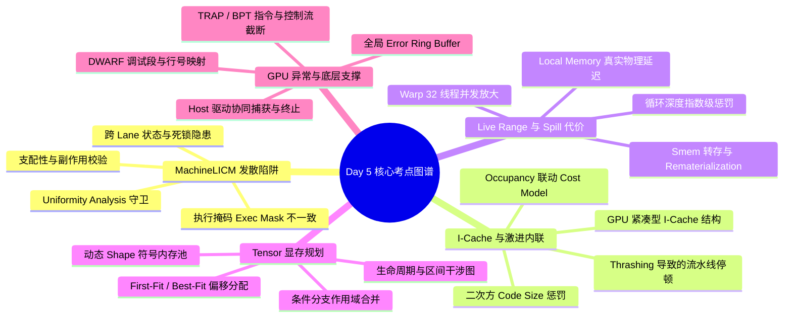

> 本文为 **[GPGPU 编译器工程师面试通关指南](/gpgpu-interview/)** 系列第5期（Day 5）。
> 建议在阅读“面试官参考解析”前，先独立思考每道题目的考察意图与答题脉络（每题思考 3~5 分钟）。

> 💡 **核心考察维度**：MachineLICM 机器级循环外提在 SIMT 上的“发散不变式”陷阱与 Uniformity 准入过滤、激进函数内联引发的 I-Cache Thrashing 与 TLP 级联崩溃、GPU 专属 Spill Cost 评估（Warp 32x 放大、内存合并感知与 Remat 替代）、Tensor Lifetime Scheduling 区间图着色与动态控制流显存复用、轻量化硬件调度下的 GPU 异常（Trap/Assert）与全局 Error Ring Buffer 协同支撑。

---

## 📝 今日高频面试题清单

### 【Q1 · 机器级循环优化】MachineLICM 在 GPU 上的“发散不变式”陷阱与一致性过滤
在 GPGPU 编译器的机器级循环不变式外提（MachineLICM）优化 pass 中，如果一个在循环体内表现为"循环不变"的表达式实际上是发散的（Divergent，例如直接或间接依赖于 `threadIdx`、`lane_id` 或 warp 内部的分支执行掩码），盲目将其外提至 Preheader 块会引发什么致命问题？GPU 后端编译器（如 NVPTX 或 AMDGPU）是如何结合 Uniformity Analysis（或 Divergence Analysis）在 Code Motion 阶段进行精准过滤的？

---

### 【Q2 · 过程间优化与硬件交互】I-Cache Thrashing 与激进内联的博弈
在 CPU 上，函数内联（Inlining）通常能通过消除调用开销和扩大过程间优化（IPO）空间带来显著提升。然而在 GPU 上，过度激进的内联会导致指令缓存抖动（I-Cache Thrashing），进而引发 Warp 调度的"连锁崩溃"。请详细解释其硬件层面的传导机制，并说明 GPU 编译器在设计 Inliner Cost Model 时，如何精准量化 Code Size 膨胀对 I-Cache 和 TLP（Thread Level Parallelism）的负面效应？

---

### 【Q3 · 寄存器分配与局部访存】Live Range Splitting 与 GPU 专属 Spill Cost 评估
通用的 CPU 寄存器分配算法（如基于 Chaitin-Briggs 的图着色算法）在处理变量生命周期切分（Live Range Splitting）和 Spill（寄存器溢出）时，通常假设 Spill 成本为固定的 L1 Cache 或 RAM 访问延迟。为什么这种假设在 GPU 编译器中会导致极度糟糕的代码质量（甚至产生性能降级 10x 以上）？GPU 后端在 Live Range Splitting 和 Spill Cost Model 中，需要引入哪些针对 GPU 存储架构和执行模型的专属评估指标？

---

### 【Q4 · 图级内存规划与生命周期】Tensor Lifetime Scheduling 与显存复用
在 AI 编译器（如 TVM、TensorRT 或 PyTorch Inductor）的前中端图优化层，Tensor Lifetime Scheduling 是将模型内存占用（Peak Memory Footprint）降至最低的核心技术。请简述基于生命周期分析与区间图着色（Interval Graph Coloring）进行显存复用的基本算法逻辑。在面对包含动态控制流（如 `If-Else` 分支、`While` 循环或动态 Shape）的计算图时，该算法面临什么挑战？编译器如何做出保守而高效的静态/动态内存规划？

---

### 【Q5 · 运行时系统与硬件异常】GPU 异常（Trap/Assert）与编译器底层支撑机制
与具备成熟操作系统内核支持和中断处理机制的 CPU 不同，GPGPU 运行在极其轻量化的硬件调度层上。当 GPU 在执行 Kernel 时触发断言失败（如 `assert(false)`）、越界访问或硬件 Trap 指令，编译器必须在指令生成、寄存器保留和运行时（Runtime）协议上做出哪些特殊设计，才能保证：

1. 发生异常时不会导致整个 GPU 硬件死锁或驱动崩溃；  
   2

) 能够精准向 Host 端返回发生 Trap 的源码文件名、行号以及触发异常的 Lane/Warp ID？

---

## 🎯 面试官深度解析与追问点



---

### 题 1 深度解析：MachineLICM 在 GPU 上的"发散不变式"陷阱

### **陷阱分析（发散不变式外提的灾难性后果）**

1. **控制流掩码（Exec Mask/Predicate）不一致导致数据污染**  
   * 在 SIMT 架构下，循环体内的指令是在特定分支掩码（如 `active_mask`）下执行的。即使某个计算（如 `x = threadIdx.x + c`）对于当前线程在循环迭代间保持不变，其值在 Warp 内部的不同 Lane 之间也是发散的（Divergent）。  
   * 若将其外提至 Preheader，Preheader 的执行掩码可能与循环体内部的激活状态不同（例如 Preheader 在某个分支外，或者是在父级控制流下执行）。如果外提的代码包含带侧效应的指令、条件内存加载或发散的寄存器写入，会导致未激活线程误执行该计算，篡改寄存器值或触发非法内存访问。  
2. **隐式 Warp 同步与死锁风险**  
   * 某些架构或指令（如跨 Lane 规约 `__shfl_sync` 或特定的 Warp 级原语）虽然在循环内由于控制流对齐而可以安全执行，一旦被 MachineLICM 移动到 Preheader，可能破坏原有的 Warp 收敛点（Reconvergence Point），导致部分线程由于未到达 Preheader 而陷入无限等待（Deadlock）。

### **后端过滤机制**

编译器在执行 MachineLICM 之前，必须建立严格的合法性分析管道（Legality Pipeline）：

1. **Uniformity Analysis / Divergence Analysis**  
   * 编译器构建静态单赋值（SSA）形式的数据流图，使用固定点迭代分析（Dataflow Analysis）来标注每个虚拟寄存器是 `Uniform`（Warp 内所有线程值相同）还是 `Divergent`（线程间值可能不同）。  
2. **外提准入条件判断（LICM Safety Check）**  
   * **值一致性规则**：指令的目标寄存器必须被证明为 `Uniform`。如果是 `Divergent`，绝对禁止越过控制流边界（如从循环体到 Preheader）进行 Code Motion。  
   * **控制依赖规则**：若指令是 `Divergent` 的，必须保证其所在的 Basic Block 严格支配（Dominate）循环的所有 Exit Blocks，且不存在分支发散带来的部分执行（Speculative Execution Check）。  
   * **Side-Effect Check**：含有 volatile 内存操作、屏障（Barrier）或潜在 Trap/Exception 的指令直接禁止外提。

---

### 题 2 深度解析：I-Cache Thrashing 与激进内联的博弈

### **硬件层面的传导机制**

1. **GPU I-Cache 结构特性与 Miss 级联效应**  
   * GPU 的 Instruction Cache (I-Cache) 通常非常小（例如每 SM/CU 仅数十 KB 至上百 KB），旨在为少量高度紧凑的内核代码提供极致吞吐。  
   * 过度内联会导致展开后的机器码体积剧增。当膨胀后的代码尺寸超越 I-Cache 容量时，多个 Warp 在同一执行管线中交替调度时，会不断擦除彼此的指令缓存行，引发严重的 **I-Cache Thrashing**。  
2. **TLP 掩盖延迟机制的失效**  
   * GPU 依赖海量 Warp 的上下文切换（Context Switching）来掩盖长延迟（如 Global Memory 访问）。  
   * 当发生 I-Cache Miss 时，Warp 必须等待从 L2/DRAM 读取指令。由于所有 Warp 几乎同时陷入 I-Cache Miss，Warp Scheduler 找不到任何可发射（Ready to Issue）的 Warp，导致硬件流水线彻底空转（Pipeline Starvation），TLP 隐藏延迟的能力完全失效，总体性能呈现断崖式下跌。

### **Cost Model 设计与反控制策略**

GPU 编译器的 Inliner 必须使用比 CPU 更为保守和严格的成本模型：

| 维度 | 评估公式 / 策略 | 影响机制 |
| :---- | :---- | :---- |
| **基础 Call Threshold** | `InlineThreshold` 设定为低基准值（如 CPU 的 1/5） | 默认阻断中大型函数的非必要展开 |
| **Code Size Penalty** | $Cost_{CodeSize} = W_{base} \\times \\text{InstructionCount}^2$ | 随着函数尺寸二次方增加惩罚权重，二次方抑制大函数 |
| **Register Pressure Weight** | $Cost_{Reg} = \\alpha \\times \\Delta \\text{LiveRanges}$ | 内联若延长变量生命周期导致溢出，大幅提高成本成本 |
| **Loop Unroll Multiplier** | $Cost_{Total} = Cost_{Body} \\times \\text{LoopTripCount}$ | 如果内联代码包含无法完全展开的循环，极其严厉惩罚 |

1. **结合 Launch Bounds / Occupancy 动态调整**  
   * 编译器查询用户指定的 `__launch_bounds__` 或分析目标寄存器用量。若当前内联会导致 Occupancy（驻留 Warp 数量）下降，直接增加内联惩罚系数。  
2. **过程间调用保留（Indirect Call / Tail Call 策略）**  
   * 对无法内联的函数，评估使用 GPU 函数指针或 Tail Call Opt，宁可承受少量 `JAL/RET` 指令与栈帧开销，也要保证核心热点循环（Hot Loops）被完整装入 I-Cache。

---

### 题 3 深度解析：Live Range Splitting 与 GPU 专属 Spill Cost 评估

### **通用 CPU Spill 算法在 GPU 上的失效原因**

1. **存储介质的物理延迟差异巨大**  
   * CPU 的 Spill 通常命中高带宽、低延迟的 L1/L2 缓存（几个周期）。  
   * GPU 的寄存器溢出（Spill to Local Memory）本质上是映射到 Global Memory 的逻辑段（虽然有 L1/L2 Cache 缓存，但每个线程的 Local Address 空间非常庞大且容易造成缓存缺失）。一旦 L1 Cache Miss，访问延迟高达 200~600 个 Clock Cycles。  
2. **SIMT 线程膨胀效应与内存合并（Coalescing）失败**  
   * GPU 上一个 Spill 不是发生在一个线程，而是由 Warp（32 个线程）同时触发。  
   * 如果 Live Range Splitting 产生的 Spill 指令地址未对齐或包含复杂索引（偏移计算），会导致 Warp 内部的 32 个内存请求无法被合并（Uncoalesced Memory Access），产生数十个独立的 DRAM 事务（Memory Storm），引发严重的内存总线堵塞。  
3. **寄存器压力与 Occupancy 的非线性坍塌**  
   * Spill 的目的通常是降低寄存器压力，但在循环内部不当的 Splitting/Spill 会增加 Load/Store 指令所需的临时地址寄存器，反而 **增加** 了局部寄存器压力，触发更剧烈的溢出循环（Spill Cascade）。

### **GPU 专属 Spill Cost Model 设计**

编译器在评估是否切分/溢出变量 $v$ 时，使用以下精确的加权模型：

$$\\text{SpillCost}(v) = \\frac{\\sum_{i \\in \\text{Uses}(v)} \\left( \\text{Weight}(i) \\times \\text{MemLatency}(i) \\times \\text{DivergenceFactor}(i) \\right) - \\text{RematBenefit}(v)}{\\Delta \\text{RegisterPressure}}$$                       

```text
                       [ 评估变量 v 的 Spill Cost ]
                                    │
           ┌────────────────────────┴────────────────────────┐
           ▼                                                 ▼
   【内存与调度开销】                                 【Remat & 架构优化】
   • Loop Depth Weight (10^N)                         • 可重算？(Rematerialization)
   • Memory Coalescing Check                          • 线程间溢出 (Shared Memory Spill)
   • Divergence Factor (Divergent Mask)               • Vector Register Packing
```

1. **循环深度指数级惩罚（Loop Depth Weighting）**  
   * 循环内部的 Spill 权重按照 $10^{\\text{LoopDepth}}$ 呈指数增长。对于 Loop 内部的 Live Range，优先选择 **Rematerialization（重新计算）** 而非 Spill。如果一个值可以通过简单算术指令（如 `SASS` 中的 `IMAD` 或 `LEA`）重新算得，其 Spill Cost 被设为无限大（优先重算）。  
2. **内存合并与访存合并感知（Coalescing-Aware Cost）**  
   * 分析切分点插入的 `Store/Load` 指令基地址。如果基地址是 Uniform 的且偏移连续，Cost 较小；如果基地址依赖 Divergent 变量，乘以 4x~32x 的惩罚系数。  
3. **共享内存/Warp 级替代 Spill（Shared Memory / Lane-Shuffling Alternative）**  
   * 后端在决定溢出到 Local Memory 之前，会检查当前 Block 是否有剩余的 Shared Memory，或者 Warp 内是否有空闲 Lane。编译器可将溢出变量通过 `__shfl_sync` 暂时转存至同 Warp 其它空闲线程的寄存器中，或存入 Shared Memory，其 Cost 远低于 Local Memory Spill。

---

### 题 4 深度解析：Tensor Lifetime Scheduling 与显存规划

### **生命周期分析与区间图着色算法**

1. **生命周期分析（Liveness Analysis）**  
   * 对计算图中的节点进行拓扑排序，确定算子执行序列 $T = [0, 1, ..., N]$。  
   * 每个 Tensor $v$ 的生命周期定义为一个闭区间 $I_v = [\\text{birth}(v), \\text{death}(v)]$，其中 $\\text{birth}(v)$ 为产生该 Tensor 的算子序号，$\\text{death}(v)$ 为最后一次读取该 Tensor 的算子序号。  
2. **构建干涉图（Interference Graph）与内存分配**  
   * **节点**：计算图中的每个 Tensor。  
   * **边**：若两个 Tensor 的生命周期区间重叠（$I_u \\cap I_v \\neq \\emptyset$），则在它们之间连一条边，表示不能共享同一块物理显存。  
   * **着色/偏移量分配（First-Fit / Best-Fit Memory Planning）**：考虑 Tensor 的 Size 与 Alignment 要求，利用 Greedy First-Fit 或 Offset-Based Storage Allocation 算法，在一维地址空间中为无干涉边的 Tensor 分配重叠的地址段（Block Reuse）。

```text
Tensor A: [================] (Time 0 -> 4)  ──┐
Tensor B:        [=========] (Time 2 -> 6)    ├── A 与 B 生命周期重叠 (不能复用)
                                              │
Tensor C:                     [======]        └── B 与 C 生命周期重叠；A 与 C 不重叠 (可复用 A 的地址)
          0   1   2   3   4   5   6   7 (Time)
```

### **动态控制流与 Dynamic Shape 的挑战及解决方案**

| 挑战场景 | 产生的问题 | 编译器的解决方案 |
| :---- | :---- | :---- |
| **If-Else 条件分支** | 无法在编译期预测哪条分支会被执行，两侧分支内部 Tensor 生命周期呈条件互斥 | **分支作用域合并（Scope Merging）**：将 `Then` 和 `Else` 块内的生命周期视为平行的虚拟区间。两侧块内部的 Tensor 可互相复用，但对外部而言，合并为单一最大生命周期区间。 |
| **动态 Loop 循环** | 循环迭代次数 $N$ 动态未知，Loop 内部 Tensor 生命周期跨越迭代 | **Loop-Invariant & Loop-Carried 分析**：将循环体内的临时 Tensor 生命周期限制在单次迭代内（Iteration-local）；对于跨迭代传递的 Tensor（Loop Carry），其生命周期强制扩展至整个循环开始到结束。 |
| **Dynamic Shape** | Tensor 物理大小在编译期无法确定，无法精确计算 Byte Offset | **分级内存池（Symbolic Memory Pool）**：基于符号推导（Symbolic Shape Analysis）导出上限（Upper Bound）；或构建动态 Memory Arena，在 Runtime 按照 Cache-aligned Slab 分配。 |

---

### 题 5 深度解析：GPU 异常（Trap/Assert）与编译器底层支撑

### **编译器底层支撑机制**

1. **Trap 指令插入与控制流截断（Control Flow Termination）**  
   * 当编译器遇到 `assert(cond)` 时，生成判定代码。若条件失败，跳转至异常处理块：  
     * **汇编指令**：生成硬件特有的 `TRAP` / `BRKPT` 或 `BPT`（BreakPoint）指令。  
     * **控制流收敛**：插入终止执行指令（如 `EXIT`），阻断当前 Warp 后续指令的发射，防止错误数据进一步污染 Global Memory。  
2. **错误信息环形缓冲区（Global Error Ring Buffer）**  
   * 编译器在系统 Module 中隐式声明全局内存结构体（Error Buffer）：

```cpp
struct GPUErrorBuffer {
    uint32_t trap_flag;       // 异常发生标志
    uint32_t error_code;      // 错误类型
    uint32_t block_id[3];     // 触发异常的 Block
    uint32_t thread_id[3];    // 触发异常的 Thread / Lane
    uint64_t source_loc_ptr;  // 指向编译期嵌入的源码文件名与行号字符串指针
};
```

* 在触发 `TRAP` 前，编译器生成代码，利用原子操作（`atomicCAS`）争抢 Error Buffer 的写入槽位，将当前 Warp 的 `blockIdx`、`threadIdx` 以及编译期固化的 Debug 信息地址写入 Global Memory。  
3. **保存现场与轻量级 Stack Trace**  
   * **DWARF/Debug Line Table**：编译器在生成 PTX/AMDGPU ISA 时，随附 `.loc`（Line Location）调试段，将 PC（Program Counter）偏移量与高级语言源码行号建立映射表。

### **软硬件协同与 Host 端捕获流程**

 

```text
 [ GPU Warp 触发 Assert/Trap ]
               │
               ▼
 [ 1. 原子写入 Error Buffer ] ───> 保存 Block/Thread ID 与 Debug Info 指针
               │
               ▼
 [ 2. 执行 TRAP / BPT 指令 ]
               │
               ▼
 [ 3. 硬件挂起当前 Warp ] ───────> 向 GPU Driver 抛出 Hardware Exception Interrupt
               │
               ▼
 [ 4. Host 端 Driver 捕获异常 ]
               │
               ▼
 [ 5. 驱动读取 Error Buffer ] ───> 解析 Debug Info 映射表，打印精确源码行号与堆栈
```

1. **Hardware Exception Vector -> Driver Interrupt**  
   * GPU 硬件捕获到 `TRAP` 指令后，将对应的 Warp 置于 Error 状态并挂起，同时向 Host 驱动发送中断（Interrupt）或设置 Event 状态位。  
2. **Host-Side Runtime 协同解析**  
   * 当 Host 端调用 `cudaStreamSynchronize()` 或 `hipDeviceSynchronize()` 时，Runtime 检查 GPU 端 Error Buffer 标志位。  
   * 若发现 `trap_flag > 0`，Runtime 从 Global Memory 拷回 Error Buffer 数据，查找符号表（DWARF），格式化输出类似 `Assert failed at kernel.cu:85 (Thread [12,0,0], Block [2,0,0])` 的错误日志，并向 Host 进程抛出 RuntimeError，安全终止 Kernel 运行。

---

## 💡 面试实战总结（复盘金句）

> 1. **谈发散不变式外提时**：*"循环不变并不等价于线程一致；盲目外提发散表达式不仅会破坏分支掩码导致数据污染，还会引发 Warp 跨收敛点的隐式死锁，必须经由严格的 Uniformity Analysis 过滤。"*
> 2. **谈函数内联与 I-Cache 时**：*"GPU 依赖海量 Warp 隐藏延迟的前提是指令流平稳；激进内联导致的 I-Cache 抖动会让所有 Warp 同时陷入缺页等待，引发执行流水线的彻底停转。"*
> 3. **谈 Spill Cost 评估时**：*"GPU 的溢出代价具有 Warp 维度的 32 倍放大效应；循环深度的指数加权与访存合并感知，是防止寄存器分配器落入局部最优陷阱的关键。"*
> 4. **谈显存规划时**：*"端到端编译的显存峰值控制依赖精确的区间图着色；面对动态控制流，通过分支作用域合并与符号分析，在保证安全的前提下实现显存块的极致复用。"*
> 5. **谈 GPU 异常处理时**：*"在轻量化的 GPU 硬件架构上，编译期埋设的全局 Error Buffer 与原子争抢机制，是连接硬件 Trap 挂起与 Host 端精确定位行号的关键桥梁。"*

---

> 👈 **上一期回顾**：**[Day 4：GlobalISel、Fragment 布局、发散展开与异步流水](/gpu-compiler/2026-10-19-gpgpu-compiler-interview-day-4/)**
> 👉 **下一期推荐**：**[Day 6：Hazard Recognizer、分布式共享内存、标量化与自动调优](/gpu-compiler/2026-10-21-gpgpu-compiler-interview-day-6/)**
> 👉 **专栏返回**：查看更多模块内容与更新计划，请访问 **[GPGPU 编译器面试通关指南目录](/gpgpu-interview/)**。
