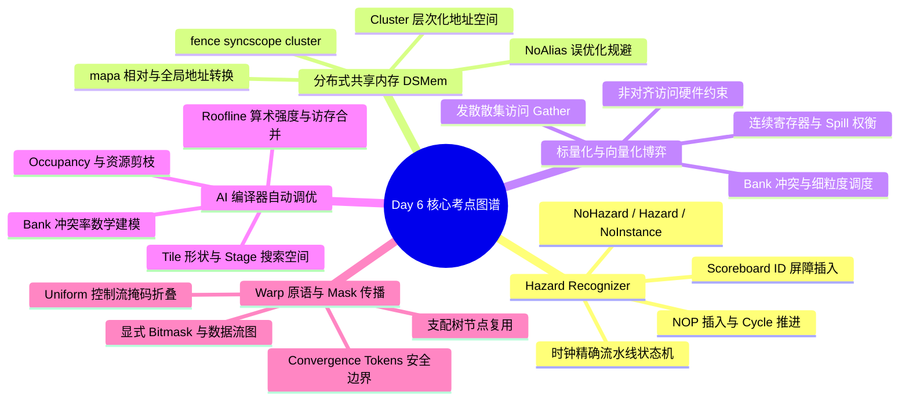

> 本文为 **[GPGPU 编译器工程师面试通关指南](/gpgpu-interview/)** 系列第6期（Day 6）。
> 建议在阅读“面试官参考解析”前，先独立思考每道题目的考察意图与答题脉络（每题思考 3~5 分钟）。

> 💡 **核心考察维度**：TargetHazardRecognizer 时钟精确状态机与 Post-RA 流水线冲突判定、Hopper 分布式共享内存（DSMem / Cluster SM）跨块数据交换编译与 ScheduleDAG Chain 隔离、标量化（Scalarization）与宽向量访存的动态博弈（非对齐与 Bank 冲突）、AI 编译器（Triton/TVM）Tile Size 自动调优（Auto-Tuning）与多维硬件代价模型、Warp-Level 原语与 Active Mask 数据流传播消除及收敛安全边界。

---

## 📝 今日高频面试题清单

### 【Q1 · 机器指令调度与流水线冲突】Machine Hazard Recognizer 的设计与 GPU 流水线冲突判定
在 LLVM 后端开发中，`TargetHazardRecognizer` 的工作机制是什么？在 Post-RA（寄存器分配后）指令调度阶段，针对 GPU 复杂的流水线依赖（如数据 RAW 冲突、特定执行单元延迟、长周期访存等），编译器如何利用 Hazard Recognizer 准确判定 Hazard 并决定插入 NOP 或是设置依赖等待周期（如 SASS 中的 yield / depbar / waitcnt）？请详细阐述其设计架构与控制流程。

---

### 【Q2 · 存储层次与跨块数据交换】Distributed Shared Memory (DSMem) 与 Cluster 级数据交换编译
现代 GPGPU 架构（如 NVIDIA Hopper 架构的 Threadblock Cluster）引入了分布式共享内存（Distributed Shared Memory, DSMem），允许同一个 Cluster 内的不同 SM 跨块直接访问对方的 Shared Memory。请问 LLVM IR 如何表征这种跨块内存访问与地址空间映射？针对跨 SM 的异步数据传输（如 `asma` / `gmma` / Remote SM Copy）与同步，编译器在 ScheduleDAG 中需要建立怎样的内存栅栏（Memory Fence）与数据流图依赖，以保证内存一致性并防止指令非法重排？

---

### 【Q3 · 向量化与合法化博弈】标量化（Scalarization）与向量化（Vectorization）的动态博弈
在 GPGPU 编译优化Pass中，通常倾向于将多个标量访存合并为向量访存（如将 4 个 `f32` 标量 Load 合并为 `v4f32` / `LDG.E.128` 指令）以提高内存吞吐。然而，编译器有时会反其道而行之，主动将宽向量指令拆散进行"标量化（Scalarization）"。请详细分析：编译器在什么情况下必须或选择进行标量化？这种拆分对非对齐内存访问（Divergent/Unaligned Access）、Bank 冲突以及 GPGPU 访存合并（Memory Coalescing）分别会产生什么深远影响？

---

### 【Q4 · AI 编译器与代码生成调优】Tile Size 选择与 AI 编译器自动调优（Auto-Tuning）代价模型
在 Triton、TVM 或 Ansor 等现代 AI 领域专用编译器（DSL Compiler）中，Tile Size（分块大小）的选择对 GEMM/Conv 等算子的性能起着决定性作用。请阐述自动调优框架（Auto-Tuning Engine）如何在庞大的搜索空间中高效寻找最优 Tile 形状？并详细剖析：在设计静态代价模型（Static Cost Model）或基于 ML 的性能预测模型时，必须量化评估哪些 GPGPU 硬件层的核心指标？

---

### 【Q5 · SIMT 束内通信与数据流优化】Warp-Level 原语与 Mask 传播优化
在 CUDA / GPGPU 编程中，Warp-Level 原语（如 `__shfl_sync`、`__ballot_sync`、`__activemask`）被广泛用于线程块内的高效通信。从 LLVM 中端 IR 到后端 SASS 代码生成，编译器如何对代表 Active Mask（活跃线程掩码）的控制流进行分析与传播优化？如何在保证 SIMT 汇聚安全（Divergence / Convergence Safety）的前提下，消除冗余的掩码计算，并在安全边界内合并相邻的 Warp 同步点？

---

## 🎯 面试官深度解析与追问点



---

### 题 1 深度解析：Machine Hazard Recognizer 的设计与 GPU 流水线冲突

#### 1. TargetHazardRecognizer 内部架构与核心状态机

`TargetHazardRecognizer` 是 LLVM 调度器（ScheduleDAG）用于在指令发射（Emit）或排序时动态检测流水线冲突（Hazards）的核心抽象类。其内部本质上维护了一个表示硬件流水线状态的时钟/周期精确模型（Pipeline State Machine）。

* **核心状态检测（`getHazardType`）**：在为当前周期选择可发射指令（`SU` - Scheduling Unit）时，调度器会调用 `getHazardType(SU, reserveCycles)`。此方法返回以下四种基本类型：  
  * `NoHazard`：当前指令在当前周期可以安全发射。  
  * `Hazard`：存在严重的结构冲突（Structural Hazard）或数据冲突（Data Hazard），必须延迟发射。  
  * `NoInstanceAvailable`：执行单元（如 Tensor Core / SFU）当前全忙，无可用资源实例。  
  * `NoTree`：树形依赖冲突。  
* **状态推进与更新（`EmitInstruction` / `AdvanceCycle`）**：  
  * `EmitInstruction(SU)`：当调度器决定发射某条指令时调用，Hazard Recognizer 会更新内部状态机（如标记硬件资源被占用 N 个周期，或记下该指令写目标寄存器的预期完成周期）。  
  * `AdvanceCycle()`：当当前周期无指令可发射，或已达到单周期发射上限时调用，将状态机内部的时钟计数器加 1，更新内部延迟计数器（Decrement Delays）。

#### 2. Post-RA 调度阶段的 Hazard 处理机制

在 Post-RA 调度阶段，寄存器分配已经完成，实际物理寄存器被固定，发生了大量的硬性数据依赖（RAW, WAR, WAW）。针对 GPU 架构，处理 Hazard 的手段主要分为两类：静态显式插入（NOP/Wait States）与动态控制码生成。

* **硬件 NOP/空周期填补**：  
  * 若 `getHazardType(SU)` 返回 `Hazard`，且 Top-Down / Bottom-Up 调度队列中没有其他无 Hazard 的独立指令可以用来填补该时隙（Bubble），调度器将强制调用 `EmitNoop()`。  
  * `EmitNoop()` 会在机器指令序列中直接插入一条 `NOP` 软件指令，或者直接推进内部 Cycle 计数，指导后期的 Code Emitter 输出指令编码中的 `yield` 延迟计数。  
* **GPU 屏障与计数寄存器设置（Wait States / Depbar）**：  
  * 对于延迟极其不确定的异步操作（如 Global Memory 异步加载、Shared Memory 读写），单纯依靠 NOP 会极大膨胀代码体积。  
  * GPU 架构（如 NVIDIA SASS 或 AMD GCN/RDNA）引入了硬件依赖屏障机制（如 NVIDIA 的 Dependency Barriers / Barrier Masks，或 AMD 的 `s_waitcnt`）。  
  * Hazard Recognizer 会在 Post-RA 阶段追踪异步指令的 `Scoreboard ID`。当遇到读写未完成异步指令目标寄存器的后续指令时，Hazard Recognizer 会判定存在 Hazard，并触发特定的 Pass 在指令前插入显式的等待原语（例如 `s_waitcnt vmcnt(0)` 或设置 SASS 指令头部的 Wait Mask），从而清空 Hazard 状态。

```text
[ScheduleDAG Post-RA]
       │
       ▼
 检查 Ready Queue 中的 SU ──► 调用 getHazardType(SU)
       │                              │
       ├───────────────┬──────────────┘
       ▼               ▼
  [NoHazard]        [Hazard]
       │               │
       │               ├──► 存在其他无 Hazard 指令? ──► [Yes] ──► 调度该独立指令
       │               │                                              │
       │               └──► [No] ──► 插入 NOP 或 设置 Wait-State ──────┘
       ▼
 调用 EmitInstruction(SU) ──► 更新寄存器 Scoreboard / 硬件 Pipeline 状态
```

---

### 题 2 深度解析：Distributed Shared Memory (DSMem) 与 Cluster 级数据交换编译

#### 1. LLVM IR 中的地址空间表征与地址计算

在传统的 GPU 编译模型中，Shared Memory 被映射到特定的地址空间（如 LLVM Address Space 3）。而在支持 Threadblock Cluster 的架构中，内存模型被扩展为层次化的 Shared Memory 系统：

* **地址空间扩展（Address Space Hierarchy）**：  
  * Address Space 3：Local Shared Memory（仅当前 CTA / SM 可见）。  
  * Address Space 6/7（扩展）：Cluster Shared Memory / Distributed Shared Memory（当前 Cluster 内所有 SM 可见）。  
* **绝对与相对地址转换**：  
  * LLVM IR 通过内建函数（Intrinsic）表示基于 Cluster 坐标的地址转换。例如：`llvm.nvvm.mapa(metadata, base_ptr, sm_id)`。  
  * 编译器前端将对远程 Shared Memory 的指针操作编译为求值逻辑：获取目标 Block 在 Cluster 内的相对 ID（`cluster_ctaid`），利用硬件提供的映射指令（如 `mapa`）将本地逻辑 Shared Memory 偏移量转换为 Cluster 作用域内的通用物理地址（Generic Address）或专有的 Remote Shared Address Space 指针。

#### 2. 跨 SM 数据交换的同步屏障与 ScheduleDAG 约束

由于跨 SM 访问涉及到非本地互联网络（Network-on-Chip, NoC），内存延迟和乱序访问的复杂性显著增加。编译器必须显式维护内存一致性。

```text
SM 0 (Producer)                      SM 1 (Consumer)
────────────────                      ────────────────
Write to DSMem Address (Remote)
  │
  ▼
fence.sc.cluster ──(NoC Signal)──► cluster.barrier.wait
                                       │
                                       ▼
                                   Read DSMem Address (Local)
```

* **内存栅栏与域（Memory Scopes）的 IR 表征**：  
  * C++11 / OpenCL 内存模型被扩展以支持 `SyncScope::Cluster`。  
  * 在 LLVM IR 中表示为：`fence syncscope("cluster") seq_cst` 或特定的 Intrinsic，如 `@llvm.nvvm.barrier.cluster.wait()`。  
* **ScheduleDAG 中的依赖关系建构**：  
  * **内存依赖边（Memory Chains & Memory Glue）**：在 ScheduleDAG 构建阶段，普通的 Load/Store 可以被调度器重排。但对于涉及 `DSMem` 的读写指令，编译器必须为其添加 `SDNode` 之间的 `Chain` 依赖（`ISD::TokenFactor`）。  
  * **强控制栅栏**：当遇到 Cluster 级别的屏障指令（如 `cluster.barrier`）时，ScheduleDAG 会创建一个不可跨越的控制边（Control Edge / MayAlias Cross-Boundary Barrier）。该节点会将屏障之前的写操作 `Chain` 与屏障之后的读操作 `Chain` 物理隔离。  
  * **防止 Aliasing 错误优化**：Alias Analysis (AA) Pass 必须被扩展。默认情况下，AA 可能认为不同 CTA 的指针绝不重叠（NoAlias）。但对于 DSMem，针对 Remote Pointer 的 Alias 查询必须返回 `MayAlias` 或针对 Cluster 作用域的显式重叠判定，防止 LICM（循环代码外提）或 Dead Store Elimination (DSE) 错误地擦除看似"未被使用"的远程写入指令。

---

### 题 3 深度解析：标量化（Scalarization）与向量化（Vectorization）的动态博弈

#### 1. 编译器主动或被动选择"标量化"的核心场景

尽管向量化能有效减少指令发射数量并提升总线利用率，但在以下场景中，LLVM / GPGPU 后端必须执行 Scalarization（如通过 `VectorCombine` 或 `TypeLegalizer` Pass）：

* **硬件非对齐访问约束（Alignment Enforcement）**：  
  * GPU 的向量访存指令（如 SASS `LDG.E.128`）通常严格要求首地址进行 16 字节对齐。如果指针分析（Pointer Tracking / KnownBits Analysis）无法在编译期证明该向量地址满足 16 字节对齐，强制生成向量指令会导致硬件抛出非法地址对齐异常（Alignment Fault）或触发严重的硬件惩罚。此时编译器必须将 `v4f32` 拆解为 4 个独立的 `f32` 标量加载。  
* **发散地址/散集访问（Divergent / Gather Load）**：  
  * 如果一个向量指令的地址在 SIMD/SIMT 内部是发散的（即同一 Warp 内不同 Thread 访问的向量首地址不连续或不具备相同步长），硬件无法通过单条向量指令完成跨线程与跨通道的加载。编译器需将其标量化为标量 Loop 或多个标量 Load。  
* **寄存器压力与生命周期（Register Pressure & Spilling）**：  
  * 宽向量指令（如 `v8f32` 或 `v16f32`）会一次性绑定大量的连续物理寄存器（Register Contiguity）。在寄存器分配（RA）极度紧张的代码段，强制保留连续寄存器会导致严重的寄存器溢出（Spill to Local Memory）。标量化可以打散变量生命周期，允许寄存器分配器更加灵活地重用零散的寄存器。  
* **控制流掩码与谓词化执行（Predication）**：  
  * 在极其复杂的 Divergent Branch 内，只有部分 Lane 是 Active 的。如果向量指令不支持 Fine-grained Predication，标量化后附带 Exec Mask/Predicate 标记能更精准地避免无用访存。

#### 2. 对硬件性能特性的深远影响对比

| 维度 | 向量化访问 (v4f32 / 128-bit) | 标量化访问 (4x f32 / 32-bit) |
| :---- | :---- | :---- |
| **内存合并 (Memory Coalescing)** | **极佳**。同一 Warp 内 32 个线程各发 128-bit 连续访问，可由少量的 128-Byte Sector Transactions 完美覆盖。 | **依赖优化**。若 4 个标量 Load 地址连续，硬件 Coalescer 仍可将其合并，但指令发射流水线开销增加 4 倍。 |
| **Shared Memory Bank 冲突** | **高风险**。若步长不一致，128-bit 向量访问会一次性跨越 4 个 Bank，极易引发严重的多路 Bank Conflict。 | **可调度性高**。标量化后，调度器可通过指令重排（Interleaving），错开不同线程对相同 Bank 的访问时间窗口。 |
| **非对齐访问 (Unaligned Access)** | **硬件崩溃/高惩罚**。直接引发 Unaligned Exception 或拆分为多个极其微效的微码事务。 | **安全但低效**。标量加载可以安全地跨越字节边界（或使用 `LDR` 等字节级加载指令），避免崩溃。 |
| **指令发射与 Code Size** | **低**。降低 Instruction Cache 占用与 Issue Cycle 消耗。 | **高**。膨胀 Code Size，增加 Decode 与 Scheduling 单元负担。 |

---

### 题 4 深度解析：Tile Size 选择与 AI 编译器自动调优（Auto-Tuning）代价模型

#### 1. Auto-Tuning 搜索空间与搜索策略

Tile Size 选择本质上是一个受硬件资源约束的非线性组合优化问题。搜索空间通常涵盖：`Tile_M, Tile_N, Tile_K`、`Thread_Block_Size`、`Vectorize_Factor` 以及 `Pipeline_Stages`（如 Async Copy Stage 数）。  

```text
  [ Search Space Design ] ──► (Tile_M, Tile_N, Tile_K, Block_Size, Stages)
             │
             ▼
  [ Pruning Rules (静态硬约束过滤) ]
             │
             ├── Shared Memory Size Limit Exceeded?
             ├── Register Count Per Thread Exceeded?
             └── Unaligned Tile Boundaries?
             │
             ▼
  [ Cost Model Evaluation / Active Profiling ]
             │
             ├── Static/ML Model 筛选 Top-K 候选
             └── 硬件 Profiler 部署测试 (Micro-benchmarking)
             │
             ▼
  [ Feedback Loop Optimization (Genetic / Evolutionary / XGBoost) ]
```

* **空间剪枝（Pruning Rules）**：利用硬件硬性指标预先剪掉非法配置：  
  * Shared Memory 总需求量 $> SM_{max_shared_mem}$。  
  * 每个 Block 的线程数超过 1024 或不是 32（Warp Size）的整数倍。  
  * 单线程寄存器估算量超过 255 个上限。  
* **搜索算法**：采用遗传算法（Genetic Algorithm）、模拟退火（Simulated Annealing）或基于蒙特卡洛树搜索（MCTS）的方法在剪枝后的空间中快速收敛。

#### 2. 代价模型（Cost Model）的核心计算指标

无论是基于解析解的静态代价模型（Static Analytic Model），还是基于机器学习（如 XGBoost / GNN）的预测模型，必须精确表达以下四大硬件指标：

##### A. Occupancy（SM 占用率与 Active Warps）

* **计算逻辑**：由 `Tile Size` 推导出的 `Shared Memory/Block` 和 `Registers/Thread` 共同决定。  
* $$\\text{Active Blocks} = \\min\\left( \\lfloor\\frac{\\text{SM_Shared_Mem}}{\\text{Block_Shared_Mem}}\\rfloor, \\lfloor\\frac{\\text{SM_Registers}}{\\text{Block_Registers}}\\rfloor, \\text{Max_Blocks_Per_SM} \\right)$$  
* **权衡**：Occupancy 并非越高越好。过高的 Occupancy 会削弱单线程的寄存器数量，导致矢量化失败或 Register Spilling；过低的 Occupancy 则不足以隐藏 Global Memory 延迟。

##### B. Shared Memory Bank 冲突概率 (Bank Conflict Ratio)

* **建模**：基于 Tile 维度与 Stride 计算 Shared Memory 访问 Pattern。  
* **公式推导**：$\\text{Bank Index} = (\\text{Address} / 4) \\pmod{32}$。  
* 若静态分析检测到多 Lane 在同一 Cycle 内访问相同 Bank 但不同 Tag 的地址，代价模型将赋予极高的 Penalty 权重。同时模型会评估是否需要主动增加 Pad（例如将 `[32, 32]` 的 Tile 扩充为 `[32, 33]`）来消除冲突。

##### C. 算术强度与屋顶模型 (Arithmetic Intensity & Roofline Limit)

* **计算公式**：$\\text{Arithmetic Intensity} = \\frac{\\text{FLOPs (FLOP)}}{\\text{Memory Access (Bytes)}}$。  
* 模型依据目标 GPU 的 Roofline Curve 判定算子处于 Compute-Bound 还是 Memory-Bound 区域。若 Tile 选择导致算术强度远低于 Compute-Bound 拐点，则表明 Tile 空间切分过小，重用率不够。

##### D. Memory Coalescing Efficiency（访存合并效率）

* 评估最内层循环 Tile 在 Global Memory 连续读取时的 DRAM Sector 覆盖率。若访问跨度（Stride）导致单次 128 字节 Transaction 中仅有效利用了 4 字节，合并效率被判定为 $\\frac{4}{128} = 3.125%$，此 Tile 方案会被代价模型直接淘汰。

---

### 题 5 深度解析：Warp-Level 原语与 Mask 传播优化

#### 1. IR 层面的 Mask 语义表征与数据流分析

现代 GPU 引入了结合显式掩码的 Warp 原语（如 CUDA 9 之后的 `*_sync` 原语），要求传入一个 32 位的 Bitmask（如 `0xFFFFFFFF`），明确指定参与该束内通信的线程集合。

* **LLVM IR Intrinsics**：  
  * 例如：`decl i32 @llvm.nvvm.shfl.sync.i32(i32 %mask, i32 %val, i32 %src_lane, i32 %clamp)`。  
* **Active Mask 传播分析（Mask Propagation Analysis）**：  
  * 编译器在 SSA 形式下构建掩码的数据流图（Data Flow Graph）。  
  * **常量折叠与谓词下推**：若通过静态控制流分析（ Divergent Analysis / Uniformity Analysis ）确定某段代码处于 **Uniform Control Flow**（即 Warp 内所有 32 个线程必然同时进入且无分支发散），编译器可将上游动态生成的 `__activemask()` 替换为全 1 常量 `0xFFFFFFFF`。  
  * **控制依赖闭包（Post-Dominance Tree）**：通过寻找 Post-Dominance 节点，若确定某个 `ballot` 节点完全支配（Dominates）并反向支配（Post-Dominance）后方的另一个 `shfl` 节点，且中途没有任何 Divergent Branch，则后者的 Mask 计算可直接复用前者的 SSA Value，消除重复的 `VOTE` / `ACTIVE_MASK` 指令。

#### 2. Synchronous Region Consolidation（同步点合并与消除）

跨多个 Warp 原语时，反复插入同步代码会严重阻碍流水线发射。编译器在后端执行 Mask 传播优化与屏障合并：

```text
[原始 IR 序列]
  %mask1 = call @llvm.nvvm.activemask()
  %res1  = call @llvm.nvvm.shfl.sync(%mask1, %val1, ...)
  ; (没有发生 Divergent Branch 的中间计算)
  %mask2 = call @llvm.nvvm.activemask()
  %res2  = call @llvm.nvvm.shfl.sync(%mask2, %val2, ...)
            │
            ▼ [Mask Propagation & Divergence Analysis Optimization]
            │
[优化后 IR 序列]
  %mask_shared = call @llvm.nvvm.activemask()  <-- 复用掩码
  %res1        = call @llvm.nvvm.shfl.sync(%mask_shared, %val1, ...)
  %res2        = call @llvm.nvvm.shfl.sync(%mask_shared, %val2, ...)
```

#### 3. Divergence/Convergence Safety（汇聚安全边界约束）

编译器在消除与合并 Mask 时，必须极其严防因过度优化导致的**死锁（Deadlock）或数据受损（Data Corruption）**：

* **防止死锁约束**：如果编译器错误地将一个发散分支（Divergent Branch）内部的 `__shfl_sync(0xFFFFFFFF, ...)` 提至分支外部，会导致 Warp 内未进入该分支的 线程在硬件层等待，导致 GPU 硬件线程同步死锁。  
* **Convergence Barrier 保护**：  
  * LLVM 引入了 `llvm.experimental.convergence.entry` 和 `llvm.experimental.convergence.loop` 锚点 Intrinsics。  
  * 这些 Control Convergence Tokens 严格规定了线程必须在此处收敛。Mask 传播优化 Pass **绝对不能跨越收敛Token界限**去合并两个不同 Convergence Domain 内的 Mask 计算。  
* **SASS 级别的 Predicate Subsumption**：在后端生成 SASS 代码时，合并后的 Warp 原语会被映射为带硬件 Predicate Register（如 `@P0`）的指令，保证只有当前处于 Active 状态的 Exec Mask 对应的 Lane 执行数据交换，非 Active 线程的写入结果被静默丢弃（No-Op），确保 SIMT 状态机的执行安全性。

---

## 💡 面试实战总结（复盘金句）

> 1. **谈 Hazard Recognizer 时**：*"Post-RA 调度不仅是指令重排，更是微架构状态机的精确推演；TargetHazardRecognizer 在时钟周期级别捕捉数据冲突，指导静态气泡填充与硬件控制码下发。"*
> 2. **谈分布式共享内存时**：*"DSMem 扩展了 GPU 片上通信的物理边界；编译器必须在 ScheduleDAG 中构建强内存 Chain 边，并重写别名分析逻辑，杜绝跨 SM 远程写入的误优化。"*
> 3. **谈标量化与向量化时**：*"宽向量访存并非万灵丹；在面临非对齐惩罚、发散散集访问或寄存器强绑定危机时，果断拆解标量化反而能赋予寄存器分配与指令调度更大的自由度。"*
> 4. **谈自动调优与代价模型时**：*"搜索空间的精准剪枝始于对硬件硬约束的严谨建模；从 Occupancy、Bank 冲突率到 Roofline 算术强度，多维指标协同才能避开伪最优陷阱。"*
> 5. **谈 Warp 原语与掩码优化时**：*"掩码计算的消除必须建立在严格的汇聚安全边界之上；利用 Convergence Tokens 与支配树推导常量掩码，在加速束内通信的同时杜绝死锁与数据竞争。"*

---

> 👈 **上一期回顾**：**[Day 5：发散不变式、I-Cache 抖动、Spill 代价与显存规划](/gpu-compiler/2026-10-20-gpgpu-compiler-interview-day-5/)**
> 👉 **下一期推荐**：**[Day 7：参数传递、发射端口饥饿、动态调用与内存布局](/gpu-compiler/2026-10-22-gpgpu-compiler-interview-day-7/)**
> 👉 **专栏返回**：查看更多模块内容与更新计划，请访问 **[GPGPU 编译器面试通关指南目录](/gpgpu-interview/)**。
