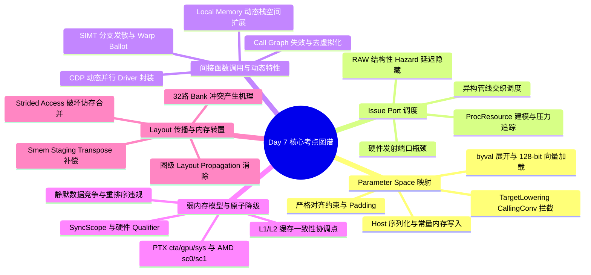

> 本文为 **[GPGPU 编译器工程师面试通关指南](/gpgpu-interview/)** 系列第7期（Day 7）。
> 建议在阅读“面试官参考解析”前，先独立思考每道题目的考察意图与答题脉络（每题思考 3~5 分钟）。

> 💡 **核心考察维度**：Host 到 Device 参数传递机制与 TargetLowering Parameter Space 映射、Issue Port Starvation（发射端口饥饿）与微架构管线交织调度、GPGPU 间接函数调用与 CUDA Dynamic Parallelism（CDP）挑战与去虚拟化方案、atomicrmw 弱内存模型硬件 Qualifier 生成与静默数据竞争排查、张量 Layout Propagation 图级消除与 Shared Memory Staging Transpose 补偿转置。

---

## 📝 今日高频面试题清单

### 【Q1 · 调用约定与硬件参数区】Kernel 函数参数传递与 Parameter Space 映射
请详细阐述在 GPGPU 编译架构中，Host 端发起 Kernel 调用时，参数是如何物理传递至 GPU 硬件端的？在 LLVM 后端 lowering 阶段，`TargetLowering` 接口与 Calling Convention（如 NVPTX 的 `PTX_Kernel`）如何将抽象的函数参数映射到具体的 Parameter Address Space（`addrspace(4)` 或 Constant/Param 寄存器）？在此过程中，对于按值传递的大型结构体（Aggregates/Structs）、指针参数以及 Alignment 约束，后端分别采取了怎样的内存布局与指令降级策略？

---

### 【Q2 · 硬件微架构瓶颈与调度】Issue Port Starvation 与异构管线交织调度
在现代 GPGPU 架构（如 NVIDIA Ampere/Hopper 或 AMD RDNA/CDNA）中，SM/CU 内部通常包含多种异构计算管线（如 ALU、FMA、SFU/Tensor Core、LSU 等）及有限的指令发射端口（Issue Ports）。请分析当某一类指令（例如密集 SFU 超越函数运算或连续 Address Generation ALU 指令）过载导致 Issue Port Starvation（发射端口饥饿）时的底层硬件现象。编译器（特别是 Machine Instruction Scheduler）如何借助 `TargetScheduleModel` 与 Hazards Recognition 机制，在 Instruction-Level Parallelism (ILP) 与 Thread-Level Parallelism (TLP) 之间取得平衡，实现异构管线交织调度？

---

### 【Q3 · 动态特性与控制流】GPGPU 上的间接函数调用与动态并行编译挑战
在 GPU 上支持 C++ 虚函数（Virtual Functions）、函数指针（Function Pointers）以及 CUDA Dynamic Parallelism (CDP) 等动态特性面临严重的硬件与编译器挑战。请从 Call Graph 可达性分析、SIMT 线程分歧（Divergence）、栈空间膨胀以及 Hardware Context 角度，深入探讨间接函数调用（Indirect Calls）对 GPGPU 编译器的挑战，并说明编译器（如 Clang/LLVM PTX Backend）与 Dynamic Runtime 联合采取的解决方案（去虚拟化、Jump Tables、Dynamic Stack Allocation 等）。

---

### 【Q4 · 弱内存模型与原子降级】LLVM IR atomicrmw 到弱一致性 GPU ISA 的转换
GPU 架构（如 NVIDIA PTX / AMD HSAIL）采用了复杂的弱内存模型（Weak Memory Model）与多级 Hierarchy 作用域（Scope System）。请阐述 LLVM IR 中的 `atomicrmw` / `fence` 指令（带有 `SyncScope` 和 `AtomicOrdering`）如何逐步降级并映射到具体的 GPU 硬件原子指令（如 PTX 的 `atom.global.level::gpu.add` 或 AMDGPU 的 buffer_atomic_add）？若编译器降级时漏配了 Scope 修饰符或 Memory Barrier，会导致怎样的底层 Cache 状态错误与数据竞争？

---

### 【Q5 · 张量内存布局与硬件对齐】Layout Propagation 与 Strided Memref 性能损耗
在 高级端到端 GPU 编译器（如 MLIR / Triton / Halide）中，张量数据布局（Data Layout，如 NCHW vs NHWC，或 Block/Thread 级 Tile Layout）对访存性能起决定性作用。请分析非连续步长内存访问（Strided Memory Access）如何破坏 GPU 的 Coalesced Memory Access（合并访存）机制并引发 L1 Cache Line 浪费与 Bank Conflict。随后阐述 MLIR 中的 Layout Propagation（布局传播） Pass 如何在图级（Graph Level）与 Loop 级自动消除 Transpose，以及遇到无法消除的 Strided Access 时，编译器如何通过 Buffer Packing 与 Shared Memory 暂存转置（Smem Staging Transpose）恢复硬件满带宽访问。

---

## 🎯 面试官深度解析与追问点



---

### 题 1 深度解析：Kernel 函数参数传递与 Parameter Space 映射

#### 1. 硬件传递机制与 Parameter Space 结构

Host 端在调用 CUDA/HIP Driver API（如 `cuLaunchKernel`）时，会将所有 Kernel 参数序列化打包写入 Host-side 内存缓冲区，并通过 PCIe 通道传输或通过 Driver 预先映射的常量内存页写入 GPU 的专用硬件参数区（Parameter Memory / Constant Space）。

当 Grid 被网格调度器（Grid Scheduler/Giga Thread Engine）分发到各个 Streaming Multiprocessor (SM) 时，硬件参数区的指针或基址寄存器会被自动加载到 SM 的特定常数缓存（Constant Cache）或专用参数寄存器中。硬件保证 Warp 在执行 Kernel 第一条指令前，所有参数均在 Parameter Space（PTX 中对应 `.param` space）就绪且只读。

#### 2. LLVM 后端 lowering 与 Calling Convention 映射

在 LLVM 后端中，自定义 Calling Convention（如 `CallingConv::PTX_Kernel`）拦截了标准的参数传递逻辑（如通用 C 调用约定的寄存器/栈传参）：

* **`TargetLowering::LowerFormalArguments` 阶段**：后端遍历 Calling Convention 定义的参数列表。对于标记为 `CallingConv::PTX_Kernel` 的入口函数，后端将每个参数标记为来自 Parameter Space（对应 Address Space 4）。  
* **DAG / GlobalISel 构建**：每一个原始 IR 参数（`Argument`）被降级为一个指向 Parameter Space 的加载节点（`SelectionDAG::getLoad` 或 `G_LOAD`），其内存操作数（`MachineMemOperand`）绑定到特殊的 Parameter Memory 标志位，禁止与其他 Global/Local 内存访问进行不合规的 Reordering。

#### 3. 复合数据类型与 Alignment 降级策略

* **指针参数（Pointers）**：指针本身作为 64 位（或 32 位）标量值存放在 Parameter Space。降级时，先从 `.param` 加载 64 位地址到通用寄存器（GPR），后续的解引用操作则根据指针本身的 Address Space 属性（Global/Shared/Local）转换为对应内存空间的访问指令（如 `ld.global`）。  
* **大型结构体（Structs / Aggregates）**：按值传递结构体时，前端（Clang）通常将其转换为 `byval` 属性的指针。后端在 `LowerFormalArguments` 中会将整个结构体展开为在 Parameter Space 内的一组连续偏移。后端根据结构体内成员的标量类型生成矢量加载（如 `ld.param.v4.s32`）或多条标量加载，以最大化指令吞吐。  
* **对齐约束（Alignment）**： Parameter Space 中的布局严格遵循宿主与设备一致的数据对齐标准（通常为 1/2/4/8/16 字节）。若结构体对齐要求为 16 字节，后端会强制在该参数起始地址插入 Padding，并尝试使用 128-bit 的向量加载指令（如 `ld.param.v4.b32`）直接读入寄存器组。若对齐不足，则回退为多条低位宽读取并执行位拼装（Shift-Or）。

---

### 题 2 深度解析：Issue Port Starvation 与异构管线调度

#### 1. 硬件瓶颈与 Issue Port Starvation 机制

GPGPU SM 内部由多个 Warp Scheduler 驱动。每个 Scheduler 在每个 Clock Cycle 尝试挑选一个 Ready 状态的 Warp，并将其指令发射给具体的 Execution Pipe（如 Tensor Core Pipe、ALU Pipe、SFU Pipe、LSU Pipe）。

当代码中连续出现同类型指令（如连续 `MUFU`/`SFU` 求正弦/指数运算，或连续 `SASS` 级别的寻址加法 `IMAD`）时：

* 该特定管线的硬件 Queue 或 Issue Port 会被快速占满。  
* Scheduler 无法将后续指令下发，导致 Issue Stage 阻塞（Stall）。  
* 即使其他功能单元（如 FMA 或 Load/Store Unit）处于完全空闲状态，也因指令流被阻塞而陷入饥饿（Starvation）。  
* 在低 TLP（如 Register/Shared Memory 消耗过大导致 SM 上并发 Warp 数量受限）的场景下，这种端口阻塞会直接暴露硬件延迟，造成严重的 CPI（Cycles Per Instruction）退化。

#### 2. LLVM Machine Scheduler 与 Pipeline-Aware 调度

LLVM 的 `MachineScheduler` (MISched) 在 RA（Register Allocation）前或后构建依赖图（DAG），并利用 `TargetScheduleModel` 进行指令重排：

```text
[DAG 构建] -> [计算 WriteProcRes / Latency] -> [ Top-Down/Bottom-Up 遍历 ] -> [微架构 Hazard 过滤] -> [指令重排]
```

* **资源建模（ProcResource）**：后端为 GPU 微架构的每个硬件管线定义 `ProcResource`（如 `DefResource<ALU_PIPE>`、`DefResource<SFU_PIPE>`）。每条 SASS/PTX 指令在 Target Itinerary/SchedMachineModel 中声明其占用的 Resource Units 及占用 Cycles（Issue Latency 与 Execution Latency）。  
* **端口压力跟踪（Resource Tracking）**：调度器使用 `SchedBoundary` 追踪当前已调度指令序列对各个 `ProcResource` 的消耗百分比。当检测到 `SFU_PIPE` 的压力接近 100% 而 `ALU_PIPE` 处于低利用率时，调度器会提升候选队列中 `ALU_PIPE` 指令的优先级（Priority Metric）。

#### 3. 延迟隐藏与异构交织策略

* **指令交织（Interleaving）**：编译器主动在密集 Memory/SFU 指令流中打入 independent 的 ALU/FMA 计算指令。例如将 `Address Calc -> Load -> SFU` 展开并交织为：  
  $$\\text{AddrCalc}_0 \\longrightarrow \\text{Load}_0 \\longrightarrow \\text{ALUOp}_0 \\longrightarrow \\text{SFU}_0 \\longrightarrow \\text{AddrCalc}_1 \\longrightarrow \\text{Load}_1 \\dots$$  
* **Hazard Recognizer 约束**：由于 GPU 存在 Read-After-Write (RAW) 结构性 Hazard，调度器需利用 `Scoreboard` 机制模型计算指令间的 Distance（周期数）。若发现指令 A 与 B 存在 Hardware Pipeline Dependency，调度器将强制插入无冲突指令或利用 GPU 特殊的 SASS 控制码（如 Yield/No-Bar/Dependency Barriers）显式标记，从而在不依赖高 TLP 的前提下隐藏单个 Warp 内的管线延迟。

---

### 题 3 深度解析：GPGPU 上的间接函数调用与动态并行编译挑战

#### 1. 核心挑战分析

| 维度 | 挑战描述 | 硬件/架构影响 |
| :---- | :---- | :---- |
| **Call Graph 失效** | 无法在编译期确定调用的具体 Target Function。 | 破坏内联（Inlining）与全局寄存器分配（RA）策略；阻碍跨函数优化。 |
| **SIMT Divergence** | 同一 Warp 内的不同 Lane 通过函数指针跳入不同的代码段。 | 产生严重分支分歧；硬件必须将不同 Target 序列化执行（Divergent Control Flow）。 |
| **栈空间（Stack Frame）暴涨** | GPU 无高效硬件栈支持，每个 Thread 的 Local Memory (Private Memory) 建立在 High-latency Global Memory 上。 | 若支持递归或未知深度间接调用，必须按"最坏情况"预分配 Stack，导致 Local Memory 爆栈与 TLP 暴跌。 |
| **ABI 与 Register Saving** | 没有全局统一的 Calling Convention 寄存器保存机制（GPR 数量庞大）。 | 间接调用强制执行 Caller/Callee-Saved 寄存器落盘（Spill to Local Memory），造成巨大性能开销。 |

#### 2. 编译器级解决机制

* **静态去虚拟化（Devirtualization）与 Class Hierarchy Analysis (CHA)**：  
  编译器利用 LLVM Whole Program Optimization (WPO) / LTO，搜集类型继承树及函数指针赋值点。若证明某指针仅可能指向 `FuncA` 或 `FuncB`，则将间接调用改写为显式的条件分支直接调用：

```cpp
// 优化前: fp(arg);

// 优化后:
if (fp == FuncA) 
    FuncA(arg);
else if (fp == FuncB) 
    FuncB(arg);
```  
    
  该转换允许 LLVM 后续对 `FuncA` 和 `FuncB` 执行 Inline，并精细化控制各分支下的寄存器使用。  
    
* **跳转表（Jump Table）与 Code Unrolling**：  
  若函数指针候选集较大但闭合，编译器生成显式的 Jump Table 并配合 PTX 指令（如 `brx.idx`）。对于 SIMT 分歧，编译器尝试插入 Warp-level Ballot 逻辑：提取 Warp 内所有 Lane 的目标函数地址，按 Target Function 分组执行（Uniform Warps Execution），以缓解 Divergence。

#### 3. 动态 Runtime 与内存协同

* **Dynamic Local Memory Expansion**：  
  CUDA Runtime 为每个 Thread 分配独立的 Stack Space。若编译期无法计算上限（如存在间接调用），编译器在二进制 Header 标记 `MAX_STACK_SIZE` 需求。Runtime 在 Kernel Launch 前配置 `cudaDeviceSetLimit(cudaLimitStackSize, ...)`，动态扩展 Thread Private Memory 区域。  
* **CDP (CUDA Dynamic Parallelism) 编译处理**：  
  当在 GPU Kernel 内部再次启动 Kernel 时，编译器不将其视为普通函数调用，而是插入对 Runtime Driver API（GPU-side Entry Point）的封装指令。编译器将 Launch 参数序列化到 Parent Kernel 的 Dynamic Shared Memory 或 Local Memory 中，通过硬件 Control Block 触发 Grid 调度器生成子网格。

---

### 题 4 深度解析：LLVM IR atomicrmw 到弱一致性 GPU ISA 的转换

#### 1. LLVM IR 内存语义与 GPU 作用域（SyncScope）映射

LLVM IR 标准的 `atomicrmw` 指令包含两个关键属性：`AtomicOrdering`（如 `Monotonic`, `Acquire`, `Release`, `SequentiallyConsistent`）与 `SyncScope`（如 `syncscope("subgroup")`, `syncscope("workgroup")`, `syncscope("agent")`, `syncscope("cross-system")`）。

后端降级逻辑映射关系如下表：

```text
LLVM IR atomicrmw -> SelectionDAG (ATOMIC_RMW) -> Target-specific ISA Node -> SASS/AMD ISA
```

| LLVM SyncScope | PTX Memory Scope Qualifier | AMDGPU Memory Scope Qualifier | 硬件影响范围 |
| :---- | :---- | :---- | :---- |
| `"singlethread"` / `"subgroup"` | `.cta` / (Warp 级优化) | `wavefront` | 仅限制在当前 Thread Block / Warp 内可见 |
| `"workgroup"` | `.cta` (Block) | `workgroup` | 当前 CTA / Thread Block 内部 Shared Memory 及 L1 缓存 |
| `"agent"` / `"device"` | `.gpu` | `agent` | 整个 GPU 芯片（跨 SM，涉及 L2 Cache 强一致） |
| System Scope | `.sys` | `system` | 跨 PCIe/NVLink，包含 Host CPU 内存与多 GPU 空间 |

#### 2. Instruction Selection (ISel) 与 硬件 Qualifier 生成

以 PTX 为例：

* 一条 `atomicrmw add i32* %ptr, i32 1 syncscope("agent") seq_cst` 指令：  
* **ISel 降级**：后端将 `SyncScope` 提取为 `PTX::gpu`，将 `seq_cst` 降级为带有 Acquire-Release 语义的内存屏障结合。  
* **生成 PTX 指令**：  
  `atom.global.acq_rel.gpu.add.u32 %rd, [%r_ptr], 1;`  
* **SASS 物理转换**：硬件根据 `.gpu` Qualifier 指示 LSU 指令跳过仅本地 SM 有效的 L1 Cache 脏写，直接下发给 L2 Cache 协调点（Point of Coherency）；同时插入内部 Pipeline Flush 保证写缓冲区（Write Buffer）刷入 L2。

#### 3. 错误降级的硬件级后果

若编译器在降级过程中漏配修饰符（例如误将 `system` Scope 降级为 `cta` Scope，或遗漏了 `Acquire` 屏障）：

```text
[Thread A (SM 0)]                              [Thread B (SM 1)]
写入 L1 Cache (Scope: CTA 误用)                  从 L2 Cache 读取 (Scope: GPU)
      |                                              |
 (仅刷入 SM0 L1)                                 (无法感知 SM0 L1 脏数据)
      v                                              v
 状态: L1 包含新值, L2 仍为旧值                     状态: 读取到旧值 (Stale Data)
```

1. **静默数据竞争（Silent Data Corruption）**：Thread A 在 SM 0 执行原子写，由于降级为 `.cta`，硬件仅保证 SM 0 的 L1 Cache 或 Register/Shared 空间更新。Thread B 在 SM 1 读取同一 Global Address 时，SM 1 的 L1 Cache 依然命中了本地的旧缓存行（Stale Cache Line），造成数据一致性破坏。  
2. **内存重排序越界（Out-of-Order Memory Access Violation）**：若 `Release` 降级丢失，编译器可能将 `atomicrmw` 之后的普通 Load/Store 重排序到原子写之前，导致其他 Thread 在观察到 Flag 置位时，关联的 Payload 数据尚未真正写入 Main Memory。

---

### 题 5 深度解析：Layout Propagation 与 Strided Memref 性能损耗

#### 1. 非连续步长（Strided Access）对硬件的破坏

GPU 的 Memory Pipeline 以 32 字节（Warp 内 8 个 4-byte 元素）或 128 字节（Warp 内 32 个 4-byte 元素，对应一个 Transaction）为最小粒度对 Global Memory 进行请求发包：

* **Coalesced Access（合并访存）**：当 Warp 内 32 个 Thread 依次读取连续的 128 字节地址时（Stride = 1），LSU 仅需发起 **1 次** 128-byte 的 Memory Transaction，内存带宽利用率为 100%。  
* **Strided Access（步长访存，如 Stride = N）**：若 Thread $i$ 读取地址 $Base + i \\times N \\times 4$ 字节（如矩阵转置后的按列读取）：  
  * 32 个 Thread 的地址落在了 32 个完全不同的 128-byte Cache Line 上。  
  * LSU 被迫将 1 次合并请求拆解为 **32 次** 独立的 32/128-byte Transaction（Uncoalesced）。  
  * 有效数据仅占传输总量的 $\\frac{4}{128} = 3.125%$，总线处于严重的开销冗余（Overhead）状态。  
* **Shared Memory Bank Conflict**：若将 Strided 数据直接放入 Shared Memory，由于 Shared Memory 划分为 32 个 Bank（按 4-byte 循环交叉编址），当 Thread $i$ 访问地址偏移为 $i \\times Stride$ 且 $Stride$ 为 2 的倍数时，会导致多个 Thread 映射到同一 Bank，触发 N-way Bank Conflict，使 Shared Memory 吞吐成倍衰减。

#### 2. 图级别与 IR 级别的 Layout Propagation 优化

为了从源头消除 Strided Memref，编译器在 IR 层（如 MLIR `linalg` / `tensor` Dialect）引入 Layout Propagation：

```text
[OpA (NCHW)] -> [Transpose (NCHW->NHWC)] -> [OpB (Layout-Insenstive)] -> [OpC (NHWC)]
                                |
                   (Layout Propagation 推导)
                                v
[OpA (NCHW)] -----------------> [OpB (NCHW)] --------------------------> [OpC (NCHW->NHWC)]
```

* **Layout 连通图构建**：编译器分析控制流图/数据流图中的所有 Node。将算子分为 Layout-Sensitive（如 Convolution、Gemm）与 Layout-Insensitive（如 Elementwise Add、Relu、Softmax）。  
* **布局逆向/正向传播**：若 `OpB` 为 Elementwise 算子，编译器清除其中间插入的 `Transpose` / `ReinterpretCast` 算子，将 `NHWC` 的 Layout 要求沿数据流图向上或向下传播，修改 `OpB` 的 Loop Nest 映射关系，使得整个子图在统一的数据布局下执行，从而彻底消除运行时的 Transpose Kernel 开销。

#### 3. 硬件级补偿：Shared Memory Staging Transpose

对于算法上无法避免的 Strided 访存（如 GEMM 中的 Matrix B 转置 $D = A \\times B^T$），编译器生成包含 Shared Memory 暂存转置的代码：

```text
Global Memory (Strided/Uncoalesced Read)
         |  (Warp 协同按行连续加载 + Packing)
         v
Shared Memory (带 Padding 的二维 Tile 数组: [TILE_SIZE][TILE_SIZE + 1])
         |  (按列无 Bank Conflict 读取)
         v
Register File  (提供给 Tensor Core / Vector ALU 进行 Compute)
```

1. **Coalesced Global Load**：编译器重构 Global-to-Shared 的加载逻辑。让 Warp 内的 Thread 依然沿 Global Memory 的连续方向读取数据（确保 Global Coalescing），写入 Shared Memory。  
2. **Swizzling / Padding 消除 Bank Conflict**：在 Shared Memory 声明中，编译器自动加入 Padding（如将 `smem[32][32]` 扩展为 `smem[32][33]`）或应用 XOR Swizzling 地址映射：  
   $$\\text{Bank_ID} = (\\text{Row} \\oplus \\text{Col}) \\pmod{32}$$  
   这保证了后续按列（Strided）读取 Shared Memory 时，32 个 Thread 映射到 32 个不同的 Banks 上，实现了 0-Bank-Conflict 的转置读取。

---

### 知识汇总：GPGPU 编译器核心机制综合对比分析表

为了更加直观地理解 Day 07 中涉及的 GPGPU 编译器核心机制与其硬件影响，下表总结了各优化项的对比：

| 优化/分析维度 | 关注的硬件资源 | 编译器关键 IR / Pass 节点 | 主要解决的性能瓶颈 | 典型硬件表现 |
| :---- | :---- | :---- | :---- | :---- |
| **Parameter Space 映射** | Constant Cache / Dedicated Param Regs | `TargetLowering::LowerFormalArguments` | Host-Device 传参开销与对齐冲突 | `ld.param` 指令发射；128-bit 向量化加载 |
| **Issue Port 调度** | Instruction Issue Ports / FP/ALU Pipes | `MachineScheduler`, `TargetScheduleModel` | 端口饥饿（Starvation）与管线 Stalls | 降低 CPI，提高异构 Pipe 并行利用率 |
| **间接函数调用优化** | Local Memory / Thread Private Stack | Class Hierarchy Analysis (CHA), Devirtualization | Dynamic Stack 暴涨与 Divergence | 减少 Stack Spill，消除 Branch Divergence |
| **Atomic SyncScope 降级** | L1/L2 Cache, Coherency Point | `atomicrmw`, `SelectionDAG::getAtomic` | 弱内存模型下的数据竞争与脏读 | 生成正确的 `.gpu`/`.sys` PTX 修饰符与 Fence |
| **Layout Propagation** | Global Memory Bus / Shared Memory Banks | MLIR Layout Propagation, `memref.transpose` | Strided Memory Access & Bank Conflict | 100% Coalesced Global Read, 0 Bank Conflict |

---

## 💡 面试实战总结（复盘金句）

> 1. **谈参数传递与 Parameter Space 时**：*"Kernel 参数通过硬件专用常数区下发，TargetLowering 的关键在于将形参精确降级为受限内存空间的向量加载，在严格对齐约束下保障发射效率。"*
> 2. **谈管线饥饿与指令调度时**：*"同质指令堆叠是发射端口饥饿的罪魁祸首；MachineScheduler 依托微架构模型进行异构管线交织，在低 Occupancy 下同样能实现极致的延迟掩盖。"*
> 3. **谈动态调用与 C++ 虚函数时**：*"GPU 缺失高效硬件栈帧，间接调用是性能与发散的噩梦；通过 Whole Program 去虚拟化与 Jump Table 谓词规整，是将高级面向对象语言平滑下发至 SIMT 架构的核心钥匙。"*
> 4. **谈原子降级与作用域时**：*"弱内存模型下的原子操作不仅仅是单条硬件指令，更是缓存连贯性维度的精准限定；降级丢失一个 Scope 修饰符，就会在跨 SM 通信中埋下难以复现的静默脏读。"*
> 5. **谈张量布局与暂存转置时**：*"非连续步长访存对 GPU 显存总线是毁灭性的；在图级消除 Transpose 之外，利用带 Padding 的 Shared Memory 暂存转置是化解 Strided 访存与 Bank 冲突的经典工业级利刃。"*

---

> 👈 **上一期回顾**：**[Day 6：Hazard Recognizer、分布式共享内存、标量化与自动调优](/gpu-compiler/2026-10-21-gpgpu-compiler-interview-day-6/)**
> 👉 **下一期推荐**：**[Day 8：MLIR 降级、共享内存映射、循环变换与混合架构分工](/gpu-compiler/2026-10-23-gpgpu-compiler-interview-day-8/)**
> 👉 **专栏返回**：查看更多模块内容与更新计划，请访问 **[GPGPU 编译器面试通关指南目录](/gpgpu-interview/)**。
