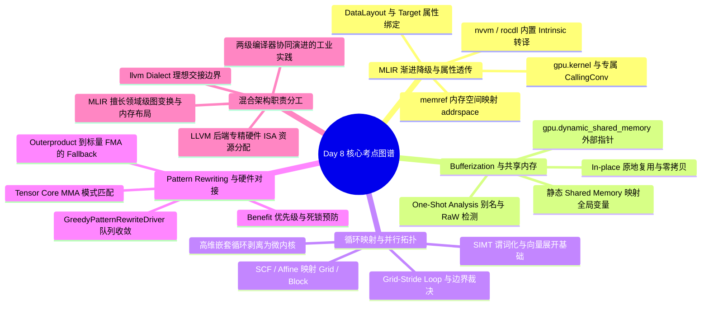

> 本文为 **[GPGPU 编译器工程师面试通关指南](/gpgpu-interview/)** 系列第8期（Day 8）。
> 建议在阅读“面试官参考解析”前，先独立思考每道题目的考察意图与答题脉络（每题思考 3~5 分钟）。

> 💡 **核心考察维度**：MLIR 渐进式 Lowering 与 GPU 目标硬件属性保留（Address Space / CallingConv / Intrinsics）、One-Shot Bufferization 别名分析与静态/动态 Shared Memory 降级、SCF/Affine 循环到 GPU Grid/Block 硬件拓扑映射与 Trip Count 裁决、GreedyPatternRewriter 匹配收敛机制与 Tensor Core 原语 Fallback 降级、现代 GPU 编译器中 MLIR 与传统 LLVM 后端的职责边界划分与交接架构。

---

## 📝 今日高频面试题清单

### 【Q1 · 多级中间表示与属性透传】MLIR Dialect Lowering 与 GPU 目标属性保留
在将高层 MLIR（如 `gpu`、`nvvm` 或 `rocdl` Dialect）逐步降级（Lowering）至 `llvm` Dialect 的过程中，编译器如何确保目标硬件相关的关键属性不丢失？请具体说明：

1. **地址空间（Address Spaces）**：`memref` 的 Memory Space 属性如何准确映射到 LLVM IR 的 Pointer Address Space（如 CUDA 的 Shared/Global Memory 或 ROCm 的 Local/Global Memory）？  
2. **Kernel 调用约定与属性**：`gpu.func` 在转换到 `llvm.func` 时，其作为入口函数的标记（`gpu.kernel`）、Block/Thread 尺寸约束以及硬件专属属性（如 CUDA 的 `maxntid`，ROCm 的 `amdgpu_flat_work_group_size`）是如何透传与附加的？  
3. **线程内置函数（Builtins）**：`gpu.thread_id` 或 `gpu.block_id` 等抽象内置操作如何转译为 `nvvm` / `rocdl` 的专有 Intrinsic，并在最终降级至 `llvm` Dialect 时保留正确的硬件寄存器映射？

---

### 【Q2 · 内存抽象与物理存储映射】Tensor 到 Memref 的 Bufferization 与 GPU 共享内存映射
在基于 MLIR 的 GPU 编译器（如 IREE 或 MLIR-TensorFlow）中，程序通常先在 Tensor 语义下进行高层优化，随后通过 Bufferization 转化为 Memref 语义。请回答：

1. **In-place Bufferization 原理**：MLIR 的 One-Shot Bufferize 如何利用读写分析（One-Shot Analysis）与生命周期分析（Liveness Analysis）来实现内存就地复用（In-place Reuse）？如何规避 GPU 上的 Read-After-Write (RAW) 冲突？  
2. **Dynamic/Static Shared Memory 分配**：  
   * 静态 Shared Memory 如何在 Bufferization 阶段映射为 `memref.alloc()` 并最终绑定到 GPU 的 Local Data Share (LDS) / Workgroup 内存？  
   * 动态 Shared Memory（尺寸在运行时决定）如何通过 `gpu.dynamic_shared_memory` Dialect 操作建模？在 Lowering 到 LLVM IR 时，它是如何转化为外部动态共享内存声明指针（如 PTX 中的 `extern __shared__`）的？

---

### 【Q3 · 并行拓扑与循环映射】SCF / Affine 循环到 GPU Grid/Block 的映射
MLIR 中通常使用 `scf.for` 或 `affine.for` 表示多层嵌套循环。GPU 编译器的核心 Pass 之一是将这些结构化循环映射到 GPU 的 Hardware Thread Hierarchy（Grid 与 Block）。

1. **Mapping Pass 的算法机制**：以 `affine.parallel` 或 `scf.parallel` 到 `gpu.launch` 的映射为例，编译器如何决定哪些循环层级映射到 `blockIdx`（x, y, z），哪些映射到 `threadIdx`（x, y, z）？如何处理 Loop Trip Count 与 Thread Hierarchy 维度不匹配（如 Loop 迭代次数大于 Thread Block 尺寸）的情况？  
2. **对下游循环展开（Unroll & Loop Transformations）的影响**：  
   * 循环被映射到 GPU 线程拓扑后，原本连续的循环控制流发生了什么变化？  
   * 映射后的代码如何影响后端（如 LLVM NVPTX 后端）的 Vectorizer 和 SIMT 谓词化（Predication）优化？

---

### 【Q4 · 图模式匹配与指令特化】MLIR Pattern Rewriting 与硬件原语对接及 Fallback 机制
MLIR 依赖 `PatternRewriter` 体系实现 Dialect 之间的转换与优化（例如将高层的矩阵乘法操作匹配并转换为 NVIDIA PTX 的 `wmma` / `mma.sync`，或 AMD 的 `mfma` 指令）。

1. **匹配与收敛机制**：`GreedyPatternRewriteDriver` 如何维护 Worklist？当多个 Pattern 发生匹配冲突或重叠时，编译器如何确定优先级？如何确保 Rewrite 过程不会陷入无限死循环？  
2. **硬件原语匹配与 Fallback 机制**：  
   * 以 GEMM 为例，当高层 `linalg.matmul` 或 `vector.contract` 的 Shape/数据类型（如 `i4` 或不规则 Shape `13x17x5`）与目标硬件矩阵原语（如 CUDA `mma.sync.16x8x16`）不符合时，Pattern Rewrite 如何触发降级/回退（Fallback）路径？  
   * 详细描述从硬件专有原语匹配失败，到生成通用标量/向量循环（FMA）的完整降级逻辑。

---

### 【Q5 · 编译器系统架构设计】混合编译架构下 MLIR 与传统 LLVM 后端的职责分工
现代 GPGPU 编译器（如 TensorFlow XLA、Triton、Mojo 等）普遍采用了"MLIR 高层 IR + 传统 LLVM（NVPTX/AMDGPU）后端"的混合编译架构。

1. **底层优化的不可替代性**：为什么诸如寄存器分配（Register Allocation）、指令调度（Instruction Scheduling）、软件流水线（Software Pipelining）以及硬件 Hazard 消除等优化不适合在 MLIR 高层 Dialect 中完成？  
2. **理想交接点（Handoff Point）**：  
   * MLIR 与传统 LLVM 后端之间最合理的交接点在哪里？  
   * 在进入 LLVM 后端之前，MLIR 必须完成哪些工作？LLVM 后端又接管了哪些工作？

---

## 🎯 面试官深度解析与追问点

---

### 题 1 深度解析：MLIR Dialect Lowering 与 GPU 目标属性保留

#### 1. 地址空间映射机制

在 MLIR 中，`memref` 类型包含一个可选的 `memorySpace` 属性（如 `Attribute` 或 `IntegerAttr`）。在向 `llvm` Dialect 转换时，`LLVMTypeConverter` 机制会调用专用的 Address Space Mapping 接口：

* **类型转换**：`MemRefType` 转换为 `LLVM::LLVMPointerType`。如果 `memref` 的 memory space 是一个整数或代表特定硬件存储区域的 Dialect 属性（例如 `#gpu.address_space<workgroup>`），类型转换器会通过硬件 target 提供的 `DataLayout` 或 `TargetAttr` 将其映射为具体的数值。  
* **硬件映射示例**：  
  * **NVPTX**：`global` $\\rightarrow$ `addrspace(1)`，`shared` $\\rightarrow$ `addrspace(3)`，`local` $\\rightarrow$ `addrspace(5)`。  
  * **AMDGPU**：`global` $\\rightarrow$ `addrspace(1)`，`region/lds` $\\rightarrow$ `addrspace(3)`，`private` $\\rightarrow$ `addrspace(5)`。  
* **指令重写**：读写该 `memref` 的 `memref.load`/`store` 会转换为 `llvm.load`/`store`，指针类型严格保留 `addrspace(N)` 标记，从而强制 LLVM PTX/AMDGPU 后端在 Codegen 时生成对应的硬件访存指令（如 PTX 的 `ld.shared` 或 `ld.global`）。

#### 2. Kernel 调用约定与属性透传

`gpu.func` 到 `llvm.func` 的转换由 `ConvertGPUToLLVMPatterns` 驱动：

* **Calling Convention 转换**：如果 `gpu.func` 带有 `gpu.kernel` 单元属性（UnitAttr），转换器在生成 `llvm.func` 时，会为其赋予特定的调用约定。例如在 NVPTX 后端中设为 `LLVM::cconv::C` 并添加 `nvvm.kernel` 属性；在 AMDGPU 中则赋予 `LLVM::cconv::AMDGPU_KERNEL` (CallingConv 85)。  
* **属性翻译**：  
  * **CUDA/NVPTX**：`gpu.known_block_size` 属性会被重写为 `nvvm.maxntidX` / `Y` / `Z` 属性节点。进入 LLVM IR 后生成 `!nvvm.annotations` 命名元数据。  
  * **ROCm/AMDGPU**：转换为 `rocdl.max_flat_work_group_size` 节点，最终转化为 LLVM IR 中的 `attributes #0 = { "amdgpu-flat-work-group-size"="1,1024" }`。

#### 3. 线程内置函数转译

高层 `gpu.thread_id x` / `gpu.block_dim x` 等操作在 Lowering 时遵循两阶段映射：

* **阶段一（Dialect 到 Hardware Dialect）**：`gpu.thread_id {x}` 被 Pattern Matching 重写为 `nvvm.read.ptx.sreg.tid.x`（NVPTX）或 `rocdl.workitem.id.x`（ROCm）。  
* **阶段二（Hardware Dialect 到 LLVM IR Dialect）**：这些 Dialect 中的 Op 实现了 `LLVM::PointerBitcastOp` 或 Intrinsics 接口，被翻译为 `llvm.call @llvm.nvvm.read.ptx.sreg.tid.x()` 或 `llvm.call @llvm.amdgcn.workitem.id.x()`。这些是 LLVM 内置的 Intrinsic，能够在后端寄存器分配阶段直接映射到硬件物理寄存器（如 PTX 的 `%tid.x` 或 AMDGCN 的 `v0` 寄存器）。

---

### 题 2 深度解析：Tensor 到 Memref 的 Bufferization 与 GPU 共享内存映射

#### 1. One-Shot Bufferization 与就地复用

* **SSA 破坏与分析**：Tensor 是不可变（Immutable）的 SSA 值，而 Memref 是可变（Mutable）的内存缓冲区。Bufferization 的核心任务是将 Tensor 操作转换为对 Memref 的读写。  
* **One-Shot Analysis（Alias & RaW 分析）**：  
  * 编译器自底向上/自顶向下遍历 AST，为每个 Tensor SSA 值构建 Write-To-Memory 图。  
  * **冲突检测**：如果两个 Tensor 操作绑定到同一内存区域，且存在一个读操作在写操作之后发生（甚至存在跨 Loop 的 RaW 依赖），One-Shot 分析会将该节点标记为 "Must Allocate"。  
  * **就地复用（In-Place）**：若无 RaW 冲突（即旧 Tensor 值在写操作后不再被任何后续节点读取），编译器直接让输出 Tensor 复用输入 Tensor 的 Memref 内存块，避免分配新的显存。  
* **规避 GPU 上的 RAW 冲突**：在 GPU 多线程环境下，若跨线程/跨 Block 复用同一个 Shared Memory 区域，除了依赖 SSA 分析外，Bufferization 阶段还会引入 `gpu.barrier`（或 `memref.copy` 后插 barrier）。若检测到跨 Thread 读写交织，无法原地安全消去，则强制插入 `memref.alloc()` 申请额外 Buffer。

#### 2. Shared Memory 分配与 LLVM IR 映射

#### **静态 Shared Memory 映射**

* 当高层代码声明一个固定 shape 的 Tensor 并指定存放在 Shared Memory 时（如带有 `#gpu.address_space<workgroup>` 标记），Bufferization 将其转换为：%0 = memref.alloc() : memref<128x64xf32, #gpu.address_space<workgroup>>  
* 降级至 `llvm` Dialect 时，该 `memref.alloc` 不会被转换为 `malloc` 或 `cudaMalloc` 调用，而是直接转换为 **Global Variable**，其 Storage Class 设置为 `InternalLinkage`，Address Space 设为 3（Shared/Workgroup）。在 PTX 中生成 `.shared .align 4 .b8 alloc_0[32768]`。

#### **动态 Shared Memory 映射**

* 当 Shared Memory 的大小依赖运行时参数（如 Block 维度）时，无法在静态全局作用域分配。  
* MLIR 使用 `gpu.dynamic_shared_memory` 操作：%shmem = gpu.dynamic_shared_memory : memref<?xi8, #gpu.address_space<workgroup>>  
* **Lowering 到 LLVM IR 的转换流程**：  
  1. `gpu.dynamic_shared_memory` 被重写为一个指向外部符号的 `llvm.mlir.addressof` 操作。  
  2. 编译器在 LLVM Module 头部隐式插入一个外部动态共享内存全局变量声明：@dynamic_shmem = external addrspace(3) global [0 x i8], align 16  
  3. 通过 `llvm.getelementptr` 获取该全局变量的起始地址，并将其 `bitcast` 转换为实际所需的数据类型指针（如 `float*`）。  
  4. 最终在 PTX 中输出为 `extern .shared .align 16 .b8 dynamic_shmem[];`，其真实物理大小在 Kernel 发射（`cudaLaunchKernel` 的第 4 个参数 `dynamicSharedMemSize`）时由 Runtime 动态传入。

---

### 题 3 深度解析：SCF / Affine 循环到 GPU Grid/Block 的映射

#### 1. 循环映射机制与 Trip Count 匹配算法

#### **映射判定机制（Mapping Strategy）**

* MLIR 的 `ConvertAffineToGPU` 或 `SCFToGPU` Pass 采用属性标记（Attribute-driven）或启发式分析来进行映射。  
* 程序员或自动调度器（如 Polyhedral Scheduler）会给 `scf.parallel` 绑定映射属性，例如 `{mapping = [#gpu.loop_mapping<processor = block_x>, #gpu.loop_mapping<processor = thread_x>]}`。  
* 降级过程：  
  1. 识别顶层的 `parallel` 循环，将其归纳变量（Induction Variables）重新计算为全局/局部线程索引。  
  2. 创建 `gpu.launch blocks(...), threads(...)` 包装块。  
  3. 循环变量 $i$ 被重写为：$i = \\text{lower_bound} + (\\text{blockIdx} \\times \\text{blockDim} + \\text{threadIdx}) \\times \\text{step}$。

#### **Trip Count 与 HW 维度不匹配的处理**

当循环迭代次数 $N$ 大于硬件线程配置（如 $N=1024$，但 `blockDim.x=256`）时，编译器采用两种模式：

| 模式 | 机制 | 生成的代码结构 |
| :---- | :---- | :---- |
| **Grid-Stride Loop (网格步长循环)** | 将超出硬件维度的循环保留为 Kernel 内部的 `scf.for`，跨度为 $GridDim \\times BlockDim$。 | `for (int i = tid; i < N; i += stride)` |
| **Thread Tile + Bound Guard (边界裁决)** | 将 Block 尺寸设为固定值，发射足够多的 Blocks，并在 Kernel 内部插入谓词分支。 | `if (global_id < N) { ... }` |

#### 2. 对下游 Loop 展开与后端 Codegen 的影响

#### **控制流变化**

* 映射前：显式的高层嵌套循环（`scf.for` / `affine.for`），具有完备的依赖关系图与归纳变量。  
* 映射后：原始的循环结构被**拆解/剥离（Strip-mined）**。部分循环轴完全消失，转化为隐式的硬件多线程并行；内核内部仅留下余数的跨段循环（Grid-Stride Loop）或纯粹的单线程顺序执行块（Basic Blocks）。

#### **对下游 LLVM 后端优化的影响**

1. **打破连续循环结构，依赖 SIMT 谓词化（Predication）**：  
   * 原本平滑的循环被插入了 `if (threadIdx.x < boundary)` 的条件分支。  
   * 下游 NVPTX/AMDGPU 后端必须利用 **SIMT Predication** 将这些分支重构为硬件 Mask（如 PTX 中的 `@p0 bra` 或 Execution Mask `EXEC`），消除 Warp Divergence。  
2. **构建向量化与 Tensor Core 化的基础**：  
   * 映射消除了高层的大循环后，留存在 Thread 内部的微小循环（如 $4 \\times 4$ 的寄存器 Tile 循环）变得极易被完全展开（Unroll All）。  
   * 展开后的连续 `memref.load` 操作可以被匹配为向量加载（`vector.load` $\\rightarrow$ PTX `ld.global.v4`），为后端的 Register Allocation 和 Instruction Scheduling 创造了高度定量的指令序列。

---

### 题 4 深度解析：MLIR Pattern Rewriting 与硬件原语对接

#### 1. Pattern Rewriting 匹配收敛机制

* **Worklist 驱动架构**：`GreedyPatternRewriteDriver` 内部维护一个 FIFO/LIFO 的 Worklist，初始状态下将指定区域（Region）内的所有 Operation 入队。  
* **匹配与应用（Match and Rewrite）**：  
  * 驱动器不断从 Worklist 弹出 Op，遍历注册到该 Op 的 `RewritePattern` 集合。  
  * **优先级判定（Benefit）**：每个 Pattern 声明了一个 `PatternBenefit`（无符号整数）。驱动器优先匹配 `Benefit` 值更高的 Pattern。如果 `Benefit` 相同，则按 Pattern 注册的先后顺序尝试。  
  * **状态更新**：一旦某个 Pattern 匹配成功并调用了 `rewrite()`，被修改/新生成的 Op，以及其受影响的邻居 Op（Parent、Users、Operands），会被重新推入 Worklist。  
* **收敛与死锁预防**：  
  * **Iteration Limit**：驱动器设定了最大迭代次数上限（如 `max_iterations = 10`）。  
  * **DAG 严格单调递减/改动检测**：PatternRewriter 强制要求通过 `rewriter.replaceOp` 或 `rewriter.eraseOp` 修改 IR。如果一个 Rewrite 动作没有改变 IR 结构，或者 Pattern 只是不断创建等价的 Op，驱动器通过比较匹配历史或达到 Iteration Limit 终止，抛出编译失败。

#### 2. 硬件原语匹配失败（Fallback）路径机制

针对矩阵乘法（GEMM）下发至 GPU 硬件 Tensor Core 原语的匹配，MLIR 采用分层的降级策略：               [linalg.matmul / vector.contract]

                               |

               (Shape & Type Check Pass)

                               |

         +---------------------+---------------------+

         | Match Success                             | Match Fail

         v                                           v

[vector.mma.sync / vector.mfma]             [vector.outerproduct / Unroll]

         |                                           |

         v                                           v

[LLVM NVVM/ROCDL Intrinsics]                [scf.for + Elementwise FMA]

         |                                           |

         v                                           v

(PTX: mma.sync.aligned...)                  (PTX: fma.rn.f32...)

#### 1. 匹配条件检查（Pattern Matching）

`VectorToGPU` 或 `LinalgToNVVM` Pattern 会检查 `vector.contract` 的维度与类型：

* **Shape 是否匹配**：如 $M=16, N=8, K=16$。  
* **Type 是否支持**：如输入为 `f16`，累加器为 `f32`。

#### 2. 补齐与切块（Padding & Tiling - 预防 Fallback）

如果 Shape 是 `13x17x5`，在进入最终 Pattern 之前，高层 Pass（如 `LinalgTilingAndPadddingPass`）会先尝试进行 Padding（填充 0 至 `16x32x16`）并切片。若 Padding 失败，才真正进入 Fallback。

#### 3. 硬件原语匹配失败（Fallback 降级）

若 Shape 或类型无法满足硬件 Tensor Core 要求（例如 target 不支持 `i4`，或者 Tile 尺寸无法对齐）：

* **Step A (Vector Dialect 拆解)**：匹配 `vector.contract` 到 `nvvm.mma` 的 High-Benefit Pattern 宣布失败 (`failure()`)。驱动器回退至低 Benefit 的通用 Pattern，将 `vector.contract` 拆解为外积操作（`vector.outerproduct`）。  
* **Step B (Vector 到 Loop 降级)**：`vector.outerproduct` 被进一步 Lower 到 `scf.for` 循环，并在最内层包含向量化/标量的 `math.fma` 或 `arith.mulf` + `arith.addf`。  
* **Step C (LLVM Target 展开)**：`scf.for` 生成标准的控制流，`fma` 被 Lower 为 `llvm.fmuladd` 或标量 IR 指令。  
* **后端结果**：最终在 NVPTX 后端输出标准的 CUDA Core 标量/向量 FMA 指令（如 `fma.rn.f32 %f3, %f1, %f2, %f4;`），保证了即使缺少硬件 Accelerator 原语支持，程序依然具备**语义正确性**的底层兜底实现。

---

### 题 5 深度解析：混合编译架构下 MLIR 与传统 LLVM 后端的职责分工

#### 1. 为什么底层优化不适合在 MLIR 高层完成？

虽然 MLIR 具备极强的抽象与表达能力，但将某些**微架构相关的优化**放在 MLIR 中实现是不高效且极其危险的：

* **缺少物理硬件状态建模**：  
  * **寄存器分配**：依赖于具体的物理寄存器文件（Register File）数量、寄存器重命名机制、溢出（Spill）代价以及 Call Convention。MLIR 的 SSA 形式拥有无限的虚拟寄存器/SSA 值，在 MLIR 层无法精确评估 Register Pressure。若在 MLIR 层强行分配，后续 LLVM IR 到 Target Machine 的 Lowering 可能会因为引入新的临时变量而破坏分配结果。  
  * **指令调度与 HW Hazard**：需要精确的硬件 Execute Pipeline 延迟表（Latency Table）、Issue Width、乱序/顺序执行特性以及 Register Read-After-Write (RAW) Stall 周期（例如 AMD GCN 的 `s_waitcnt` 或 NVIDIA GPU 的 Instruction Dependency Barriers）。这些属于芯片内部微架构细节，频繁变更且极具私有性，不适合抽象为通用的 MLIR Pass。

#### 2. MLIR 与 LLVM 后端的职责划分与交接点

双方理想的交接点位于 **`llvm` Dialect（转换为标准 LLVM IR 文本或 Bitcode 的临界点）**。+-------------------------------------------------------------------+

|                        MLIR Framework                             |

|                                                                   |

|   [High-Level Dialects: Tosa / Linalg / Vector / GPU / SCF]      |

|                               |                                   |

|   - Tiling, Fusing, Vectorization                                 |

|   - Memory Layout Optimization & Bufferization                    |

|   - Explicit GPU Thread/Block Mapping                             |

|                               v                                   |

|                        [LLVM Dialect]                             |

+-------------------------------+-----------------------------------+

                                | (TranslateToLLVMIR)

================================v===================================

                                | (LLVM IR / Bitcode)

+-------------------------------+-----------------------------------+

|                     LLVM Backend (NVPTX / AMDGPU)                 |

|                                                                   |

|   - Target-Specific LLVM IR Passes                                |

|   - Instruction Selection (SelectionDAG / GlobalISel)           |

|   - Register Allocation & Spilling                                |

|   - Machine Instruction Scheduling & Hazard Recognition           |

|   - Assembly / Binary Assembly Emission (PTX / SASS / HSACO)      |

+-------------------------------------------------------------------+

#### **MLIR 必须完成的工作（高层与中层）**

1. **结构化控制流平铺（Domain-Specific Transformations）**：完成 GEMM/Conv 的 Tile、Fuse（融合）、Unroll 以及 Auto-Tuning。  
2. **显式内存层级管理**：显式完成从 Global Memory 到 Shared Memory/LDS 的 Copy 操作插入与 Double Buffering（异步拷贝 `async.copy`）调度。  
3. **并行拓扑映射**：将抽象逻辑并行映射为明确的 GPU Grid/Block/Thread 维度以及 Thread Group (Warp) 级别的离散操作。  
4. **降级为单层表达**：将所有的抽象类型（`tensor`、`memref`、`vector`）完全展开为扁平化的指针、数值标量及 `llvm.struct`，输出符合 C/LLVM ABI 的 `llvm` Dialect。

#### **LLVM 后端接管的工作（底层与硬件 Target）**

1. **LLVM IR 标量优化**：运行 LLVM 标准的 `InstCombine`、`LICM`、`GVN` 以及 `SimplifyCFG` 等，消除 MLIR 降级过程中产生的冗余 Load/Store 或 Pointer 计算。  
2. **指令选择（Instruction Selection）**：将 `llvm.call @llvm.nvvm...` 或标准 LLVM Ops 转换为 Target Machine Instruction (MachineInstr/MC)。  
3. **寄存器分配与溢出优化（Register Allocation & Spill）**：在真实物理寄存器约束下分配 Register，并尽可能通过 Liveness Analysis 减少显存 Spill。  
4. **机器指令调度与汇编发射（Machine Scheduling & Emission）**：  
   * 针对特定 GPU 架构进行 Pipeline 填塞（如 PTX 级别或 SASS 级别的指令重排，隐藏访存延迟）。  
   * 最终输出目标平台专有代码（NVIDIA PTX/SASS 或 AMDGPU HSACO 镜像）。

---

## 💡 面试实战总结（复盘金句）

> 1. **谈 MLIR 渐进式降级时**：*"从高层张量到硬件二进制，MLIR 的多层 Dialect 在每一步都必须保留硬件元数据；通过类型转换器与属性透传，使高层表达的并行语义在底层精准沉降为硬件地址空间与调用约定。"*
> 2. **谈 Bufferization 共享内存映射时**：*"One-Shot Bufferization 打破了函数边界的内存分配阻碍；静态共享内存沉降为内部全局变量，动态共享内存映射为外部符号，统一在编译期锁定了片上 SRAM 的物理拓扑。"*
> 3. **谈循环变换与线程映射时**：*"SCF 循环映射是将软件嵌套迭代投影至物理线程网格的枢纽；剥离外层并行轴、内层留存微小循环，为下游 LLVM 后端的向量化与寄存器完全展开奠定了坚实基础。"*
> 4. **谈模式重写与 Fallback 时**：*"工业级编译器不仅要有最先进硬件原语的高收益匹配，更要有严谨完备的降级兜底；当 Tensor Core 匹配受阻时，优雅回退至通用标量/向量 FMA 循环是保证语义正确性的基石。"*
> 5. **谈混合编译架构分工时**：*"MLIR 专精于宏观结构优化、张量切块与内存层次划分，LLVM 后端则深耕于微架构寄存器分配、流水线调度与物理指令发射；明确两者在 llvm Dialect 处的交接边界，是构建现代 AI 与高性能计算编译基础设施的最佳实践。"*

---

> 👈 **上一期回顾**：**[Day 7：参数传递、发射端口饥饿、动态调用与内存布局](/gpu-compiler/2026-10-22-gpgpu-compiler-interview-day-7/)**
> 👉 **专栏返回**：查看更多模块内容与更新计划，请访问 **[GPGPU 编译器面试通关指南目录](/gpgpu-interview/)**。
