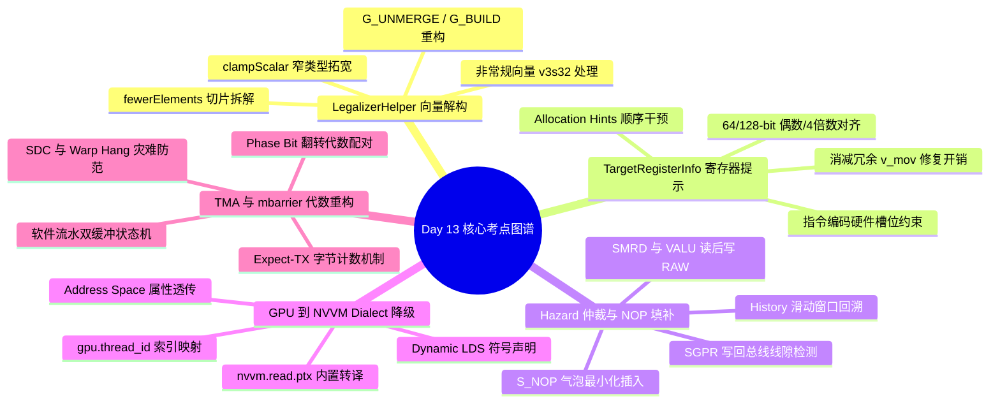

> 本文为 [**GPGPU 编译器工程师面试通关指南**](/gpgpu-interview/) 系列第13期（Day 13）。
> 建议在阅读“面试官参考解析”前，先独立思考每道题目的考察意图与答题脉络（每题思考 3~5 分钟）。

> 💡 **核心考察维度**：GlobalISel LegalizerHelper 向量解构与窄类型合法化、TargetRegisterInfo 硬件分配提示注入与对齐保护、AMDGPUHazardRecognizer SMRD/VALU 读后写冒险仲裁、ConvertGPUToNVVMPass 抽象索引与 Dynamic Smem 降级、TMA 与 mbarrier 跨迭代异步流水代数重构与 5 深度技术对比。

---

## 📝 今日高频面试题清单

### 【Q1 · GlobalISel 类型合法化】LegalizerHelper.cpp 中的向量解构与窄类型位宽合法化
在 GlobalISel 流水线中，GPU 目标后端（如 AMDGPU/NVPTX）经常面临非常规向量（如 v3s32）或不受硬件原生支持的标量/向量类型操作。请结合 llvm/lib/CodeGen/GlobalISel/LegalizerHelper.cpp 源码，解释 fewerElementsVector 的底层数据流转换逻辑：当遇到 GPU 不支持的非 2 幂次向量时，Helper 如何利用 `G_UNMERGE_VALUES` 与 `G_BUILD_VECTOR` 进行 SSA 重构？这对后续 RegAlloc 的向量寄存器连续性约束有何直接影响？

---

### 【Q2 · 寄存器分配与硬件约束】TargetRegisterInfo.cpp 中的寄存器分配约束与 Allocation Hints 注入
GPU 后端对操作数的对齐和排布有硬性微架构约束（如 AMDGPU 中 64 位操作数必须分配在偶数号 VGPR 对，如 v\[0:1\]；128 位操作数必须分配在 4 对齐的寄存器组 v\[0:3\]）。请结合 TargetRegisterInfo.cpp 及后端重写接口，剖析 getRegAllocationHints 是如何干预贪心着色器的搜索遍历序列的？

---

### 【Q3 · 硬件冒险与滑动窗口仲裁】AMDGPUHazardRecognizer.cpp 中的 SMRD 与 VALU 读后写冲突仲裁
在 AMD GCN/CDNA 架构中，标量内存读取（SMRD/SMEM）与向量 ALU（VALU）指令在写入标量寄存器（SGPR）时存在固定硬件流水线线隙与读后写（RAW）/写后写（WAW） Hazard。请结合 `AMDGPUHazardRecognizer.cpp` 源码，剖析其状态机实现：识别器如何利用 History 滑动窗口检测 RAW 并在无可用独立指令时插入 `S_NOP`？

---

### 【Q4 · MLIR 到目标 ISA 降级】ConvertGPUToNVVMPass.cpp 中的线程内置索引映射与 Dynamic LDS 分配
在从 MLIR 的 `gpu` Dialect 降级至 `nvvm` / `llvm` Dialect 时，抽象的 `gpu.thread_id` 和 `gpu.dynamic_shared_memory` 需要转化为 Target-specific 的 PTX 内置函数与 Address Space 建模。请结合 MLIR 源码解释 `GPUIndexIntrinsicOpLowering` 的重写模式，以及 dynamic shared memory（Dynamic LDS/Smem）是如何被声明与降级的？

---

### 【Q5 · 软件流水与异步屏障重构】Loop Pipelining 与 TMA 异步屏障代数重构
在将高层 Matmul/GEMM 映射到现代 GPU（如 NVIDIA Hopper 架构）时，编译器利用 TMA（Tensor Memory Accelerator）与硬件级 `mbarrier` 实现无需 SM 算力介入的跨迭代异步数据搬运。请分析编译器如何使用跨迭代变量表征 mbarrier，若由于调度错误导致事务计数未对齐即执行 Phase Flip 会引发什么硬件灾难？

---

## 🎯 面试官深度解析与追问点



---

### 题 1 深度解析：LegalizerHelper.cpp 中的向量解构与窄类型位宽合法化

#### 源码级深度剖析与核心实现
> 📌 **源码剖析提问**：在 GlobalISel 流水线中，GPU 目标后端（如 AMDGPU/NVPTX）经常面临非常规向量（如 v3s32）或不受硬件原生支持的标量/向量类型操作。请结合 llvm/lib/CodeGen/GlobalISel/LegalizerHelper.cpp 源码，解释 fewerElementsVector 的底层数据流转换逻辑：当遇到 GPU 不支持的非 2 幂次向量时，Helper 如何利用 `G_UNMERGE_VALUES` 与 `G_BUILD_VECTOR` 进行 SSA 重构？这对后续 RegAlloc 的向量寄存器连续性约束有何直接影响？

##### 源码文件直达

* `llvm/lib/CodeGen/GlobalISel/LegalizerHelper.cpp`  
* `llvm/include/llvm/CodeGen/GlobalISel/LegalizerHelper.h`

##### 核心类与核心代码块逻辑

```cpp
// llvm/lib/CodeGen/GlobalISel/LegalizerHelper.cpp
LegalizerHelper::LegalizeResult
LegalizerHelper::fewerElementsVector(MachineInstr &MI, unsigned OpIdx, LLT NarrowTy) {
  MIRBuilder.setInstrAndDebugLoc(MI);
  unsigned Opc = MI.getOpcode();
  
  Register DstReg = MI.getOperand(0).getReg();
  LLT DstTy = MRI.getType(DstReg);
  
  // 计算原向量类型与目标合法窄类型的元素数量比值
  unsigned OldNumElts = DstTy.isVector() ? DstTy.getNumElements() : 1;
  unsigned NarrowNumElts = NarrowTy.isVector() ? NarrowTy.getNumElements() : 1;
  
  if (OldNumElts % NarrowNumElts != 0)
    return UnableToLegalize;

  unsigned NumParts = OldNumElts / NarrowNumElts;
  
  // 1. 针对源操作数（Op1, Op2...）发射 G_UNMERGE_VALUES 拆解原向量为合法窄切片
  SmallVector<Register, 8> SplitSrc1Regs, SplitSrc2Regs;
  extractParts(MI.getOperand(1).getReg(), NarrowTy, NumParts, SplitSrc1Regs);
  extractParts(MI.getOperand(2).getReg(), NarrowTy, NumParts, SplitSrc2Regs);

  // 2. 针对每个窄切片独立生成目标机器指令 (如 G_ADD)
  SmallVector<Register, 8> NewDstRegs;
  for (unsigned i = 0; i < NumParts; ++i) {
    Register NewDst = MRI.createGenericVirtualRegister(NarrowTy);
    MIRBuilder.buildInstr(Opc)
              .addDef(NewDst)
              .addUse(SplitSrc1Regs[i])
              .addUse(SplitSrc2Regs[i]);
    NewDstRegs.push_back(NewDst);
  }

  // 3. 发射 G_BUILD_VECTOR 或 G_MERGE_VALUES 重新聚合成原始输出类型
  if (DstTy.isVector())
    MIRBuilder.buildBuildVector(DstReg, NewDstRegs);
  else
    MIRBuilder.buildMergeValues(DstReg, NewDstRegs);

  MI.eraseFromParent();
  return Legalized;
}
```

##### 逐行逻辑深度拆解与 SSA 重构机理

1. **SSA 图的拓扑解构（Unmerge Phase）**：  
   当输入指令为 `%res:_(v3s32) = G_ADD %a:_(v3s32), %b:_(v3s32)` 时，由于硬件缺乏 96 位向量算术单元，`fewerElementsVector` 被触发。`extractParts` 方法会自动检查硬件支持的最小切片（例如 `s32` 标量）。它会在 SSA 图中插入 `G_UNMERGE_VALUES` 或多个 `G_EXTRACT_VECTOR_ELT` 指令：

```llvm
%a0:_(s32), %a1:_(s32), %a2:_(s32) = G_UNMERGE_VALUES %a:_(v3s32)
%b0:_(s32), %b1:_(s32), %b2:_(s32) = G_UNMERGE_VALUES %b:_(v3s32)
```

2. **标量/窄向量并行算术标量化（Element-wise Emission）**：  
   循环体按照 `NumParts` 切片数量，构建 `NumParts` 条独立的通用机器指令（Generic MachineInstr）。此时原本打包在单个 `v3s32` 虚拟寄存器上的并行计算，被展开为 3 条独立的 `s32` 加法计算操作：

```
%r0:_(s32) = G_ADD %a0:_(s32), %b0:_(s32)
%r1:_(s32) = G_ADD %a1:_(s32), %b1:_(s32)
%r2:_(s32) = G_ADD %a2:_(s32), %b2:_(s32)
```

3. **SSA 结果重构（Merge Phase）**：  
   为保持 SSA 图后续消费节点的接口一致性，系统通过 `G_BUILD_VECTOR` 将 `%r0`, `%r1`, `%r2` 重新打包为 `%res:_(v3s32)`。后续的优化 Pass（如 `Combiner`）会进一步通过 Def-Use 链消除多余的 `G_BUILD_VECTOR(G_UNMERGE_VALUES)` 指令对。  
4. **对 RegAlloc（寄存器分配）与物理寄存器连续性的深远影响**：  
   * **消除物理连续性约束**：原始 `v3s32` 类型在被选择为机器指令时，若映射为向量寄存器类（如 AMDGPU 的 `VReg_96`），分配器必须寻找 **3 个连续的物理 VGPR**（例如 `v[0:2]`）。在活跃区间（Live Range）密集的代码块中，这极易引发严重的寄存器碎片化（Fragmentation）。  
   * **降低 Spill 概率与压力**：拆解为独立标量（`s32`）后，每个 `s32` 虚拟寄存器可以被 RAGreedy 独立着色，分配到任意不连续的空闲物理寄存器（如 `v0`, `v5`, `v12`）。这彻底消除了因无连续物理寄存器块可分而导致的虚假寄存器溢出（Spill to Local Memory）。

---

### 题 2 深度解析：TargetRegisterInfo.cpp 中的寄存器分配约束与 Allocation Hints 注入

#### 源码级深度剖析与核心实现
> 📌 **源码剖析提问**：GPU 后端对操作数的对齐和排布有硬性微架构约束（如 AMDGPU 中 64 位操作数必须分配在偶数号 VGPR 对，如 v\[0:1\]；128 位操作数必须分配在 4 对齐的寄存器组 v\[0:3\]）。请结合 TargetRegisterInfo.cpp 及后端重写接口，剖析 getRegAllocationHints 是如何干预贪心着色器的搜索遍历序列的？

##### 源码文件直达

* `llvm/lib/CodeGen/TargetRegisterInfo.cpp`  
* `llvm/lib/Target/AMDGPU/SIRegisterInfo.cpp`  
* `llvm/include/llvm/CodeGen/TargetRegisterInfo.h`

##### 核心类与核心代码块逻辑

```cpp
// llvm/lib/Target/AMDGPU/SIRegisterInfo.cpp
bool SIRegisterInfo::getRegAllocationHints(
    Register VirtReg, ArrayRef<MCPhysReg> Order,
    SmallVectorImpl<MCPhysReg> &Hints, const MachineFunction &MF,
    const VirtRegMap *VRM, const LiveRegMatrix *Matrix) const {

  const MachineRegisterInfo &MRI = MF.getRegInfo();
  const TargetRegisterClass *RC = MRI.getRegClass(VirtReg);

  // 1. 检查当前虚拟寄存器是否属于需要特殊对齐的 64 位向量类 (VReg_64)
  if (RC->hasSuperClassEq(&AMDGPU::VReg_64RegClass)) {
    for (MCPhysReg PhysReg : Order) {
      // 提取物理寄存器基号，施加 HW 要求的 2 对齐 (偶数号检查)
      unsigned RegNo = PhysReg - AMDGPU::VGPR0;
      if (RegNo % 2 == 0) {
        Hints.push_back(PhysReg);
      }
    }
    // 返回 true 表示 Hints 列表拥有最高优先搜索权
    return true;
  }

  // 2. 对于 128 位向量 (VReg_128)，施加 4-Alignment 约束
  if (RC->hasSuperClassEq(&AMDGPU::VReg_128RegClass)) {
    for (MCPhysReg PhysReg : Order) {
      unsigned RegNo = PhysReg - AMDGPU::VGPR0;
      if (RegNo % 4 == 0) {
        Hints.push_back(PhysReg);
      }
    }
    return true;
  }

  // 回退到 LLVM 标准的 Copy-Hint 逻辑
  return TargetRegisterInfo::getRegAllocationHints(VirtReg, Order, Hints, MF, VRM, Matrix);
}
```

###### 逐行逻辑深度拆解与着色器干预机制

1. **RAGreedy 搜索遍历序列重组**：
   在贪心寄存器分配器（`RAGreedy`）为虚拟寄存器 `VirtReg` 寻找物理寄存器时，默认按照 `AllocationOrder`（由寄存器类定义的默认分配顺序）进行逐个尝试。`getRegAllocationHints` 接口在遍历之前被调用。如果该函数返回 `true`，分配器会优先遍历 `Hints` 数组中的物理寄存器；只有当 `Hints` 中的所有寄存器均因冲突（Interference）不可用时，才会退回尝试 `Order` 中的其余寄存器。

2. **硬件微架构编码限制（ISA Encoding Constraints）**：
   在 AMDGPU GCN/CDNA ISA 中，64 位浮点/向量指令（如 `v_add_f64` 或 `ds_read_b64`）的机器指令编码槽位只容纳 8 位的基址寄存器索引 `src_v`。硬件指令译码器默认将 `src_v` 乘以 2 或要求最低位为 0。如果分配器将 `VirtReg_64` 分配到了奇数号物理寄存器 `v1`（即 `v[1:2]`），硬件执行时将触发非法寄存器对齐陷阱（Illegal Register Alignment Trap）。

3. **从后置修复到前置提示（Preemptive Avoidance vs Post-Fixup）**：
   通过在 `SIRegisterInfo::getRegAllocationHints` 中前置注入偶数号/4-倍数号物理寄存器，LLVM 能保证 99% 以上的宽字寄存器分配直接满足硬件对齐要求。这避免了后置 Pass（如 `FixupVectorRegisters`）通过强行插入额外的 `v_mov_b32` 移位指令来纠正对齐，从而显著降低了指令膨胀（Code Bloat）和寄存器拷贝开销。

---

### 题 3 深度解析：AMDGPUHazardRecognizer.cpp 中的 SMRD 与 VALU 读后写冲突仲裁

#### 源码级深度剖析与核心实现
> 📌 **源码剖析提问**：在 AMD GCN/CDNA 架构中，标量内存读取（SMRD/SMEM）与向量 ALU（VALU）指令在写入标量寄存器（SGPR）时存在固定硬件流水线线隙与读后写（RAW）/写后写（WAW） Hazard。请结合 `AMDGPUHazardRecognizer.cpp` 源码，剖析其状态机实现：识别器如何利用 History 滑动窗口检测 RAW 并在无可用独立指令时插入 `S_NOP`？

###### 源码文件直达
* `llvm/lib/Target/AMDGPU/AMDGPUHazardRecognizer.cpp`
* `llvm/lib/Target/AMDGPU/AMDGPUHazardRecognizer.h`

###### 核心类与核心代码块逻辑

```cpp
// llvm/lib/Target/AMDGPU/AMDGPUHazardRecognizer.cpp
ScheduleHazardRecognizer::HazardType
AMDGPUHazardRecognizer::getHazardType(SUnit *SU, int Stalls) {
  MachineInstr *MI = SU->getInstr();

  // 检测检查: 当即将发射的指令为 SMRD/SMEM 读指令时
  if (SIInstrInfo::isSMRD(*MI)) {
    int Cycles = checkSMRDHazards(MI);
    if (Cycles > 0)
      return Hazard_IsHazard; // 标记必须暂停/插空
  }

  return ScheduleHazardRecognizer::getHazardType(SU, Stalls);
}

int AMDGPUHazardRecognizer::checkSMRDHazards(MachineInstr *SMRD) {
  int WaitCycles = 0;
  unsigned ScanDepth = 0;

  // 1. 遍历 History 滑动窗口中的历史已发射指令
  for (const MachineInstr *PastMI : History) {
    if (!PastMI) {
      WaitCycles--;
      continue;
    }

    // 2. 检查 RAW Hazard: 历史指令是否为将 SGPR 写入的 VALU 指令
    // (例如 v_readfirstlane_b32 写 SGPR，接着 SMRD 使用该 SGPR 作基址)
    if (SIInstrInfo::isVALU(*PastMI) && writesSGPR(PastMI, SMRD->getOperand(0).getReg())) {
      int RequiredWait = 4 - ScanDepth; // 硬件流水线要求至少 4 个 Clock Cycles 的 Gap
      if (RequiredWait > WaitCycles)
        WaitCycles = RequiredWait;
    }

    ScanDepth++;
    if (ScanDepth >= MaxHistoryDepth)
      break;
  }
  return std::max(0, WaitCycles);
}

void AMDGPUHazardRecognizer::EmitInstruction(SUnit *SU) {
  MachineInstr *MI = SU ? SU->getInstr() : nullptr;
  // 将新发射的指令压入环形 History 队列头部，维护滑动窗口
  History.push_front(MI);
  if (History.size() > MaxHistoryDepth)
    History.pop_back();
}
```

##### 逐行逻辑深度拆解与硬件 Hazard 仲裁

1. **History 环形滑动窗口机制**：  
   `AMDGPUHazardRecognizer` 内部维护了一个 `std::deque<MachineInstr*>` 结构的 `History` 队列。每当指令调度器（`MachineScheduler`）决定发射一条指令时，就会调用 `EmitInstruction` 将其加入队列；若调度器选择插入空操作（Stall），则压入 `nullptr` 以模拟 1 个 Clock Cycle 的流水线流逝。  
2. **微架构 Hazards 的精准捕捉 (RAW on SGPR)**：  
   在 CDNA 架构中，当 VALU 指令通过 `v_readfirstlane_b32` 或 `v_cmp` 将数据写入 SGPR 寄存器文件时，由于 SGPR 与 VGPR 处于不同的 Writeback Bus，该数据写回 SGPR 存在 4 个 Clock 的 Read-After-Write (RAW) 延迟。如果接下来的 4 个 Cycle 内 SMRD 指令（如 `s_load_dword`）立即读取该 SGPR 作为 Base Pointer，SMRD 将读取到旧的脏数据（Garbage Value）。  
3. **调度优先与显式 `S_NOP` 降级策略**：  
   * **指令重排**：当 `getHazardType` 返回 `Hazard_IsHazard` 时，LLVM 机器调度器（`PostRAHazardRecognizer`）会立刻阻止当前 `SUnit` 发射，转而在 ReadyList 中寻找不相关的其他指令（如无关的 `v_add_f32`）插入空隙。  
   * **`S_NOP` 强制补全**：若 ReadyList 中无任何可用无冲突指令，调度器将强制调用 `PreEmitNoops`，计算出所需补偿的 Cycles 数，显式生成 `s_nop (Cycles - 1)` 机器指令写进最终的二进制 Executable 中，确保硬件运行绝对安全。

---

### 题 4 深度解析：ConvertGPUToNVVMPass.cpp 中的线程内置索引映射与 Dynamic LDS 分配

#### 源码级深度剖析与核心实现
> 📌 **源码剖析提问**：在从 MLIR 的 `gpu` Dialect 降级至 `nvvm` / `llvm` Dialect 时，抽象的 `gpu.thread_id` 和 `gpu.dynamic_shared_memory` 需要转化为 Target-specific 的 PTX 内置函数与 Address Space 建模。请结合 MLIR 源码解释 `GPUIndexIntrinsicOpLowering` 的重写模式，以及 dynamic shared memory（Dynamic LDS/Smem）是如何被声明与降级的？

##### 源码文件直达

* `mlir/lib/Conversion/GPUToNVVM/GPUToNVVMPass.cpp`  
* `mlir/lib/Conversion/GPUCommon/IndexIntrinsicsOpLowering.h`  
* `mlir/lib/Conversion/GPUCommon/GPUOpsLowering.cpp`

##### 核心类与核心代码块逻辑

```cpp
// mlir/lib/Conversion/GPUCommon/IndexIntrinsicsOpLowering.h
template <typename Op, typename IntrinsicOp>
struct GPUIndexIntrinsicOpLowering : public OpRewritePattern<Op> {
  using OpRewritePattern<Op>::OpRewritePattern;

  LogicalResult matchAndRewrite(Op op, PatternRewriter &rewriter) const override {
    Location loc = op.getLoc();
    // 1. 读取 GPU 维度属性 (x, y, 或 z)
    auto dim = op.getDimension();
    
    // 2. 将 gpu.thread_id x/y/z 替换为对应的 target intrinsic (如 nvvm.read.ptx.sreg.tid.x)
    switch (dim) {
    case gpu::Dimension::x:
      rewriter.replaceOpWithNewOp<IntrinsicOp>(op, rewriter.getI32Type(), NVVM::TID::x);
      break;
    case gpu::Dimension::y:
      rewriter.replaceOpWithNewOp<IntrinsicOp>(op, rewriter.getI32Type(), NVVM::TID::y);
      break;
    case gpu::Dimension::z:
      rewriter.replaceOpWithNewOp<IntrinsicOp>(op, rewriter.getI32Type(), NVVM::TID::z);
      break;
    }
    return success();
  }
};

// mlir/lib/Conversion/GPUCommon/GPUOpsLowering.cpp: Dynamic Shared Memory Lowering
struct GPUDynamicSharedMemoryOpLowering : public ConvertOpToLLVMPattern<gpu::DynamicSharedMemoryOp> {
  LogicalResult matchAndRewrite(gpu::DynamicSharedMemoryOp op, OpAdaptor adaptor,
                                ConversionPatternRewriter &rewriter) const override {
    Location loc = op.getLoc();
    ModuleOp moduleOp = op->getParentOfType<ModuleOp>();
    
    // 1. 在 Module 顶层寻找或创建外部 Symbol: @rgb_sMem (外部动态共享内存声明)
    StringRef symName = "__cuda_dynamic_smem__";
    auto globalOp = moduleOp.lookupSymbol<LLVM::GlobalOp>(symName);
    if (!globalOp) {
      OpBuilder::InsertionGuard guard(rewriter);
      rewriter.setInsertionPointToStart(moduleOp.getBody());
      // 创建 AddressSpace = 3 (NVVM Shared Memory Space) 的 0-element i8 数组
      auto arrayTy = LLVM::LLVMArrayType::get(rewriter.getI8Type(), 0);
      globalOp = rewriter.create<LLVM::GlobalOp>(
          loc, arrayTy, /*isConstant=*/false, LLVM::Linkage::External,
          symName, /*value=*/Attribute(), /*alignment=*/16,
          /*addrSpace=*/3);
    }

    // 2. 获取该 Symbol 的 AddressOf 句柄并 Cast 到目标 MemRef 类型
    Value globalPtr = rewriter.create<LLVM::AddressOfOp>(loc, globalOp);
    Value bitcastPtr = rewriter.create<LLVM::BitcastOp>(loc, LLVM::LLVMPointerType::get(rewriter.getContext(), 3), globalPtr);
    
    // 3. 构建 MemRef Descriptor 并替换原始 Operation
    Value memRefDesc = convertBufferPointer(loc, bitcastPtr, rewriter);
    rewriter.replaceOp(op, memRefDesc);
    return success();
  }
};
```

##### 逐行逻辑深度拆解与 Dialect 降级图景

1. **GPU 索引内置函数的映射转换**：  
   MLIR 中的 `gpu.thread_id x` 是平台无关的抽象 Dialect 节点。通过 `GPUIndexIntrinsicOpLowering<gpu::ThreadIdOp, NVVM::ReadPTXSregTidXOp>` 模式匹配，重写器将其直接替换为 NVVM Dialect 的固有指令 `nvvm.read.ptx.sreg.tid.x`。该 Operation 最终导出为 LLVM IR 中的 `call i32 @llvm.nvvm.read.ptx.sreg.tid.x()`，对应汇编层面的 PTX 寄存器 `%tid.x`。  
2. **动态共享内存（Dynamic Shared Memory）的 0-Length Symbol 建模**：  
   CUDA/HIP 运行库允许在 Kernel 启动时通过 `kernel<<<grid, block, dynamic_smem_size>>>` 动态传参指定 shared memory 大小。MLIR 编译器在 Compile-time 无法获知具体的 Byte 数。因此， lowering 模式采用了一个极其巧妙的 C 语言 `extern char smem[]` 映射思想：  
   * 在 Module 级别声明一个 `AddressSpace(3)`（即 Workgroup / Shared Memory Space）的全局外部变量 `@__cuda_dynamic_smem__`，其类型为 `[0 x i8]`（零长度字节数组）。  
   * 在使用 `gpu.dynamic_shared_memory` 的函数体内部，发射 `LLVM::AddressOfOp` 获取该全局符号的基地址。  
   * 通过 `LLVM::BitcastOp` 将其转换为目标元素类型（如 `float*`）的指针，并填入 MLIR 的 MemRef Descriptor 数据结构中。  
3. **内存对齐与 PTX 导出**：  
   `alignment=16` 属性确保了动态 Shared Memory 的起始基地址满足 NVVM 规范中的 128-bit（16 字节）对齐要求，以便后续使用 `LDG.128` 或 `LDS.128` 等宽矢量访存指令。

---

### 题 5 深度解析：Loop Pipelining 与 TMA 异步屏障代数重构

#### 源码级深度剖析与核心实现
> 📌 **源码剖析提问**：在将高层 Matmul/GEMM 映射到现代 GPU（如 NVIDIA Hopper 架构）时，编译器利用 TMA（Tensor Memory Accelerator）与硬件级 `mbarrier` 实现无需 SM 算力介入的跨迭代异步数据搬运。请分析编译器如何使用跨迭代变量表征 mbarrier，若由于调度错误导致事务计数未对齐即执行 Phase Flip 会引发什么硬件灾难？

##### 微架构状态机与编译代码模型

在 Hopper 及更新架构的软件流水（Software Pipelining）中，编译器通过构建一个包含 **Phase Bit（阶段翻转位）** 与 **Transaction Count（事务字节数）** 的双重环形缓冲区状态机来操纵 `mbarrier`：

```
               +-------------------------------------------------+

               |              mbarrier Hardware State            |
|---|
               | |   Phase Bit (0 or 1)  | Pending Count (Bytes)| |
               | +-----------------------+---------------------+ |
               +-------------------------------------------------+
                                      ^
                                      |
       1. mbarrier.arrive_expect_tx   | 2. Async Load (TMA Engine)
       (Register Expected Bytes)      | (Auto Decrement Pending Count)
                                      |
+-------------------------------------+-------------------------------------+
| Executing Warp (SM)                 | Hardware TMA Engine                 |
|                                     |                                     |
| mbarrier.arrive_expect_tx(bar, 1024)|                                     |
| tma.async.load(smem, gmem, bar) ----+---> Transferring 1024 Bytes...        |
|                                     |     (Decrement count by 1024)       |
| mbarrier.try_wait(bar, phase)       |                                     |
| MMA_Compute(smem_buffer)            |                                     |
| phase ^= 1                          |                                     |
+-------------------------------------+-------------------------------------+
```

##### 稳态软件流水（Pipelined Loop）核心 C++ / PTX 代码拓扑

```cpp
// 编译器生成的 Hopper GEMM 主循环伪代码 (NVVM PTX 视角)
void emitHopperMainLoop(int num_iterations, DynamicSharedMemory smem) {
  // 跨迭代状态变量 (Loop-carried Variables)
  int phase = 0; 
  uint64_t* mbar_ptr = smem.getMbarrierArray();

  for (int iter = 0; iter < num_iterations; ++iter) {
    int buf_idx = iter % 2; // 双缓冲切换
    
    // -------------------------------------------------------------
    // Step 1: 注册预期事务字节数 (Expect-TX)
    // 告诉 mbarrier 硬件：本阶段将有 1024 字节由 TMA 自动写入
    // -------------------------------------------------------------
    if (threadIdx.x == 0) {
      // PTX: mbarrier.arrive.expect_tx.shared.b64 [mbar_ptr + buf_idx], 1024;
      llvm_nvvm_mbarrier_arrive_expect_tx(mbar_ptr + buf_idx, 1024);
      
      // Step 2: 触发 TMA 硬件非阻塞读取，绑定 mbarrier
      // PTX: cp.async.bulk.tensor.3d.shared::cluster.global.mbarrier::complete_tx::bytes...
      llvm_nvvm_tma_async_load(smem.getBuffer(buf_idx), gmem_ptr, mbar_ptr + buf_idx);
    }
    
    // -------------------------------------------------------------
    // Step 3: 等待前一轮/当前轮 TMA 数据传输就绪 (Wait Phase Transition)
    // -------------------------------------------------------------
    // PTX: @p mbarrier.try_wait.shared.b64 [mbar_ptr + buf_idx], phase;
    while (!llvm_nvvm_mbarrier_try_wait(mbar_ptr + buf_idx, phase)) {
      // Hardware Yield / Spin
    }

    // -------------------------------------------------------------
    // Step 4: 消费 Shared Memory 数据进行 Matrix Multiply (Tensor Core)
    // -------------------------------------------------------------
    mma_sync_wgmma(smem.getBuffer(buf_idx));

    // -------------------------------------------------------------
    // Step 5: 跨迭代 Phase Bit 翻转
    // -------------------------------------------------------------
    phase ^= 1; // 0 -> 1 -> 0 ...
  }
}
```

##### 逐行逻辑深度拆解与硬件灾难分析

1. **`Expect-TX` 与 TMA 的硬件自动递减计数器**：  
   当 Warp 执行 `mbarrier.arrive_expect_tx(mbar, 1024)` 时，硬件 `mbarrier` 内部的 `Pending Byte Count` 增加 1024。随后 SM 发射 TMA 异步拷贝指令，立即解除阻塞并继续向下执行。TMA 硬件引擎在后台直接读取 DRAM，每当向 L1/Shared Memory 写入一个 Cache Line，TMA 硬件逻辑会自动向 `mbarrier` 发送一个 Transaction Decrement 信号。当 `Pending Byte Count` 减归 0 时，硬件自动将 `mbarrier` 的内部 Phase 状态翻转（例如从 0 变 1）。  
2. **`try_wait` 与 Phase-Flip 相位配对代数**：  
   `mbarrier.try_wait(mbar, phase)` 是一个非阻塞的查询指令。只有当硬件 `mbarrier` 内部的 Phase 状态与软件传入的 `phase` 参数一致时，该指令才返回 `true`，表明当前阶段的数据传输已全部完成（Transaction Count 归零）。  
3. **调度错误引发 Phase Flip 异常与硬件死锁灾难**：  
   如果 GPU 编译器指令调度器（Instruction Scheduler）或 Loop Pipelining Pass 出现了错误：  
   * **灾难场景 A：字节计数未对齐（Expect-TX Misalignment）**：  
     若编译器误将 `expect_tx` 设为 2048 字节，但实际发起的 TMA 传输仅有 1024 字节。TMA 传输完毕后，`Pending Byte Count` 残余 1024，硬件 `mbarrier` 的 Phase **永远不会翻转**。当软件循环执行到 `phase ^= 1` 并试图在下一次 `try_wait` 中等待新 Phase 时，该 Thread Block 内的所有 Warp 将进入永无止境的 Spin/Wait 陷阱，造成 **Warp Hang / Dynamic TDR Locking**（硬件超时重置）。  
   * **灾难场景 B：提前 Phase 翻转（Premature Phase Flip）**：  
     若编译器在 TMA 传输尚未完全触发之前，因指令重排将 `phase ^= 1` 提升到了 `try_wait` 之前，`try_wait` 将试图匹配下一个周期的 Phase Bit。如果恰巧此时上一轮残存的 Phase 标志位满足条件，Warp 会在 TMA 尚未将数据写入 Shared Memory 的情况下，提前强行执行 `mma_sync_wgmma`。这将读取到未初始化的 Garbage 内存数据，引发严重的 **Silent Data Corruption (SDC)** 结果数值错误。

---

## 5 深度技术对比

| 优化阶段 / 机制 | 解决的核心硬件/软件瓶颈 | LLVM/MLIR 关键 IR 操作符与 IR 节点 | 错误处理不当的后果 |
| :---- | :---- | :---- | :---- |
| **Legalizer (`fewerElementsVector`)** | 消除非 2 幂次向量导致的物理寄存器连续分配死锁 | `G_UNMERGE_VALUES`, `G_BUILD_VECTOR` | 寄存器碎片化，引发大量虚假 Memory Spill |
| **Allocation Hints (`getRegAllocationHints`)** | 满足硬件微架构指令编码对齐限制 | `Hints.push_back()`, `VReg_64` | 产生非对齐物理寄存器，触发 Hardware Trap |
| **Hazard Recognizer (`AMDGPUHazardRecognizer`)** | 消除 SGPR 寄存器读后写 (RAW) 流水线冲突 | `s_nop`, `Hazard_IsHazard` | 寄存器读到脏数据，导致的逻辑运算错误 |
| **GPU to NVVM Dialect (`Lowering`)** | 将高层抽象索引与内存映射为 Target PTX | `nvvm.read.ptx.sreg.tid.x`, `LLVM::GlobalOp` | 符号未定义，无法生成合法 PTX 二进制 |
| **TMA & `mbarrier` Pipelining** | 解耦 SM 算力与 Memory 搬运，实现极低延迟流水 | `mbarrier.arrive_expect_tx`, `try_wait` | **Warp Permanent Hang** 或 **Silent Data Corruption (SDC)** |

---

## 💡 面试实战总结（复盘金句）

> 1. **谈 LegalizerHelper 向量解构时**：*"GlobalISel 合法化是处理 GPU 异构与非常规数据类型的枢纽；面对非 2 幂次向量，通过 fewerElements 切片解构与 SSA 标量重组，从源头上遏制了寄存器碎片化死锁。"*
> 2. **谈 Allocation Hints 注入时**：*"物理寄存器分配绝非单纯的图着色；微架构指令编码的偶数对齐与宽字限制，必须通过 TargetRegisterInfo 前置注入提示，避免后置插入冗余移动指令导致代码膨胀。"*
> 3. **谈 SMRD 与 VALU 读后写仲裁时**：*"异构总线写回线隙是静默数据损坏的高危地带；AMDGPUHazardRecognizer 深入滑动窗口捕捉微架构 RAW 竞争，在无可用指令时精准填补 s_nop，守住硬件安全底线。"*
> 4. **谈 GPU 到 NVVM Dialect 降级时**：*"高层并行模型沉降为目标 ISA 必须严谨建模；线程索引映射为只读硬件寄存器，动态共享内存映射为外部未定义全局符号，确保生成的 PTX 具备完备的 ABI 与物理语义。"*
> 5. **谈 TMA 与 mbarrier 代数重构时**：*"Hopper 软件流水的核心在于 Expect-TX 与 Phase-Flip 的代数配对；字节计数与硬件事务的微小偏差都会引发永久 Warp 挂起或脏读，调度器必须以绝对严谨的拓扑依赖守护异步传输的正确性。"*

---

> 👈 **上一期回顾**：[**Day 12：MachineLICM、OneShotBufferize、RAGreedy 与机制对比**](/gpu-compiler/2026-10-27-gpgpu-compiler-interview-day-12/)
> 👉 **下一期推荐**：[**Day 14：VectorCombine、指令级活跃区间切分、SASS 控制码与 Memref 逃逸**](/gpu-compiler/2026-10-29-gpgpu-compiler-interview-day-14/)
> 👉 **专栏返回**：查看更多模块内容与更新计划，请访问 [**GPGPU 编译器面试通关指南目录**](/gpgpu-interview/)。
