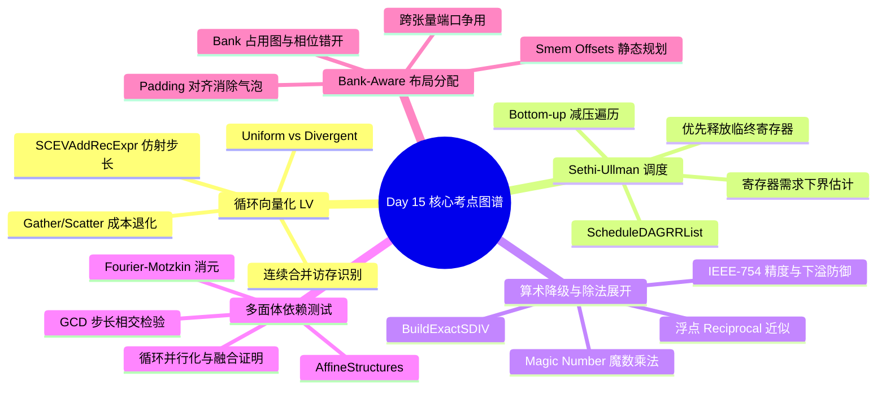

> 本文为 **[GPGPU 编译器工程师面试通关指南](/gpgpu-interview/)** 系列第15期（Day 15）。
> 建议在阅读“面试官参考解析”前，先独立思考每道题目的考察意图与答题脉络（每题思考 3~5 分钟）。

> 💡 **核心考察维度**：LoopVectorize 非均匀指针与 SCEV 仿射步长判别、ScheduleDAGRRList Sethi-Ullman 标号与寄存器减压调度、TargetLowering 整数除法魔数乘法与 IEEE-754 浮点倒数展开、AffineStructures 多面体 Fourier-Motzkin 依赖测试与 GCD 检验、Triton/IREE Bank-Aware 共享内存布局分配器与端口冲突消解。

---

## 📝 今日高频面试题清单

### 【Q1 · 循环向量化与发散访存】LoopVectorize.cpp 中的 Uniform/Divergent 指针步长识别与反变向展开
在通用循环向量化（LV）阶段，GPU 后端需面对 SIMT 执行模型下的非均匀（Divergent）地址步长。请结合 llvm/lib/Transforms/Vectorize/LoopVectorize.cpp 源码，分析 LoopVectorizationCostModel::isUniformAfterVectorization 是如何结合 ScalarEvolution（SCEV）判断地址生成指令是否为 Uniform 的？当遇到非连续（Gather/Scatter）访存时，成本模型如何量化宽向量访存与标量化逐 Lane 打包的代价？

---

### 【Q2 · 指令调度与寄存器减压】ScheduleDAGRRList.cpp 中的 Sethi-Ullman 标号法与寄存器减压调度
在寄存器极端受限（Register-Constrained）的 GPU 编译场景中，经典的基于依赖链长度的列表调度容易导致虚拟寄存器生命周期过早开启。请结合 llvm/lib/CodeGen/SelectionDAG/ScheduleDAGRRList.cpp 源码，剖析 RegReductionPriorityQueue（减压优先队列）如何利用经典的 Sethi-Ullman 标号或活跃定义计数器（Active Defs）逆向选择就绪节点？为什么这种自底向上（Bottom-Up）的调度策略在 GPU 后端能够显著降低峰值寄存器压力？

---

### 【Q3 · 算术降级与常数优化】TargetLowering.cpp 中的除法常数展开（Reciprocal Multiplication）与 IEEE-754 精度合规
GPU 原生硬件通常不配备高吞吐的完全流水化整数除法器或高精度浮点除法器。请结合 llvm/lib/CodeGen/SelectionDAG/TargetLowering.cpp 中 TargetLowering::BuildExactSDIV 与浮点除法降级逻辑，分析编译器是如何利用魔数乘法与右移（Magic Number Division）替代标量整数除法的？面对浮点单精度除法，编译器如何在单周期倒数近似指令（如 PTX rcp.approx.ftz.f32）配合 Newton-Raphson 迭代，与严格 IEEE-754 舍入模式（如 div.rn.f32）之间做代码降级决策？

---

### 【Q4 · 多面体模型与依赖分析】AffineStructures.cpp 中的多面体依赖测试（Fourier-Motzkin 消除与 GCD 检验）
在 MLIR 的 affine 方言中，证明多维循环嵌套间不存在循环依赖是实现循环融合（Loop Fusion）和并行映射（Parallel Mapping）的前置条件。请结合 mlir/lib/Dialect/Affine/Analysis/AffineStructures.cpp 源码，剖析 FlatAffineValueConstraints 如何构建等式与不等式约束矩阵？依赖分析器是如何通过 GCD 测试与 Fourier-Motzkin 消元法求解整型线性规划问题，以证明两个数组访问之间不存在写后读（RAW）冲突的？

---

### 【Q5 · 共享内存与 Bank 冲突】Triton / IREE 中的 Bank-Aware Shared Memory Layout Allocator
在多级分块（Multi-level Tiling）算子中，多个中间张量片段（如 GEMM 中的 A Tile、B Tile 与 Acc Tile）共享同一块片上共享内存（SRAM/LDS）。请结合 AI 编译器架构分析：当静态分配共享内存偏移量（Smem Offsets）时，编译器如何通过冲突图（Interference Graph）进行带 Bank 步长对齐的装箱（Packing）？如果直接将多个连续声明的 Tile 紧凑排列在 SRAM 首地址，会引发什么跨张量 Bank 冲突？

---

## 🎯 面试官深度解析与追问点



---

### 题 1 深度解析：LoopVectorize.cpp 中的 Uniform/Divergent 指针步长识别与反变向展开

#### 源码级深度剖析与核心实现
> 📌 **源码剖析提问**：在通用循环向量化（LV）阶段，GPU 后端需面对 SIMT 执行模型下的非均匀（Divergent）地址步长。请结合 llvm/lib/Transforms/Vectorize/LoopVectorize.cpp 源码，分析 LoopVectorizationCostModel::isUniformAfterVectorization 是如何结合 ScalarEvolution（SCEV）判断地址生成指令是否为 Uniform 的？当遇到非连续（Gather/Scatter）访存时，成本模型如何量化宽向量访存与标量化逐 Lane 打包的代价？

##### 源码文件直达

  - `llvm/lib/Transforms/Vectorize/LoopVectorize.cpp`
  - `llvm/include/llvm/Analysis/ScalarEvolutionExpressions.h`

##### 核心类与核心代码块逻辑

```cpp
// llvm/lib/Transforms/Vectorize/LoopVectorize.cpp 核心逻辑精选
bool LoopVectorizationCostModel::isUniformAfterVectorization(
    Instruction *I, ElementCount VF) const {
  if (PSE.getSE()->isLoopInvariant(PSE.getSCEV(I), TheLoop))
    return true;

  // 1. 获取指令的仿射步长表达式 (AddRecExpr)
  const SCEVAddRecExpr *AR = dyn_cast<SCEVAddRecExpr>(PSE.getSCEV(I));
  if (!AR)
    return false;

  // 2. 检查步长是否为 0 (在迭代间不发生变化)
  const SCEV *Step = AR->getStepRecurrence(*PSE.getSE());
  return Step->isZero();
}

InstructionCost LoopVectorizationCostModel::getMemoryOpCost(
    Instruction *I, ElementCount VF) {
  // 若判定为非连续步长 (Strided/Divergent)，评估 Gather/Scatter 代价
  if (isConsecutiveLoadOrStore(I)) {
    return TTI.getMemoryOpCost(I->getOpcode(), VectorType::get(I->getType(), VF), ...);
  }
  // 在 GPU 上，Gather 算子需退化为多次独立序列化标量访存
  return TTI.getGatherScatterOpCost(I->getOpcode(), VectorType::get(I->getType(), VF), ...);
}
```

##### 逐行逻辑深度拆解

  1. **SCEV 步长递归分析**：`isUniformAfterVectorization` 通过 `PSE.getSCEV(I)` 提取指针算术链。如果指针由外层循环定义（`isLoopInvariant`）或者其在当前向量化循环的递推步长为 0（`Step->isZero()`），判定为所有 Lane 共享同一地址。
  2. **合并访存与标量退化**：对于连续指针（Consecutive），生成单条宽向量加载指令（如 `v4f32`）；若指针带有间接索引（`A[B[i]]`），无法被证明为连续，`getMemoryOpCost` 返回包含高额惩罚的 `GatherScatterOpCost`。
  3. **GPU 微架构成本传导**：在 SIMT 体系下，非连续加载（Gather）必须在硬件端被拆解成 32 次独立的内存事务，触发严重的 L1/L2 缓存行污染与总线仲裁延迟，成本模型据此直接否决宽向量化方案，引导编译器转为多线程跨步拆分。

---

### 题 2 深度解析：ScheduleDAGRRList.cpp 中的 Sethi-Ullman 标号法与寄存器减压调度

#### 源码级深度剖析与核心实现
> 📌 **源码剖析提问**：在寄存器极端受限（Register-Constrained）的 GPU 编译场景中，经典的基于依赖链长度的列表调度容易导致虚拟寄存器生命周期过早开启。请结合 llvm/lib/CodeGen/SelectionDAG/ScheduleDAGRRList.cpp 源码，剖析 RegReductionPriorityQueue（减压优先队列）如何利用经典的 Sethi-Ullman 标号或活跃定义计数器（Active Defs）逆向选择就绪节点？为什么这种自底向上（Bottom-Up）的调度策略在 GPU 后端能够显著降低峰值寄存器压力？

##### 源码文件直达

  - `llvm/lib/CodeGen/SelectionDAG/ScheduleDAGRRList.cpp`
  - `llvm/lib/CodeGen/SelectionDAG/ScheduleDAGSDNodes.h`

##### 核心类与核心代码块逻辑

```cpp
// llvm/lib/CodeGen/SelectionDAG/ScheduleDAGRRList.cpp 核心逻辑精选
bool RegReductionPriorityQueue::RegPressureTracker::canClobber(
    SUnit *SU, SUnit *OpSU) {
  // 1. 检查 OpSU 是否是其定义寄存器的最后一个使用者 (Last Use)
  for (const SDep &Succ : OpSU->Succs) {
    if (Succ.isCtrl()) continue;
    // 若仍有其他未调度的后继指令等待消费该寄存器，不可回收该物理槽位
    if (!Succ.getSUnit()->isScheduled)
      return false;
  }
  return true; // 消费后即可就地释放物理寄存器
}

// 节点挑选比较函数：优先调度能够立刻释放寄存器的指令
bool bu_ls_rr_sort::operator()(const SUnit *left, const SUnit *right) const {
  // 优先选择能够杀死 (Kill) 活跃寄存器定义数量最多的节点
  unsigned LeftKills = getNumRegKills(left);
  unsigned RightKills = getNumRegKills(right);
  if (LeftKills != RightKills)
    return LeftKills > RightKills;

  // 依赖链深度打破平衡 (Tie-breaker)
  return left->getHeight() < right->getHeight();
}
```

##### 逐行逻辑深度拆解

  1. **自顶向下调度的致命缺陷**：传统的 Top-Down 列表调度倾向于尽早发射长延迟指令（如显存读取），导致该指令产出的目标寄存器必须一直存活并横跨后续所有计算，使活跃变量峰值居高不下。
  2. **活跃定义计数与即时释放**：`RegReductionPriorityQueue` 采用逆向自底向上发射。`getNumRegKills` 统计发射当前节点能立即闭合多少个输入虚拟寄存器的生命周期。
  3. **压低寄存器高水位线**：优先调度 `LeftKills > RightKills` 的指令，意味着一旦某个中间结果被计算出，其所有的消费者紧随其后在极短的指令窗口内被全数调度完成。这种贪心策略最大化缩短了寄存器的生存跨度（Live Range），在进入物理寄存器分配前显著压低了寄存器压力峰值。

---

### 题 3 深度解析：TargetLowering.cpp 中的除法常数展开（Reciprocal Multiplication）与 IEEE-754 精度合规

#### 源码级深度剖析与核心实现
> 📌 **源码剖析提问**：GPU 原生硬件通常不配备高吞吐的完全流水化整数除法器或高精度浮点除法器。请结合 llvm/lib/CodeGen/SelectionDAG/TargetLowering.cpp 中 TargetLowering::BuildExactSDIV 与浮点除法降级逻辑，分析编译器是如何利用魔数乘法与右移（Magic Number Division）替代标量整数除法的？面对浮点单精度除法，编译器如何在单周期倒数近似指令（如 PTX rcp.approx.ftz.f32）配合 Newton-Raphson 迭代，与严格 IEEE-754 舍入模式（如 div.rn.f32）之间做代码降级决策？

##### 源码文件直达

  - `llvm/lib/CodeGen/SelectionDAG/TargetLowering.cpp`
  - `llvm/lib/Target/NVPTX/NVPTXISelLowering.cpp`

##### 核心类与核心代码块逻辑

```cpp
// llvm/lib/CodeGen/SelectionDAG/TargetLowering.cpp 核心逻辑精选
SDValue TargetLowering::BuildExactSDIV(const SDNode *N, SelectionDAG &DAG) const {
  SDLoc dl(N);
  EVT VT = N->getValueType(0);
  int64_t D = cast<ConstantSDNode>(N->getOperand(1))->getSExtValue();

  // 1. 求解无进位乘法魔数 Magic Number (M) 与后置右移位数 (S)
  APInt MagicNum;
  unsigned ShiftAmount;
  magics(D, MagicNum, ShiftAmount);

  // 2. 发射乘高位指令 (ISD::MULHS)
  SDValue MulH = DAG.getNode(
      ISD::MULHS, dl, VT, N->getOperand(0),
      DAG.getConstant(MagicNum, dl, VT));

  // 3. 发射算术右移与符号位修正
  SDValue SRA = DAG.getNode(ISD::SRA, dl, VT, MulH,
                            DAG.getConstant(ShiftAmount, dl, MVT::i32));
  SDValue SignBit = DAG.getNode(ISD::SRL, dl, VT, N->getOperand(0),
                                DAG.getConstant(VT.getSizeInBits() - 1, dl, MVT::i32));
  return DAG.getNode(ISD::ADD, dl, VT, SRA, SignBit);
}
```

##### 逐行逻辑深度拆解

  1. **标量整数除法替换**：硬件层面无专用多周期流水线除法器时，执行一次 32 位整数除法需耗费数十周期的软件微码模拟循环。通过 `magics` 算法在编译期预先推导出 Magic Constant $M$ 与移位量 $S$，将除法 $X / D$ 代数转换为高位乘法与右移：$\lfloor (X 	imes M) / 2^{32+S} 
floor$，直接映射为单周期 `mul.hi.s32` 加移位，吞吐提升 10 倍以上。
  2. **浮点精度模式决策**：在 `NVPTXISelLowering.cpp` 中检查编译标志：若开启 `-ffast-math` 或 `-ftz=true`（Flush to Zero），`FDIV` 被直接降级为硬件单周期近似倒数指令 `rcp.approx.f32` 结合 `fmul`；若需扩展单精度至 24 位有效数，编译器插入一步 Newton-Raphson 迭代：$x_{1} = x_{0} 	imes (2 - d 	imes x_{0})$。若处于严格 IEEE-754 模式，编译器严禁使用近似倒数展开，必须发射硬件专有的低吞吐高精度指令（如 PTX `div.rn.f32`），保证下溢处理与舍入方向符合规范。

---

### 题 4 深度解析：AffineStructures.cpp 中的多面体依赖测试（Fourier-Motzkin 消除与 GCD 检验）

#### 源码级深度剖析与核心实现
> 📌 **源码剖析提问**：在 MLIR 的 affine 方言中，证明多维循环嵌套间不存在循环依赖是实现循环融合（Loop Fusion）和并行映射（Parallel Mapping）的前置条件。请结合 mlir/lib/Dialect/Affine/Analysis/AffineStructures.cpp 源码，剖析 FlatAffineValueConstraints 如何构建等式与不等式约束矩阵？依赖分析器是如何通过 GCD 测试与 Fourier-Motzkin 消元法求解整型线性规划问题，以证明两个数组访问之间不存在写后读（RAW）冲突的？

##### 源码文件直达

  - `mlir/lib/Dialect/Affine/Analysis/AffineStructures.cpp`
  - `mlir/include/mlir/Dialect/Affine/Analysis/AffineAnalysis.h`

##### 核心类与核心代码块逻辑

```cpp
// mlir/lib/Dialect/Affine/Analysis/AffineStructures.cpp 核心逻辑精选
bool FlatAffineValueConstraints::solveIntegerLinearProgram(
    SmallVectorImpl<int64_t> *solution) const {
  // 1. 执行快速最大公约数 (GCD) 检验
  for (unsigned r = 0; r < getNumEqualities(); ++r) {
    int64_t gcdVal = 0;
    for (unsigned c = 0; c < getNumCols() - 1; ++c)
      gcdVal = std::gcd(gcdVal, atEq(r, c));
    
    // 若所有系数的 GCD 无法整除常数项，整型线性规划无整数解 (证明依赖绝不发生)
    if (atEq(r, getNumCols() - 1) % gcdVal != 0)
      return false; // 无依赖
  }

  // 2. 使用 Fourier-Motzkin 消元法逐维消除内层循环变量
  FlatAffineValueConstraints projectedCst = *this;
  for (unsigned var = 0; var < getNumDimVars(); ++var) {
    projectedCst.fourierMotzkinEliminate(var);
  }

  // 3. 检查消元后凸多胞形是否为空集 (Empty Polyhedron)
  return !projectedCst.isEmpty();
}
```

##### 逐行逻辑深度拆解

  1. **仿射等式建模**：假设写操作访问 `A[2*i + 1]`，读操作访问 `A[2*j]`。依赖分析器建立等式约束：$2i + 1 - 2j = 0 \implies 2i - 2j = -1$。
  2. **GCD 算术快速判定**：方程左侧各项系数的 $\gcd(2, -2) = 2$。常数项为 $-1$。因为 $-1 \pmod 2 
eq 0$，整型方程在离散整数域无解。`solveIntegerLinearProgram` 在步骤 1 即判定无解，瞬间证明该循环对不存在 RAW 依赖。
  3. **Fourier-Motzkin 投影与并行化解锁**：若 GCD 检验通过，算法将多维循环边界与不等式构成凸几何约束，利用 Fourier-Motzkin 消元消除归纳变量（IV）。若投影多面体为空集，证明依赖在合法循环迭代空间外，编译器合法执行循环融合（Loop Fusion）并将内层直接并行化映射为 GPU 硬件线程。

---

### 题 5 深度解析：Triton / IREE 中的 Bank-Aware Shared Memory Layout Allocator

#### 源码级深度剖析与核心实现
> 📌 **源码剖析提问**：在多级分块（Multi-level Tiling）算子中，多个中间张量片段（如 GEMM 中的 A Tile、B Tile 与 Acc Tile）共享同一块片上共享内存（SRAM/LDS）。请结合 AI 编译器架构分析：当静态分配共享内存偏移量（Smem Offsets）时，编译器如何通过冲突图（Interference Graph）进行带 Bank 步长对齐的装箱（Packing）？如果直接将多个连续声明的 Tile 紧凑排列在 SRAM 首地址，会引发什么跨张量 Bank 冲突？

##### 微架构冲突模型与核心算法实现

```cpp
// 片上共享内存 Bank 冲突感知布局规划器伪代码
class BankAwareSharedMemoryAllocator {
public:
  uint64_t allocateTile(int64_t tileBytes, int64_t rowStrideBytes) {
    // 1. 计算该张量在每行跨度上产生的 Bank 偏移步长 (32 Banks, 4 字节/Bank)
    int64_t bankStride = (rowStrideBytes / 4) % 32;

    // 2. 避免前一张量尾部与新张量首地址落入相同 Bank 仲裁相位的对齐填充
    if (bankStride == 0) {
      // 产生完全的纵向同 Bank 重合，插入 128 字节 (1 个整 Cache Line) 错相 Padding
      currentSmemOffset = llvm::alignTo(currentSmemOffset, 128) + 16;
    } else {
      currentSmemOffset = llvm::alignTo(currentSmemOffset, 128);
    }

    uint64_t allocatedOffset = currentSmemOffset;
    currentSmemOffset += tileBytes;
    return allocatedOffset;
  }
private:
  uint64_t currentSmemOffset = 0;
};
```

##### 逐行逻辑深度拆解

  1. **跨张量 Bank 冲突隐患**：若直接将张量紧凑排列在 SRAM 中（如张量 A 占据 Offset 0~4095，张量 B 紧随其后占据 Offset 4096），在现代 Tensor Core 流水线中，Warp 往往在一个周期内通过不同的寄存器同时发起对张量 A（读取源矩阵）与张量 B（写入累加片段）的访问。
  2. **跨张量 Bank 读写端口争用**：若张量 B 的首地址对应的物理 Bank 恰好与张量 A 当前读取线程的 Bank 编号一致（同属 Bank 0），且行偏移不同，硬件片上 Crossbar 会发生全局端口冲突，导致原本独立的两个张量访存互相等待。
  3. **Bank-Aware Padding 对齐机制**：分配器在分配静态偏移量时，维护全局 Bank 占用图。通过在不满足互质步长的张量之间强制插入不对称的偏移微调（如 `+16` 字节，即偏移 4 个 Bank），人为错开两张量在片上交叉开关上的相位角，确保双张量并发流水线在单周期内无气泡通过。

---

## 5 深度技术对比

| 优化阶段 / 机制 | 解决的核心硬件/软件瓶颈 | LLVM/MLIR/Triton 关键接口与节点 | 错误处理不当的严重后果 |
| :---- | :---- | :---- | :---- |
| **Loop Vectorize (`isUniform`)** | 消除 SIMT 线程发散访存，构建宽连续访存 | `SCEVAddRecExpr`, `isLoopInvariant` | 误将发散指针标量化，触发 Gather/Scatter 性能雪崩 |
| **Register Reduction (`DAGRRList`)** | 抑制指令调度过早开启虚拟寄存器生命周期 | `ScheduleDAGRRList`, `Sethi-Ullman` | 寄存器压力骤增引发级联溢出（Spill Bloat） |
| **Divide Lowering (`BuildExactSDIV`)** | 替代无原生硬件支持的超长延迟整数除法 | `TargetLowering::BuildExactSDIV` | 发射昂贵系统调用，或破坏 IEEE-754 边界合规 |
| **Dependence Test (`AffineStructures`)** | 严谨证明嵌套循环间无数据相关性以允许融合 | `Fourier-Motzkin`, `GCDTest` | 错误重排数据依赖，引发静默数据计算污染（SDC） |
| **Bank Allocator (`SmemOffsets`)** | 消除多张量在片上 SRAM 交叉开关上的端口争用 | `Bank-Aware Padding`, `Conflict Graph` | Crossbar 硬件序列化串行等待，严重削弱流水线吞吐 |

---

## 💡 面试实战总结（复盘金句）

> 1. **谈循环向量化步长判别时**：*"SIMT 架构下向量化的第一准则是 Uniform 性鉴别；借助 SCEV 的仿射展开证明步长不变，才能将零散内存事务聚拢为单次猝发式的合并访存。"*
> 2. **谈 Sethi-Ullman 减压调度时**：*"最长依赖链与寄存器压力永远是一对不可调和的矛盾；Sethi-Ullman 标号以数学严谨性定义了寄存器消耗下界，自底向上的调度收敛是瓦解局部活区风暴的利刃。"*
> 3. **谈除法常数展开与精度控制时**：*"除法魔数乘法是底层算术优化的典范；在利用位移与预乘倒数替代长延迟除法指令的同时，必须恪守 IEEE-754 精度底线，绝不在微架构加速中牺牲科学计算的真实性。"*
> 4. **谈多面体依赖测试时**：*"多维循环变换的前提是确凿的数据无关性证明；从 GCD 步长整除到 Fourier-Motzkin 不等式消元，多面体几何约束为无畏的循环融合与并行展开提供了最坚固的数学背书。"*
> 5. **谈 Bank-Aware 共享内存分配时**：*"片上 SRAM 的性能杀手不仅是张量内部的 Bank 冲突，更有张量间的端口踩踏；通过 Bank 占用相位分析注入微量 Padding，是榨干 Crossbar 极限带宽的工业级工程智慧。"*

---

> 👈 **上一期回顾**：**[Day 14：VectorCombine、指令级活跃区间切分、SASS 控制码与 Memref 逃逸](/gpu-compiler/2026-10-29-gpgpu-compiler-interview-day-14/)**
> 👉 **下一期推荐**：**[Day 16：发散出口规约、子区间干涉、寻址偏移折叠与内存复用](/gpu-compiler/2026-10-31-gpgpu-compiler-interview-day-16/)**
> 👉 **专栏返回**：查看更多模块内容与更新计划，请访问 **[GPGPU 编译器面试通关指南目录](/gpgpu-interview/)**。