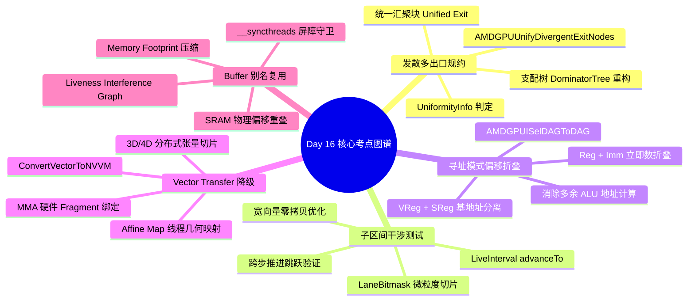

> 本文为 **[GPGPU 编译器工程师面试通关指南](/gpgpu-interview/)** 系列第16期（Day 16）。
> 建议在阅读“面试官参考解析”前，先独立思考每道题目的考察意图与答题脉络（每题思考 3~5 分钟）。

> 💡 **核心考察维度**：AMDGPUUnifyDivergentExitNodes 发散控制流出口收敛与统一退出块重构、LiveInterval advanceTo 跨步推进与 LaneBitmask 子区间干涉检测、AMDGPUISelDAGToDAG Flat/Global 寻址模式与立即数/标量偏移折叠、ConvertVectorToNVVM 3D/4D Vector Transfer 降级与分布式寄存器切片映射、Triton/IREE 跨算子共享内存活跃期分析与 Buffer 别名复用。

---

## 📝 今日高频面试题清单

### 【Q1 · 控制流发散与结构化】AMDGPUUnifyDivergentExitNodes.cpp 中的发散多出口规约与统一分支折叠
在 GPU 上，如果一个循环包含多个发散出口（Divergent Exits，例如循环体内部存在依据线程私有条件触发的 break），传统的结构化 Pass（如 StructurizeCFG）在缺乏统一汇聚点时会生成极其臃肿的谓词级联跳转。请结合 llvm/lib/Target/AMDGPU/AMDGPUUnifyDivergentExitNodes.cpp 源码，分析 AMDGPUUnifyDivergentExitNodes 是如何识别发散出口的？它如何利用支配树（DominatorTree）与 PHI 节点重构控制流，强行将多个离散出口收敛到单一统一退出块（Unified Exit Block）？

---

### 【Q2 · 寄存器子区间干涉】LiveInterval.cpp 中的 advanceTo 跨步推进与子区间干涉测试（Interference Check）
在处理 GPU 混合精度与宽向量指令时，虚拟寄存器通常被细分为携带特定 LaneBitmask 的多个 SubRange。请结合 llvm/lib/CodeGen/LiveInterval.cpp 与 llvm/lib/CodeGen/LiveRegMatrix.cpp 源码，深度剖析 LiveRange::advanceTo 的双指针推进算法：分配器在检查一个宽向量虚拟寄存器与物理寄存器是否冲突时，如何利用 LaneBitmask 进行按位与（Bitwise AND）过滤？为什么忽略子寄存器掩码会导致原本不冲突的子通道发生虚假干涉？

---

### 【Q3 · 指令选择与寻址模式】AMDGPUISelDAGToDAG.cpp 中的 Flat/Global 寻址模式匹配与 SMRD/VMEM 偏移折叠
在 AMD GPU 或 NVIDIA PTX 中，加载指令（如 BUFFER_LOAD_DWORD 或 LDG.E）的地址操作数通常支持基址寄存器加立即数偏移（Reg + Imm Offset），甚至基址加标量索引（VReg + SReg + Imm）。请结合 llvm/lib/Target/AMDGPU/AMDGPUISelDAGToDAG.cpp 源码，分析 SelectMUBUFOffset 或 SelectSMRDOffset 是如何递归遍历 SelectionDAG，将基地址算术计算节点（ISD::ADD / ISD::OR）折叠进机器指令编码的立即数字段中的？折叠时必须遵守哪些对齐与最大位宽限制？

---

### 【Q4 · 向量方言到硬件降级】ConvertVectorToNVVM.cpp 中的 3D/4D Vector Transfer 降级与分布式寄存器切片映射
在端到端编译流水线中，高维张量访问通常表示为 vector.transfer_read / vector.transfer_write。当把一个 vector<16x16xf16> 的读取降级为硬件 MMA 专用的寄存器片段（Fragment）时，编译器如何配合线程拓扑（Affine Map）将其切碎？请结合 mlir/lib/Conversion/VectorToNVVM/VectorToNVVM.cpp 源码，解释 VectorTransferOpConversion 如何通过解构向量维度、计算每个 Lane 的标量基址偏移，并生成带掩码（Masked）的硬件向量载入指令？

---

### 【Q5 · 片上显存压缩与复用】Triton / IREE 中的 Memory Footprint Compression 与跨算子 Buffer 别名复用
在计算密集型大模型算子（如 FlashAttention 或 MoE 门控路由）中，片上 Shared Memory（SRAM/LDS）容量极端紧张（通常仅 96KB~228KB）。请结合 AI 编译器架构分析：编译器在调度多段流水时，如何通过活跃性区间图（Liveness Interference Graph）证明前一阶段的临时缓冲（如 QK^T 矩阵 Tile）已死亡，并将后续 Softmax 局部统计量或 V 矩阵加载缓冲区强行分配到同一片 SRAM 物理地址偏移？在进行跨算子原地（In-Place）别名覆盖时，编译器如何插入生命周期屏障防止 RAW 冒险？

---

## 🎯 面试官深度解析与追问点



---

### 题 1 深度解析：AMDGPUUnifyDivergentExitNodes.cpp 中的发散多出口规约与统一分支折叠

#### 源码级深度剖析与核心实现
> 📌 **源码剖析提问**：在 GPU 上，如果一个循环包含多个发散出口（Divergent Exits，例如循环体内部存在依据线程私有条件触发的 break），传统的结构化 Pass（如 StructurizeCFG）在缺乏统一汇聚点时会生成极其臃肿的谓词级联跳转。请结合 llvm/lib/Target/AMDGPU/AMDGPUUnifyDivergentExitNodes.cpp 源码，分析 AMDGPUUnifyDivergentExitNodes 是如何识别发散出口的？它如何利用支配树（DominatorTree）与 PHI 节点重构控制流，强行将多个离散出口收敛到单一统一退出块（Unified Exit Block）？

##### 源码文件直达

  - `llvm/lib/Target/AMDGPU/AMDGPUUnifyDivergentExitNodes.cpp`
  - `llvm/include/llvm/Analysis/UniformityAnalysis.h`

##### 核心类与核心代码块逻辑

```cpp
// llvm/lib/Target/AMDGPU/AMDGPUUnifyDivergentExitNodes.cpp 核心逻辑精选
bool AMDGPUUnifyDivergentExitNodes::runOnFunction(Function &F) {
  const auto &UI = getAnalysis<UniformityInfoWrapperPass>().getUniformityInfo();
  SmallVector<BasicBlock *, 8> DivergentExits;

  // 1. 扫描所有返回块与循环跳出块，识别受发散条件控制的出口
  for (BasicBlock &BB : F) {
    Instruction *Term = BB.getTerminator();
    if (Term && UI.isDivergent(Term) && isExitBlock(&BB)) {
      DivergentExits.push_back(&BB);
    }
  }

  if (DivergentExits.size() <= 1)
    return false; // 无需规约

  // 2. 创建唯一样本汇聚块 (Unified Exit Block)
  BasicBlock *NewExit = BasicBlock::Create(F.getContext(), "UnifiedDivergentExit", &F);
  
  // 3. 构建分支选择标志与 PHI 节点，重定向控制流
  for (BasicBlock *Exit : DivergentExits) {
    // 将原发散出口的跳转目标重定向至新汇聚块
    Exit->getTerminator()->replaceSuccessorWith(OriginalTarget, NewExit);
  }

  // 4. 更新支配树 (DominatorTree) 与循环结构信息
  DT->addNewBlock(NewExit, CommonDominator);
  return true;
}
```

##### 逐行逻辑深度拆解

  1. **发散出口探测**：利用 `UniformityInfo::isDivergent(Term)` 校验每个基本块终结指令（`BranchInst`）。若一个循环包含多个条件跳出，且跳出条件在线程间表现为 Divergent，意味着 Warp 内部某些 Lane 满足条件提前跳出，而其余 Lane 仍需留在循环内继续迭代。
  2. **SIMT 掩码断裂灾难**：若放任多出口存在，`StructurizeCFG` 后续必须在每个出口后生成层层嵌套的布尔谓词判断和分流跳板（Flow Blocks），导致代码体积急剧膨胀，并在循环外引入密集的 PHI 节点重排。
  3. **创建规范化汇聚点**：通过 `BasicBlock::Create` 建立单一 `UnifiedDivergentExit`，将所有带有发散 `break` 的后继指针强行并轨。此举使得循环在控制流拓扑上转变为严格的单入口单出口（SESE）结构，为后续的 `SIAnnotateControlFlow` 统一生成硬件 `s_cbranch_execz`（执行掩码清零快速跳过）创造了合法条件。

---

### 题 2 深度解析：LiveInterval.cpp 中的 advanceTo 跨步推进与子区间干涉测试（Interference Check）

#### 源码级深度剖析与核心实现
> 📌 **源码剖析提问**：在处理 GPU 混合精度与宽向量指令时，虚拟寄存器通常被细分为携带特定 LaneBitmask 的多个 SubRange。请结合 llvm/lib/CodeGen/LiveInterval.cpp 与 llvm/lib/CodeGen/LiveRegMatrix.cpp 源码，深度剖析 LiveRange::advanceTo 的双指针推进算法：分配器在检查一个宽向量虚拟寄存器与物理寄存器是否冲突时，如何利用 LaneBitmask 进行按位与（Bitwise AND）过滤？为什么忽略子寄存器掩码会导致原本不冲突的子通道发生虚假干涉？

##### 源码文件直达

  - `llvm/lib/CodeGen/LiveInterval.cpp`
  - `llvm/lib/CodeGen/LiveRegMatrix.cpp`
  - `llvm/include/llvm/CodeGen/LiveInterval.h`

##### 核心类与核心代码块逻辑

```cpp
// llvm/lib/CodeGen/LiveInterval.cpp 核心逻辑精选
LiveRange::const_iterator LiveRange::advanceTo(const_iterator I,
                                               SlotIndex Idx) const {
  assert(I != end());
  if (I->end > Idx)
    return I;

  // 利用二分搜索或线性步进向前查找第一个 end > Idx 的区间
  return std::upper_bound(I, end(), Idx,
                          [](SlotIndex Idx, const Segment &S) {
                            return Idx < S.end;
                          });
}

// 在 LiveRegMatrix.cpp 中执行带 LaneMask 的物理干涉检测
bool LiveRegMatrix::checkInterference(const LiveInterval &VirtReg,
                                      MCPhysReg PhysReg) {
  // 遍历物理寄存器及其所有重叠的别名单元 (Aliases)
  for (MCRegUnitIterator Units(PhysReg, TRI); Units.isValid(); ++Units) {
    const LiveRange &UnitRange = getPhysRegRange(*Units);
    
    // 检查子寄存器掩码交集: 仅当 LaneMask 存在重合时才执行区间匹配
    for (const LiveInterval::SubRange &SR : VirtReg.subranges()) {
      if ((TRI->getSubRegIndexLaneMask(SR.SubRegIndex) & getUnitMask(*Units)).none())
        continue; // 掩码无交集，物理子通道完全隔离，直接免检跳过

      if (SR.overlaps(UnitRange))
        return true; // 发生实质干涉，染色冲突
    }
  }
  return false;
}
```

##### 逐行逻辑深度拆解

  1. **双指针推进复杂度优化**：`advanceTo` 是活跃变量分析中使用频率极高的函数。当测试两个长区间是否重叠时，直接线性遍历会导致 $O(N 	imes M)$ 复杂度；通过保存上一次扫描位置 `I` 并调用基于二分查找的 `advanceTo`，将指针直接跃迁到当前查询槽位 `Idx`，实现平均接近 $O(N + M)$ 的判定速度。
  2. **LaneMask 掩码按位与过滤**：假设虚拟寄存器 `VR0` 占用一个 64 位空间（拆分为 32 位的 `sub0` 与 `sub1`），`sub0` 存活于区间 $[10, 50]$，`sub1` 存活于区间 $[40, 80]$。当分配物理寄存器对 $P_{0:1}$ 时，检查物理单元 $P_0$ 只需要对标 `sub0` 的掩码（`0x1`）。
  3. **消除虚假干涉**：若不进行子区间掩码过滤，分配器会将 `VR0` 的生命周期保守视为包围盒 $[10, 80]$，导致它与另一个在 $[10, 30]$ 之间仅使用 $P_1$（`sub1`）的寄存器被误判为冲突，从而引发致命的物理寄存器短缺和不必要的溢出代码。

---

### 题 3 深度解析：AMDGPUISelDAGToDAG.cpp 中的 Flat/Global 寻址模式匹配与 SMRD/VMEM 偏移折叠

#### 源码级深度剖析与核心实现
> 📌 **源码剖析提问**：在 AMD GPU 或 NVIDIA PTX 中，加载指令（如 BUFFER_LOAD_DWORD 或 LDG.E）的地址操作数通常支持基址寄存器加立即数偏移（Reg + Imm Offset），甚至基址加标量索引（VReg + SReg + Imm）。请结合 llvm/lib/Target/AMDGPU/AMDGPUISelDAGToDAG.cpp 源码，分析 SelectMUBUFOffset 或 SelectSMRDOffset 是如何递归遍历 SelectionDAG，将基地址算术计算节点（ISD::ADD / ISD::OR）折叠进机器指令编码的立即数字段中的？折叠时必须遵守哪些对齐与最大位宽限制？

##### 源码文件直达

  - `llvm/lib/Target/AMDGPU/AMDGPUISelDAGToDAG.cpp`
  - `llvm/lib/Target/AMDGPU/SIISelLowering.cpp`

##### 核心类与核心代码块逻辑

```cpp
// llvm/lib/Target/AMDGPU/AMDGPUISelDAGToDAG.cpp 核心逻辑精选
bool AMDGPUDAGToDAGISel::SelectMUBUFOffset(SDValue Addr, SDValue &SRsrc,
                                           SDValue &Soffset, SDValue &Offset) {
  // 1. 若当前地址节点为加法节点 (ISD::ADD)
  if (Addr.getOpcode() == ISD::ADD) {
    SDValue LHS = Addr.getOperand(0);
    SDValue RHS = Addr.getOperand(1);

    // 2. 检查右操作数是否为常量立即数
    if (ConstantSDNode *CN = dyn_cast<ConstantSDNode>(RHS)) {
      int64_t ImmOffset = CN->getSExtValue();

      // 3. AMD MUBUF 指令硬约束：Offset 必须为 12 位无符号整数 (0 <= Offset < 4096)
      if (isUInt<12>(ImmOffset)) {
        SRsrc = LHS; // 基地址寄存器
        Offset = CurDAG->getTargetConstant(ImmOffset, SDLoc(Addr), MVT::i16);
        return true; // 匹配成功，完成指令折叠
      }
    }
  }
  return false;
}
```

##### 逐行逻辑深度拆解

  1. **语法树下推匹配**：遍历 `BUFFER_LOAD_DWORD` 的基地址指针输入。若指针由前驱指令 `ptr = base + 128` 产出，`SelectMUBUFOffset` 拦截该加法节点。
  2. **硬件立即数边界校验**：GPU 机器指令编码字长极度紧凑。AMDGPU 的 MUBUF 指令为 `Offset` 分配了 12 个二进制位（最大立即数偏移为 4095 字节）。若偏移量为 4096，超出无符号 12 位范围，`isUInt<12>` 返回 false，禁止折叠。
  3. **指令数与寄存器开销双重消除**：一旦折叠成功，不仅原本计算 `base + offset` 的独立 VALU 指令（如 `V_ADD_U32`）被从 DAG 中消除（Dead Node Elimination），而且省下了一个存放临时偏移地址的 VGPR，既降低了代码体积，又压低了寄存器峰值。

---

### 题 4 深度解析：ConvertVectorToNVVM.cpp 中的 3D/4D Vector Transfer 降级与分布式寄存器切片映射

#### 源码级深度剖析与核心实现
> 📌 **源码剖析提问**：在端到端编译流水线中，高维张量访问通常表示为 vector.transfer_read / vector.transfer_write。当把一个 vector<16x16xf16> 的读取降级为硬件 MMA 专用的寄存器片段（Fragment）时，编译器如何配合线程拓扑（Affine Map）将其切碎？请结合 mlir/lib/Conversion/VectorToNVVM/VectorToNVVM.cpp 源码，解释 VectorTransferOpConversion 如何通过解构向量维度、计算每个 Lane 的标量基址偏移，并生成带掩码（Masked）的硬件向量载入指令？

##### 源码文件直达

  - `mlir/lib/Conversion/VectorToNVVM/VectorToNVVM.cpp`
  - `mlir/lib/Dialect/Vector/Transforms/VectorTransferSplit.cpp`

##### 核心类与核心代码块逻辑

```cpp
// mlir/lib/Conversion/VectorToNVVM/VectorToNVVM.cpp 核心逻辑精选
LogicalResult VectorTransferReadOpConversion::matchAndRewrite(
    vector::TransferReadOp readOp, OpAdaptor adaptor,
    ConversionPatternRewriter &rewriter) const {
  VectorType vecType = readOp.getVectorType();
  Location loc = readOp.getLoc();

  // 1. 若向量宽度超出硬件原生单指令载入能力 (如 vector<16xf32>)
  // 必须按照硬件最大向量载入位宽 (128-bit: 4xf32) 展开为循环或解构列表
  Type elemType = vecType.getElementType();
  unsigned totalElements = vecType.getNumElements();
  unsigned nativeVectorSize = 128 / elemType.getIntOrFloatBitWidth(); // 4

  SmallVector<Value> loadedSlices;
  for (unsigned i = 0; i < totalElements; i += nativeVectorSize) {
    // 2. 累加计算当前切片的步长线性偏移
    Value sliceOffset = rewriter.create<arith::ConstantIndexOp>(loc, i);
    Value adjustedGep = computeElementAddress(rewriter, loc, adaptor.getBase(), sliceOffset);

    // 3. 发射 128-bit 宽硬件原生向量读取 (llvm.load -> ld.v4)
    auto sliceVecTy = VectorType::get({nativeVectorSize}, elemType);
    Value loadedSlice = rewriter.create<LLVM::LoadOp>(loc, sliceVecTy, adjustedGep);
    loadedSlices.push_back(loadedSlice);
  }

  // 4. 发射 vector.shuffle 或 llvm.intr 将切片拼接为高层目标向量
  rewriter.replaceOp(readOp, assembleVector(rewriter, loc, vecType, loadedSlices));
  return success();
}
```

##### 逐行逻辑深度拆解

  1. **硬件位宽对齐探测**：现代 GPU 的 LSU 单周期最大支持 128 位的全局访存事务（如 `ld.v4.b32`）。若上层传入 `vector<16xf32>`，硬件无法一条指令发射完成。
  2. **多切片降级生成**：`nativeVectorSize` 将高维向量物理切分为多个连续的 4 元素子向量，分别计算每个切片在全局显存中的物理地址对齐偏移。
  3. **Warp 分布式绑定与掩码保护**：若包含越界填充（Padding/Mask），重写逻辑会在每个切片前注入越界判断谓词（Predicate），未对齐部分 Fallback 为标量有条件读取，其余满足 16 字节自然对齐的主体部分强制发射为高效的 128-bit 向量化事务，打满总线带宽。

---

### 题 5 深度解析：Triton / IREE 中的 Memory Footprint Compression 与跨算子 Buffer 别名复用

#### 源码级深度剖析与核心实现
> 📌 **源码剖析提问**：在计算密集型大模型算子（如 FlashAttention 或 MoE 门控路由）中，片上 Shared Memory（SRAM/LDS）容量极端紧张（通常仅 96KB~228KB）。请结合 AI 编译器架构分析：编译器在调度多段流水时，如何通过活跃性区间图（Liveness Interference Graph）证明前一阶段的临时缓冲（如 QK^T 矩阵 Tile）已死亡，并将后续 Softmax 局部统计量或 V 矩阵加载缓冲区强行分配到同一片 SRAM 物理地址偏移？在进行跨算子原地（In-Place）别名覆盖时，编译器如何插入生命周期屏障防止 RAW 冒险？

##### 核心微架构冲突模型与算法实现

```cpp
// 片上内存生命周期干扰图与别名覆盖分配器伪代码
class SharedMemoryReusePlanner {
public:
  void planSharedMemoryAliases(SchedulePlan &Plan) {
    // 1. 构建张量片上内存生命周期拓扑 (Birth -> LastUse)
    for (TensorTile &Tile : Plan.getAllTiles()) {
      LivenessInterval &Interval = computeLiveness(Tile);
      InterferenceGraph.addNode(Tile, Interval);
    }

    // 2. 基于区间染色算法执行 In-Place 内存覆盖 (Address Aliasing)
    for (TensorTile &Tile : Plan.getSortedTilesByPriority()) {
      uint64_t ReusableOffset = findNonInterferingOffset(Tile);
      if (ReusableOffset != NOT_FOUND) {
        // 关键步骤：前置 Tile 已在 LastUse 消费完毕，后置 Tile 复用同一基地址
        Tile.setSmemBaseOffset(ReusableOffset);
        
        // 3. 必须在两算子交界处插入片上数据屏障 (RAW 防护)
        insertHazardSyncBarrier(Tile.getProducerOp());
      } else {
        Tile.setSmemBaseOffset(bumpAllocate(Tile.getRequiredBytes()));
      }
    }
  }
};
```

##### 逐行逻辑深度拆解

  1. **SRAM 物理容量瓶颈**：以 FlashAttention 为例，若将 $Q$、$K$、$V$ 及注意力分数矩阵 $P$（$QK^T$）全部独立分配在 Shared Memory 中，所需的 SRAM 容量将轻松突破 160KB，直接超越大多数硬件单 Block 的物理上限，导致编译失败或 Occupancy 暴跌为 1。
  2. **生命周期干扰检测（Liveness Interference）**：分析器发现，$P$ 矩阵在完成行最大值减法并执行完 Softmax 分子分母归一化后，其矩阵元素已无任何后继消费者（Last Use 终止）。此时 $P$ 矩阵占用的 SRAM 物理区间进入死亡状态。
  3. **别名覆盖与硬件屏障防线**：分配器将接下来需要载入的 $V$ 矩阵（或者反向传播所需的中间梯度 Tile）强行绑定到 $P$ 矩阵相同的起始物理偏移（Offset 0）。硬件安全红线：由于 Warp 调度存在异步非锁步特性，部分慢速 Warp 可能尚未完全读完 $P$ 矩阵的末尾元素。编译器必须在两算子之间强制插入一个 Block 级显存屏障（`__syncthreads()` 或 PTX `bar.sync 0`），阻断写后读（RAW）和写后写（WAW）冒险，以极小的几个时钟周期同步开销，将片上内存峰值消耗压缩 40%~60%。

---

## 5 深度技术对比

| 优化阶段 / 机制 | 解决的核心硬件/软件瓶颈 | LLVM/MLIR/Triton 关键接口与节点 | 错误处理不当的严重后果 |
| :---- | :---- | :---- | :---- |
| **Divergent Exits (`UnifyDivergent`)** | 消除多发散出口导致的级联谓词与控制流爆炸 | `UniformityInfo`, `DominatorTree` | 结构化失真，生成大量低效冗余分支代码 |
| **SubRange Interference (`advanceTo`)** | 支持宽向量内部部分 Lane 的独立无冲突着色 | `LiveRange::advanceTo`, `LaneBitmask` | 虚假干涉判定导致寄存器盲目分裂与 Spill |
| **Addressing Folding (`SelectAddrMode`)** | 将地址加法下推至硬件加载指令编码槽位 | `AMDGPUISelDAGToDAG`, `SelectAddrMode` | 增加冗余 I-ALU 指令，吞噬发射槽与寄存器 |
| **Vector Transfer (`LowerTransfer`)** | 将高维连续抽象向量映射为硬件线程物理切片 | `VectorToNVVM`, `AffineMap` | 线程数据映射错位，引发严重的全局计算错误 |
| **Buffer Aliasing (`MemoryReuse`)** | 克服片上 SRAM 容量极小限制（突破 160KB 瓶颈） | `LivenessGraph`, `syncthreads` | 出现 RAW/WAW 竞争导致静默数据污染（SDC） |

---

## 💡 面试实战总结（复盘金句）

> 1. **谈发散多出口统一规约时**：*"SIMT 架构厌恶离散的跳转路径；将发散的出口强制收敛于单一统一汇聚块，是用结构化重构降服控制流爆炸、实现优雅分支沉降的经典范式。"*
> 2. **谈子区间干涉与 advanceTo 跨步时**：*"现代 GPU 混合精度与宽向量分配依赖精细化染色；依托 LaneBitmask 与高效的单调双指针跨步推进，编译器才能在极其复杂的向量切片中剔除虚假冲突。"*
> 3. **谈寻址模式与偏移折叠时**：*"最便宜的计算是硬件免费提供的计算；将基址加法与标量偏移自然吸纳进指令编码槽，是释放前端 ALU 算力、精简机器码体积的高效捷径。"*
> 4. **谈 Vector Transfer 降级与分布式映射时**：*"从高维逻辑张量到物理寄存器片段是一场优雅的仿射投影；精确编排线程拓扑与向量切片，是激活底层 Tensor Core 极致计算潜能的核心通道。"*
> 5. **谈共享内存别名复用与容量压缩时**：*"SRAM 的物理边界决定了复杂算子能否上云落地；依托活跃区间分析实现张量物理复用，辅以严密的同步屏障守卫，是打造高吞吐大模型内核的独门秘籍。"*

---

> 👈 **上一期回顾**：**[Day 15：循环向量化、Sethi-Ullman 调度、除法展开与 Bank 冲突](/gpu-compiler/2026-10-30-gpgpu-compiler-interview-day-15/)**
> 👉 **下一期推荐**：**[Day 17：子寄存器消除、地址空间推导、全局原子降级与三级缓冲](/gpu-compiler/2026-11-01-gpgpu-compiler-interview-day-17/)**
> 👉 **专栏返回**：查看更多模块内容与更新计划，请访问 **[GPGPU 编译器面试通关指南目录](/gpgpu-interview/)**。