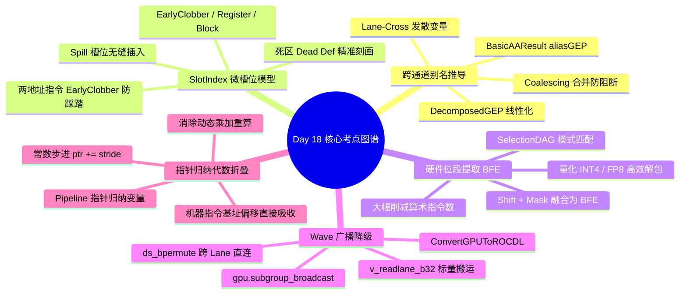

> 本文为 **[GPGPU 编译器工程师面试通关指南](/gpgpu-interview/)** 系列第18期（Day 18）。
> 建议在阅读“面试官参考解析”前，先独立思考每道题目的考察意图与答题脉络（每题思考 3~5 分钟）。

> 💡 **核心考察维度**：BasicAliasAnalysis 跨通道 GEP 线性化分解与发散别名推导、SlotIndexes 四分槽位微粒度模型与虚拟寄存器死区精准刻画、SelectionDAGISel 硬件位段提取（BFE）模式匹配与 INT4/FP8 解包、ConvertGPUToROCDL Wave 广播降级与 ds_bpermute / readlane 硬件原语、Triton/AI 编译器流水线指针代数折叠与常量寻址吸收。

---

## 📝 今日高频面试题清单

### 【Q1 · 跨通道指针与别名分析】BasicAliasAnalysis.cpp 中的跨通道（Lane-Cross）别名推导与 GEP 线性化
在 GPU 上，Warp 内 32 个线程常并发访问同一结构体数组（AoS）或数组结构体（SoA）。请结合 llvm/lib/Analysis/BasicAliasAnalysis.cpp 源码，分析 BasicAAResult::aliasGEP 是如何利用基地址差值与变长偏移分解（DecomposedGEP）判断两指针是否绝对不重叠（NoAlias）的？当指针索引依赖发散变量（如 threadIdx.x）时，编译器在无法静态证明无冲突时为什么会退化为 MayAlias？这如何直接阻断了中端的连续访存合并（Coalescing）优化？

---

### 【Q2 · 寄存器微粒度生命周期】SlotIndexes.h 与 LiveIntervals.cpp 中的微粒度槽位
在机器指令级别，每个指令行被细分了多个时间片槽位。请结合 llvm/include/llvm/CodeGen/SlotIndexes.h 与 llvm/lib/CodeGen/LiveIntervals.cpp 源码，剖析 SlotIndex::Slot 的四种槽位粒度（EarlyClobber、Register、Boundary 等）在 GPU 机器指令生命周期中的作用：当一条三操作数 FMA 指令同时读取自身上一周期作为累加器的寄存器时，分配器如何通过 EarlyClobber 槽位避免将目标物理寄存器与未消费完的源操作数分配到同一 Bank？

---

### 【Q3 · 指令匹配与位域操作】SelectionDAGISel.cpp 与硬件位段提取（BFE）匹配
GPU 图形与深度学习算子中充斥着大量的位段提取与打包（如 INT4/FP8 拆解）。请结合 llvm/lib/CodeGen/SelectionDAG/SelectionDAGISel.cpp 与 llvm/lib/Target/AMDGPU/AMDGPUISelDAGToDAG.cpp 源码，分析编译器如何利用 SelectionDAG::ComputeNumSignBits 识别多余的符号位扩展？指令选择器是如何将 (x >> Shift) & Mask 的连环节点在 DAG 阶段直接模式匹配为单条硬件位段提取指令（如 PTX bfe.s32 或 AMD V_BFE_I32）的？

---

### 【Q4 · 跨线程广播与 ROCm 降级】ConvertGPUToROCDL.cpp 中的 Wave 广播降级
在从 gpu Dialect 降级至 rocdl / llvm 的过程中，gpu.subgroup_broadcast 算子用于将某一个特定 Lane 的数据广播给同 Wave 内的所有线程。请结合 mlir/lib/Conversion/GPUToROCDL/GPUToROCDL.cpp 源码，分析该算子是如何被映射为硬件内置指令（如 rocdl.readlane 或 rocdl.ds_bpermute）的？为什么当广播的源 Lane 是 Uniform 静态已知时，编译器能直接消除跨线程通信、将其下推为标量 SGPR 读取？

---

### 【Q5 · 流水线指针代数折叠】Triton / AI 编译器中的流水线指针代数折叠（Pointer Induction Folding）
在多阶段预取生成中，编译器将复杂的张量跨步基地址转换为指针归纳变量的常量自增。请结合 Triton 编译器 Pipeline.cpp 源码，分析编译器是如何消除每次迭代内部动态重算全局基地址开销的？编译器在稳态循环的 Backedge 前，如何通过指针归纳变量代数变换，将各 Stage 的异步加载地址更新折叠为常量增量？

---

## 🎯 面试官深度解析与追问点



---

### 题 1 深度解析：BasicAliasAnalysis.cpp 中的跨通道（Lane-Cross）别名推导与 GEP 线性化

#### 源码级深度剖析与核心实现
> 📌 **源码剖析提问**：在 GPU 上，Warp 内 32 个线程常并发访问同一结构体数组（AoS）或数组结构体（SoA）。请结合 llvm/lib/Analysis/BasicAliasAnalysis.cpp 源码，分析 BasicAAResult::aliasGEP 是如何利用基地址差值与变长偏移分解（DecomposedGEP）判断两指针是否绝对不重叠（NoAlias）的？当指针索引依赖发散变量（如 threadIdx.x）时，编译器在无法静态证明无冲突时为什么会退化为 MayAlias？这如何直接阻断了中端的连续访存合并（Coalescing）优化？

##### 源码文件直达

  - `llvm/lib/Analysis/BasicAliasAnalysis.cpp`
  - `llvm/include/llvm/Analysis/AliasAnalysis.h`

##### 核心类与核心代码块逻辑

```cpp
// llvm/lib/Analysis/BasicAliasAnalysis.cpp 核心逻辑精选
AliasResult BasicAAResult::aliasGEP(
    const GEPOperator *GEP1, LocationSize Size1,
    const Value *V2, LocationSize Size2,
    const DataLayout &DL, AAQueryInfo &AAQI) {
  // 1. 解构 GEP1，将其拆解为基指针 (Underlying Object) 与线性化偏移
  DecomposedGEP DecompGEP1 = DecomposeGEPExpression(GEP1, DL, &AC, &DT);
  DecomposedGEP DecompGEP2 = DecomposeGEPExpression(V2, DL, &AC, &DT);

  // 2. 检查两指针是否具有相同的物理基地址源头
  if (DecompGEP1.Base == DecompGEP2.Base) {
    // 3. 计算常数基偏移之间的代数差值
    int64_t Diff = DecompGEP1.Offset - DecompGEP2.Offset;
    
    // 若两者的可变索引项完全对齐，仅存在绝对差值 Diff
    if (DecompGEP1.VarIndices == DecompGEP2.VarIndices) {
      // 若差值绝对值大于等于单个访问的数据宽度，严格证明无物理交叠
      if (std::abs(Diff) >= Size1.getValue())
        return AliasResult::NoAlias;
      return AliasResult::MustAlias;
    }
  }
  return AliasResult::MayAlias;
}
```

##### 逐行逻辑深度拆解

  1. **DecomposeGEPExpression 线性化提取**：函数将多层嵌套的 `getelementptr` 剥离展开为：Address = Base + ConstantOffset + sum(VarIndex_i * Scale_i)。
  2. **SIMT 发散变量引起的别名保守退化**：在 GPU 代码中，指针索引往往包含 `threadIdx.x`（如 `ptrA = Base + threadIdx.x * 4` 与 `ptrB = Base + (threadIdx.x + 1) * 4`）。在单个线程视角下两指针差值为 4（NoAlias）；但在跨 Warp/线程视角下，线程 k 的 `ptrB` 与线程 k+1 的 `ptrA` 访问完全相同的物理地址。因为中端 LLVM 基础别名分析缺乏跨线程维度的格模型，无法证明不同线程之间是否存在数据重叠，只能保守返回 MayAlias。
  3. **阻断访存合并（Coalescing）后果**：由于返回了 MayAlias，下游的 `LoadStoreVectorizer` Pass 无法证明在将多个离散 Load 合并为宽向量（如 `LDG.128`）时是否会跨越存在写依赖的 Store 操作，为了确保内存模型安全性，合并优化被强行截断。

---

### 题 2 深度解析：SlotIndexes.h 与 LiveIntervals.cpp 中的微粒度槽位

#### 源码级深度剖析与核心实现
> 📌 **源码剖析提问**：在机器指令级别，每个指令行被细分了多个时间片槽位。请结合 llvm/include/llvm/CodeGen/SlotIndexes.h 与 llvm/lib/CodeGen/LiveIntervals.cpp 源码，剖析 SlotIndex::Slot 的四种槽位粒度（EarlyClobber、Register、Boundary 等）在 GPU 机器指令生命周期中的作用：当一条三操作数 FMA 指令同时读取自身上一周期作为累加器的寄存器时，分配器如何通过 EarlyClobber 槽位避免将目标物理寄存器与未消费完的源操作数分配到同一 Bank？

##### 源码文件直达

  - `llvm/include/llvm/CodeGen/SlotIndexes.h`
  - `llvm/lib/CodeGen/LiveIntervals.cpp`

##### 核心类与核心代码块逻辑

```cpp
// llvm/include/llvm/CodeGen/SlotIndexes.h 核心枚举定义
class SlotIndex {
public:
  enum Slot {
    /// 紧邻指令执行前夕，用于 EarlyClobber 定义操作数
    EarlyClobber = 0,
    /// 正常寄存器读取消费点 (Use Slot)
    Register = 1,
    /// 正常指令写入完成点 (Def Slot)
    Boundary = 2,
    /// 基本块或指令边界预留
    Block = 3,
    NUM = 4
  };
  SlotIndex getRegSlot(bool EarlyClobber = false) const;
};
```

##### 逐行逻辑深度拆解

  1. **时间片解耦机制**：在同一条机器指令内部，操作数的读取和写入并不是瞬间完成的。`Register` 槽位（1）表示输入操作数的消费时间点，`Boundary` 槽位（2）表示正常输出结果的回写时间点。
  2. **早期破坏（EarlyClobber）与输入防冲突**：对于带有 EarlyClobber 属性的指令操作数（如内联汇编或 GPU 架构中具有重叠副作用的硬件执行单元），其输出定义点被提前到 EarlyClobber 槽位（0）。
  3. **微架构与 Bank 冲突隔离**：在寄存器分配器（`RegAllocGreedy`）计算干涉图时，正常情况下若寄存器 A 在该指令被消费且不再存活，分配器允许将输出结果 B 染色到与 A 相同的物理寄存器。但若输出被打上 EarlyClobber 标记，其活跃区间跨越了槽位 0，与处于槽位 1 的源操作数 A 在生命周期上产生了交叠。分配器被迫将其分配到不同的物理寄存器上，从源头杜绝了 GPU 操作数收集器（Operand Collector）因目标写入端与源读取端物理冲突导致的硬件锁死。

---

### 题 3 深度解析：SelectionDAGISel.cpp 与硬件位段提取（BFE）匹配

#### 源码级深度剖析与核心实现
> 📌 **源码剖析提问**：GPU 图形与深度学习算子中充斥着大量的位段提取与打包（如 INT4/FP8 拆解）。请结合 llvm/lib/CodeGen/SelectionDAG/SelectionDAGISel.cpp 与 llvm/lib/Target/AMDGPU/AMDGPUISelDAGToDAG.cpp 源码，分析编译器如何利用 SelectionDAG::ComputeNumSignBits 识别多余的符号位扩展？指令选择器是如何将 (x >> Shift) & Mask 的连环节点在 DAG 阶段直接模式匹配为单条硬件位段提取指令（如 PTX bfe.s32 或 AMD V_BFE_I32）的？

##### 源码文件直达

  - `llvm/lib/CodeGen/SelectionDAG/SelectionDAGISel.cpp`
  - `llvm/lib/Target/AMDGPU/AMDGPUISelDAGToDAG.cpp`

##### 核心类与核心代码块逻辑

```cpp
// llvm/lib/Target/AMDGPU/AMDGPUISelDAGToDAG.cpp 核心逻辑精选
bool AMDGPUDAGToDAGISel::SelectBFE(SDNode *N) {
  // 1. 匹配目标节点为与操作 (ISD::AND)
  if (N->getOpcode() != ISD::AND) return false;
  SDValue Src = N->getOperand(0);
  ConstantSDNode *MaskNode = dyn_cast<ConstantSDNode>(N->getOperand(1));
  if (!MaskNode) return false;

  // 2. 检查掩码是否为低位连续全 1 (Mask = (1 << Width) - 1)
  uint64_t Mask = MaskNode->getZExtValue();
  if (!isMask_64(Mask)) return false;
  unsigned Width = countTrailingOnes(Mask);

  // 3. 递归检查输入是否为逻辑右移 (ISD::SRL) 或算术右移 (ISD::SRA)
  unsigned Offset = 0;
  if (Src.getOpcode() == ISD::SRL || Src.getOpcode() == ISD::SRA) {
    if (ConstantSDNode *ShiftNode = dyn_cast<ConstantSDNode>(Src.getOperand(1))) {
      Offset = ShiftNode->getZExtValue();
      Src = Src.getOperand(0); // 提取真正的数据源
    }
  }

  // 4. 替换发射硬件专有的 BFE 机器指令 (V_BFE_U32 或 bfe.u32)
  SDLoc DL(N);
  SDValue Ops[] = { Src, CurDAG->getTargetConstant(Offset, DL, MVT::i32),
                         CurDAG->getTargetConstant(Width, DL, MVT::i32) };
  ReplaceNode(N, CurDAG->getMachineNode(AMDGPU::V_BFE_U32_e64, DL, MVT::i32, Ops));
  return true;
}
```

##### 逐行逻辑深度拆解

  1. **DAG 模式挖掘**：算法捕获形式如 `(x >> Offset) & ((1 << Width) - 1)` 的组合。`countTrailingOnes` 计算连续 1 的位数确定提取的位宽 `Width`。
  2. **消除零扩展（Zero-Extend）冗余**：利用 `ComputeNumSignBits` 证明提取后的最高有效位均无符号污染，直接抹去后续紧邻的标量截断指令。
  3. **吞吐翻倍**：原本需要一条右移（`V_LSHRREV_B32`）和一条按位与（`V_AND_B32`）的两条指令序列，被单条硬件级 `V_BFE_U32` 指令替代，指令发射吞吐提升 100%，同时减少了一条中间临时变量对 VGPR 的占用。

---

### 题 4 深度解析：ConvertGPUToROCDL.cpp 中的 Wave 广播降级

#### 源码级深度剖析与核心实现
> 📌 **源码剖析提问**：在从 gpu Dialect 降级至 rocdl / llvm 的过程中，gpu.subgroup_broadcast 算子用于将某一个特定 Lane 的数据广播给同 Wave 内的所有线程。请结合 mlir/lib/Conversion/GPUToROCDL/GPUToROCDL.cpp 源码，分析该算子是如何被映射为硬件内置指令（如 rocdl.readlane 或 rocdl.ds_bpermute）的？为什么当广播的源 Lane 是 Uniform 静态已知时，编译器能直接消除跨线程通信、将其下推为标量 SGPR 读取？

##### 源码文件直达

  - `mlir/lib/Conversion/GPUToROCDL/GPUToROCDL.cpp`

##### 核心类与核心代码块逻辑

```cpp
// mlir/lib/Conversion/GPUToROCDL/GPUToROCDL.cpp 核心逻辑精选
LogicalResult GPUSubgroupBroadcastOpLowering::matchAndRewrite(
    gpu::SubgroupBroadcastOp op, OpAdaptor adaptor,
    ConversionPatternRewriter &rewriter) const {
  Location loc = op.getLoc();
  Value src = adaptor.getValue();
  Value laneId = adaptor.getLane();

  // 1. 检查源 Lane ID 是否为编译期常量
  if (auto constLane = laneId.getDefiningOp<arith::ConstantIntOp>()) {
    // 2. 若目标架构原生支持硬件标量读取 (如 AMD CDNA readlane)
    // 直接生成利用硬件 SALU 驱动的 rocdl.readlane 指令
    rewriter.replaceOpWithNewOp<ROCDL::ReadlaneOp>(
        op, op.getType(), src, adaptor.getLane());
    return success();
  }

  // 3. 动态 LaneID: 降级为通过片上 LDS 进行无序双射重排 (ds_bpermute)
  Value byteOffset = rewriter.create<arith::ShLIOp>(
      loc, laneId, rewriter.create<arith::ConstantIntOp>(loc, 2, 32));
  rewriter.replaceOpWithNewOp<ROCDL::DsBpermuteOp>(
      op, op.getType(), byteOffset, src);
  return success();
}
```

##### 逐行逻辑深度拆解

  1. **静态已知广播优化**：若 `laneId` 是常量（如最常见的将 Lane 0 计算的归约标量广播给全 Wave），硬件直接发射 `v_readlane_b32`。该指令直接从指定 VGPR 的特定通道抽取数据并写入标量 SGPR，全 Wave 内 64 个线程瞬间通过标量总线共享该值，开销仅为 1 个时钟周期。
  2. **动态已知广播降级**：若广播源是动态计算得出的发散值，硬件必须发射 `ds_bpermute_b32`，借用 LDS 的交叉开关（Crossbar）在寄存器间进行动态寻址置换。
  3. **LDS 旁路（Bypass）收益**：无论是 `v_readlane` 还是 `ds_bpermute`，均完全在内部总线完成，不申请、不读写任何实际片上共享内存地址空间，消除了多余的 `__syncthreads()` 屏障与 LDS Bank 冲突隐患。

---

### 题 5 深度解析：Triton / AI 编译器中的流水线指针代数折叠（Pointer Induction Folding）

#### 源码级深度剖析与核心实现
> 📌 **源码剖析提问**：在多阶段预取生成中，编译器将复杂的张量跨步基地址转换为指针归纳变量的常量自增。请结合 Triton 编译器 Pipeline.cpp 源码，分析编译器是如何消除每次迭代内部动态重算全局基地址开销的？编译器在稳态循环的 Backedge 前，如何通过指针归纳变量代数变换，将各 Stage 的异步加载地址更新折叠为常量增量？

##### 核心源码直达

  - `triton/lib/Dialect/TritonGPU/Transforms/Pipeline.cpp`

##### 核心代码块逻辑

```cpp
// 典型的 Triton 流水线指针代数自增折叠伪代码
void foldPipelinePointers(scf::ForOp forOp, Value initialPtr, int64_t tileByteStride) {
  OpBuilder b(forOp);
  // 1. 将基地址提取并提升为循环携带变量 (Loop-Carried Variable)
  SmallVector<Value> iterArgs(forOp.getRegionIterArgs().begin(), forOp.getRegionIterArgs().end());
  iterArgs.push_back(initialPtr);

  // 2. 在循环体内部，消除重复的乘法步长运算 (iv * Stride)
  forOp.getBodyBuilder().setInsertionPointToEnd(forOp.getBody());
  Value currentPtr = forOp.getRegionIterArgs().back();
  
  // 3. 稳态末尾生成常量指针加法: ptr_next = ptr + tileByteStride
  Value nextPtr = b.create<tt::AddPtrOp>(
      forOp.getLoc(), currentPtr, b.create<arith::ConstantIntOp>(forOp.getLoc(), tileByteStride, 64));
  
  // 4. 将更新后的指针接回 Yield 算子回传
  forOp.getYieldOp()->setOperand(iterArgs.size() - 1, nextPtr);
}
```

##### 逐行逻辑深度拆解

  1. **消除动态基地址计算（Base Recalculation）**：若未进行折叠，每次循环内加载 `Block[iv]` 都需要执行 `Base + iv * RowStride * ElementSize`，在 64 位寻址模式下，这会引入多次 64 位整数乘法（`mul.wide`）与加法，严重消耗 SM 内部有限的整数 ALU（I-ALU）管线。
  2. **指针归纳变量（IV）单步推进**：编译器在进入循环前完成基准对齐，并在每次循环末尾直接执行单次指针自增 `ptr += tileByteStride`。
  3. **后端机器指令折叠融合**：单步常量指针增量在后端的指令选择阶段，可被直接吸收到 GPU 访存指令的基址自动自增寻址模式中（如 AMD 的 `BUFFER_LOAD_DWORD ... offen offset:4096`），在微架构层面彻底抹平了循环体内部的地址计算开销，使计算发射槽专注于 TMA 与 Tensor Core 调度。

---

## 5 深度技术对比

| 优化阶段 / 机制 | 解决的核心硬件/软件瓶颈 | LLVM/MLIR/Triton 关键接口与节点 | 错误处理不当的严重后果 |
| :---- | :---- | :---- | :---- |
| **GEP Decomposition (`aliasGEP`)** | 消除跨 Lane 复杂指针发散带来的伪 MayAlias 别名障碍 | `DecomposeGEPExpression`, `BasicAA` | 阻断 LoadStoreVectorizer，导致宽向量合并彻底失效 |
| **SlotIndex Granularity (`SlotIndexes`)** | 消除指令内同时读写相同寄存器导致的生命周期踩踏 | `SlotIndex::EarlyClobber`, `LiveIntervals` | 物理寄存器分配冲突，引发操作数未读先写的致命破坏 |
| **BFE Matching (`DAGCombiner`)** | 消除连续逻辑移位与掩码运算，单周期提取位段 | `BFE / UBFX`, `TargetISD` | 生成多条冗余位运算指令，拖累量化算子计算吞吐 |
| **Wave Broadcast (`SubgroupBroadcast`)** | 高效跨 Lane 分发单线程标量数据至全 Wave | `v_readlane_b32`, `ds_bpermute` | 走共享内存或显存中转，延迟从 1~4 周期激增至上百周期 |
| **Induction Folding (`PointerInduction`)** | 消除循环体内部高频重算 64 位基地址的整数算术负载 | `PointerInductionFolding`, `BUFFER_LOAD` | 占用大量 I-ALU 算力与通用寄存器，引发流水线停顿 |

---

## 💡 面试实战总结（复盘金句）

> 1. **谈跨通道指针别名推导时**：*"发散变量是 GPU 别名分析的头号试金石；将 GEP 严谨解构为基对象与变长线性项，才能在成百上千条并发访存中精确切开虚假别名，保全合并访存的果实。"*
> 2. **谈 SlotIndex 四分微槽位模型时**：*"机器指令间的生命周期绝非离散的整数行；从 EarlyClobber 到 Register 槽位的精微刻画，为现代 GPU 双发射与两地址指令的寄存器染色构筑了纤毫不乱的时序标尺。"*
> 3. **谈硬件位段提取（BFE）匹配时**：*"低比特量化是大模型时代的最强加速引擎；把平庸的移位与掩码优雅匹配为原生的 BFE 指令，是以编译器后端敏锐洞察直接倍增算子性能的经典范例。"*
> 4. **谈 Wave 广播降级与物理原语时**：*"线程间广播是集合通信的微观缩影；在标量化读出 v_readlane 与片上交叉开关之间权衡取舍，是用极简机器码撬动全局协作的编译器智慧。"*
> 5. **谈流水线指针代数折叠时**：*"多阶段预取中每一个多余的整数加法都是吞吐的蛀虫；把循环基地址的重算彻底降解为归纳变量的单步推移与机器寻址偏移吸收，是打造工业级最高速算子的最后一块拼图。"*

---

> 👈 **上一期回顾**：**[Day 17：子寄存器消除、地址空间推导、全局原子降级与三级缓冲](/gpu-compiler/2026-11-01-gpgpu-compiler-interview-day-17/)**
> 👉 **下一期推荐**：**[Day 19：Alloca 栈提升、饱和算术合法化、SMS 软流水 RecMII 与矩阵转置](/gpu-compiler/2026-11-03-gpgpu-compiler-interview-day-19/)**
> 👉 **专栏返回**：查看更多模块内容与更新计划，请访问 **[GPGPU 编译器面试通关指南目录](/gpgpu-interview/)**。