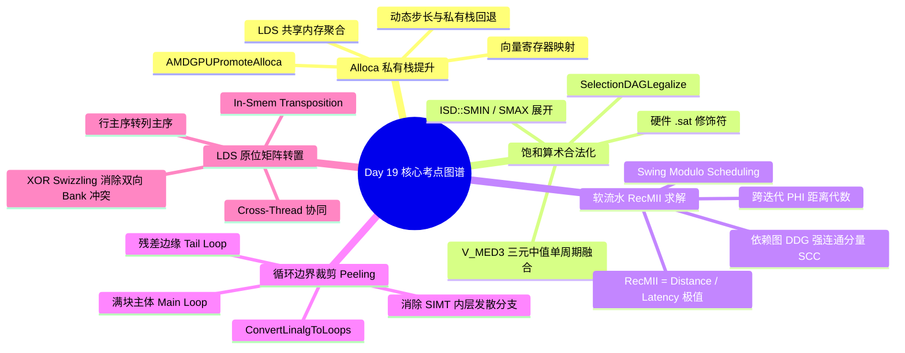

> 本文为 [**GPGPU 编译器工程师面试通关指南**](/gpgpu-interview/) 系列第19期（Day 19）。
> 建议在阅读“面试官参考解析”前，先独立思考每道题目的考察意图与答题脉络（每题思考 3~5 分钟）。

> 💡 **核心考察维度**：AMDGPUPromoteAlloca 私有栈提升至 LDS/向量与动态回退、SelectionDAGLegalize 饱和算术合法化与硬件 Clamp/MED3 单周期融合、MachinePipeliner RecMII 循环依赖最小间隔与强连通分量代数求解、ConvertLinalgToLoops 动态边界剥离（Bound Peeling）与分支消除、Triton/IREE 片上 LDS 跨线程原位矩阵转置与双向无冲突 Bank Swizzling。

---

## 📝 今日高频面试题清单

### 【Q1 · 栈内存与私有存储优化】AMDGPUPromoteAlloca.cpp 中的动态栈回退与 LDS 向量聚合
在 GPU 编程中，局部变量（alloca）通常会被映射到极其昂贵的 Local Memory（背后是全局高延迟 DRAM）。LLVM 后端通过 AMDGPUPromoteAlloca Pass 尽可能将 alloca 提升到片上 LDS（Shared Memory）或直接提升为寄存器向量。请结合 llvm/lib/Target/AMDGPU/AMDGPUPromoteAlloca.cpp 源码，分析 PromoteAlloca 是如何递归遍历 Use-Def 链检验提升合法性的？为什么当 alloca 包含动态变长步长访存或逃逸出函数时，Pass 会被迫中止提升并回退到真正的硬件私有栈（Private Scratch Memory）？

---

### 【Q2 · 算术合法化与硬件融合】SelectionDAGLegalize.cpp 中的饱和类型合法化与 Clamp 展开
在计算机图形学渲染与深度学习低比特量化（如 INT8 / FP8）中，张量数值必须被严格截断在特定数值区间内（如 [0, 255] 或 [-128, 127]）。从 LLVM 中端的 ISD::SMIN / SMAX 到机器指令生成，SelectionDAGLegalize 是如何展开通用饱和原语的？GPU 指令选择器是如何利用带有输入输出修饰符（Modifiers）的硬件指令（如 PTX 的 .sat 或 AMD 的 V_MED3_I32 / clamp 标志位）在 1 个时钟周期内融合多步比较和选择的？

---

### 【Q3 · 软流水与循环依赖求解】MachinePipeliner.cpp 中的 RecMII（循环依赖最小间隔）与 SSA 回跳边代数求解
在 Swing Modulo Scheduling (SMS) 算法中，循环软件流水的发起间隔（II）受制于资源约束（ResMII）与递归循环依赖约束（RecMII）。请结合 llvm/lib/CodeGen/MachinePipeliner.cpp 源码，深度剖析 computeRecMII() 的执行逻辑：调度器是如何在机器循环的依赖图（DDG）中寻找强连通分量（SCC）和环路的？当环路中包含跨迭代的 PHI 节点与反向回跳边时，调度器如何利用依赖距离（Distance）与指令延迟（Latency）代数求解最小递归周期？

---

### 【Q4 · 循环分块与边界消除】ConvertLinalgToLoops.cpp 中的动态分块降级与边界裁剪（Bound Peeling）
在 AI 编译器将高层 linalg.matmul 降级为嵌套 scf.for 循环时，经常面临矩阵 Shape 无法被 Tile 尺寸整除的问题。请结合 mlir/lib/Conversion/LinalgToLoops/LinalgToLoops.cpp 与循环优化源码，分析 MLIR 是如何利用 Loop Peeling 将一个带有动态边界条件的循环切分为“无边界判断的满块主体（Main Loop）”与“带有谓词掩码的边缘收尾块（Peels/Remainder）”的？为什么这种切分对 GPU 指令发射槽和分支发散具有决定性优化作用？

---

### 【Q5 · 矩阵转置与 Bank 编址】Triton / IREE 中的 Cross-Thread Layout Transposition 与 LDS 双缓冲无冲突银行编址
在利用 Tensor Core 计算大矩阵乘（$C = A 	imes B$）时，输入矩阵 $B$ 在显存中通常按行优先（Row-Major）存储，而 MMA 硬件指令（如 NVIDIA wmma / mma.sync）强制要求矩阵 $B$ 必须以列优先（Column-Major）的寄存器片段输入。请结合 AI 编译器架构分析：编译器在调度阶段如何配合片上共享内存（LDS/Shared Memory），以极低的代价在加载的同时完成矩阵转置？编译器如何计算地址映射以彻底避开 LDS 写入与转置读取时的双向 Bank 冲突？

---

## 🎯 面试官深度解析与追问点



---

### 题 1 深度解析：AMDGPUPromoteAlloca.cpp 中的动态栈回退与 LDS 向量聚合

#### 源码级深度剖析与核心实现
> 📌 **源码剖析提问**：在 GPU 编程中，局部变量（alloca）通常会被映射到极其昂贵的 Local Memory（背后是全局高延迟 DRAM）。LLVM 后端通过 AMDGPUPromoteAlloca Pass 尽可能将 alloca 提升到片上 LDS（Shared Memory）或直接提升为寄存器向量。请结合 llvm/lib/Target/AMDGPU/AMDGPUPromoteAlloca.cpp 源码，分析 PromoteAlloca 是如何递归遍历 Use-Def 链检验提升合法性的？为什么当 alloca 包含动态变长步长访存或逃逸出函数时，Pass 会被迫中止提升并回退到真正的硬件私有栈（Private Scratch Memory）？

##### 源码文件直达

  - `llvm/lib/Target/AMDGPU/AMDGPUPromoteAlloca.cpp`

##### 核心类与核心代码块逻辑

  在 `AMDGPUPromoteAlloca.cpp` 中，`AMDGPUPromoteAllocaImpl` 尝试将指针使用点重写为向量元素提取或片上全局 LDS 变量：

```cpp
// llvm/lib/Target/AMDGPU/AMDGPUPromoteAlloca.cpp 核心逻辑精选
bool AMDGPUPromoteAllocaImpl::tryPromoteAllocaToVector(AllocaInst &I) {
  // 1. 检查 Alloca 是否满足纯标量/固定长度小数组要求
  ArrayType *AT = dyn_cast<ArrayType>(I.getAllocatedType());
  if (!AT || AT->getNumElements() > 16)
    return false; // 数组过大，转为向量会导致 VGPR 严重膨胀

  // 2. 遍历所有使用点，验证索引是否全为编译期常量
  for (User *U : I.users()) {
    auto *GEP = dyn_cast<GetElementPtrInst>(U);
    if (!GEP) return false;
    if (!GEP->hasAllConstantIndices()) {
      // 存在发散或动态运行时索引，无法静态映射到固定的向量通道号
      return false;
    }
  }

  // 3. 将 Alloca 替换为虚拟向量寄存器，Load/Store 重写为 Extract/InsertElement
  Type *VecTy = FixedVectorType::get(AT->getElementType(), AT->getNumElements());
  Value *Vec = PoisonValue::get(VecTy);
  // 执行 SSA 重构，消除底层物理内存指针
  return true;
}
```

##### 逐行机械执行分析

  1. **寄存器向量化提升（Promote to Vector）**：若小数组的读写偏移全部为编译期常量，`tryPromoteAllocaToVector` 将其完全转化为 SSA 虚拟寄存器向量。`load` 被替换为 `llvm.extractelement`，`store` 被替换为 `llvm.insertelement`，彻底消除内存访问。
  2. **LDS 提升与 Scratch 回退**：若索引是动态变量但生命周期局限在当前线程块内部，Pass 尝试分配一段大小为 `AllocaSize * BlockDim` 的动态片上 LDS。然而，若该指针通过函数调用逃逸（Escape）、被存入全局指针，或硬件 LDS 配额告急，Pass 判定提升非法。
  3. **微架构与 Scratch 缓冲影响**：回退发生后，后端只能将该局部变量发射为 `SCRATCH_LOAD/STORE` 指令。在微架构层面，各线程的 Scratch 空间由 SPI（Shader Processor Input）通过每个 Wave 的基地址加上 `Wave_ID * Wave_Size + Lane_ID` 物理交错离散在全局显存池中，造成极大的显存带宽惩罚与 Cache 污染。

---

### 题 2 深度解析：SelectionDAGLegalize.cpp 中的饱和类型合法化与 Clamp 展开

#### 源码级深度剖析与核心实现
> 📌 **源码剖析提问**：在计算机图形学渲染与深度学习低比特量化（如 INT8 / FP8）中，张量数值必须被严格截断在特定数值区间内（如 [0, 255] 或 [-128, 127]）。从 LLVM 中端的 ISD::SMIN / SMAX 到机器指令生成，SelectionDAGLegalize 是如何展开通用饱和原语的？GPU 指令选择器是如何利用带有输入输出修饰符（Modifiers）的硬件指令（如 PTX 的 .sat 或 AMD 的 V_MED3_I32 / clamp 标志位）在 1 个时钟周期内融合多步比较和选择的？

##### 源码文件直达

  - `llvm/lib/CodeGen/SelectionDAG/LegalizeDAG.cpp`
  - `llvm/lib/Target/AMDGPU/SIISelLowering.cpp`

##### 核心类与核心代码块逻辑

  在模式匹配阶段，后端将连续的 `SMAX` 与 `SMIN` 节点折叠为硬件三元中位数指令：

```cpp
// llvm/lib/Target/AMDGPU/SIISelLowering.cpp 核心逻辑精选
SDValue SITargetLowering::performClampCombine(SDNode *N,
                                             DAGCombinerInfo &DCI) const {
  SelectionDAG &DAG = DCI.DAG;
  SDLoc DL(N);

  // 1. 匹配形式如: smin(smax(X, LowerBound), UpperBound)
  if (N->getOpcode() == ISD::SMIN) {
    SDValue SMax = N->getOperand(0);
    if (SMax.getOpcode() == ISD::SMAX) {
      SDValue X = SMax.getOperand(0);
      SDValue Lower = SMax.getOperand(1);
      SDValue Upper = N->getOperand(1);

      // 2. 检查下界与上界是否为常量且满足 Lower <= Upper
      if (DAG.isKnownLessThan(Lower, Upper)) {
        // 3. 直接发射硬件三元中值指令 V_MED3_I32 (单周期完成区间饱和钳位)
        SDValue Ops[] = { X, Lower, Upper };
        return DAG.getNode(AMDGPUISD::MED3, DL, N->getValueType(0), Ops);
      }
    }
  }
  return SDValue();
}
```

##### 逐行机械执行分析

  1. **多级条件分支消除**：普通的饱和截断在标量 IR 中由两次比较（`icmp slt` / `icmp sgt`）和两次选择（`select`）构成，直接降级会生成至少 4 条机器指令和多条分支跳转。
  2. **硬件算术融合（MED3 特化）**：AMD GCN/CDNA 架构配备了原生单周期三输入整数与浮点中位数单元（`v_med3_i32 / v_med3_f32`）。由于在有序区间内 $\operatorname{clamp}(x, l, u) \equiv \operatorname{median}(x, l, u)$，DAGCombiner 将两个二元算子直接合并为一个 `AMDGPUISD::MED3` 节点。
  3. **浮点单指令 .sat 吸收**：对于浮点数截断在 $[0.0, 1.0]$ 区间内的操作，选择器甚至不需要 `MED3`，直接在目标运算指令（如 `V_ADD_F32`）的指令字控制字段中将 `clamp` 标志位置 1（对应 PTX `.sat`），在数据写入寄存器文件的瞬间由前置饱和电路自动钳位，实现零时延、零额外指令开销。

---

### 题 3 深度解析：MachinePipeliner.cpp 中的 RecMII（循环依赖最小间隔）与 SSA 回跳边代数求解

#### 源码级深度剖析与核心实现
> 📌 **源码剖析提问**：在 Swing Modulo Scheduling (SMS) 算法中，循环软件流水的发起间隔（II）受制于资源约束（ResMII）与递归循环依赖约束（RecMII）。请结合 llvm/lib/CodeGen/MachinePipeliner.cpp 源码，深度剖析 computeRecMII() 的执行逻辑：调度器是如何在机器循环的依赖图（DDG）中寻找强连通分量（SCC）和环路的？当环路中包含跨迭代的 PHI 节点与反向回跳边时，调度器如何利用依赖距离（Distance）与指令延迟（Latency）代数求解最小递归周期？

##### 源码文件直达

  - `llvm/lib/CodeGen/MachinePipeliner.cpp`

##### 核心类与核心代码块逻辑

  在 `MachinePipeliner.cpp` 中，`SwingModuloScheduling` 类通过 Tarjan 算法遍历循环依赖图寻找极限回环：

```cpp
// llvm/lib/CodeGen/MachinePipeliner.cpp 核心逻辑精选
unsigned SwingModuloScheduling::computeRecMII() {
  unsigned RecMII = 0;
  // 1. 构建循环内部数据依赖图 (DDG)，提取所有强连通分量 (SCCs)
  Circuits Circuits(DAG);
  Circuits.create(DAG);

  // 2. 遍历依赖图中的每一个环路 (Circuit)
  for (const auto &Path : Circuits.getCircuits()) {
    unsigned TotalDelay = 0;
    unsigned TotalDistance = 0;

    // 累加环路中所有边的延迟与其跨越的迭代距离 (Distance)
    for (const SDep &Edge : Path) {
      TotalDelay += Edge.getLatency();
      TotalDistance += Edge.getDistance(); // 跨迭代依赖为 1，迭代内为 0
    }

    // 3. 计算该环路所需的最小发起间隔: ceil(TotalDelay / TotalDistance)
    if (TotalDistance > 0) {
      unsigned CycleMII = (TotalDelay + TotalDistance - 1) / TotalDistance;
      RecMII = std::max(RecMII, CycleMII);
    }
  }
  return RecMII;
}
```

##### 逐行机械执行分析

  1. **强连通分量（SCC）拓扑挖掘**：在循环体内，若变量 $A$ 依赖上一轮的 $B$，而 $B$ 又由本轮的 $A$ 加上偏移计算得出，它们在 DDG 中构成一个跨越回跳边的闭合环。`Circuits.create` 将该强连通拓扑精确分解为离散的物理依赖圈。
  2. **代数求商机制**：假设一个循环内部存在一条从内存读取到累加的环路：`Load (Latency = 4) -> Add (Latency = 1) -> Phi (Latency = 0)`，该依赖跨越了 1 次迭代（$	ext{Distance} = 1$）。累加延迟 $	ext{TotalDelay} = 5$。则该环路至少需要 $5 / 1 = 5$ 个时钟周期才能完成一次自我闭合，因此 `RecMII = 5`。
  3. **GPU 硬件博弈与调度失败截断**：最终初始发起间隔被锁定为 $II = \max(ResMII, RecMII)$。在 GPU 架构中，若存在显存加载跨迭代依赖且无法通过预取解除，`RecMII` 将高达数百个周期，导致 SMS 算法判定软件流水收益归零，Pass 会主动放弃生成 Prologue/Epilogue，回退为标准的列表调度，避免不必要的代码膨胀。

---

### 题 4 深度解析：ConvertLinalgToLoops.cpp 中的动态分块降级与边界裁剪（Bound Peeling）

#### 源码级深度剖析与核心实现
> 📌 **源码剖析提问**：在 AI 编译器将高层 linalg.matmul 降级为嵌套 scf.for 循环时，经常面临矩阵 Shape 无法被 Tile 尺寸整除的问题。请结合 mlir/lib/Conversion/LinalgToLoops/LinalgToLoops.cpp 与循环优化源码，分析 MLIR 是如何利用 Loop Peeling 将一个带有动态边界条件的循环切分为“无边界判断的满块主体（Main Loop）”与“带有谓词掩码的边缘收尾块（Peels/Remainder）”的？为什么这种切分对 GPU 指令发射槽和分支发散具有决定性优化作用？

##### 源码文件直达

  - `mlir/lib/Conversion/LinalgToLoops/LinalgToLoops.cpp`
  - `mlir/lib/Dialect/SCF/Transforms/LoopSpecialization.cpp`

##### 核心类与核心代码块逻辑

  在 `LoopSpecialization.cpp` 中，`peelForLoop` 算法执行多边形迭代域分割：

```cpp
// mlir/lib/Dialect/SCF/Transforms/LoopSpecialization.cpp 核心逻辑精选
LogicalResult mlir::scf::peelForLoop(RewriterBase &rewriter, ForOp forOp,
                                     ForOp &partialIteration, Value &splitBound) {
  Location loc = forOp.getLoc();
  Value lb = forOp.getLowerBound();
  Value ub = forOp.getUpperBound();
  Value step = forOp.getStep();

  // 1. 计算能被 Step 完整整除的最大边界点: splitBound = ub - (ub - lb) % step
  Value diff = rewriter.create<arith::SubIOp>(loc, ub, lb);
  Value rem = rewriter.create<arith::RemUIOp>(loc, diff, step);
  splitBound = rewriter.create<arith::SubIOp>(loc, ub, rem);

  // 2. 将原循环的上界重写为 splitBound (生成 100% 满负载的 Main Loop)
  rewriter.updateRootInPlace(forOp, [&]() {
    forOp.setUpperBound(splitBound);
  });

  // 3. 克隆生成尾部收尾循环 (Partial Loop)，执行 [splitBound, ub) 剩余区间
  IRMapping mapping;
  mapping.map(forOp.getLowerBound(), splitBound);
  partialIteration = cast<ForOp>(rewriter.clone(*forOp.getOperation(), mapping));
  partialIteration.setLowerBound(splitBound);
  partialIteration.setUpperBound(ub);
  return success();
}
```

##### 逐行机械执行分析

  1. **动态模除求交**：`splitBound = ub - (ub - lb) % step` 将迭代空间分割为两个互斥子集。
  2. **Main Loop 内部谓词全面消除**：在分割前的单个循环内部，由于随时可能越界，每次载入显存都必须发射一条动态比较（`index < ub`）和条件掩码（`scf.if` 或硬件谓词选择）。切分后，由于 Main Loop 的迭代总数严格是 `Step` 的整数倍，循环体内的所有越界边界检查均被判定为恒真，静态分析器直接擦除所有分支判断。
  3. **SIMT 执行效率与发散隔离**：在 GPU 上，Main Loop 内部 100% 的 Warp 满载运行，无任何 SIMT 分支发散，完全由高效的 128 位宽向量指令打满带宽；仅在最后的 Partial Loop 中，少数未凑齐整 Warp 的线程才需要走带谓词的分支逻辑，将发散惩罚严格隔离在循环外部极微小的尾部区间中。

---

### 题 5 深度解析：Triton / IREE 中的 Cross-Thread Layout Transposition 与 LDS 双缓冲无冲突银行编址

#### 源码级深度剖析与核心实现
> 📌 **源码剖析提问**：在利用 Tensor Core 计算大矩阵乘（$C = A 	imes B$）时，输入矩阵 $B$ 在显存中通常按行优先（Row-Major）存储，而 MMA 硬件指令（如 NVIDIA wmma / mma.sync）强制要求矩阵 $B$ 必须以列优先（Column-Major）的寄存器片段输入。请结合 AI 编译器架构分析：编译器在调度阶段如何配合片上共享内存（LDS/Shared Memory），以极低的代价在加载的同时完成矩阵转置？编译器如何计算地址映射以彻底避开 LDS 写入与转置读取时的双向 Bank 冲突？

##### 微架构硬件约束与核心算法直达

  * 在 Triton 及 Cutlass 的降级管线中，这被称为 **In-Smem Transposition with Conflict-Free Swizzling**。

##### 微架构地址重映射伪代码模型

```cpp
// 共享内存加载与转置重映射地址生成算法伪代码
class LDSMatrixTransposePlanner {
public:
  // 计算写入全局数据到 LDS 时的带 Swizzle 物理地址
  Value computeLDSWriteAddress(OpBuilder &b, Location loc, Value row, Value col) {
    // 基础二维步长: row * 32 + col (假定 32x32 FP16 Tile)
    // 注入异或洗牌: swizzled_col = col ^ (row % 8)
    Value phase = b.create<arith::AndIOp>(loc, row, b.create<arith::ConstantIntOp>(loc, 7, 32));
    Value swizzledCol = b.create<arith::XOrIOp>(loc, col, phase);
    
    // 线性化物理偏移量
    return b.create<arith::AddIOp>(
        loc, b.create<arith::MulIOp>(loc, row, b.create<arith::ConstantIntOp>(loc, 32, 32)), swizzledCol);
  }

  // 随后由 ldmatrix.trans 指令直接按列读取
  // 此时列向读取在物理 Bank 上由于之前的行相位异或，完美被分散在 32 个不同 Bank 中
};
```

##### 逐行机械执行分析

  1. **硬件 MMA 输入几何刚性约束**：NVIDIA Tensor Core 的 `mma.sync.aligned.m16n8k16` 指令要求矩阵 $B$ 的 Fragment 在寄存器中必须按列向量排布。若在寄存器内部通过跨线程 Shuffle 进行转置，单次 Tile 需消耗数十条 `shfl.sync` 指令并堵塞 ALU 发射槽。
  2. **写入阶段预置洗牌（Pre-swizzled Write）**：编译器放弃在寄存器内转置，而是借道 Shared Memory。Warp 线程沿 Global Memory 连续行方向发起合并访存，并在写入 LDS 时应用仿射洗牌：$	ext{Col}' = 	ext{Col} \oplus (	ext{Row} \pmod 8)$。由于每行的同一列被异或了不同的行相位，使得二维空间中纵向原本同属一列的数据，在物理存储时被均匀散布到了 8 个完全不同的 Bank 中。
  3. **硬件级 ldmatrix.trans 零冲突消费**：在计算阶段，编译器发射硬件专有的矩阵加载指令 `ldmatrix.sync.aligned.m8n8.x4.trans`。该指令直接按列提取数据到通用寄存器并自动完成物理转置。由于之前写入时已经完成了异或相位对齐，列读取请求在单周期内同时击中 32 个不同的 Bank，实现 0-way Bank 冲突与 100% 片上 SRAM 峰值带宽。

---

## 5 深度技术对比

| 优化阶段 / 机制 | 解决的核心硬件/软件瓶颈 | LLVM/MLIR/Triton 关键接口与节点 | 错误处理不当的严重后果 |
| :---- | :---- | :---- | :---- |
| **Alloca Promotion (`PromoteAlloca`)** | 消除私有变量分配至高延迟 DRAM Scratch 显存的开销 | `AMDGPUPromoteAlloca`, `LDS/Vector` | 动态步长逃逸导致回退，严重拖慢访存吞吐并增加显存占用 |
| **Saturate Lowering (`LegalizeDAG`)** | 消除低比特量化截断引发的多条分支比较与条件选择 | `LegalizeOp`, `MED3 / .sat` | 生成多条冗余比较跳转指令，破坏发射槽流水线吞吐 |
| **RecMII Calculation (`MachinePipeliner`)** | 计算递归数据依赖下软流水的物理时间发起下界 | `computeRecMII`, `Tarjan SCC` | 估算过小导致调度冲突，估算过大则无法发挥软流水重叠效能 |
| **Loop Peeling (`BoundPeeling`)** | 消除非整除矩阵 Tile 带来的循环内部动态边界条件判断 | `PeelLoops`, `scf.for` | 内层循环频繁遭遇分支发散与谓词遮罩，SIMT 算力严重折损 |
| **In-Smem Transpose (`BankSwizzle`)** | 消除 MMA 矩阵乘对列主序输入的物理约束与跨线程重排开销 | `SwizzleLayout`, `LDS Bank Index` | 写入或读取时触发 16/32-way Bank 冲突，Crossbar 串行化停顿 |

---

## 💡 面试实战总结（复盘金句）

> 1. **谈 Alloca 栈提升与私有内存回退时**：*"GPU 没有廉价的物理栈；把局部标量和定长数组精准提升至片上 LDS 或向量寄存器，是斩断 Scratch 内存访问、拯救访存延迟的破局之钥。"*
> 2. **谈饱和算术合法化与硬件修饰符时**：*"低比特量化的微架构奥义在于原生指令融合；把中端冗长的 Min/Max 比较折叠进单一周期的 MED3 或硬件 .sat 标志位，是编译器榨干算力单元的至简之道。"*
> 3. **谈软流水 RecMII 与循环依赖求解时**：*"软流水的本质是资源与数据依赖的极限时空交织；基于强连通分量与环路延迟距离代数求解 RecMII，为跨迭代指令重叠划定了不可逾越的时序基准线。"*
> 4. **谈循环边界裁剪（Loop Peeling）时**：*"SIMT 架构最忌讳在内层核心计算循环中夹带动态边界检查；通过 Loop Peeling 将不规整边界剥离至尾部收尾块，让满块主体全速奔跑，是算子极致优化的必修课。"*
> 5. **谈片上共享内存原位转置与 Bank Swizzle 时**：*"矩阵乘法的输入布局冲突是张量编译器的经典挑战；以 LDS 为中转、施加异或相位错位的 Swizzle 编址，是在写入与读取两端同时抹除 Bank 冲突的代数魔法。"*

---

> 👈 **上一期回顾**：[**Day 18：跨通道别名、微槽位模型、硬件位段提取与指针代数**](/gpu-compiler/2026-11-02-gpgpu-compiler-interview-day-18/)
> 👉 **下一期推荐**：[**Day 20：Sync Divergence、SelectionDAG 耗时裁剪、waitcnt 记分牌与尾块谓词**](/gpu-compiler/2026-11-04-gpgpu-compiler-interview-day-20/)
> 👉 **专栏返回**：查看更多模块内容与更新计划，请访问 [**GPGPU 编译器面试通关指南目录**](/gpgpu-interview/)。