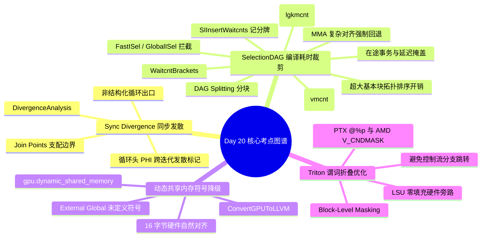

> 本文为 [**GPGPU 编译器工程师面试通关指南**](/gpgpu-interview/) 系列第20期（Day 20）。
> 建议在阅读“面试官参考解析”前，先独立思考每道题目的考察意图与答题脉络（每题思考 3~5 分钟）。

> 💡 **核心考察维度**：DivergenceAnalysis 同步发散（Sync Divergence）与非结构化循环出口判定、SelectionDAG 巨大基本块分块与 GlobalISel/FastISel 早筛回退、AMDGPU SIInsertWaitcnts 异步全局 VMEM 与片上 LDS 记分牌精确推导、MLIR GPUToLLVM 动态共享内存符号降级与 16 字节对齐保护、Triton Block-Level Masking 谓词折叠与零填充旁路优化。

---

## 📝 今日高频面试题清单

### 【Q1 · 控制流发散分析】DivergenceAnalysis.cpp 中的 Sync Divergence 与非结构化循环 Loop Exit 判定
在 SIMT 执行模型中，控制流分歧分为数据发散（Data Divergence）与同步发散（Sync Divergence）。当一个发散循环拥有多个非结构化出口（Unstructured Exits）时，某些线程跳出循环而另一些线程继续迭代。请结合 llvm/lib/Analysis/DivergenceAnalysis.cpp 源码，分析 DivergenceAnalysis::compute 是如何利用 Join Points（支配边界）检测 Sync Divergence 的？为什么在循环头部的 PHI 节点，即便所有的输入值都是标量 Uniform 常数，也会因为跨迭代发散分支的存在被强行标记为 Divergent？

---

### 【Q2 · 编译耗时与指令选择】FastISel 与 SelectionDAG 在 GPU 极端编译耗时下的裁剪机制
在现代大型 AI 算子（如展开后包含数万条指令的 FlashAttention 或长序列 GEMM 内核）中，指令选择（Instruction Selection）常常成为编译时间的严重瓶颈。传统基于 DAG 的 SelectionDAGISel 会消耗极大的内存与拓扑排序时间。请结合 llvm/lib/CodeGen/SelectionDAG/SelectionDAGISel.cpp 源码，分析 SelectionDAG 在面对巨大基本块时是如何被分块（DAG Splitting）或由 GlobalISel / FastISel 进行早筛拦截的？在为 GPU 启用快速指令选择时，为什么遇到带有复杂多操作数对齐要求的指令（如 MMA/WMMA）必须强制回退（Fallback）到慢速 DAG 模式？

---

### 【Q3 · 记分牌与流水线等待】SIInsertWaitcnts.cpp 中的 VMEM 与 LDS 写入后并发读取（RAW）记分牌推导
在 AMD GCN/CDNA 架构中，全局向量内存访问（VMEM）、导出指令（EXP）与本地数据共享（LDS）共用显式等待指令 s_waitcnt。请结合 llvm/lib/Target/AMDGPU/SIInsertWaitcnts.cpp 源码，深度剖析 WaitcntBrackets 是如何追踪在途写入计数器的：当程序依次发起一条异步全局加载（BUFFER_LOAD_DWORD）和一条异步片上 LDS 读取（DS_READ_B32）并在后续指令中混合消费它们时，编译器如何分别计算 vmcnt 和 lgkmcnt 的精确值，以最大化掩盖内存访问延迟？

---

### 【Q4 · 内存模型与符号降级】ConvertGPUToLLVMPass.cpp 中的 Dynamic Shared Memory 符号降级与对齐保护
在 CUDA / ROCm 编程中，用户常通过 extern __shared__ int dynamic_smem[] 声明动态共享内存。在 MLIR 降级流水线中，这种未指定固定尺寸的片上内存是如何从 gpu Dialect 逐步降级为带特定地址空间属性的 LLVM 符号的？请结合 mlir/lib/Conversion/GPUToLLVM/GPUToLLVMPass.cpp 源码，分析动态共享内存的外部全局变量（External Global）是如何生成的？如何确保其满足 16 字节（128-bit）的硬件自然对齐以支持宽向量访存？

---

### 【Q5 · 掩码加载与谓词折叠】Triton 中的 Block-Level Masking 与动态张量尾块谓词优化（Predicate Folding）
在 AI 算子（如处理不可整除输入尺寸的 Softmax / LayerNorm）中，Triton 语言广泛采用 tl.load(ptr, mask=mask, other=0.0) 语法。请结合 Triton 编译器源码，剖析在将带掩码的高层加载降级为硬件指令时，编译器是如何避免生成复杂的控制流分支跳转的？编译器在指令选择阶段如何将 mask 布尔向量直接转换为底层 GPU 的条件谓词向量（如 PTX @%p ld.global 或 AMD V_CNDMASK_B32）？如果 other 填充值为 0.0，硬件如何利用 LSU 旁路直接执行零填充而无需发起真实显存请求？

---

## 🎯 面试官深度解析与追问点



---

### 题 1 深度解析：DivergenceAnalysis.cpp 中的 Sync Divergence 与非结构化循环 Loop Exit 判定

#### 源码级深度剖析与核心实现
> 📌 **源码剖析提问**：在 SIMT 执行模型中，控制流分歧分为数据发散（Data Divergence）与同步发散（Sync Divergence）。当一个发散循环拥有多个非结构化出口（Unstructured Exits）时，某些线程跳出循环而另一些线程继续迭代。请结合 llvm/lib/Analysis/DivergenceAnalysis.cpp 源码，分析 DivergenceAnalysis::compute 是如何利用 Join Points（支配边界）检测 Sync Divergence 的？为什么在循环头部的 PHI 节点，即便所有的输入值都是标量 Uniform 常数，也会因为跨迭代发散分支的存在被强行标记为 Divergent？

##### 源码文件直达

  - `llvm/lib/Analysis/DivergenceAnalysis.cpp`
  - `llvm/include/llvm/Analysis/DivergenceAnalysis.h`

##### 核心类与核心代码块逻辑

  在 `DivergenceAnalysis.cpp` 中，发散分析引擎通过工作列表与循环支配边界处理同步发散：

```cpp
// llvm/lib/Analysis/DivergenceAnalysis.cpp 核心逻辑精选
void DivergenceAnalysis::propagateSyncDivergence(const BasicBlock &DivBranchBlock) {
  // 1. 获取发散分支块的迭代支配边界 (Iterated Dominance Frontier / Join Blocks)
  const auto &JoinBlocks = RegionInfo.getJoinBlocks(DivBranchBlock);

  for (const BasicBlock *JoinBB : JoinBlocks) {
    // 2. 遍历汇聚点处的所有 PHI 节点
    for (const PHINode &Phi : JoinBB->phis()) {
      if (isDivergent(Phi)) continue;

      // 3. 核心判定：不同线程沿不同前驱进入 JoinBB，到达时间轴步调不一致
      // 产生时序发散 (Temporal Divergence)，强行标记为发散
      markDivergent(Phi);
      Worklist.push_back(&Phi);
    }
  }
}
```

##### 逐行机械执行分析

  1. **支配边界（Dominance Frontier）定位**：发散分支 $B$ 分裂出两条路径，这两条路径在汇聚块（Join Point）相遇。由于发散分支导致线程分流，Warp 内的不同 Lane 在不同物理时钟周期分别遍历分支两侧。
  2. **时序步调不一致（Temporal Divergence）**：即使循环头部 PHI 的输入是绝对的 Uniform 常量（例如来自 Preheader 的 0 和来自 Backedge 的 1），只要循环体内存在受发散条件控制的 `break`，在某次迭代中，部分线程退出循环，另一部分线程走 Backedge 回跳。
  3. **强制标记发散的微架构原因**：此时走回跳边的线程看到了新一轮迭代的常量，而提前跳出的线程仍停留在上一周期的状态。两组线程在时间轴上的生命周期已撕裂。若编译器误将该 PHI 视为 Uniform 并分配标量 SGPR，会导致回跳线程在改写标量寄存器时，直接踩踏破坏未跳出或已跳出线程的依赖视图，引发静默数据崩溃。

---

### 题 2 深度解析：FastISel 与 SelectionDAG 在 GPU 极端编译耗时下的裁剪机制

#### 源码级深度剖析与核心实现
> 📌 **源码剖析提问**：在现代大型 AI 算子（如展开后包含数万条指令的 FlashAttention 或长序列 GEMM 内核）中，指令选择（Instruction Selection）常常成为编译时间的严重瓶颈。传统基于 DAG 的 SelectionDAGISel 会消耗极大的内存与拓扑排序时间。请结合 llvm/lib/CodeGen/SelectionDAG/SelectionDAGISel.cpp 源码，分析 SelectionDAG 在面对巨大基本块时是如何被分块（DAG Splitting）或由 GlobalISel / FastISel 进行早筛拦截的？在为 GPU 启用快速指令选择时，为什么遇到带有复杂多操作数对齐要求的指令（如 MMA/WMMA）必须强制回退（Fallback）到慢速 DAG 模式？

##### 源码文件直达

  - `llvm/lib/CodeGen/SelectionDAG/SelectionDAGISel.cpp`
  - `llvm/lib/CodeGen/GlobalISel/InstructionSelect.cpp`

##### 核心类与核心代码块逻辑

  在 `SelectionDAGISel.cpp` 中，当基本块指令过多时，系统通过阈值强行拆分 DAG：

```cpp
// llvm/lib/CodeGen/SelectionDAG/SelectionDAGISel.cpp 核心逻辑精选
void SelectionDAGISel::SelectAllBasicBlocks(const Function &Fn) {
  for (const BasicBlock &BB : Fn) {
    // 检查基本块内部指令数量是否突破系统上限
    if (BB.size() > DAGSizeThreshold) {
      // 强行按最大指令块切分成多个微型 DAG (DAG Slicing)
      // 在切片边界发射跨切片虚拟寄存器胶水节点，阻断单图无限膨胀
      splitAndSelectBasicBlock(BB);
      continue;
    }
    // 正常发射单基本块完整 DAG
    SelectBasicBlock(BB.begin(), BB.end(), HadTailCall);
  }
}

// 快速指令选择中的 Fallback 拦截
bool FastISel::selectInstruction(const Instruction *I) {
  // 若指令涉及目标专有的超长连续寄存器绑定 (如 MMA Tuple)
  if (isTargetSpecificComplexOp(I)) {
    // FastISel 缺乏跨节点连续寄存器着色约束求解能力，直接宣告失败
    return false; // 触发 Fallback，移交给完整 ISel 处理
  }
  return runTargetFastISel(I);
}
```

##### 逐行机械执行分析

  1. **DAG 节点爆炸与内存局部性崩溃**：SelectionDAG 为基本块内每个操作数创建 `SDNode` 并维护 `SDUse` 链表。当一个展开内核包含上万条指令时，DAG 图节点数超过数十万，拓扑排序（`TopologicalSort`）与合法化遍历导致严重的 L3 Cache 抖动，编译耗时呈二次方飙升。
  2. **`splitAndSelectBasicBlock` 强行切断**：当超出阈值，编译器在指令流中硬性插入切片边界，前一切片产出的叶子节点作为虚拟寄存器暴露，强制完成局部代码发射后再开启下一个切片，以牺牲极小跨切片调度优化为代价换取线性的编译内存开销。
  3. **MMA 原语 Fallback 机理**：`FastISel` 属于局部贪心单指令匹配器，无法处理图级的模式替换。GPU 的 Tensor Core 指令（如 `wmma.mma`）要求源操作数必须满足 4 或 8 个寄存器的物理偶数对齐与元组约束（`REG_SEQUENCE`）。`FastISel` 无法在单指令窗口内协调多寄存器的依赖拓扑，必须调用 `return false` 强制回退至完整指令选择器。

---

### 题 3 深度解析：SIInsertWaitcnts.cpp 中的 VMEM 与 LDS 写入后并发读取（RAW）记分牌推导

#### 源码级深度剖析与核心实现
> 📌 **源码剖析提问**：在 AMD GCN/CDNA 架构中，全局向量内存访问（VMEM）、导出指令（EXP）与本地数据共享（LDS）共用显式等待指令 s_waitcnt。请结合 llvm/lib/Target/AMDGPU/SIInsertWaitcnts.cpp 源码，深度剖析 WaitcntBrackets 是如何追踪在途写入计数器的：当程序依次发起一条异步全局加载（BUFFER_LOAD_DWORD）和一条异步片上 LDS 读取（DS_READ_B32）并在后续指令中混合消费它们时，编译器如何分别计算 vmcnt 和 lgkmcnt 的精确值，以最大化掩盖内存访问延迟？

##### 源码文件直达

  - `llvm/lib/Target/AMDGPU/SIInsertWaitcnts.cpp`

##### 核心类与核心代码块逻辑

  在 `SIInsertWaitcnts.cpp` 中，`WaitcntBrackets` 类维护多维计数器状态：

```cpp
// llvm/lib/Target/AMDGPU/SIInsertWaitcnts.cpp 核心逻辑精选
void WaitcntBrackets::setRegScore(Register Reg, InstCounterType T, int Score) {
  // 为物理寄存器打上绑定的未决事件标记 (Score)
  RegScore[Reg][T] = Score;
}

AMDGPU::Waitcnt WaitcntBrackets::getWaitcntForScore(Register Reg, InstCounterType T) {
  AMDGPU::Waitcnt W;
  int Score = getRegScore(Reg, T);
  int CurrentCounter = getEventCounter(T);

  // 计算必须等待的安全阈值：在途总事务数 - 目标寄存器发起的事务序数
  if (Score > CurrentCounter) {
    unsigned WaitAmount = CurrentCounter - (Score - CurrentCounter);
    if (T == VM_CNT)
      W.VmCnt = std::min(W.VmCnt, WaitAmount);
    else if (T == LGKM_CNT)
      W.LgkmCnt = std::min(W.LgkmCnt, WaitAmount);
  }
  return W;
}
```

##### 逐行机械执行分析

  1. **多计数器维度解耦**：AMD 硬件设计了独立的硬件计数器：
     - `vmcnt`：监控向量全局/平坦内存（VMEM/FLAT）在途请求；
     - `lgkmcnt`：监控 LDS、GDS、常量缓存（SMEM）以及消息（Message）的在途请求。
  2. **在途分数标定（Score Tagging）**：发射 `BUFFER_LOAD_DWORD` 时，`VM_CNT` 计数器累加，目标 VGPR 登记为 `Score = 1`；随后紧接着发射 `DS_READ_B32`，`LGKM_CNT` 计数器累加，其目标 VGPR 登记为 `Score = 1`。两者在不同的硬件队列中并发传输。
  3. **延迟掩盖与渐进释放**：
     - 当后续指令先消费 LDS 数据时，编译器仅发射 `s_waitcnt lgkmcnt(0)`。此时全局显存加载仍在后台高速进行，`vmcnt` 完全不被阻塞。
     - 直到数十条算术指令之后真正需要消费全局数据时，编译器才在目标指令紧邻前夕发射 `s_waitcnt vmcnt(0)`。
     - 通过将 `lgkmcnt` 与 `vmcnt` 的等待时机物理拆离，使得慢速的全局访存延迟（~400 周期）被大量独立的本地计算与 LDS 访存充分吸收。

---

### 题 4 深度解析：ConvertGPUToLLVMPass.cpp 中的 Dynamic Shared Memory 符号降级与对齐保护

#### 源码级深度剖析与核心实现
> 📌 **源码剖析提问**：在 CUDA / ROCm 编程中，用户常通过 extern __shared__ int dynamic_smem[] 声明动态共享内存。在 MLIR 降级流水线中，这种未指定固定尺寸的片上内存是如何从 gpu Dialect 逐步降级为带特定地址空间属性的 LLVM 符号的？请结合 mlir/lib/Conversion/GPUToLLVM/GPUToLLVMPass.cpp 源码，分析动态共享内存的外部全局变量（External Global）是如何生成的？如何确保其满足 16 字节（128-bit）的硬件自然对齐以支持宽向量访存？

##### 源码文件直达

  - `mlir/lib/Conversion/GPUToLLVM/GPUToLLVMPass.cpp`
  - `mlir/lib/Conversion/GPUCommon/GPUOpsLowering.cpp`

##### 核心类与核心代码块逻辑

  在 `GPUToLLVMPass.cpp` 中，动态共享内存的降级通过在模块级别注入专有的全局无尺寸数组实现：

```cpp
// mlir/lib/Conversion/GPUCommon/GPUOpsLowering.cpp 核心逻辑精选
LogicalResult GPUDynamicSharedMemoryOpLowering::matchAndRewrite(
    gpu::DynamicSharedMemoryOp op, OpAdaptor adaptor,
    ConversionPatternRewriter &rewriter) const {
  Location loc = op.getLoc();
  ModuleOp module = op->getParentOfType<ModuleOp>();

  // 1. 检查或在 Module 级别创建专用的外部动态共享内存全局符号
  auto global = module.lookupSymbol<LLVM::GlobalOp>("__dynamic_shared_memory__");
  if (!global) {
    OpBuilder::InsertionGuard guard(rewriter);
    rewriter.setInsertionPointToStart(module.getBody());

    // 创建零尺寸数组: [0 x i8], 赋予目标架构 Shared Memory 地址空间 (addrspace 3)
    auto arrayType = LLVM::LLVMArrayType::get(rewriter.getI8Type(), 0);
    global = rewriter.create<LLVM::GlobalOp>(
        loc, arrayType, /*isConstant=*/false, LLVM::Linkage::External,
        "__dynamic_shared_memory__", Attribute(), /*alignment=*/16,
        targetAddressSpace); // addrspace(3)
  }

  // 2. 在使用点发射 AddressOf 获取首地址指针
  Value addr = rewriter.create<LLVM::AddressOfOp>(loc, global);
  // 3. 将其转换并位强转为操作数声明的 MemRef 基指针
  rewriter.replaceOpWithNewOp<LLVM::BitcastOp>(op, op.getType(), addr);
  return success();
}
```

##### 逐行机械执行分析

  1. **零尺寸外部数组建模**：由于动态共享内存的尺寸在编译期不可知，仅在运行时 Kernel Launch 的第三个参数（`sharedMemBytes`）动态指定，编译器将其建模为 `[0 x i8]` 且带 `External` 链接属性的全局符号。
  2. **16 字节自然对齐强制注入**：在创建 `LLVM::GlobalOp` 时，必须显式附加 `/*alignment=*/16`。GPU 的向量访存指令（如 `LDS_READ2` 或 PTX `ld.shared.v4.b32`）要求基地址满足 128 位对齐。若遗漏该参数，后端在指令选择时无法证明指针对齐，会保守将后续所有宽向量加载拆散为单字节或标量加载，导致片上带宽暴跌 4 倍。
  3. **地址空间打通**：通过 `targetAddressSpace`（NVPTX/AMDGPU 均为 3）赋予该全局符号专有属性，使得下游 `InferAddressSpaces` 与别名分析能够立刻识别其片上 SRAM 性质，杜绝将其降级为低速通用指针。

---

### 题 5 深度解析：Triton 中的 Block-Level Masking 与动态张量尾块谓词优化（Predicate Folding）

#### 源码级深度剖析与核心实现
> 📌 **源码剖析提问**：在 AI 算子（如处理不可整除输入尺寸的 Softmax / LayerNorm）中，Triton 语言广泛采用 tl.load(ptr, mask=mask, other=0.0) 语法。请结合 Triton 编译器源码，剖析在将带掩码的高层加载降级为硬件指令时，编译器是如何避免生成复杂的控制流分支跳转的？编译器在指令选择阶段如何将 mask 布尔向量直接转换为底层 GPU 的条件谓词向量（如 PTX @%p ld.global 或 AMD V_CNDMASK_B32）？如果 other 填充值为 0.0，硬件如何利用 LSU 旁路直接执行零填充而无需发起真实显存请求？

##### 核心源码直达

  - `triton/lib/Conversion/TritonGPUToLLVM/LoadStoreOpToLLVM.cpp`

##### 核心类与核心代码块逻辑

  在 `LoadStoreOpToLLVM.cpp` 中，带有掩码的读取被重塑为硬件谓词指令：

```cpp
// 典型的 Triton Masked Load 降级逻辑伪代码
void emitMaskedGlobalLoad(ConversionPatternRewriter &rewriter, Location loc,
                          Value ptr, Value mask, Value otherVal) {
  // 1. 将高维布尔掩码向量展开为针对每个 128-bit 向量切片的 1 位谓词
  Value pred = extractSlicePredicate(mask);

  // 2. 模式 A: 硬件原生支持带谓词的非阻塞读取 (PTX 模式)
  // 生成: @%p0 ld.global.nc.v4.f32 {$v0, $v1, $v2, $v3}, [%ptr];
  // 若谓词为假，硬件内部直接抑制总线请求，并将目标寄存器赋初值
  Value loadedVal = rewriter.create<nvvm::LoadWithPredicateOp>(
      loc, ptr, pred, /*defaultVal=*/otherVal);

  // 3. 模式 B: 硬件无原生谓词读取时的通用回退 (AMD 模式)
  // 生成条件指针置换: safe_ptr = mask ? ptr : null_buffer_ptr
  // 配合 v_cndmask_b32 在后置阶段将非法越界数据覆盖为 otherVal
}
```

##### 逐行机械执行分析

  1. **消除 SIMT 线程发散分支**：若采用常规的 `if (mask)` 分支语句，Warp 内某些越界的 Lane 会触发分支发散，导致执行单元串行化分流。Triton 编译器彻底抹平高层分支，始终维持一条线性的数据流图（Straight-Line Code）。
  2. **硬件级 LSU 事务抑制（Bus Suppression）**：对于 PTX 目标，编译器直接发射前缀带 `@%p` 谓词的机器指令。在微架构层面，当 Warp 发射该访存指令时，LSU（加载存储单元）检查各线程的谓词寄存器。若线程的谓词为 0，硬件掩码电路直接屏蔽该 Lane 的总线请求，不向 L1/L2 缓存控制器发射任何事务包。
  3. **Zero-Fill 硬件旁路**：当 `other=0.0` 时，被抑制的 Lane 不会执行等待，硬件内部的数据总线直接向该 Lane 的写入寄存器刷入全零比特，零延迟掩盖了边界对齐惩罚，完全避免了因非法越界访问触发的硬件 Memory Fault（如 MMU 缺页异常）。

---

## 5 深度技术对比

| 优化阶段 / 机制 | 解决的核心硬件/软件瓶颈 | LLVM/MLIR/Triton 关键接口与节点 | 错误处理不当的严重后果 |
| :---- | :---- | :---- | :---- |
| **Sync Divergence (`compute`)** | 识别非结构化控制流引发的隐式线程不同步 | `DivergenceAnalysis`, `JoinPoints` | 错误将发散 PHI 标为 Uniform，引发分支执行死锁 |
| **DAG Trimming (`SelectionDAG`)** | 消除万行展开内核下指令选择爆内存与编译超时 | `DAGSplit`, `FastISel Fallback` | JIT 编译耗时爆炸达数十分钟，或编译直接 OOM 崩溃 |
| **Waitcnt Brackets (`SIWaitcnts`)** | 最小化 GPU 异步显存与片上 LDS 等待周期数 | `WaitcntBrackets`, `s_waitcnt` | 插入时机过早导致算力空转，或漏插导致 RAW 脏读 |
| **Dynamic Smem (`GPUToLLVM`)** | 消除无固定尺寸动态片上内存的重定义冲突 | `ExternalGlobalOp`, `Alignment` | 地址空间绑定错误无法分配，或非对齐引发硬件 Trap |
| **Predicate Folding (`Masking`)** | 消除处理非整除尾块张量时生成的分支跳转 | `tl.load(mask)`, `V_CNDMASK` | 引入密集的 SIMT 控制流分歧，严重拖慢向量吞吐 |

---

## 💡 面试实战总结（复盘金句）

> 1. **谈同步发散（Sync Divergence）与循环头 PHI 时**：*"发散不仅仅是数值的不同步，更是控制流推进拓扑的失步；即便循环头 PHI 接收的是标量常数，跨迭代控制流的发散仍会从结构上撕裂同步边界。"*
> 2. **谈 SelectionDAG 编译时间裁剪与回退时**：*"万级指令的极限展开是对编译器前端与后端的终极压力测试；在 FastISel 快速通关与 SelectionDAG 复杂模式匹配之间构建鲁棒的回退防火墙，是工业级编译器的刚性底线。"*
> 3. **谈 waitcnt 记分牌推导与延迟隐藏时**：*"异步内存指令的最高境界是'发而不断、用时方等'；WaitcntBrackets 精密跟踪 VMEM 与 LDS 在途未决事务，把硬件等待指令推迟到消费前最后一刻，是用编译器编织出极限延迟掩盖的典范。"*
> 4. **谈动态共享内存符号降级与对齐时**：*"动态片上内存是异构运行时的未解之谜；降级为外部符号并严格施加 16 字节对齐，不仅打通了主机传参的桥梁，更为 128 位宽向量的高速吞吐锁定了物理基石。"*
> 5. **谈 Triton 尾块谓词折叠与零填充时**：*"消除分支分化的终极武器是就地谓词化；把高维掩码下推为 GPU 原生硬件谓词并激活 LSU 零填充旁路，是 AI 编译器斩断尾块碎片开销的高效利刃。"*

---

> 👈 **上一期回顾**：[**Day 19：Alloca 栈提升、饱和算术合法化、SMS 软流水 RecMII 与矩阵转置**](/gpu-compiler/2026-11-03-gpgpu-compiler-interview-day-19/)
> 👉 **下一期推荐**：[**Day 21：RegBankSelect、SDIVREM 折叠、EXEC 掩码短路与 WMMA/MFMA 降级**](/gpu-compiler/2026-11-05-gpgpu-compiler-interview-day-21/)
> 👉 **专栏返回**：查看更多模块内容与更新计划，请访问 [**GPGPU 编译器面试通关指南目录**](/gpgpu-interview/)。