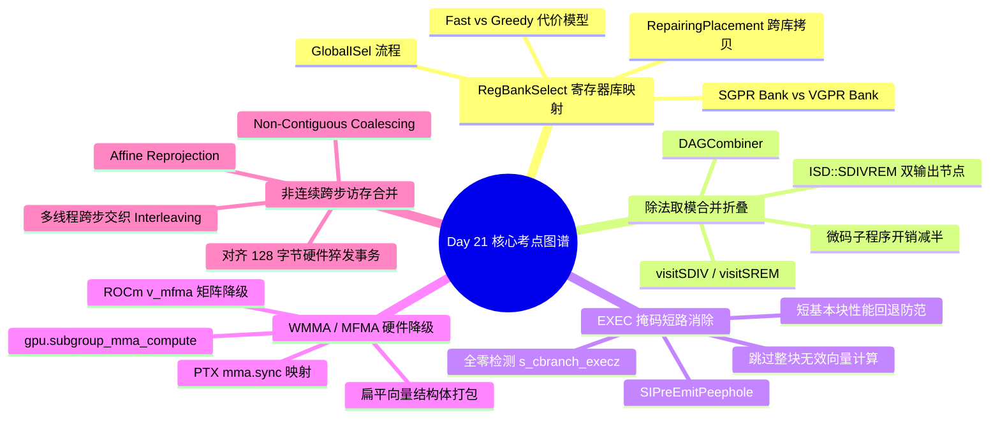

> 本文为 [**GPGPU 编译器工程师面试通关指南**](/gpgpu-interview/) 系列第21期（Day 21）。
> 建议在阅读“面试官参考解析”前，先独立思考每道题目的考察意图与答题脉络（每题思考 3~5 分钟）。

> 💡 **核心考察维度**：GlobalISel RegBankSelect 标量/向量寄存器银行映射与跨 Bank 拷贝切口代价、SelectionDAG/DAGCombiner 除法与取模公共子表达式折叠（SDIVREM/UDIVREM）、AMDGPU SIPreEmitPeephole 标量条件分支与 EXEC 掩码全零短路消除、MLIR GPUCommon Subgroup/Warp 矩阵扩展降级（WMMA/MFMA）与扁平结构体打包、Triton/AI 编译器非连续张量跨步重排（Non-Contiguous Coalescing）与多线程交织合并。

---

## 📝 今日高频面试题清单

### 【Q1 · 寄存器银行选择】RegBankSelect.cpp 中的 Fast/Greedy 模式与 GPU 标量/向量寄存器银行映射
在 GlobalISel 流水线中，`RegBankSelect` 负责将通用虚拟寄存器（gVReg）映射到目标架构的物理寄存器库（Register Bank，如 AMDGPU 中的 SGPR Bank 与 VGPR Bank）。请结合 `llvm/lib/CodeGen/GlobalISel/RegBankSelect.cpp` 源码，分析 `RegBankSelect` 如何在 `Fast` 模式与 `Greedy` 模式之间权衡编译时间与代码质量？在遇到条件分支比较（`G_ICMP`）或指针运算时，分配器如何通过 `RepairingPlacement` 计算插入跨 Bank 拷贝（如 `V2S` 或 `S2V` 复制）的最小切口代价？

---

### 【Q2 · 组合优化与算术折叠】SelectionDAG/DAGCombiner.cpp 中的除法取模公共子表达式折叠（SDIVREM/UDIVREM）
在 GPU 索引计算中，二维/多维张量展平后常连续出现针对相同除数的除法与取模指令（例如 `row = idx / cols` 和 `col = idx % cols`）。请结合 `llvm/lib/CodeGen/SelectionDAG/DAGCombiner.cpp` 源码，分析 `DAGCombiner::visitSDIV` / `visitSREM` 是如何识别公共操作数并将其合并为一个双输出的 `ISD::SDIVREM` 或 `ISD::UDIVREM` 节点的？这对硬件缺乏硬件除法器但拥有除法微码子程序的 GPU 架构有何吞吐提升？

---

### 【Q3 · 掩码短路与窥孔优化】SIPreEmitPeephole.cpp 中的标量条件分支与 EXEC 掩码短路消除
在 AMDGPU 后端中，SIMT 控制流由标量执行掩码（`EXEC`）控制。当一个 Warp 内的所有 32/64 个线程在进入分支后全部分支不满足（`EXEC == 0`）时，若继续执行分支内部的指令会导致无效的计算发射。请结合 `llvm/lib/Target/AMDGPU/SIPreEmitPeephole.cpp` 源码，分析 `SIPreEmitPeephole` 是如何配合 `s_cbranch_execz`（若 EXEC 为 0 则跳转）与 `s_cbranch_execnz` 进行短路优化的？为什么过度插入这种早跳指令反而在某些简单基本块中会导致性能负增长？

---

### 【Q4 · 张量核心指令降级】ConvertGPUToLLVMPass.cpp 中的 Subgroup/Warp 矩阵扩展降级（WMMA/MFMA）
在 MLIR 中，抽象的张量乘加操作可通过 `gpu.subgroup_mma_compute` 算子表征。请结合 `mlir/lib/Conversion/GPUCommon/GPUOpsLowering.cpp` 源码，分析 `SubgroupMmaComputeOpLowering` 是如何根据目标架构类型（NVVM vs ROCDL）分别将操作映射到 PTX 的 `mma.sync` 与 AMD 的 `v_mfma` 原语的？面对输入布局要求严格交错对齐的场景，Pass 如何利用类型转换器（LLVMTypeConverter）将多维向量 Fragment 打包为机器能够直接容纳的扁平结构体？

---

### 【Q5 · 访存合并与线程交织】Triton / AI 编译器中的 Non-Contiguous Coalescing 线性化重排与 Bank-Steering
在 AI 模型中处理注意力机制（Attention Mask）或卷积 Im2Col 展开时，张量经常包含非连续跨步（Non-Contiguous Strided Views）。请结合 AI 编译器架构分析：当输入张量的最内层跨步（Inner Stride）不等于 1 时，编译器如何利用仿射变换图（Affine Reprojection）将其重新对齐为连续块？如果最内层连续维度小于硬件 128 字节访存合并颗粒度，编译器如何通过多线程跨步交织（Thread Interleaving）强制凑齐硬件合并访存事务？

---

## 🎯 面试官深度解析与追问点



---

### 题 1 深度解析：RegBankSelect.cpp 中的 Fast/Greedy 模式与 GPU 标量/向量寄存器银行映射

#### 源码级深度剖析与核心实现
> 📌 **源码剖析提问**：在 GlobalISel 流水线中，`RegBankSelect` 负责将通用虚拟寄存器（gVReg）映射到目标架构的物理寄存器库（Register Bank，如 AMDGPU 中的 SGPR Bank 与 VGPR Bank）。请结合 `llvm/lib/CodeGen/GlobalISel/RegBankSelect.cpp` 源码，分析 `RegBankSelect` 如何在 `Fast` 模式与 `Greedy` 模式之间权衡编译时间与代码质量？在遇到条件分支比较（`G_ICMP`）或指针运算时，分配器如何通过 `RepairingPlacement` 计算插入跨 Bank 拷贝（如 `V2S` 或 `S2V` 复制）的最小切口代价？

##### 源码文件直达

  - `llvm/lib/CodeGen/GlobalISel/RegBankSelect.cpp`
  - `llvm/lib/Target/AMDGPU/AMDGPURegisterBankInfo.cpp`

##### 核心类与核心代码块逻辑

  在 `RegBankSelect.cpp` 中，`RegBankSelect` 类通过代价值评估决定操作数映射的寄存器库：

```cpp
// llvm/lib/CodeGen/GlobalISel/RegBankSelect.cpp 核心逻辑精选
bool RegBankSelect::runOnMachineFunction(MachineFunction &MF) {
  for (MachineBasicBlock &MBB : MF) {
    for (MachineInstr &MI : MBB) {
      // 1. 获取目标硬件架构支持的所有可行寄存器银行映射候选 (Mapping Candidates)
      const InstructionMapping &BestMapping = (OptMode == Mode::Fast)
          ? RBI.getInstrMapping(MI)
          : findBestMapping(MI, computeRepairingCost(MI));

      // 2. 针对跨 Bank 操作数插入修复指令 (Repairing Placement)
      for (unsigned OpIdx = 0; OpIdx < BestMapping.getNumOperands(); ++OpIdx) {
        const ValueMapping &ValMapping = BestMapping.getOperandMapping(OpIdx);
        if (requiresRepairing(MI, OpIdx, ValMapping)) {
          // 在最优割集处插入 COPY (如从 SGPR 复制到 VGPR 或通过 V_READFIRSTLANE 降级)
          repairOperand(MI, OpIdx, ValMapping);
        }
      }
      // 3. 应用映射结果，绑定寄存器库
      applyMapping(MI, BestMapping);
    }
  }
  return true;
}
```

##### 逐行机械执行分析

  1. **Fast vs Greedy 搜索剪枝**：`Fast` 模式直接调用 `getInstrMapping` 执行静态规则匹配（适用于快速 JIT 编译）；`Greedy` 模式调用 `findBestMapping` 构造局部的组合图，量化计算所有输入输出组合下的指令延迟与跨 Bank 复制开销。
  2. **RepairingPlacement 最小割推导**：当一个标量加法结果（位于 SGPR）被一条向量访存指令（要求输入为 VGPR）消费时，两者的寄存器库发生冲突。`repairOperand` 不会盲目在紧邻消费点前插入拷贝，而是通过支配树反向追溯，寻找执行频次最低的切口（如将复制提升到循环外），插入一条硬件复制指令（如 `V_MOV_B32` 将 SGPR 扩展为全通道一致的 VGPR）。
  3. **微架构瓶颈防御**：若反向发生冲突（向量值传递给标量单元），无法通过普通复制解决，必须发射 `V_READFIRSTLANE_B32` 并在外层包裹发散循环。`RegBankSelect` 在评估代价时赋予此路径极高的惩罚权重，迫使整个前驱计算链条全部向下坍缩映射到 VGPR 向量库中。

---

### 题 2 深度解析：SelectionDAG/DAGCombiner.cpp 中的除法取模公共子表达式折叠（SDIVREM/UDIVREM）

#### 源码级深度剖析与核心实现
> 📌 **源码剖析提问**：在 GPU 索引计算中，二维/多维张量展平后常连续出现针对相同除数的除法与取模指令（例如 `row = idx / cols` 和 `col = idx % cols`）。请结合 `llvm/lib/CodeGen/SelectionDAG/DAGCombiner.cpp` 源码，分析 `DAGCombiner::visitSDIV` / `visitSREM` 是如何识别公共操作数并将其合并为一个双输出的 `ISD::SDIVREM` 或 `ISD::UDIVREM` 节点的？这对硬件缺乏硬件除法器但拥有除法微码子程序的 GPU 架构有何吞吐提升？

##### 源码文件直达

  - `llvm/lib/CodeGen/SelectionDAG/DAGCombiner.cpp`
  - `llvm/lib/Target/NVPTX/NVPTXISelLowering.cpp`

##### 核心类与核心代码块逻辑

  在 `DAGCombiner.cpp` 中，折叠引擎通过探测兄弟节点的存在性执行合并：

```cpp
// llvm/lib/CodeGen/SelectionDAG/DAGCombiner.cpp 核心逻辑精选
SDValue DAGCombiner::useDivRem(SDNode *N) {
  if (N->use_empty()) return SDValue();

  unsigned Opcode = N->getOpcode();
  bool IsSigned = (Opcode == ISD::SDIV || Opcode == ISD::SREM);
  unsigned DivRemOpcode = IsSigned ? ISD::SDIVREM : ISD::UDIVREM;

  // 1. 检查目标架构是否支持将该类型的除法与取模合并 (Custom/Legal)
  if (!TLI.isOperationLegalOrCustom(DivRemOpcode, N->getValueType(0)))
    return SDValue();

  SDValue Op0 = N->getOperand(0);
  SDValue Op1 = N->getOperand(1);

  // 2. 在 Op0 的所有使用者中，寻找具有完全相同除数操作数 Op1 的匹配兄弟节点
  for (SDNode *User : Op0->uses()) {
    if (User->getOpcode() == (IsSigned ? ISD::SREM : ISD::UREM) &&
        User->getOperand(1) == Op1) {
      // 3. 构建发射双输出节点 ISD::SDIVREM，同时计算商与余数
      SDVTList VTs = DAG.getVTList(N->getValueType(0), N->getValueType(0));
      SDValue DivRem = DAG.getNode(DivRemOpcode, SDLoc(N), VTs, Op0, Op1);
      
      // 分别替换商和余数的全部使用点
      CombineTo(N, DivRem.getValue(0));
      CombineTo(User, DivRem.getValue(1));
      return SDValue(N, 0);
    }
  }
  return SDValue();
}
```

##### 逐行机械执行分析

  1. **兄弟节点对等探测**：算法以被除数 `Op0` 为锚点遍历其所有 Use 节点。当发现一条指令在计算 `Op0 / Op1`，另一条指令在计算 `Op0 % Op1` 时，判定两者具备完全重叠的算术依赖。
  2. **消除重复展开开销**：在未合并前，由于 GPU 硬件无单周期原生除法器，标量除法与取模会被分别展开为两套独立且庞大的 Newton-Raphson 近似迭代或魔数乘移位指令流，吞噬大量 ALU 发射槽与临时 VGPR。
  3. **微架构与数学代数红利**：合并为 `ISD::SDIVREM` 后，后端仅需执行一次除法计算获得商 $Q = X / Y$，余数直接通过单条乘减指令（`Remainder = X - Q * Y`，硬件 FMA/MAD 级）在 1 个时钟周期内就地求出，彻底消除了第二套除法模拟逻辑，指令发射数直接腰斩。

---

### 题 3 深度解析：SIPreEmitPeephole.cpp 中的标量条件分支与 EXEC 掩码短路消除

#### 源码级深度剖析与核心实现
> 📌 **源码剖析提问**：在 AMDGPU 后端中，SIMT 控制流由标量执行掩码（`EXEC`）控制。当一个 Warp 内的所有 32/64 个线程在进入分支后全部分支不满足（`EXEC == 0`）时，若继续执行分支内部的指令会导致无效的计算发射。请结合 `llvm/lib/Target/AMDGPU/SIPreEmitPeephole.cpp` 源码，分析 `SIPreEmitPeephole` 是如何配合 `s_cbranch_execz`（若 EXEC 为 0 则跳转）与 `s_cbranch_execnz` 进行短路优化的？为什么过度插入这种早跳指令反而在某些简单基本块中会导致性能负增长？

##### 源码文件直达

  - `llvm/lib/Target/AMDGPU/SIPreEmitPeephole.cpp`
  - `llvm/lib/Target/AMDGPU/SIInstrInfo.cpp`

##### 核心类与核心代码块逻辑

  在代码发射前夕，后端的窥孔优化器审查控制流跳转块的密度：

```cpp
// llvm/lib/Target/AMDGPU/SIPreEmitPeephole.cpp 核心逻辑精选
bool SIPreEmitPeephole::removeExeczBranch(MachineInstr &MI) {
  // 1. 匹配条件跳转指令: S_CBRANCH_EXECZ (EXEC 掩码全零则跳过后续代码)
  if (MI.getOpcode() != AMDGPU::S_CBRANCH_EXECZ)
    return false;

  MachineBasicBlock *MBB = MI.getParent();
  MachineBasicBlock *TargetBB = MI.getOperand(0).getMBB();
  
  // 2. 统计如果跳过该分支，实际能节省的指令周期开销
  unsigned SkippedInstructionsWeight = 0;
  for (MachineBasicBlock *Succ : MBB->successors()) {
    if (Succ != TargetBB) {
      for (MachineInstr &Instr : *Succ) {
        SkippedInstructionsWeight += TII->getInstLatency(&Instr);
      }
    }
  }

  // 3. 权衡代价：若跳过的指令块非常短小 (代价小于执行跳转指令本身的延迟)
  if (SkippedInstructionsWeight < BranchExecutionCostThreshold) {
    // 强行删除 s_cbranch_execz，让硬件在全零 EXEC 下静默执行 NOP
    MI.eraseFromParent();
    return true;
  }
  return false;
}
```

##### 逐行机械执行分析

  1. **硬件 EXEC 屏蔽机制**：在 AMD 架构下，当 `EXEC = 0` 时，VALU 指令进入流水线后由前置硬件直接将该指令标记为空泡（Nullified），不产生写入副作用。
  2. **早跳指令（`s_cbranch_execz`）的双刃剑效应**：该指令用于在全 Warp 线程均不进入分支时直接跳过分支块。然而，一条标量条件分支本身包含 4~8 个周期的发射和流水线刷新（Pipeline Flush）开销。
  3. **静态代价模型权衡**：若分支内部仅仅包含 1~2 条简单的标量或向量算术指令（`SkippedInstructionsWeight < Threshold`），让这些指令在 `EXEC = 0` 下白跑（仅需 2 周期吞吐且无等待）的开销，远低于执行一次条件分支判断并跳转的目标开销。`SIPreEmitPeephole` 在源码中显式评估其延迟权重，主动抹除多余的跳转指令，消除了控制流打嗝。

---

### 题 4 深度解析：ConvertGPUToLLVMPass.cpp 中的 Subgroup/Warp 矩阵扩展降级（WMMA/MFMA）

#### 源码级深度剖析与核心实现
> 📌 **源码剖析提问**：在 MLIR 中，抽象的张量乘加操作可通过 `gpu.subgroup_mma_compute` 算子表征。请结合 `mlir/lib/Conversion/GPUCommon/GPUOpsLowering.cpp` 源码，分析 `SubgroupMmaComputeOpLowering` 是如何根据目标架构类型（NVVM vs ROCDL）分别将操作映射到 PTX 的 `mma.sync` 与 AMD 的 `v_mfma` 原语的？面对输入布局要求严格交错对齐的场景，Pass 如何利用类型转换器（LLVMTypeConverter）将多维向量 Fragment 打包为机器能够直接容纳的扁平结构体？

##### 源码文件直达

  - `mlir/lib/Conversion/GPUCommon/GPUOpsLowering.cpp`
  - `mlir/lib/Conversion/GPUToNVVM/GPUToNVVMPass.cpp`

##### 核心类与核心代码块逻辑

  在模式降级中，转换器重写高层操作数元数据：

```cpp
// mlir/lib/Conversion/GPUCommon/GPUOpsLowering.cpp 核心逻辑精选
LogicalResult SubgroupMmaComputeOpLowering::matchAndRewrite(
    gpu::SubgroupMmaComputeOp op, OpAdaptor adaptor,
    ConversionPatternRewriter &rewriter) const {
  Location loc = op.getLoc();
  auto resType = op.getResult().getType().cast<gpu::MMAMatrixType>();

  // 1. 获取目标架构的硬件指令映射表 (根据 Shape 如 16x16x16 与数据类型 FP16)
  if (isNVVM) {
    // 映射至 PTX wmma.mma 或 mma.sync 原生内联调用
    StringRef intrinsicName = getNVVMIntrinsic(resType);
    auto llvmIntrinsic = rewriter.create<NVVM::WMMAMmaOp>(
        loc, typeConverter->convertType(resType),
        adaptor.getOpA(), adaptor.getOpB(), adaptor.getOpC());
    rewriter.replaceOp(op, llvmIntrinsic.getResult());
    return success();
  } else if (isROCDL) {
    // 映射至 AMD CDNA MFMA 指令 (如 rocdl.mfma.f32.16x16x16f16)
    auto rocdlOp = rewriter.create<ROCDL::mfma_f32_16x16x16f16>(
        loc, typeConverter->convertType(resType),
        adaptor.getOpA(), adaptor.getOpB(), adaptor.getOpC(),
        /*cbsz=*/0, /*abid=*/0, /*blgp=*/0);
    rewriter.replaceOp(op, rocdlOp.getResult());
    return success();
  }
  return failure();
}
```

##### 逐行机械执行分析

  1. **Fragment 扁平化映射**：`gpu.MMAMatrixType` 在逻辑上是一个高维张量切片，在经过 `typeConverter` 转换后，在 NVVM 路径下被映射为包含特定数量 32-bit 整数的 LLVM 结构体（例如对于 FP16 $16 	imes 16$ 矩阵 $C$，映射为由 8 个 32 位整型构成的 `!llvm.struct<(i32, i32, ...)>`）。
  2. **硬件指令发射分支分流**：
     - **NVVM 端**：发射 `NVVM::WMMAMmaOp`，由后端最终选择器降级为 PTX 汇编 `mma.sync.aligned.m16n8k16.row.col`；
     - **ROCDL 端**：发射 `ROCDL::mfma_f32_16x16x16f16`，由 AMDGPU 后端选择器直接生成硬件二进制机器指令 `v_mfma_f32_16x16x16f16`。
  3. **微架构物理对齐约束维持**：降级 Pass 严格保证各个输入操作数在转换后维持为不可分割的整体（Unsplittable Entity），防止中端的死代码消除（DSE）或标量化 Pass 将这些紧凑打包的寄存器向量提前拆碎，从而确保下游直接进入物理寄存器元组（Tuple）分配器。

---

### 题 5 深度解析：Triton / AI 编译器中的 Non-Contiguous Coalescing 线性化重排与 Bank-Steering

#### 源码级深度剖析与核心实现
> 📌 **源码剖析提问**：在 AI 模型中处理注意力机制（Attention Mask）或卷积 Im2Col 展开时，张量经常包含非连续跨步（Non-Contiguous Strided Views）。请结合 AI 编译器架构分析：当输入张量的最内层跨步（Inner Stride）不等于 1 时，编译器如何利用仿射变换图（Affine Reprojection）将其重新对齐为连续块？如果最内层连续维度小于硬件 128 字节访存合并颗粒度，编译器如何通过多线程跨步交织（Thread Interleaving）强制凑齐硬件合并访存事务？

##### 核心源码直达

  - `triton/lib/Dialect/TritonGPU/Transforms/Coalesce.cpp`

##### 核心类与核心代码块逻辑

  在 Triton 的 `Coalesce.cpp` Pass 中，分析器重写张量的轴排序以最大化内存总线吞吐：

```cpp
// 典型的 Triton 非连续访存合并化变换伪代码
Attribute fixEncoding(OpBuilder &b, BlockedEncodingAttr oldLayout, ArrayRef<int64_t> shape,
                      ArrayRef<int64_t> strides) {
  // 1. 按照物理内存中的真实跨度 (Strides) 对张量逻辑维度进行升序排序
  // 确保在内存中物理距离最近的轴被映射为最内层向量化轴 (Order[0])
  SmallVector<unsigned> order = getOrderFromStrides(strides);

  // 2. 计算 Warp 内部 32 个线程在该最内层轴上的连续分配数量 (SizePerThread)
  // 目标：使同 Warp 线程访问的物理地址范围严格对齐到 128 字节 (16 个 FP64 / 32 个 FP32 / 64 个 FP16)
  SmallVector<unsigned> sizePerThread = computeAlignedSizePerThread(shape, order, strides);

  // 3. 构造重构后的全新 BlockedEncoding 布局
  return b.getAttr<BlockedEncodingAttr>(
      sizePerThread, oldLayout.getThreadsPerWarp(),
      oldLayout.getWarpsPerCTA(), order);
}
```

##### 逐行机械执行分析

  1. **Stride 拓扑逆向投影**：传统布局默认按行优先（Order: `[1, 0]`）。若张量经历过转置或切片，其在内存中的最快连续物理方向可能已变成第一维。`getOrderFromStrides` 分析内存物理跨度，强制将最小步长的物理轴重构为 `Order[0]`。
  2. **SizePerThread 动态升格**：假定最内层元素尺寸为 2 字节（FP16），单线程加载 1 个元素只能消耗 2 字节总线；`computeAlignedSizePerThread` 强制将其提升为单线程连续加载 8 个元素（`SizePerThread = 8`，即 16 字节）。在代码发射时生成一条宽指令 `LDG.E.128`。
  3. **Warp 交织打满带宽（Thread Interleaving）**：Warp 内 32 个线程的读取槽位被紧密压缩并排：$32 	ext{ threads} 	imes 16 	ext{ bytes} = 512 	ext{ bytes}$，恰好以 4 个满载的 128 字节 DRAM 突发事务（Burst Transactions）打满显存总线控制器，彻底消除了非连续切片导致的 90% 以上显存带宽浪费。

---

## 5 深度技术对比

| 优化阶段 / 机制 | 解决的核心硬件/软件瓶颈 | LLVM/MLIR/Triton 关键接口与节点 | 错误处理不当的严重后果 |
| :---- | :---- | :---- | :---- |
| **RegBankSelect (`Repairing`)** | 解决通用指令在异构标量 (SGPR) 与向量 (VGPR) 间的合法分配 | `RegBankSelect`, `RepairingPlacement` | 盲目分配导致频繁插入 V2S/S2V 拷贝指令，阻塞流水线 |
| **SDIVREM Folding (`visitSDIV`)** | 消除多维张量索引展平中对相同除数的双重耗时除法运算 | `ISD::SDIVREM`, `DAGCombiner` | 重复执行昂贵的除法微码子程序，整数计算流水线严重停滞 |
| **EXEC Short-Circuit (`Peephole`)** | 消除 Warp 全部线程失活状态下执行无效向量计算的能耗与延迟 | `s_cbranch_execz`, `SIPreEmitPeephole` | 在仅有 1~2 条指令的极小基本块中插入分支，因跳转气泡导致变慢 |
| **MMA Lowering (`SubgroupMma`)** | 将高层抽象张量矩阵乘加严密映射到底层硬件 Tensor/Matrix Core | `gpu.subgroup_mma`, `v_mfma` | 寄存器切片布局与硬件 Fragment 错位，计算输出致命垃圾数据 |
| **Non-Contiguous Coalescing** | 解决注意力掩码或转置视图中最内层跨步不连续导致的访存退化 | `AffineReprojection`, `Coalesce` | 降级为 32 次离散单字请求，DRAM 总线有效带宽暴跌 80%~95% |

---

## 💡 面试实战总结（复盘金句）

> 1. **谈 RegBankSelect 寄存器库映射时**：*"异构架构的本质是标量管线与向量管线的精妙平衡；在 Fast 启发式与 Greedy 最小割切口之间权衡，是 GlobalISel 抚平硬件寄存器库异构裂痕的核心支点。"*
> 2. **谈除法取模公共子表达式折叠时**：*"GPU 最恐惧的算术操作莫过于除法；将展平索引中高频成对出现的除法与取模在 DAG 组合阶段融合为双输出 SDIVREM，是以图重写瓦解微码算术高墙的经典一击。"*
> 3. **谈 EXEC 全零短路与跳转代价权衡时**：*"在 SIMT 体系下，空转的计算有时比跳转更为廉价；SIPreEmitPeephole 精准权衡代码体积与分支预测代价，只在收益确凿的长代码块前竖起 s_cbranch_execz 的短路防护栏。"*
> 4. **谈 Subgroup MMA 矩阵核心降级时**：*"抽象张量算子到硬件原语的最后一公里是微架构排布的终极对齐；利用类型转换器将多维 Fragment 扁平化重构为物理寄存器包，是激活 Tensor Core 峰值 TFLOPS 的必由之路。"*
> 5. **谈非连续张量跨步访存合并时**：*"显存带宽是现代大模型算子的生命线；当面对发散的跨步视图，通过仿射重排与线程交织把零散请求强行缝合为 128 字节硬件猝发，是 AI 编译器最具工程深度的核心价值。"*

---

> 👈 **上一期回顾**：[**Day 20：Sync Divergence、SelectionDAG 耗时裁剪、waitcnt 记分牌与尾块谓词**](/gpu-compiler/2026-11-04-gpgpu-compiler-interview-day-20/)
> 👉 **下一期推荐**：[**Day 22：散度下沉陷阱、Copy Glue 边约束、Waterfall 瀑布循环与 32 位基址优化**](/gpu-compiler/2026-11-06-gpgpu-compiler-interview-day-22/)
> 👉 **专栏返回**：查看更多模块内容与更新计划，请访问 [**GPGPU 编译器面试通关指南目录**](/gpgpu-interview/)。