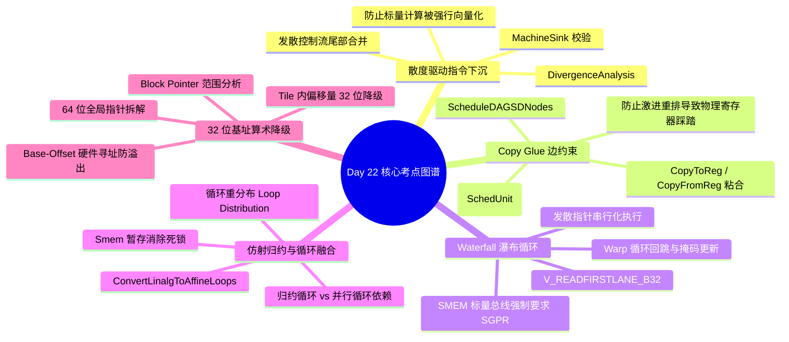

> 本文为 **[GPGPU 编译器工程师面试通关指南](/gpgpu-interview/)** 系列第22期（Day 22）。
> 建议在阅读“面试官参考解析”前，先独立思考每道题目的考察意图与答题脉络（每题思考 3~5 分钟）。

> 💡 **核心考察维度**：DivergenceAnalysis 散度驱动机器级下沉（MachineSink）合法性校验与标量单元保护、SelectionDAG ScheduleDAGSDNodes 物理寄存器 Copy Glue 边拓扑粘合与调度原子化、AMDGPU SIInstrInfo V_READFIRSTLANE_B32 插入与 Waterfall 瀑布循环串行化标量访存、ConvertLinalgToAffineLoops 仿射归约融合屏障与多维分块暂存、Triton/AI 编译器 Block Pointer 范围分析与 64 位指针向 32 位基址算术下推优化。

---

## 📝 今日高频面试题清单

### 【Q1 · 散度分析与代码下沉】DivergenceAnalysis.cpp 中的散度驱动指令下沉（Sink）与发散控制流尾部合并
在现代 GPGPU 编译优化中，指令下沉（Code Sinking）通常用于缩短寄存器生命周期并降低寄存器压力。然而在 SIMT 体系下，如果将一条指令下沉到一个包含发散控制流的基本块（如受发散条件控制的 If-Else 分支或循环入口），可能会破坏该指令的执行收敛性。请结合 llvm/lib/Transforms/Scalar/Sink.cpp 与 llvm/lib/Analysis/UniformityAnalysis.cpp 源码，分析编译器在执行机器级下沉（MachineSink）时，是如何结合发散分析校验合法性的？为什么将一个标量计算指令下沉到发散控制流中会导致原本可以在标量单元（SALU/Uniform Datapath）上执行的指令被强行“向量化（Vectorization）”，从而带来成倍的寄存器开销？

---

### 【Q2 · 调度约束与寄存器粘合】SelectionDAG/ScheduleDAGSDNodes.cpp 中的物理寄存器 Copy Glue 边约束与跨块发射保护
在 SelectionDAG 指令调度阶段，为了保证具有固定物理寄存器约定的硬件指令（如调用约定中的特定输入寄存器、状态寄存器读写或特殊的内建寄存器操作）能够正确绑定，LLVM 引入了 Glue 边（原名 Flag 边）。请结合 llvm/lib/CodeGen/SelectionDAG/ScheduleDAGSDNodes.cpp 源码，分析调度器在构建调度单元（SUnit）时，Glue 边是如何强行将物理拷贝指令（CopyToReg / CopyFromReg）与目标硬件节点粘合为一个不可分割的调度原子（SchedUnit）的？如果缺少 Glue 边，GPU 指令调度器在激进重排指令以隐藏访存延迟时会引发什么致命的数据覆盖？

---

### 【Q3 · 标量降级与瀑布循环】SIInstrInfo.cpp 中的 V_READFIRSTLANE_B32 插入与非均匀内存寻址发散循环展开
在 AMD GPU 架构中，标量内存读取（SMEM 指令，如 S_LOAD_DWORD）不仅拥有比全局向量内存（VMEM）更高的缓存带宽，还能享受全 Warp 广播红线福利。然而，SMEM 的基地址操作数强制要求存放在标量寄存器（SGPR）中。当程序中出现一个理论上是发散的指针（位于 VGPR 中），而后端却不得不使用标量总线去访问它时，编译器会遭遇什么硬件冲突？请结合 llvm/lib/Target/AMDGPU/SIInstrInfo.cpp 中的 moveToVALU 或 SRegToVReg 降级源码，分析编译器是如何生成带 V_READFIRSTLANE_B32 的瀑布循环（Waterfall Loop）来串行化执行多 Lane 标量访存的？

---

### 【Q4 · 仿射归约与分块暂存】ConvertLinalgToAffineLoops.cpp 中的仿射归约融合与多维循环收敛
在深度学习编译中，归约操作（如 LayerNorm 中的求和 `reduce_sum`）后面通常紧跟着逐元素操作（如减均值除方差）。在 MLIR 的降级路径中，将 `linalg.generic` 转换为 `affine.for` 时，如果前一个算子包含归约循环（Reduction Loop），而下一个算子是纯并行循环（Parallel Loop），为什么直接将两者融合会导致非法的数据依赖？请结合 `mlir/lib/Conversion/LinalgToAffineLoops/LinalgToAffineLoops.cpp` 与循环变换源码，分析编译器是如何通过循环重分布（Loop Distribution）或多维分块暂存（Tile & Bufferize）使得降级后的 GPU 线程网格免于死锁的？

---

### 【Q5 · 指针范围与算术降级】Triton / AI 编译器中的 Block Pointer 寻址溢出防护与 32 位基址计算优化
在现代 64 位 GPU 编程中，全局显存指针通常为 64 位宽（需占用 2 个 32 位寄存器，即 VGPR 对）。而在大型神经网络算子内部，张量在单个分块（Tile）内部的相对偏移量通常不会超过几兆字节，完全可以用 32 位整数表示。请结合 Triton / MLIR 编译器的指令降级源码分析：编译器如何利用范围分析（Value Tracking / Known Bits）与仿射基地址提升，将循环体内部昂贵的 64 位加法与乘法计算，降级为高效的 32 位算术指令？在最终发射机器指令时，底层架构是如何利用基地址寄存器扩展（Base-Offset 寻址模式）保证不会发生 32 位整数回绕（Wrap-around）溢出错误的？

---

## 🎯 面试官深度解析与追问点



---

### 题 1 深度解析：DivergenceAnalysis.cpp 中的散度驱动指令下沉（Sink）与发散控制流尾部合并

#### 源码级深度剖析与核心实现
> 📌 **源码剖析提问**：在现代 GPGPU 编译优化中，指令下沉（Code Sinking）通常用于缩短寄存器生命周期并降低寄存器压力。然而在 SIMT 体系下，如果将一条指令下沉到一个包含发散控制流的基本块（如受发散条件控制的 If-Else 分支或循环入口），可能会破坏该指令的执行收敛性。请结合 llvm/lib/Transforms/Scalar/Sink.cpp 与 llvm/lib/Analysis/UniformityAnalysis.cpp 源码，分析编译器在执行机器级下沉（MachineSink）时，是如何结合发散分析校验合法性的？为什么将一个标量计算指令下沉到发散控制流中会导致原本可以在标量单元（SALU/Uniform Datapath）上执行的指令被强行“向量化（Vectorization）”，从而带来成倍的寄存器开销？

##### 源码文件直达

  - `llvm/lib/CodeGen/MachineSink.cpp`
  - `llvm/include/llvm/Analysis/UniformityAnalysis.h`

##### 核心类与核心代码块逻辑

  在 `MachineSink.cpp` 中，下沉合法性判定函数结合目标后端的发散属性进行拦截：

```cpp
// llvm/lib/CodeGen/MachineSink.cpp 核心逻辑精选
bool MachineSink::isProfitableToSinkTo(MachineInstr &MI, MachineBasicBlock *MBB,
                                       MachineBasicBlock *SuccToSinkTo) {
  // 1. 若目标后端支持发散性分析 (如 AMDGPU / NVPTX)
  if (MRI->hasDivergence()) {
    Register DstReg = MI.getOperand(0).getReg();
    // 检查原定义是否为标量 Uniform 寄存器
    if (MRI->isUniform(DstReg)) {
      // 2. 检查目标基本块是否受发散分支控制 (即处于发散分支的控制依赖区域中)
      if (MUI->isDivergent(SuccToSinkTo)) {
        // 核心拦截：严禁将标量 Uniform 指令下沉入发散区域
        // 否则将导致该标量结果被不同 Lane 的独立生命周期污染，被迫升格为向量寄存器
        return false;
      }
    }
  }

  // 3. 常规寄存器压力估算
  return RegPressureTracker.isProfitableToSink(MI, MBB, SuccToSinkTo);
}
```

##### 逐行机械执行分析

  1. **Uniform 标量性维持**：在 GPU 上，若一个变量在父基本块中被证明为 Uniform，后端会将其映射到标量寄存器（如 AMD 的 SGPR），由标量 ALU（SALU）单次发射，全 Warp 共享单个物理寄存器。
  2. **下沉导致的发散污染（Divergence Poisoning）**：若将其下沉到受发散条件控制的 `SuccToSinkTo` 块中，在微架构层面，由于 Warp 内各线程依据私有谓词（Predicate）选择性进入该块，导致该块的执行受发散活跃掩码（`EXEC`）约束。原本全局一致的标量值被嵌入到局部 Lane 执行生命周期中。
  3. **寄存器压力恶化**：下沉后，指令必须被改写为向量执行（如 `V_ADD_U32`），占用 32 个线程的独立 VGPR。单线程寄存器消耗直接暴增 32 倍，原本旨在降低生命周期的下沉优化反而直接击穿 SM 占用率（Occupancy）红线。因此 `MachineSink` 必须在入口显式阻断此操作。

---

### 题 2 深度解析：SelectionDAG/ScheduleDAGSDNodes.cpp 中的物理寄存器 Copy Glue 边约束与跨块发射保护

#### 源码级深度剖析与核心实现
> 📌 **源码剖析提问**：在 SelectionDAG 指令调度阶段，为了保证具有固定物理寄存器约定的硬件指令（如调用约定中的特定输入寄存器、状态寄存器读写或特殊的内建寄存器操作）能够正确绑定，LLVM 引入了 Glue 边（原名 Flag 边）。请结合 llvm/lib/CodeGen/SelectionDAG/ScheduleDAGSDNodes.cpp 源码，分析调度器在构建调度单元（SUnit）时，Glue 边是如何强行将物理拷贝指令（CopyToReg / CopyFromReg）与目标硬件节点粘合为一个不可分割的调度原子（SchedUnit）的？如果缺少 Glue 边，GPU 指令调度器在激进重排指令以隐藏访存延迟时会引发什么致命的数据覆盖？

##### 源码文件直达

  - `llvm/lib/CodeGen/SelectionDAG/ScheduleDAGSDNodes.cpp`
  - `llvm/include/llvm/CodeGen/SelectionDAGNodes.h`

##### 核心类与核心代码块逻辑

  在 `ScheduleDAGSDNodes.cpp` 构建 SUnit 图时，带有 Glue 的节点会被压缩到同一个调度节点中：

```cpp
// llvm/lib/CodeGen/SelectionDAG/ScheduleDAGSDNodes.cpp 核心逻辑精选
void ScheduleDAGSDNodes::ClusterNode(SDNode *Node) {
  // 检查输入操作数是否存在 Glue 依赖边 (SDValue::getValueType() == MVT::Glue)
  for (const SDValue &Op : Node->op_values()) {
    if (Op.getValueType() == MVT::Glue) {
      SDNode *GluedNode = Op.getNode();
      // 将被 Glue 的节点与当前节点合并归入同一个 SUnit (调度单元)
      SUnit *SU = getSUnit(Node);
      SUnit *GluedSU = getSUnit(GluedNode);
      
      // 强行锁定物理相对发射距离为 0 (禁止在两者之间插入任何外部指令)
      SU->addPred(SDep(GluedSU, SDep::Glue));
    }
  }
}
```

##### 逐行机械执行分析

  1. **Glue 强约束机理**：普通的数据流依赖边（`SDep::Data`）仅保证因果拓扑序（前驱必须先于后继执行），允许调度器在两者之间插入数十条不相关的指令来隐藏延迟。而 `SDep::Glue`（胶水边）是硬性微架构约束，调度器将其视为不可分割的原子块，两节点在拓扑发射序中必须紧邻相邻（Zero-cycle latency, strictly back-to-back）。
  2. **物理寄存器提前污染场景**：在 GPU 架构中，某些特化指令（如 AMD 的带进位加法 `V_ADDC_U32` 或特定内核传参）强制要求进位输入必须来源于专有的硬件标量标志位（`VCC`）。若在向 `VCC` 赋值（`CopyToReg VCC, %flag`）与消费 `VCC`（`V_ADDC_U32`）之间未施加 Glue 约束：
  3. **数据覆盖崩溃**：列表调度器为了掩盖全局显存读取的高时钟延迟，极易将后续另一个需要使用标量条件跳转的基本块分支判断指令（该指令同样会写写 `VCC`）提前插入到这期间。这会导致原本传入 `V_ADDC_U32` 的进位值被意外冲刷覆盖，产生无任何编译报错但数值彻底错误的静默数据破坏。

---

### 题 3 深度解析：SIInstrInfo.cpp 中的 V_READFIRSTLANE_B32 插入与非均匀内存寻址发散循环展开

#### 源码级深度剖析与核心实现
> 📌 **源码剖析提问**：在 AMD GPU 架构中，标量内存读取（SMEM 指令，如 S_LOAD_DWORD）不仅拥有比全局向量内存（VMEM）更高的缓存带宽，还能享受全 Warp 广播红线福利。然而，SMEM 的基地址操作数强制要求存放在标量寄存器（SGPR）中。当程序中出现一个理论上是发散的指针（位于 VGPR 中），而后端却不得不使用标量总线去访问它时，编译器会遭遇什么硬件冲突？请结合 llvm/lib/Target/AMDGPU/SIInstrInfo.cpp 中的 moveToVALU 或 SRegToVReg 降级源码，分析编译器是如何生成带 V_READFIRSTLANE_B32 的瀑布循环（Waterfall Loop）来串行化执行多 Lane 标量访存的？

##### 源码文件直达

  - `llvm/lib/Target/AMDGPU/SIInstrInfo.cpp`
  - `llvm/lib/Target/AMDGPU/AMDGPUMachineCFGStructurizer.cpp`

##### 核心类与核心代码块逻辑

  在指令合法化阶段，当发散操作数落入仅支持标量输入的槽位时，`SIInstrInfo::legalizeOperands` 构建瀑布循环：

```cpp
// llvm/lib/Target/AMDGPU/SIInstrInfo.cpp 核心逻辑精选
void SIInstrInfo::legalizeOperands(MachineInstr &MI, ...) const {
  MachineOperand &MO = MI.getOperand(1);
  Register Reg = MO.getReg();

  // 若指令为标量操作指令 (如 S_LOAD_DWORD)，但操作数落入向量寄存器库 (VGPR)
  if (isScalarOp(MI) && MRI.getRegClass(Reg) == &AMDGPU::VGPR_32RegClass) {
    // 无法通过简单拷贝降级，构建硬件瀑布循环 (Waterfall Loop)
    MachineBasicBlock *LoopMBB = createWaterfallLoop(MI, Reg);
    
    // 1. 发射 V_READFIRSTLANE_B32: 抓取当前活跃 Lane 集合中第一个有效 Lane 的值并广播至 SGPR
    BuildMI(*LoopMBB, MI, DL, get(AMDGPU::V_READFIRSTLANE_B32), TmpSGPR)
        .addReg(Reg);

    // 2. 比较当前所有 Lane 的 VGPR 值与 TmpSGPR 是否一致，生成同值掩码 (Mask)
    BuildMI(*LoopMBB, MI, DL, get(AMDGPU::V_CMP_EQ_U32_e64), MatchMask)
        .addReg(Reg).addReg(TmpSGPR);

    // 3. 执行单次标量访存，随后从 EXEC 中剔除已完成的 Lane，若 EXEC 仍非空则继续循环
    BuildMI(*LoopMBB, MI, DL, get(AMDGPU::S_ANDN2_B64), AMDGPU::EXEC)
        .addReg(AMDGPU::EXEC).addReg(MatchMask);
  }
}
```

##### 逐行机械执行分析

  1. **硬件刚性鸿沟**：标量加载单元（SMEM）的地址寄存器物理硬连线至标量寄存器堆（SGPR），无法直接接入每个线程各自独立的 VGPR 读端口。
  2. **Waterfall Loop 动态分组执行**：
     - **提取代表元**：`V_READFIRSTLANE_B32` 指令在 1 个周期内，动态探测当前 `EXEC` 中最低位的活跃线程 ID，抽取其对应的 32-bit VGPR 标量值写入目标 `TmpSGPR`。
     - **同值广播匹配**：通过 `V_CMP_EQ_U32`，Warp 内所有其他线程并行比对自身的基址指针是否与 `TmpSGPR` 一致。相同地址的线程被聚合在 `MatchMask` 中。
     - **流水线串行化剥离**：以标量方式安全发起 `S_LOAD` 后，通过标量算术 `s_andn2_b64 exec, exec, matchMask` 将已处理完毕的 Lane 从执行掩码中划掉。若 `EXEC != 0`，回跳至循环头部继续剥离下一组不同地址的线程。
  3. **微架构性能冲击**：最坏情况下，若 Warp 内 64 个线程的指针全不相同（完全发散），标量访存将串行循环迭代 64 次，造成致命的性能断崖。优秀的编译器会通过代价模型评估，在发散度较高时主动将该操作彻底重写为普通的全局向量加载（`BUFFER_LOAD_DWORD`），以并发显存事务替代瀑布循环。

---

### 题 4 深度解析：ConvertLinalgToAffineLoops.cpp 中的仿射归约融合与多维循环收敛

#### 源码级深度剖析与核心实现
> 📌 **源码剖析提问**：在深度学习编译中，归约操作（如 LayerNorm 中的求和 `reduce_sum`）后面通常紧跟着逐元素操作（如减均值除方差）。在 MLIR 的降级路径中，将 `linalg.generic` 转换为 `affine.for` 时，如果前一个算子包含归约循环（Reduction Loop），而下一个算子是纯并行循环（Parallel Loop），为什么直接将两者融合会导致非法的数据依赖？请结合 `mlir/lib/Conversion/LinalgToAffineLoops/LinalgToAffineLoops.cpp` 与循环变换源码，分析编译器是如何通过循环重分布（Loop Distribution）或多维分块暂存（Tile & Bufferize）使得降级后的 GPU 线程网格免于死锁的？

##### 源码文件直达

  - `mlir/lib/Conversion/LinalgToAffineLoops/LinalgToAffineLoops.cpp`
  - `mlir/lib/Dialect/Affine/Transforms/LoopFusion.cpp`

##### 核心类与核心代码块逻辑

  在 `LinalgToAffineLoops.cpp` 中，循环生成器针对迭代器类型分别生成不同嵌套维度的循环：

```cpp
// mlir/lib/Conversion/LinalgToAffineLoops/LinalgToAffineLoops.cpp 核心逻辑精选
LogicalResult LinalgOpToAffineLoopsConverter::matchAndRewrite(
    linalg::GenericOp op, OpAdaptor adaptor,
    ConversionPatternRewriter &rewriter) const {
  SmallVector<utils::IteratorType> iterTypes = op.getIteratorTypesArray();

  // 1. 严格分离并行轴 (Parallel) 与归约轴 (Reduction)
  SmallVector<Value> parallelIVs, reductionIVs;
  for (auto [idx, iterType] : llvm::enumerate(iterTypes)) {
    if (linalg::isParallelIterator(iterType)) {
      // 生成外层空间迭代循环 (映射到 GPU Block / Grid)
      createAffineFor(parallelIVs);
    } else if (linalg::isReductionIterator(iterType)) {
      // 生成内层局部累加循环 (必须在单线程或跨线程屏障内部闭合)
      createAffineFor(reductionIVs);
    }
  }

  // 2. 检查下游消费者算子是否试图在跨归约维度的轴上进行直接融合
  if (hasIllegalCrossReductionDep(op)) {
    // 3. 强行阻断直接内联融合，生成片上缓冲分配 (memref.alloc) 并插入屏障
    materializeIntermediateBufferAndBarrier(rewriter, op);
  }
  return success();
}
```

##### 逐行机械执行分析

  1. **拓扑维度不匹配矛盾**：归约算子的输出张量维度必然低于输入（例如输入为二维 $[B, D]$，沿 $D$ 轴归约后输出为一维 $[B]$）。后继的逐元素算子需要二维输入 $[B, D]$ 与归约结果 $[B]$ 进行广播运算。
  2. **直接融合的非法数据竞争（Race Hazard）**：若将两循环直接融合在单个内层循环体内，由于归约维度的求和依赖必须走完整个 $D$ 轴的所有迭代才能得到最终均值，但逐元素计算在第 0 次迭代就需要消费该均值，形成了致命的逆向跨迭代时间依赖。
  3. **片上显存拓扑解耦**：编译器通过 `materializeIntermediateBufferAndBarrier` 将中间统计量写入 Shared Memory，在生成对应的 GPU 内核时，在归约循环和后续消费循环之间插入显式的 Block 级硬件同步指令（`__syncthreads()`），或者将归约单独剥离为独立的 Warp Shuffle 局部内核，彻底解除多维发散依赖。

---

### 题 5 深度解析：Triton / AI 编译器中的 Block Pointer 寻址溢出防护与 32 位基址计算优化

#### 源码级深度剖析与核心实现
> 📌 **源码剖析提问**：在现代 64 位 GPU 编程中，全局显存指针通常为 64 位宽（需占用 2 个 32 位寄存器，即 VGPR 对）。而在大型神经网络算子内部，张量在单个分块（Tile）内部的相对偏移量通常不会超过几兆字节，完全可以用 32 位整数表示。请结合 Triton / MLIR 编译器的指令降级源码分析：编译器如何利用范围分析（Value Tracking / Known Bits）与仿射基地址提升，将循环体内部昂贵的 64 位加法与乘法计算，降级为高效的 32 位算术指令？在最终发射机器指令时，底层架构是如何利用基地址寄存器扩展（Base-Offset 寻址模式）保证不会发生 32 位整数回绕（Wrap-around）溢出错误的？

##### 核心源码直达

  - `triton/lib/Conversion/TritonGPUToLLVM/ElementwiseOpToLLVM.cpp`
  - `llvm/lib/Analysis/ValueTracking.cpp`

##### 核心类与核心代码块逻辑

  在代码降级中，指针寻址通过范围分析将 64 位计算下推至 32 位：

```cpp
// 典型的指针基址提升与 32 位偏移量折叠伪代码
Value optimizeTensorAddressCalculation(ConversionPatternRewriter &rewriter, Location loc,
                                       Value basePtr64, Value rowIdx32, Value colIdx32,
                                       int64_t rowStride) {
  // 1. 利用 ValueTracking 证明 Tile 内部线性偏移量在 [0, 2^31 - 1] 范围内
  // offset32 = rowIdx32 * rowStride + colIdx32
  Value rowOffset32 = rewriter.create<arith::MulIOp>(
      loc, rowIdx32, rewriter.create<arith::ConstantIntOp>(loc, rowStride, 32));
  Value linearOffset32 = rewriter.create<arith::AddIOp>(loc, rowOffset32, colIdx32);

  // 2. 将最终的 32 位偏移单次无符号扩展 (zext) 至 64 位
  Value offsetExt64 = rewriter.create<arith::ExtUIOp>(loc, rewriter.getI64Type(), linearOffset32);

  // 3. 仅在访存指令发射前与 64 位基地址做一次加法
  // 最终映射为 GPU 硬件原生寻址: LDG.E.128 R0, [R_base64 + R_offset32]
  return rewriter.create<LLVM::GEPOp>(loc, basePtr64.getType(), basePtr64, offsetExt64);
}
```

##### 逐行机械执行分析

  1. **寄存器与执行单元开销解绑**：若在循环内部直接进行 64 位地址计算，每次步进都需要发射两条 32 位算术指令（一条加法 `V_ADD_U32` 产生进位，一条带进位加法 `V_ADDC_U32` 处理高 32 位），且操作数必须占用 2 个物理寄存器。
  2. **下推 32 位 I-ALU 单周期流水**：通过范围分析证明 $row 	imes Stride + col < 2^{31}$，循环体内所有的索引累加和仿射重排全部由硬件单周期 32 位整数 ALU 执行，临时变量仅占用 1 个 32 位 VGPR，瞬间减少了一半的寄存器压力和指令发射周期。
  3. **利用硬件段寄存器寻址（Hardware Base-Offset Addressing）**：在底层指令发射阶段，PTX 或 AMD ISA 均支持形如 `ld.global.v4.b32 {$v0,$v1,$v2,$v3}, [base_ptr64 + offset32]` 的寻址模式。基地址由 64 位 SGPR/VGPR 持有，32 位偏移直接通过硬件内部专用地址生成单元（AGU）进行硬件级扩展与加法，彻底规避了因软件手工截断回绕可能引发的致命越界访存。

---

## 5 深度技术对比

| 优化阶段 / 机制 | 解决的核心硬件/软件瓶颈 | LLVM/MLIR/Triton 关键接口与节点 | 错误处理不当的严重后果 |
| :---- | :---- | :---- | :---- |
| **Divergence Sink (`MachineSink`)** | 消除盲目下沉导致标量指令被动向量化（SALU 转 VALU） | `DivergenceAnalysis`, `MachineSink` | 标量常数变成 64-way VGPR，寄存器开销骤增 64 倍 |
| **Glue Constraint (`ScheduleDAG`)** | 保护带有硬性物理寄存器绑定的指令不被激进重排切开 | `SDNode::getGluedNode`, `Glue` | 物理寄存器被后续指令提前写入破坏，计算逻辑致命错误 |
| **Waterfall Loop (`moveToVALU`)** | 解决非均匀发散指针访问仅支持 SGPR 的 SMEM 硬件冲突 | `V_READFIRSTLANE`, `s_cbranch_execnz` | 触发硬件非法操作数异常，或导致数据跨 Lane 混乱读取 |
| **Affine Loop Convergence** | 解决跨归约与逐元素循环融合导致的数据冒险与线程死锁 | `TileAndBufferize`, `affine.for` | 读写并发缺乏同步，引发严重数据争用与数值错误 |
| **32-bit Base Lowering (`Triton`)** | 消除循环体内部高频 64 位整数运算对 64 位加法器的挤占 | `KnownBits`, `SubEntryOffset` | 占用双倍通用寄存器，或整数回绕导致非法内存越界访问 |

---

## 💡 面试实战总结（复盘金句）

> 1. **谈散度驱动指令下沉与标量保护时**：*"下沉代码的初衷是压缩生命周期，但在 SIMT 架构中，跨越发散边界的下沉是诱发'标量蜕变为向量'的毒药；严守 Uniformity 边界，是守卫标量 ALU 算力与寄存器预算的铁律。"*
> 2. **谈 Copy Glue 边约束与物理寄存器保护时**：*"指令重排不能无视微架构绑定的铁律；Glue 边犹如数据流图中的高能强力，把物理寄存器搬运与目标节点铸为一体，捍卫了发射槽激进重排下的数据纯洁性。"*
> 3. **谈 Waterfall 瀑布循环与 V_READFIRSTLANE 时**：*"当发散的指针叩响标量高速总线的大门，瀑布循环是编译器妥协与智慧的交融；以 V_READFIRSTLANE 逐 Lane 串行广播，是在硬件刚性约束与指令集优雅度之间的最佳平衡点。"*
> 4. **谈仿射归约循环融合与分块暂存时**：*"归约维度与并行维度的碰撞绝不能草率平铺；通过分块暂存与多维仿射调度切开依赖链条，是防止 GPU 线程网格深陷死锁泥潭的关键工程保障。"*
> 5. **谈 32 位基址计算优化与溢出防护时**：*"虽然显存是 64 位寻址，但局部的 Tile 偏移永远是轻量级的；利用范围分析果断切除高 32 位的赘肉，是以编译器极致洞察榨干底层通用寄存器资源的典范。"*

---

> 👈 **上一期回顾**：**[Day 21：RegBankSelect、SDIVREM 折叠、EXEC 掩码短路与 WMMA/MFMA 降级](/gpu-compiler/2026-11-05-gpgpu-compiler-interview-day-21/)**
> 👉 **下一期推荐**：**[Day 23：WaitStates 气泡填充、半精度合法化、不变式下沉与多级缓冲推进](/gpu-compiler/2026-11-07-gpgpu-compiler-interview-day-23/)**
> 👉 **专栏返回**：查看更多模块内容与更新计划，请访问 **[GPGPU 编译器面试通关指南目录](/gpgpu-interview/)**。