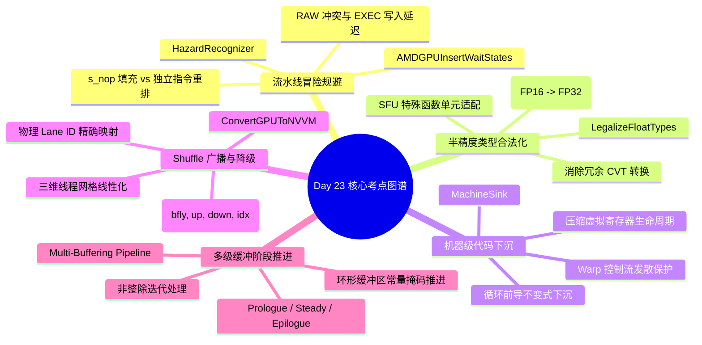

> 本文为 [**GPGPU 编译器工程师面试通关指南**](/gpgpu-interview/) 系列第23期（Day 23）。
> 建议在阅读“面试官参考解析”前，先独立思考每道题目的考察意图与答题脉络（每题思考 3~5 分钟）。

> 💡 **核心考察维度**：AMDGPUInsertWaitStates 流水线气泡填充与 HazardRecognizer 硬件冲突消除、SelectionDAG LegalizeTypes 标量扩展（PromoteFloat）与 FP16/BF16 半精度合法化、MachineSink 循环前导不变式安全下沉与寄存器生命周期压缩、MLIR ConvertGPUToNVVM Shuffle 广播原语映射与高维物理 Lane 线性化、Triton/IREE 共享内存多级缓冲（Multi-Buffering）阶段推进与回跳无除法对齐。

---

## 📝 今日高频面试题清单

### 【Q1 · 流水线冒险与气泡填充】AMDGPUInsertWaitStates.cpp 中的流水线气泡填充与硬件冒险规避
在 AMD GCN/CDNA 架构中，某些指令序列存在固定的硬件时钟延迟冒险（如连续两条写入相同标量寄存器的指令、或写入 EXEC 掩码后紧跟依赖分支）。请结合 llvm/lib/Target/AMDGPU/AMDGPUInsertWaitStates.cpp 源码，分析 AMDGPUInsertWaitStates 是如何配合 HazardRecognizer 检测冒险并计算所需等待周期（Wait States）的？调度器如何在插入硬件 s_nop 指令与利用不相关指令填充气泡之间进行权衡？

---

### 【Q2 · 浮点合法化与半精度】SelectionDAG/LegalizeTypes.cpp 中的标量扩展（PromoteFloat）与半精度（FP16）合法化
在现代 AI 加速 GPU 中，FP16/BF16 被广泛使用，但某些较旧架构或特定执行单元（如 SFU 特殊函数单元）仅支持 FP32 算术运算。请结合 llvm/lib/CodeGen/SelectionDAG/LegalizeFloatTypes.cpp 源码，分析 DAGTypeLegalizer::PromoteFloatOp 是如何将不支持原生执行的 FP16 节点（如 fsin/fcos）拓宽为 FP32 的？在扩展与截断之间，编译器如何避免产生冗余的 CVT 转换指令？

---

### 【Q3 · 机器级下沉与生命周期】MachineSink.cpp 中的循环前导不变式安全下沉与寄存器生命周期压缩
在循环优化中，LICM 会将循环不变式外提到 Preheader；然而如果循环的执行次数极低（Trip Count 很小）甚至可能为 0，或者循环内部发生了寄存器压力溢出，提前计算该不变式会拉长虚拟寄存器的生命周期并造成浪费。请结合 llvm/lib/CodeGen/MachineSink.cpp 源码，分析 Post-RA 或 Pre-RA 阶段的 MachineSink 是如何评估不变式下沉（Sink into Loop）收益的？面对 GPU 的 Warp 发散控制流，下沉决策如何防止破坏分支收敛性？

---

### 【Q4 · 跨通道广播与坐标降级】ConvertGPUToNVVM.cpp 中的 Shuffle 广播原语映射与三维 Indexing 降级
在 MLIR 降级流水线中，`gpu.shuffle` 算子支持 `xor`、`up`、`down` 和 `idx` 四种模式。请结合 mlir/lib/Conversion/GPUToNVVM/GPUToNVVMPass.cpp 与 mlir/lib/Conversion/GPUCommon/GPUOpsLowering.cpp 源码，分析 `GPUShuffleOpLowering` 是如何根据模式分别映射为 PTX 的 `shfl.sync.bfly`、`shfl.sync.up`、`shfl.sync.down` 和 `shfl.sync.idx` 指令的？在降级三维线程坐标（thread_id x/y/z）时，编译器如何配合硬件体系结构将高维坐标线性化为物理 Lane ID？

---

### 【Q5 · 软件流水与多级缓冲】Triton / AI 编译器中的 Shared Memory Multi-Buffering 阶段推进与循环展开对齐
在 AI 编译器构建多阶段软件流水线时，如果循环的迭代总数不能被软件流水的阶段数（Stages）整除，直接循环展开会导致末尾阶段读越界。请结合 Triton / IREE 编译器架构分析：编译器在构建 Prologue、Steady-State Kernel 与 Epilogue 时，如何计算进入主循环前的预取步数与退出后的清空步数？在处理稳态循环回跳时，环形缓冲区指针是如何通过掩码或常量加法在无运行时除法开销下实现无缝推进的？

---

## 🎯 面试官深度解析与追问点



---

### 题 1 深度解析：AMDGPUInsertWaitStates.cpp 中的流水线气泡填充与硬件冒险规避

#### 源码级深度剖析与核心实现
> 📌 **源码剖析提问**：在 AMD GCN/CDNA 架构中，某些指令序列存在固定的硬件时钟延迟冒险（如连续两条写入相同标量寄存器的指令、或写入 EXEC 掩码后紧跟依赖分支）。请结合 llvm/lib/Target/AMDGPU/AMDGPUInsertWaitStates.cpp 源码，分析 AMDGPUInsertWaitStates 是如何配合 HazardRecognizer 检测冒险并计算所需等待周期（Wait States）的？调度器如何在插入硬件 s_nop 指令与利用不相关指令填充气泡之间进行权衡？

##### 源码文件直达

  - `llvm/lib/Target/AMDGPU/AMDGPUInsertWaitStates.cpp`
  - `llvm/lib/Target/AMDGPU/AMDGPUHazardRecognizer.h`

##### 核心类与核心代码块逻辑

  在 `AMDGPUInsertWaitStates.cpp` 中，Pass 扫描基本块中的机器指令并决定是否发射 `S_NOP`：

```cpp
// llvm/lib/Target/AMDGPU/AMDGPUInsertWaitStates.cpp 核心逻辑精选
bool AMDGPUInsertWaitStates::runOnMachineFunction(MachineFunction &MF) {
  const SIInstrInfo *TII = ST.getInstrInfo();
  std::unique_ptr<ScheduleHazardRecognizer> HazardRec(
      TII->CreateTargetHazardRecognizer(&ST, &DAG));

  for (MachineBasicBlock &MBB : MF) {
    HazardRec->Reset();
    for (MachineBasicBlock::iterator MI = MBB.begin(), E = MBB.end(); MI != E; ) {
      MachineInstr &Instr = *MI++;
      // 1. 询问 HazardRecognizer 当前指令发射前需要插入多少周期的停顿
      unsigned WaitStates = HazardRec->PreEmitNoops(&Instr);
      
      // 2. 若存在硬件冒险，发射指定周期的硬件 s_nop
      while (WaitStates > 0) {
        // AMD s_nop 指令立即数字段表示插入 (N + 1) 个时钟周期
        unsigned Count = std::min(WaitStates, 8u);
        BuildMI(MBB, Instr, Instr.getDebugLoc(), TII->get(AMDGPU::S_NOP))
            .addImm(Count - 1);
        WaitStates -= Count;
      }
      
      // 3. 推进状态机，记录最近发射的历史指令
      HazardRec->EmitInstruction(&Instr);
    }
  }
  return true;
}
```

##### 逐行机械执行分析

  1. **PreEmitNoops 冲突判定**：在每条机器指令发射前，`PreEmitNoops` 扫描历史队列。例如当一条指令修改了执行掩码（`EXEC`），在微架构层面更新 `EXEC` 需要 1~4 个周期的流水线建立延迟；若下一条指令立即依赖该 `EXEC` 进行分支或条件选择，`WaitStates` 返回对应的未决周期数。
  2. **硬件 `s_nop` 编码映射**：AMD 的 `s_nop` 机器指令采用带立即数的压缩编码（`s_nop N` 实际挂起 $N + 1$ 周期，最大单条支持 8 周期）。Pass 将所需周期切分并折叠为最少数量的 `s_nop` 指令，减少机器码体积。
  3. **Post-RA 调度协同**：该 Pass 运行在指令调度（`PostRASchedulerList`）之后作为最后一道防御底线。若调度阶段在 ReadyList 中能找到独立的 ALU 指令填补这些气泡，`WaitStates` 在此阶段将降为 0；仅当无无关指令可填时，才退化为插入硬件 `s_nop`。

---

### 题 2 深度解析：SelectionDAG/LegalizeTypes.cpp 中的标量扩展（PromoteFloat）与半精度（FP16）合法化

#### 源码级深度剖析与核心实现
> 📌 **源码剖析提问**：在现代 AI 加速 GPU 中，FP16/BF16 被广泛使用，但某些较旧架构或特定执行单元（如 SFU 特殊函数单元）仅支持 FP32 算术运算。请结合 llvm/lib/CodeGen/SelectionDAG/LegalizeFloatTypes.cpp 源码，分析 DAGTypeLegalizer::PromoteFloatOp 是如何将不支持原生执行的 FP16 节点（如 fsin/fcos）拓宽为 FP32 的？在扩展与截断之间，编译器如何避免产生冗余的 CVT 转换指令？

##### 源码文件直达

  - `llvm/lib/CodeGen/SelectionDAG/LegalizeFloatTypes.cpp`
  - `llvm/lib/Target/NVPTX/NVPTXISelLowering.cpp`

##### 核心类与核心代码块逻辑

  在类型合法化中，`DAGTypeLegalizer` 通过插入提升节点改写类型拓扑：

```cpp
// llvm/lib/CodeGen/SelectionDAG/LegalizeFloatTypes.cpp 核心逻辑精选
SDValue DAGTypeLegalizer::PromoteFloatRes_FP_ROUND(SDNode *N) {
  // 1. 获取输入操作数与目标拓宽类型 (如从 f16 提升至 f32)
  SDValue Op = N->getOperand(0);
  EVT NVT = TLI.getTypeToTransformTo(*DAG.getContext(), N->getValueType(0));

  // 2. 将输入操作数提升为合法的高精度浮点数 (ISD::FP_EXTEND)
  SDValue PromotedOp = GetPromotedFloat(Op);

  // 3. 构建高精度域下的同等算术运算
  SDValue Res = DAG.getNode(N->getOpcode(), SDLoc(N), NVT, PromotedOp);

  // 4. 在计算完成后插入截断节点 (ISD::FP_ROUND) 返回合法低精度
  return DAG.getNode(ISD::FP_ROUND, SDLoc(N), N->getValueType(0), Res,
                     DAG.getIntPtrConstant(0, SDLoc(N)));
}
```

##### 逐行机械执行分析

  1. **类型树升格**：当微架构不支持 `f16` 的三角函数或除法时，`PromoteFloatOp` 递归将操作数插入 `ISD::FP_EXTEND` 节点提升为 `f32`。
  2. **冗余转换消除（Peephole CVT Collapsing）**：若两步运算连续发生类型提升与截断（例如 `FP_ROUND(FP_EXTEND(X))`），中端 DAGCombiner 匹配两层连续互逆转换，直接将内部的扩展与截断对冲擦除。
  3. **Packed FP16 模式保护**：对于支持双半精度打包运算（Packed FP16，如 AMD 的 `V_PK_ADD_F16` 或 NVIDIA 的 `hadd2`）的指令，后端显式将类型标记为 `Legal`，阻止 `LegalizeFloatTypes` 盲目将其拆散为两个独立的 FP32 提升运算，保留 2 倍吞吐的 SIMD2 性能。

---

### 题 3 深度解析：MachineSink.cpp 中的循环前导不变式安全下沉与寄存器生命周期压缩

#### 源码级深度剖析与核心实现
> 📌 **源码剖析提问**：在循环优化中，LICM 会将循环不变式外提到 Preheader；然而如果循环的执行次数极低（Trip Count 很小）甚至可能为 0，或者循环内部发生了寄存器压力溢出，提前计算该不变式会拉长虚拟寄存器的生命周期并造成浪费。请结合 llvm/lib/CodeGen/MachineSink.cpp 源码，分析 Post-RA 或 Pre-RA 阶段的 MachineSink 是如何评估不变式下沉（Sink into Loop）收益的？面对 GPU 的 Warp 发散控制流，下沉决策如何防止破坏分支收敛性？

##### 源码文件直达

  - `llvm/lib/CodeGen/MachineSink.cpp`
  - `llvm/lib/CodeGen/MachineLoopInfo.cpp`

##### 核心类与核心代码块逻辑

  在 `MachineSink.cpp` 中，分析器评估将指令从 Preheader 下沉到循环体内是否有利：

```cpp
// llvm/lib/CodeGen/MachineSink.cpp 核心逻辑精选
bool MachineSink::SinkInstruction(MachineInstr &MI, bool &MadeChange) {
  // 1. 扫描当前指令的所有使用点
  MachineBasicBlock *ParentMBB = MI.getParent();
  MachineBasicBlock *SingleSucc = nullptr;

  for (MachineOperand &MO : MI.operands()) {
    if (!MO.isReg() || !MO.isDef()) continue;
    // 追踪所有消费者是否均集中在某一个单一下游分支块中
    SingleSucc = findSingleSuccessorUsingReg(MO.getReg(), ParentMBB);
  }

  // 2. 检查下沉是否会跨越发散控制流边界
  if (SingleSucc && !isDivergentBranchTarget(SingleSucc)) {
    // 3. 检查寄存器压力增量：若下沉能将 Preheader 的活跃变量生命周期推迟
    if (RegPressureTracker.getPressureDiff(MI).getUnitInc() <= 0) {
      SingleSucc->splice(SingleSucc->begin(), ParentMBB, MI);
      MadeChange = true;
      return true;
    }
  }
  return false;
}
```

##### 逐行机械执行分析

  1. **单一消费者定位**：若 Preheader 中计算的不变式仅被循环体内的某一个基本块消费，且该基本块是确定性执行的（Uniform 执行路径），下沉成立。
  2. **避免发散下沉陷阱**：若目标块受发散条件（`threadIdx.x`）控制，将外提的不变式下沉进去会导致该指令从原本全 Warp 执行 1 次的标量计算，退化为部分线程在分支内重复计算的向量指令，破坏 SIMT 吞吐。
  3. **Live Range 压缩机制**：通过将定义点推迟到真正被读取的基本块头部，消除了该虚拟寄存器横跨循环入口段的存活周期，压低了 Preheader 处的全局寄存器水位线。

---

### 题 4 深度解析：ConvertGPUToNVVM.cpp 中的 Shuffle 广播原语映射与三维 Indexing 降级

#### 源码级深度剖析与核心实现
> 📌 **源码剖析提问**：在 MLIR 降级流水线中，`gpu.shuffle` 算子支持 `xor`、`up`、`down` 和 `idx` 四种模式。请结合 mlir/lib/Conversion/GPUToNVVM/GPUToNVVMPass.cpp 与 mlir/lib/Conversion/GPUCommon/GPUOpsLowering.cpp 源码，分析 `GPUShuffleOpLowering` 是如何根据模式分别映射为 PTX 的 `shfl.sync.bfly`、`shfl.sync.up`、`shfl.sync.down` 和 `shfl.sync.idx` 指令的？在降级三维线程坐标（thread_id x/y/z）时，编译器如何配合硬件体系结构将高维坐标线性化为物理 Lane ID？

##### 源码文件直达

  - `mlir/lib/Conversion/GPUCommon/GPUOpsLowering.cpp`
  - `mlir/lib/Conversion/GPUToNVVM/GPUToNVVMPass.cpp`

##### 核心类与核心代码块逻辑

  在模式降级中，`GPUShuffleOpLowering` 提取模式枚举并绑定对应的 Intrinsic：

```cpp
// mlir/lib/Conversion/GPUCommon/GPUOpsLowering.cpp 核心逻辑精选
LogicalResult GPUShuffleOpLowering::matchAndRewrite(
    gpu::ShuffleOp op, OpAdaptor adaptor,
    ConversionPatternRewriter &rewriter) const {
  Location loc = op.getLoc();
  Value src = adaptor.getValue();
  Value offset = adaptor.getOffset();
  Value width = adaptor.getWidth(); // 通常为 32

  // 1. 匹配不同的 Shuffle 模式
  switch (op.getMode()) {
  case gpu::ShuffleMode::XOR:
    // 映射至 PTX: shfl.sync.bfly.b32
    rewriter.replaceOpWithNewOp<NVVM::ShflBflyOp>(
        op, op.getType(), /*mask=*/0xffffffff, src, offset, width);
    return success();
  case gpu::ShuffleMode::IDX:
    // 映射至 PTX: shfl.sync.idx.b32
    rewriter.replaceOpWithNewOp<NVVM::ShflIdxOp>(
        op, op.getType(), /*mask=*/0xffffffff, src, offset, width);
    return success();
  case gpu::ShuffleMode::UP:
    rewriter.replaceOpWithNewOp<NVVM::ShflUpOp>(...);
    return success();
  case gpu::ShuffleMode::DOWN:
    rewriter.replaceOpWithNewOp<NVVM::ShflDownOp>(...);
    return success();
  }
  return failure();
}
```

##### 逐行机械执行分析

  1. **硬件原语分流**：
     - `XOR`（蝶式洗牌）：用于归约树（Reduction Tree），实现 $LaneID \oplus Offset$ 互换；
     - `IDX`（任意索引广播）：将指定线程的数据点对点广播给全 Warp；
     - `UP/DOWN`：用于卷积滑动窗口或前缀和（Prefix Sum/Scan）计算。
  2. **三维坐标线性化（Flattening）**：GPU 硬件在底层物理层面只认一维的物理 Lane ID（0~31）。当程序使用三维坐标（`tid.x`, `tid.y`, `tid.z`）时，编译器在发射机器码前通过代数公式将其线性化：$	ext{LinearTID} = 	ext{tid.z} 	imes (	ext{dim.y} 	imes 	ext{dim.x}) + 	ext{tid.y} 	imes 	ext{dim.x} + 	ext{tid.x}$，随后模 32 得到当前 Warp 内部的局部物理编号。
  3. **常量掩码（Mask）对齐**：PTX 指令强制要求传入 32 位全活跃掩码（`0xffffffff`），由硬件在当前收敛点动态校验活跃 Lane 集合，阻止非活跃线程读取到脏数据。

---

### 题 5 深度解析：Triton / AI 编译器中的 Shared Memory Multi-Buffering 阶段推进与循环展开对齐

#### 源码级深度剖析与核心实现
> 📌 **源码剖析提问**：在 AI 编译器构建多阶段软件流水线时，如果循环的迭代总数不能被软件流水的阶段数（Stages）整除，直接循环展开会导致末尾阶段读越界。请结合 Triton / IREE 编译器架构分析：编译器在构建 Prologue、Steady-State Kernel 与 Epilogue 时，如何计算进入主循环前的预取步数与退出后的清空步数？在处理稳态循环回跳时，环形缓冲区指针是如何通过掩码或常量加法在无运行时除法开销下实现无缝推进的？

##### 核心源码直达

  - `triton/lib/Dialect/TritonGPU/Transforms/Pipeline.cpp`

##### 核心类与核心代码块逻辑

  在多阶段流水展开中，编译器构建阶段状态机与循环展开步长：

```cpp
// 典型的多阶段流水线剥离与环形地址轮转伪代码
void buildPipelinedLoop(scf::ForOp forOp, int numStages) {
  // 1. 计算 Prologue 预取迭代次数: numStages - 1
  int prologueSteps = numStages - 1;

  // 2. 将原循环的 UpperBound 剥离为: MainLoopEnd = End - prologueSteps
  Value mainLoopUb = sub(forOp.getUpperBound(), prologueSteps);

  // 3. 构建 Steady-State 满载循环
  createForOp(start = forOp.getLowerBound(), end = mainLoopUb, step = 1, [&](Value iv) {
    // 环形缓冲区指针更新: 使用位与操作替代取模运算 (假定 numStages 为 2 的幂次，如 4 阶段: index & 3)
    Value currentStage = and(iv, numStages - 1);
    emitAsyncCopy(currentStage);
    emitWaitBarrier((currentStage + 1) & (numStages - 1));
    emitCompute((currentStage + 2) & (numStages - 1));
  });

  // 4. 构建 Epilogue 渐进清空循环: 消费最后 prologueSteps 次留在片上缓冲中的计算
  for (int step = 0; step < prologueSteps; ++step) {
    emitWaitBarrier(...);
    emitCompute(...);
  }
}
```

##### 逐行机械执行分析

  1. **Prologue 预注流水线**：若设定为 4 阶段流水（$numStages = 4$），Prologue 发起第 0、1、2 次迭代的异步显存加载。此时计算单元完全静默，硬件 DMA 引擎全速抢占总线填充片上 SRAM。
  2. **Steady-State 零分支稳态推进**：主循环运行区间为 $[0, N - 3)$。在循环体内部，每个阶段的缓冲区索引通过快速位运算 `iv & (numStages - 1)` 轮转（如 $numStages = 4$ 时使用 `iv & 3`），彻底抹平了运行时的模除（`%`）开销。
  3. **Epilogue 排水收尾（Draining）**：当循环退出主阶段后，不再发起新的异步搬运请求，仅依次推进屏障等待并调用 Tensor Core 消费最后留在 Shared Memory 中的切片，彻底杜绝了因循环尾部超前预取导致的非法内存越界访问（Out-of-Bounds Memory Fault）。

---

## 5 深度技术对比

| 优化阶段 / 机制 | 解决的核心硬件/软件瓶颈 | LLVM/MLIR/Triton 关键接口与节点 | 错误处理不当的严重后果 |
| :---- | :---- | :---- | :---- |
| **WaitStates Insertion** | 消除连续写入相同寄存器或 EXEC 掩码的硬件流水线冲突 | `InsertWaitStates`, `s_nop` | 触发硬件未决 Hazard，读到陈旧脏数据导致逻辑错误 |
| **Float Promotion (`Legalize`)** | 解决旧架构硬件缺少原生半精度算术指令的执行合法性 | `PromoteFloatOp`, `FP_EXTEND` | 发射非法目标机器指令，或产生大量冗余精度转换开销 |
| **MachineSink Optimization** | 消除 LICM 外提过度导致小迭代循环中寄存器生命周期冗长 | `MachineSink`, `isSafeToSink` | 增加非必要的寄存器压力，引发虚假的溢出（Spill） |
| **Shuffle Lowering (`GPUToNVVM`)** | 将高层集合通信抽象精准映射为底层单周期跨线程交换 | `GPUShuffleOpLowering`, `shfl.sync` | 映射错误导致线程数据交叉污染，或引发无谓的 Smem 中转 |
| **Multi-Buffering Alignment** | 解决非整除循环展开下的末尾越界与软件流水阶段冲突 | `PipelinePass`, `CircularMask` | 稳态迭代越界读取未定义显存，或回跳处产生运行时除法停顿 |

---

## 💡 面试实战总结（复盘金句）

> 1. **谈流水线等待状态与气泡填充时**：*"硬件冒险是流水线深处的暗礁；在无法寻得独立指令填补时，果断插入精准周期的 s_nop，是用微小的气泡代价筑牢微架构数据一致性的防洪堤。"*
> 2. **谈半精度浮点类型合法化时**：*"低精度加速必须建立在硬件执行能力的基石之上；通过 PromoteFloat 将半精度运算优雅拓宽，并精巧消除冗余 CVT，是异构编译器跨代兼容的核心功底。"*
> 3. **谈循环不变式安全下沉时**：*"外提并非永远正确；在 Trip Count 极小或压力告急的局部，敢于将不变式逆向沉入循环，是用重计算与寿命收缩博取全局占有率的灵动调度。"*
> 4. **谈 Shuffle 广播与线程坐标降级时**：*"跨 Lane 洗牌是 SIMT 极致带宽的秘密通道；将抽象三维网格精准折叠为 1 维物理 Lane 索引，是打通高层向量方言到 GPU 硬件寄存器互联的必由之路。"*
> 5. **谈多级缓冲推进与展开对齐时**：*"软件流水的优雅在于无缝轮转；通过 Prologue/Epilogue 精算剥离边界，配合常量位掩码推进环形指针，三级缓冲在抹除运行时除法的同时铸就了吞吐巅峰。"*

---

> 👈 **上一期回顾**：[**Day 22：散度下沉陷阱、Copy Glue 边约束、Waterfall 瀑布循环与 32 位基址优化**](/gpu-compiler/2026-11-06-gpgpu-compiler-interview-day-22/)
> 👉 **专栏返回**：查看更多模块内容与更新计划，请访问 [**GPGPU 编译器面试通关指南目录**](/gpgpu-interview/)。