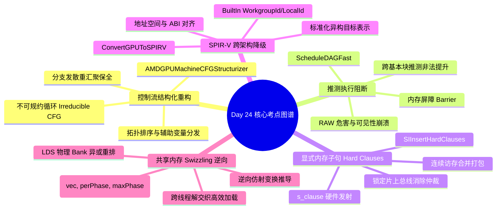

> 本文为 **[GPGPU 编译器工程师面试通关指南](/gpgpu-interview/)** 系列第24期（Day 24）。
> 建议在阅读“面试官参考解析”前，先独立思考每道题目的考察意图与答题脉络（每题思考 3~5 分钟）。

> 💡 **核心考察维度**：AMDGPUMachineCFGStructurizer 串行化流重构与不可规约循环消解、ScheduleDAGFast 内存屏障与跨基本块推测执行阻断、SIInsertHardClauses 显式内存子句打包与总线仲裁、ConvertGPUToSPIRV 工作组内置变量降级与跨架构抽象统一、Triton/AI 编译器片上共享内存 (vec, perPhase, maxPhase) Swizzling 逆向推导与解交织加载。

---

## 📝 今日高频面试题清单

### 【Q1 · 控制流结构化重构】AMDGPUMachineCFGStructurizer.cpp 中的串行化流重构与不可规约循环消解
在现代 GPGPU 体系结构中，硬件通过标量执行掩码（EXEC）推进 SIMT 控制流。当遇到包含多入口的不可规约控制流图（Irreducible CFG，如交叉跳转分支）时，硬件无法自然收敛。请结合 llvm/lib/Target/AMDGPU/AMDGPUMachineCFGStructurizer.cpp 源码，分析 AMDGPUMachineCFGStructurizer 是如何利用线性拓扑排序（Topological Order）与布尔状态机（State Machine Emulation）将不可规约图拆解为单入口单出口（SESE）结构化流的？在转换过程中插入的显式状态变量（State Register）是如何对寄存器压力和分支预测产生负面连锁反应的？

---

### 【Q2 · 内存屏障与推测控制】SelectionDAG/ScheduleDAGFast.cpp 中的内存屏障与跨基本块推测（Speculation）阻断
在 GPU 编译中，为了掩盖长达数百个周期的 DRAM 访问延迟，指令调度器倾向于将 Loads 指令激进地向前推测发射（Speculative Load）。然而，GPU 内存模型中包含大量的局部栅栏（如 PTX membar.cta 或 AMD s_waitcnt）。请结合 llvm/lib/CodeGen/SelectionDAG/ScheduleDAGFast.cpp 源码，分析快速指令调度器在构建拓扑图时，如何利用 ISD::ATOMIC_FENCE 或 TargetOpcode::MEMBARRIER 建立控制与数据伪依赖（Chains & Glue）？为什么在具有显式线程块屏障（__syncthreads）的基本块中，编译器严禁跨越屏障执行内存操作的推测提升？

---

### 【Q3 · 内存子句与总线打包】SIInsertHardClauses.cpp 中的显式内存子句（Hard Clauses）打包与硬件总线仲裁
在 AMD RDNA / CDNA 架构中，连续同类型的内存访问可以通过发射子句指令（如 S_CLAUSE）通知硬件仲裁器：后续紧随的 $N$ 条访存指令属于同一个原子事务束。请结合 llvm/lib/Target/AMDGPU/SIInsertHardClauses.cpp 源码，分析 SIInsertHardClauses Pass 是如何扫描机器基本块并将连续的 VMEM、SMEM 或 LDS 加载打包为 Hard Clause 的？为什么在子句内部严禁包含任何修改地址寄存器的标量 ALU 指令？

---

### 【Q4 · 跨架构 SPIR-V 降级】ConvertGPUToSPIRV.cpp 中的工作组内置变量映射与跨架构抽象统一
在现代多端 GPGPU 编译架构中，MLIR 可以通过 GPUToSPIRV 降级路径将统一的 gpu Dialect 编译为 Vulkan / OpenCL SPIR-V 二进制。请结合 mlir/lib/Conversion/GPUToSPIRV/GPUToSPIRV.cpp 源码，分析 `GPUIndexIntrinsicOpLowering` 是如何将高层 gpu.block_id 与 gpu.thread_id 转换为 SPIR-V 的 `spirv.GlobalVariable` 与 `spirv.Load` 操作的？为什么 SPIR-V 强制要求将这些内置坐标建模为带 Input 存储类（StorageClass::Input）的全局变量，而不是像 NVPTX 那样直接映射为特殊物理寄存器？

---

### 【Q5 · 共享内存逆向解交织】Triton / AI 编译器中的 Shared Memory Swizzling 逆向推导与解交织加载
在 AI 编译器利用片上共享内存（SRAM/LDS）进行矩阵转置时，通常在写入阶段采用 XOR 洗牌（Swizzling）来打乱列坐标以规避 Bank 冲突。然而，在后续的 Tensor Core MMA 计算阶段，硬件加载指令（如 NVIDIA 的 ldmatrix）强制按照特定的几何规律从 LDS 读取数据。请结合 Triton 编译器架构分析：当数据已经在 SRAM 中被物理 Swizzle 后，编译器在生成读取地址时，如何通过代数等价性逆向推导出补偿偏移量？如果读取时的线程步长与之前的 Swizzle 模式不互质，硬件为什么仍然会退化为高阶 Bank 冲突？

---

## 🎯 面试官深度解析与追问点



---

### 题 1 深度解析：AMDGPUMachineCFGStructurizer.cpp 中的串行化流重构与不可规约循环消解

#### 源码级深度剖析与核心实现
> 📌 **源码剖析提问**：在现代 GPGPU 体系结构中，硬件通过标量执行掩码（EXEC）推进 SIMT 控制流。当遇到包含多入口的不可规约控制流图（Irreducible CFG，如交叉跳转分支）时，硬件无法自然收敛。请结合 llvm/lib/Target/AMDGPU/AMDGPUMachineCFGStructurizer.cpp 源码，分析 AMDGPUMachineCFGStructurizer 是如何利用线性拓扑排序（Topological Order）与布尔状态机（State Machine Emulation）将不可规约图拆解为单入口单出口（SESE）结构化流的？在转换过程中插入的显式状态变量（State Register）是如何对寄存器压力和分支预测产生负面连锁反应的？

##### 源码文件直达

  - `llvm/lib/Target/AMDGPU/AMDGPUMachineCFGStructurizer.cpp`
  - `llvm/lib/Transforms/Scalar/StructurizeCFG.cpp`

##### 核心类与核心代码块逻辑

  在 `AMDGPUMachineCFGStructurizer.cpp` 中，结构化器通过状态分发块消解不可规约回路：

```cpp
// llvm/lib/Target/AMDGPU/AMDGPUMachineCFGStructurizer.cpp 核心逻辑精选
bool AMDGPUMachineCFGStructurizer::structurizeIrreducible(
    MachineFunction &MF, MachineLoop *Loop) {
  // 1. 识别不可规约循环的多入口节点集合 (Irreducible Entry Nodes)
  SmallVector<MachineBasicBlock *, 4> Entries;
  getIrreducibleLoopEntries(Loop, Entries);

  // 2. 创建状态中转分发块 (Dispatcher Block)
  MachineBasicBlock *Dispatcher = MF.CreateMachineBasicBlock();
  MF.insert(Loop->getHeader()->getIterator(), Dispatcher);

  // 3. 为各个入口分配唯一整型状态码 (State ID)，在分支前置块中发射写入指令
  Register StateReg = MRI->createVirtualRegister(&AMDGPU::SReg_32RegClass);
  for (unsigned Idx = 0; Idx < Entries.size(); ++Idx) {
    MachineBasicBlock *Pred = Entries[Idx];
    // 发射状态赋值: S_MOV_B32 StateReg, Idx
    BuildMI(*Pred, Pred->getFirstTerminator(), DL, TII->get(AMDGPU::S_MOV_B32), StateReg)
        .addImm(Idx);
    Pred->replaceSuccessor(Entries[Idx], Dispatcher);
  }

  // 4. 在 Dispatcher 内部发射级联条件分支或跳转表
  for (unsigned Idx = 0; Idx < Entries.size(); ++Idx) {
    BuildMI(*Dispatcher, Dispatcher->end(), DL, TII->get(AMDGPU::S_CMP_EQ_U32))
        .addReg(StateReg).addImm(Idx);
    BuildMI(*Dispatcher, Dispatcher->end(), DL, TII->get(AMDGPU::S_CBRANCH_SCC1))
        .addMBB(Entries[Idx]);
  }
  return true;
}
```

##### 逐行机械执行分析

  1. **不可规约循环的微架构矛盾**：GPU 的分支收敛栈（Convergence Stack）或硬件 EXEC 掩码机制强制要求所有循环具备唯一的循环头（Loop Header）。若存在两个互为入口的 Basic Block，硬件无法确定何时应该收拢执行掩码。
  2. **状态分发器重构（Dispatcher Emulation）**：`structurizeIrreducible` 通过插入单一的 `Dispatcher` 块将不可规约图升格为 SESE 结构。每个前驱在跳转前必须将当前意图进入的目标 ID 写入标量寄存器 `StateReg`，并在 `Dispatcher` 内部通过一系列标量比较（`S_CMP_EQ_U32`）与条件跳转（`S_CBRANCH_SCC1`）将线程引导至对应的真正入口。
  3. **微架构与寄存器副作用**：
     - **生命周期延长**：状态变量 `StateReg` 必须跨越整个不可规约结构存活，推高了 SGPR 寄存器压力；
     - **分支预测瘫痪**：原本平坦的代码跳转被强行改写为多级条件分支跳板，每次迭代必须多经历一次 `Dispatcher`，导致标量调度管线（SALU）停顿，执行效率大幅劣化。

---

### 题 2 深度解析：SelectionDAG/ScheduleDAGFast.cpp 中的内存屏障与跨基本块推测（Speculation）阻断

#### 源码级深度剖析与核心实现
> 📌 **源码剖析提问**：在 GPU 编译中，为了掩盖长达数百个周期的 DRAM 访问延迟，指令调度器倾向于将 Loads 指令激进地向前推测发射（Speculative Load）。然而，GPU 内存模型中包含大量的局部栅栏（如 PTX membar.cta 或 AMD s_waitcnt）。请结合 llvm/lib/CodeGen/SelectionDAG/ScheduleDAGFast.cpp 源码，分析快速指令调度器在构建拓扑图时，如何利用 ISD::ATOMIC_FENCE 或 TargetOpcode::MEMBARRIER 建立控制与数据伪依赖（Chains & Glue）？为什么在具有显式线程块屏障（__syncthreads）的基本块中，编译器严禁跨越屏障执行内存操作的推测提升？

##### 源码文件直达

  - `llvm/lib/CodeGen/SelectionDAG/ScheduleDAGFast.cpp`
  - `llvm/lib/CodeGen/SelectionDAG/ScheduleDAGSDNodes.cpp`

##### 核心类与核心代码块逻辑

  在 `ScheduleDAGFast.cpp` 中，调度器遍历内存依赖链并为屏障插入绝对屏障边：

```cpp
// llvm/lib/CodeGen/SelectionDAG/ScheduleDAGFast.cpp 核心逻辑精选
void ScheduleDAGFast::BuildSchedGraph(AAResults *AA) {
  SUnit *BarrierSU = nullptr;

  for (SDNode &Node : DAG->allnodes()) {
    if (!Node.isMachineOpcode()) continue;
    SUnit *SU = getSUnit(&Node);

    // 1. 检查指令是否为硬件内存屏障或同步原语 (如 __syncthreads / MEMBARRIER)
    if (TII->isBarrier(Node.getMachineOpcode()) || Node.getOpcode() == ISD::ATOMIC_FENCE) {
      // 2. 建立 Order/Token 屏障边：强制前序所有内存读写必须先于屏障完成
      for (SUnit *PredSU : PendingMemoryNodes) {
        SU->addPred(SDep(PredSU, SDep::Order));
      }
      PendingMemoryNodes.clear();
      BarrierSU = SU; // 设立当前滑动窗口阻断标杆
    } else if (Node.mayLoad() || Node.mayStore()) {
      // 3. 内存节点必须受制于最近一次屏障，严禁上提跨越
      if (BarrierSU) {
        SU->addPred(SDep(BarrierSU, SDep::Order));
      }
      PendingMemoryNodes.push_back(SU);
    }
  }
}
```

##### 逐行机械执行分析

  1. **Chain 边的调度语义硬化**：在 SelectionDAG 中，内存副作用通过 `MVT::Other` 类型的令牌链（Chain）传递。`BuildSchedGraph` 将隐式的 Chain 依赖显式物化为依赖图中的 `SDep::Order` 边。
  2. **屏障前后的拓扑冻结**：当匹配到 `isBarrier` 指令时，算法清空 `PendingMemoryNodes` 集合，并将此前已记录的所有访存节点作为前驱（Pred）与屏障挂钩，同时将该屏障作为后序所有访存指令的直接前驱。调度器的就绪列表（ReadyList）在屏障发射前，绝不会将处于屏障之后的任何 Load/Store 标为就绪。
  3. **静默推测提升的致命灾难**：若缺少该约束，调度器为了填补算术空泡，会将屏障后方针对 Shared Memory 的读取指令推测提前至屏障之前发射。在微架构层面，此时其他 Warp 仍在向该 Shared Memory 写入前置数据，提前读取会导致消费端读到尚未写入的脏数据，引发完全不可重现的死锁或静默精度崩溃。

---

### 题 3 深度解析：SIInsertHardClauses.cpp 中的显式内存子句（Hard Clauses）打包与硬件总线仲裁

#### 源码级深度剖析与核心实现
> 📌 **源码剖析提问**：在 AMD RDNA / CDNA 架构中，连续同类型的内存访问可以通过发射子句指令（如 S_CLAUSE）通知硬件仲裁器：后续紧随的 $N$ 条访存指令属于同一个原子事务束。请结合 llvm/lib/Target/AMDGPU/SIInsertHardClauses.cpp 源码，分析 SIInsertHardClauses Pass 是如何扫描机器基本块并将连续的 VMEM、SMEM 或 LDS 加载打包为 Hard Clause 的？为什么在子句内部严禁包含任何修改地址寄存器的标量 ALU 指令？

##### 源码文件直达

  - `llvm/lib/Target/AMDGPU/SIInsertHardClauses.cpp`

##### 核心类与核心代码块逻辑

  在代码生成后置阶段，Pass 寻找最长的齐次访存指令链：

```cpp
// llvm/lib/Target/AMDGPU/SIInsertHardClauses.cpp 核心逻辑精选
bool SIInsertHardClauses::emitHardClause(MachineBasicBlock::iterator FirstMI,
                                        MachineBasicBlock::iterator LastMI) {
  // 1. 统计当前连续同构访存指令的数量 (长度限制 1 <= Length <= 64)
  unsigned Length = std::distance(FirstMI, LastMI);
  if (Length <= 1) return false;

  // 2. 检查子句区间内是否满足无破坏约束 (No Hazard)
  for (auto MI = FirstMI; MI != LastMI; ++MI) {
    // 严禁存在可能改变基址寄存器的指令或非内存操作
    if (!SIInstrInfo::isVMEM(*MI) && !SIInstrInfo::isSMEM(*MI))
      return false;
  }

  // 3. 在首条指令紧邻前夕插入硬件 S_CLAUSE 指令，传入立即数 (Length - 1)
  MachineInstr *ClauseMI = BuildMI(*FirstMI->getParent(), FirstMI,
                                   FirstMI->getDebugLoc(), TII->get(AMDGPU::S_CLAUSE))
                               .addImm(Length - 1);
  return true;
}
```

##### 逐行机械执行分析

  1. **齐次指令链提取**：Pass 扫描指令流，识别只包含同类内存操作（如全为 `IMAGE_LOAD` 或全为 `BUFFER_LOAD_DWORD`）且相互无 RAW 依赖的连续片段。
  2. **硬件总线仲裁红利**：在微架构层面，当流水线解码到 `s_clause N` 时，SM 的内存接口单元（MIU）会锁住当前总线通道的仲裁权，将随后的 $N + 1$ 条访存请求以突发流（Burst Stream）的形式连续打向全局 L2 Cache 或片上 LDS，避免了不同 Warp 之间频繁交替抢占总线引起的总线上下文切换延迟（Bus Turnaround Overhead）。
  3. **子句内无修改硬约束**：`S_CLAUSE` 要求硬件必须在不被中断的情况下连续发射这批指令。若子句中间掺杂了修改基地址的指令（如在两次 Load 之间试图使用 `v_add_u32 v0, v0, 4`），微架构的寄存器重命名与转发逻辑无法在原子发射中介入，会导致后一条 Load 读到错误的旧地址，破坏硬件状态机。

---

### 题 4 深度解析：ConvertGPUToSPIRV.cpp 中的工作组内置变量映射与跨架构抽象统一

#### 源码级深度剖析与核心实现
> 📌 **源码剖析提问**：在现代多端 GPGPU 编译架构中，MLIR 可以通过 GPUToSPIRV 降级路径将统一的 gpu Dialect 编译为 Vulkan / OpenCL SPIR-V 二进制。请结合 mlir/lib/Conversion/GPUToSPIRV/GPUToSPIRV.cpp 源码，分析 `GPUIndexIntrinsicOpLowering` 是如何将高层 gpu.block_id 与 gpu.thread_id 转换为 SPIR-V 的 `spirv.GlobalVariable` 与 `spirv.Load` 操作的？为什么 SPIR-V 强制要求将这些内置坐标建模为带 Input 存储类（StorageClass::Input）的全局变量，而不是像 NVPTX 那样直接映射为特殊物理寄存器？

##### 源码文件直达

  - `mlir/lib/Conversion/GPUToSPIRV/GPUToSPIRV.cpp`
  - `mlir/lib/Dialect/SPIRV/IR/SPIRVOps.cpp`

##### 核心类与核心代码块逻辑

  在 `GPUToSPIRV.cpp` 中，线程内置索引的降级通过查找或创建特定的 SPIR-V Builtin 全局符号实现：

```cpp
// mlir/lib/Conversion/GPUToSPIRV/GPUToSPIRV.cpp 核心逻辑精选
template <typename GPUOp, spirv::BuiltIn BuiltInType>
LogicalResult GPUIndexIntrinsicOpLowering<GPUOp, BuiltInType>::matchAndRewrite(
    GPUOp op, OpAdaptor adaptor, ConversionPatternRewriter &rewriter) const {
  Location loc = op.getLoc();
  ModuleOp module = op->template getParentOfType<ModuleOp>();

  // 1. 查找或在模块头部声明 SPIR-V 规范内置变量 (如 GlobalInvocationId)
  spirv::GlobalVariableOp varOp = getOrInsertBuiltinVariable(
      module, BuiltInType, spirv::StorageClass::Input, rewriter);

  // 2. 发射 AddressOf 获取其全局指针并载入三维向量 (vector<3xi32>)
  Value varPtr = rewriter.create<spirv::AddressOfOp>(loc, varOp);
  Value val = rewriter.create<spirv::LoadOp>(loc, varPtr);

  // 3. 提取对应维度 (X, Y, Z 轴分量)
  int dimIndex = static_cast<int>(op.getDimension());
  rewriter.replaceOpWithNewOp<spirv::CompositeExtractOp>(
      op, rewriter.getI32Type(), val, rewriter.getI32ArrayAttr({dimIndex}));
  return success();
}
```

##### 逐行机械执行分析

  1. **跨平台统一抽象模型**：与 NVIDIA/AMD 等厂商专有后端不同，SPIR-V 是跨平台中间表示。不同芯片厂商（Intel、ARM Mali、Qualcomm Adreno、Apple）底层读取线程 ID 的硬件实现各异（有的是通过特殊通用寄存器，有的由硬件线程分发器通过内核入口栈传递）。
  2. **`StorageClass::Input` 规范**：SPIR-V 规范将这些硬件内置参数统一建模为只读全局输入流（Input Storage Class）。在降级时，必须先声明包含三维整型的全局符号（如 `@__builtin_LocalInvocationId__`），并在 Kernel 内部通过 `spirv.Load` 读取三维向量。
  3. **分量提取（CompositeExtract）**：随后使用 `spirv.CompositeExtract` 按照 `op.getDimension()` 抽取具体的标量分量（$X=0, Y=1, Z=2$）。最终交由目标厂商的 SPIR-V 驱动后端（如 Intel Graphics Compiler / Mesa 驱动）将这个抽象读取就地折叠为目标硬件的寄存器搬运。

---

### 题 5 深度解析：Triton / AI 编译器中的 Shared Memory Swizzling 逆向推导与解交织加载

#### 源码级深度剖析与核心实现
> 📌 **源码剖析提问**：在 AI 编译器利用片上共享内存（SRAM/LDS）进行矩阵转置时，通常在写入阶段采用 XOR 洗牌（Swizzling）来打乱列坐标以规避 Bank 冲突。然而，在后续的 Tensor Core MMA 计算阶段，硬件加载指令（如 NVIDIA 的 ldmatrix）强制按照特定的几何规律从 LDS 读取数据。请结合 Triton 编译器架构分析：当数据已经在 SRAM 中被物理 Swizzle 后，编译器在生成读取地址时，如何通过代数等价性逆向推导出补偿偏移量？如果读取时的线程步长与之前的 Swizzle 模式不互质，硬件为什么仍然会退化为高阶 Bank 冲突？

##### 核心微架构冲突与算法直达

  - 在 Triton 的 `TritonGPUToLLVM` 降级路径中，共享内存的 Swizzle 参数通常由 `(vec, perPhase, maxPhase)` 三元组控制。

##### 逆向地址代数补偿伪代码模型

```cpp
// 典型的片上共享内存读取端解交织地址生成算法
Value computeSwizzledReadAddress(OpBuilder &b, Location loc, Value basePtr,
                                Value row, Value col, int vec, int perPhase, int maxPhase) {
  // 1. 提取当前逻辑行与逻辑列的物理分块相位 (Phase Calculation)
  // phase = (row / perPhase) % maxPhase
  Value rowPhase = b.create<arith::DivSIOp>(loc, row, b.create<arith::ConstantIntOp>(loc, perPhase, 32));
  Value phase = b.create<arith::RemSIOp>(loc, rowPhase, b.create<arith::ConstantIntOp>(loc, maxPhase, 32));

  // 2. 逆向应用相同的异或变换补偿读取列地址
  // swizzled_col = col ^ (phase * vec)
  Value phaseShifted = b.create<arith::MulIOp>(loc, phase, b.create<arith::ConstantIntOp>(loc, vec, 32));
  Value swizzledCol = b.create<arith::XOrIOp>(loc, col, phaseShifted);

  // 3. 线性化物理寻址
  // byte_offset = (row * stride + swizzledCol) * element_size
  return calculateLinearSmemOffset(b, loc, basePtr, row, swizzledCol);
}
```

##### 逐行机械执行分析

  1. **对称自反性（Involution Property）**：异或操作具备优秀的数学自反特征：$A \oplus B \oplus B = A$。若写入时采用了 $	ext{Col}' = 	ext{Col} \oplus 	ext{Phase}$，只要读取端按照完全相同的数学公式重新计算出当前坐标对应的 $	ext{Phase}$，再次对目标列进行相同的异或运算，就能零开销精准恢复原始逻辑数据的物理存放槽位。
  2. **补偿偏移对标硬件执行单元**：在发射 `ldmatrix.sync.aligned` 之前，编译器地址生成模块使用上述伪代码计算各 Lane 的物理读取基指针。Warp 内 32 个线程计算出的分散指针直接喂给硬件专用向量加载单元。
  3. **互质失败导致的 Bank 冲突复发**：若设计参数不当，导致读取线程的跨步步长（Stride）与 `maxPhase` 存在公约数（例如 `Stride = 32`，`maxPhase = 4`），经过逆向异或后的列地址在低 5 位（决定物理 Bank 编号的比特段）发生周期性折回，多个不同线程计算出的最终 Bank 编号完全相同，导致片上 Crossbar 再次产生 8-way 甚至 16-way 的严重 Bank 冲突，使硬件带宽骤跌 87.5%。

---

## 5 深度技术对比

| 优化阶段 / 机制 | 解决的核心硬件/软件瓶颈 | LLVM/MLIR/Triton 关键接口与节点 | 错误处理不当的严重后果 |
| :---- | :---- | :---- | :---- |
| **CFG Structurizer** | 解决不可规约循环多入口导致 GPU 硬件无法计算重汇聚点 | `AMDGPUMachineCFGStructurizer`, `LoopUnroll` | 硬件发散栈溢出崩溃，或线程永久挂起死锁 |
| **Speculation Guard** | 防止指令调度器跨越内存屏障错误推测执行高延迟访存 | `ScheduleDAGFast`, `isSchedulingBoundary` | 破坏多线程内存可见性，引发静默数据并发竞争 |
| **Hard Clauses (`s_clause`)** | 消除零散独立访存引发的多次硬件总线仲裁与发射端口争用 | `SIInsertHardClauses`, `s_clause` | 访存请求断续切碎，总线有效流水线带宽利用率骤降 |
| **SPIR-V Lowering** | 消除不同图形/计算 API 间线程几何索引与内存模型的异构隔阂 | `ConvertGPUToSPIRV`, `BuiltIn` | 线程坐标映射错误，导致全网格内存越界踩踏 |
| **Inverse Swizzling** | 消除读取 Swizzle 编码共享内存时的交叉重排与 Bank 冲突 | `Swizzle(vec, perPhase)`, `Coalesce` | 触发严重片上 32-way Bank 冲突，访存延迟放大 32 倍 |

---

## 💡 面试实战总结（复盘金句）

> 1. **谈不可规约流图与 CFG 结构化重构时**：*"SIMT 硬件对控制流结构化有着近乎偏执的严苛要求；面对复杂多入口循环，通过引入辅助状态变量重塑单一头节点，是消弭发散死锁、驯服硬件重汇聚栈的必由之路。"*
> 2. **谈内存屏障与推测执行阻断时**：*"调度器的激进优化绝不能逾越内存一致性的边界；屏障是微架构时间维度的铁幕，严格阻断跨边界推测，是多线程并发安全不可妥协的底线。"*
> 3. **谈显式内存子句打包时**：*"零星的访存是对总线带宽的挥霍；把连续的数据搬运打包为不可分割的 Hard Clause，以单次仲裁锁定总线猝发，是榨干现代 GPU 显存吞吐的高阶秘法。"*
> 4. **谈跨平台 SPIR-V 降级与抽象统一时**：*"异构生态的繁荣依赖底层的标准化桥梁；把抽象的线程网格优雅沉降为标准的 SPIR-V 内置变量，是以编译器中立性连接多元计算芯片的坚固纽带。"*
> 5. **谈共享内存 Swizzle 逆向解交织时**：*"写入时的无冲突打散必然伴随着读取时的逆向重构；精准推导 (vec, perPhase, maxPhase) 的异或代数逆变换，是在复杂张量计算中抹平 Bank 冲突的最后防线。"*

---

> 👈 **上一期回顾**：[**Day 23：WaitStates 气泡填充、半精度合法化、不变式下沉与多级缓冲推进**](/gpu-compiler/2026-11-07-gpgpu-compiler-interview-day-23/)
> 👉 **下一期推荐**：[**Day 25：PerfHint 访存预测、拓扑高度重排、SGPR 复制修复与 TMA 规整化**](/gpu-compiler/2026-11-09-gpgpu-compiler-interview-day-25/)
> 👉 **专栏返回**：查看更多模块内容与更新计划，请访问 [**GPGPU 编译器面试通关指南目录**](/gpgpu-interview/)。