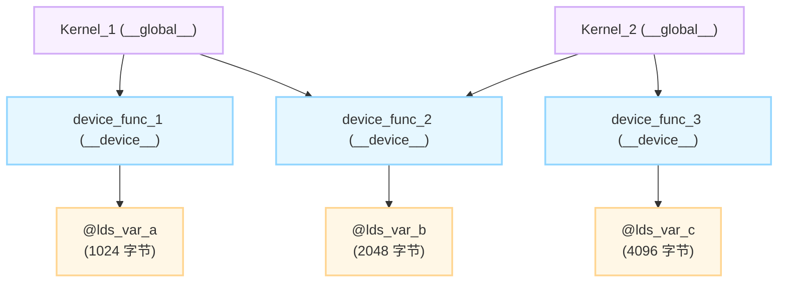

> 本文为 **[GPGPU 编译器工程师面试通关指南](/gpgpu-interview/)** 核心重难点专题深度精讲系列。
> 深度剖析工业界 GPU 编译器底层实现，聚焦片上资源约束、Call Graph 闭包分析、LDS 结构体化降级与汇编级描述符生成。

---

## 1. 面试问题与技术背景

### 1.1 问题描述
在一个编译单元（Translation Unit / LLVM Module）中，通常声明了多个文件级静态共享内存变量（CUDA `__shared__` 或 HIP/AMDGPU `addrspace(3)`）。同一个 Module 内部可能包含多个不同的 `__global__` Kernel，且分别调用了不同的 `__device__` 函数；部分 Device 函数可能被多个 Kernel 共同复用。

**核心问题**：
> 编译器（特别是 LLVM / AMDGPU 后端）是如何精准区分并计算出不同 Kernel 各自占用的静态 Shared Memory / LDS 物理大小的？如果多个 Kernel 调用了同一个访问 Shared Memory 的 Device 函数，片上物理地址是如何分配并实现时分复用的？遇到函数指针或虚函数时又是如何处理的？

---

## 2. 核心架构机理与数据流分析

在 GPGPU 体系中，每个 Thread Block / Workgroup 在 SM / CU 上启动时，硬件必须知道该 Block 需要保留多少静态片上缓存（Shared Memory / LDS）。如果尺寸多报，会直接导致硬件 Occupancy 暴跌；如果少报，则会发生物理地址越界踩踏。

### 2.1 依赖关系拓扑
假设 Module 中存在如下调用关系与内存访问关系：

```text
               [Kernel_1]                      [Kernel_2]
               /        \                      /        \
              v          v                    v          v
       [device_func_1] [device_func_2] <───────          [device_func_3]
              |               |                                 |
              v               v                                 v
         @lds_var_a      @lds_var_b                        @lds_var_c
        (1024 字节)     (2048 字节)                       (4096 字节)
```



编译器需要证明：
* $\text{Closure}(\text{Kernel\_1}) = \{ \text{device\_func\_1}, \text{device\_func\_2} \}$，关联 LDS 集合为 $\{ \text{@lds\_var\_a}, \text{@lds\_var\_b} \}$，总需求量为 $1024 + 2048 = 3072$ 字节。
* $\text{Closure}(\text{Kernel\_2}) = \{ \text{device\_func\_2}, \text{device\_func\_3} \}$，关联 LDS 集合为 $\{ \text{@lds\_var\_b}, \text{@lds\_var\_c} \}$，总需求量为 $2048 + 4096 = 6144$ 字节。

---

## 3. LLVM 官方源码级实现与逐行拆解

在 LLVM 官方仓库主干（`llvm/llvm-project`）中，该逻辑由 AMDGPU 后端的两个核心模块协同完成：
1. **调用图闭包与资源计算**：`llvm/lib/Target/AMDGPU/AMDGPUResourceUsageAnalysis.cpp`
2. **结构体降级与物理地址重构**：`llvm/lib/Target/AMDGPU/AMDGPULowerModuleLDS.cpp`

### 3.1 核心分析：`AMDGPUResourceUsageAnalysis.cpp`

该 Pass 负责统计 Kernel 的各种物理资源指标（VGPR、SGPR、LDS 字节数等）：

```cpp
// llvm/lib/Target/AMDGPU/AMDGPUResourceUsageAnalysis.cpp 核心逻辑精选
void AMDGPUResourceUsageAnalysis::analyzeResourceUsage(
    const Function &F, SIFunctionResourceInfo &Info,
    const TargetMachine &TM) {
  
  // 1. 若当前函数不是 Kernel (只是普通 Device 函数)，仅记录其直接操作的局部变量
  if (!AMDGPU::isEntryFunctionCC(F.getCallingConv()))
    return;

  // 2. 以 Kernel 函数为根节点，构建 Call Graph 可达性遍历集合
  DenseSet<const Function *> Visited;
  SmallVector<const Function *, 16> Worklist;
  Worklist.push_back(&F);

  uint32_t TotalLDSSize = 0;
  DenseSet<const GlobalVariable *> KernelLDSGlobals;

  while (!Worklist.empty()) {
    const Function *CurF = Worklist.pop_back_val();
    if (!Visited.insert(CurF).second)
      continue;

    // 扫描 CurF 内部所有的 Instruction 操作数，收集属于 addrspace(3) 的全局符号
    for (const Instruction &I : instructions(*CurF)) {
      for (const Value *Op : I.operands()) {
        if (const auto *GV = dyn_cast<GlobalVariable>(Op)) {
          if (GV->getAddressSpace() == AMDGPUAS::LOCAL_ADDRESS) { // addrspace(3)
            KernelLDSGlobals.insert(GV);
          }
        }
      }
    }

    // 遍历当前函数的 Callee，推进调用闭包展开
    for (const auto *Callee : getCallees(CurF)) {
      Worklist.push_back(Callee);
    }
  }

  // 3. 按照微架构对齐约束 (自然对齐与 16 字节对齐) 累加实际物理空间
  const DataLayout &DL = F.getParent()->getDataLayout();
  for (const GlobalVariable *GV : KernelLDSGlobals) {
    uint64_t Size = DL.getTypeAllocSize(GV->getValueType());
    Align Alignment = GV->getAlign().valueOrOne();
    // 关键点：累加前必须执行对齐填充 (alignTo)
    TotalLDSSize = alignTo(TotalLDSSize, Alignment) + Size;
  }

  // 将精确统计结果写入该 Kernel 的资源描述符
  Info.LDSSize = TotalLDSSize;
}
```

### 3.2 深度重构：`AMDGPULowerModuleLDS.cpp` 的物理结构体化

统计出大小还不够，在汇编生成时，不同的 Kernel 如何复用同一块片上物理内存？AMDGPU 采取了极其激进且优雅的 **虚拟结构体化（LDS Structification）**：

1. Pass 遍历 Module 中的所有 Kernel，将每个 Kernel 能访问到的 LDS 全局变量集合提取出来。
2. 为每个 Kernel 动态创建一个专有的 LLVM 结构体类型（如 `%struct.kernel_1_lds = type { ... }`）。
3. 将散落在各处的全局符号引用重写为该结构体的 `GEP` 操作。
4. **两套结构体在片上绝对基地址均为 `0`**。因为在 GPU 微架构中，同一个计算单元（CU）在某一瞬间为一个 Thread Block 分配的 LDS 空间是逻辑上独立的，不同 Kernel 的 Block 不会在物理空间上发生交叉访问，因此基地址均设为 `0` 实现**时分空间复用**。

---

## 4. 最小可复现验证用例（HIP / Compiler Explorer）

你可以将以下代码直接粘贴到 [Compiler Explorer (godbolt.org)](https://godbolt.org/)，选择 **HIP-Clang (如 x86_64 amdgcn AMD GPU HIP-Clang)**，并输入参数 `-O2 --offload-arch=gfx90a`：

```cpp
#include <hip/hip_runtime.h>

// 声明三个静态全局 LDS 变量
__shared__ int lds_var_a[256];   // 256 * 4  = 1024 字节
__shared__ int lds_var_b[512];   // 512 * 4  = 2048 字节
__shared__ int lds_var_c[1024];  // 1024 * 4 = 4096 字节

// 加上 __noinline__，确保保留 Device 函数的独立调用关系，便于观察 Call Graph 穿透
__device__ __noinline__ void device_func_1(int idx, int val) {
    lds_var_a[idx] = val;
}

__device__ __noinline__ void device_func_2(int idx, int val) {
    lds_var_b[idx] = val;
}

__device__ __noinline__ void device_func_3(int idx, int val) {
    lds_var_c[idx] = val;
}

// Kernel 1: 访问 lds_var_a (1024) + lds_var_b (2048) = 3072 字节
__global__ void kernel_1(int idx, int val) {
    device_func_1(idx, val);
    device_func_2(idx, val);
}

// Kernel 2: 访问 lds_var_b (2048) + lds_var_c (4096) = 6144 字节
__global__ void kernel_2(int idx, int val) {
    device_func_2(idx, val);
    device_func_3(idx, val);
}
```

### 汇编生成的机器配置对比（AMDGCN ISA）

在编译器生成的汇编底部，观察 `.amdhsa_kernel` 描述符：

```assembly
; ============================================================================
; kernel_1 描述符配置
; ============================================================================
    .amdhsa_kernel _Z8kernel_1ii
        .amdhsa_group_segment_fixed_size 3072    ; <--- 精确配置 3072 字节
        .amdhsa_user_sgpr_count 2
        ; ...
    .end_amdhsa_kernel

; ============================================================================
; kernel_2 描述符配置
; ============================================================================
    .amdhsa_kernel _Z8kernel_2ii
        .amdhsa_group_segment_fixed_size 6144    ; <--- 精确配置 6144 字节
        .amdhsa_user_sgpr_count 2
        ; ...
    .end_amdhsa_kernel
```

* **现象分析**：
  * `kernel_1` 的配置完全排除了未调用的 `lds_var_c`（4096 字节）。
  * 共同访问的 `device_func_2` 所持有的 `lds_var_b`（2048 字节）在两个 Kernel 中分别被独立累加并以基准偏移 0 进行空间重分配。

---

## 5. 面试高阶追问与技术防线

### 追问 1：如果存在函数指针（间接调用）或虚函数，Call Graph 无法静态推导时怎么办？
* **回答逻辑**：
  1. **去虚拟化与内联优先**：现代 GPU 编译器依赖激进的模块内联和 LTO 进行间接调用消解（Devirtualization）。
  2. **保守全集并集（Conservative Union）**：如果依然残留动态函数指针，编译器只能遍历 Module 内所有“地址被捕获（Address-Taken）”的 Device 函数，将它们可能访问的所有 LDS 符号全部合并至该 Kernel 中。这会造成严重的资源虚高预估，压低 SM 的 Occupancy。
  3. **编译期限制拦截**：在很多严苛的生产环境工具链中，如果在含有未决动态调用的路径中引用了静态 `__shared__` 变量，编译器会直接输出 Compile-time Error，强迫开发者改用动态共享内存（Dynamic Shared Memory）。

### 追问 2：NVIDIA NVPTX 链路的处理与 AMDGPU 有何微小差异？
* **回答逻辑**：
  * **NVPTX** 在发射 PTX 时，全局静态 shared 变量保持声明形式（`.shared .b8 var[N]`）。
  * 真实的 Call Graph 闭包计算与重叠结构体重构被推迟到了驱动层内部的 **`ptxas`（PTX 汇编器）** 中。`ptxas` 解析每个 `.entry` 的调用图，计算最终大小并写入最终 ELF 文件的 `.nv.info` 段（即 `EIATTR_SHARED_SIZE` 属性）。驱动在 `cudaLaunchKernel` 时解析该段，完成硬件资源预留。

---

## 💡 核心机制复盘与总结

> 1. **谈 Call Graph 资源遍历闭包时**：*"GPU 静态共享内存的本质是块级生命周期的片上资源；LLVM 绝非盲目按全局符号简单求和，而是以 Kernel 为根节点自顶向下递归计算调用可达闭包，并严格按微架构自然对齐累加物理占用。"*
> 2. **谈 AMDGPU LDS 虚拟结构体化（Structification）时**：*"时分复用的最高境界是在编译期重写寻址空间；通过为每个 Kernel 动态构造独占的 LDS 结构体并将基地址统一锚定在 0 偏移，不同 Kernel 的线程块得以在硬件计算单元（CU）上零冲突、零浪费地复用整块片上 SRAM。"*
> 3. **谈间接调用与动态函数指针时**：*"间接调用是 GPU 资源静态预测的天敌；面对未决的函数指针，编译器必须采取保守全集并集或直接在编译期报错阻断，以硬性规则守护硬件 Occupancy 的生命线。"*
> 4. **谈 AMDGPU 与 NVPTX / ptxas 链路差异时**：*"LLVM AMDGPU 后端选择在中端 IR 级别完成闭包重构与结构体降级，直接输出确定性的物理尺寸；而 NVPTX 则将共享内存的闭包分析推迟到了下游私有闭源的 ptxas 汇编器中，体现了开源透明与专有驱动解耦的不同工程哲学。"*

---

> 👉 **专栏返回**：查看更多模块内容与更新计划，请访问 **[GPGPU 编译器面试通关指南目录](/gpgpu-interview/)**。
