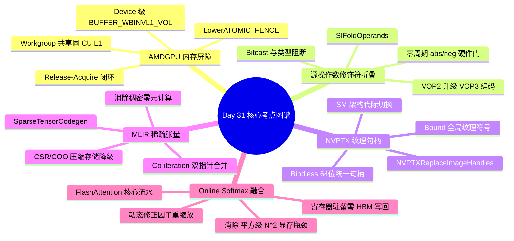

> 本文为 **[GPGPU 编译器工程师面试通关指南](/gpgpu-interview/)** 系列第31期（Day 31）。
> 建议在阅读“面试官参考解析”前，先独立思考每道题目的考察意图与答题脉络（每题思考 3~5 分钟）。

> 💡 **核心考察维度**：AMDGPU ATOMIC_FENCE 不同 SyncScope 下的 L1 失效与等待计数降级、SIFoldOperands 源操作数修饰符 (abs/neg) 折叠与 VOP2/VOP3 格式升级博弈、NVPTXReplaceImageHandles 纹理绑定句柄 Bound/Bindless 切换、MLIR SparseTensorCodegen CSR/COO 格式降级、FlashAttention Online Softmax 融合与零 SRAM 溢出流水。

---

## 📝 今日高频面试题清单

### 【Q1 · 内存一致性与屏障降级】`SIISelLowering.cpp` 中的 `ATOMIC_FENCE` 降级与 L1/L2 缓存失效控制
在 C++11 / OpenCL / HIP 内存模型中，带有不同作用域（`SyncScope::Workgroup` vs `SyncScope::Agent/Device` vs `SyncScope::System`）与内存序（`Acquire`、`Release`、`SeqCst`）的原子屏障（`fence`）必须被精确映射为底层硬件的缓存刷新与流水线等待指令。请结合 `llvm/lib/Target/AMDGPU/SIISelLowering.cpp` 与 `llvm/lib/Target/AMDGPU/SIInsertWaitcnts.cpp` 源码，分析后端是如何将不同 Scope 的 `ISD::ATOMIC_FENCE` 拆解为 `BUFFER_WBINVL1_VOL`（使向量 L1 缓存行失效）、`s_waitcnt vmcnt(0) lgkmcnt(0)` 以及 `s_barrier` 的？为什么在 `Workgroup` 作用域下，编译器可以完全省去 L1 缓存失效指令？

---

### 【Q2 · 源操作数修饰符折叠】`PeepholeOptimizer.cpp` 中的源操作数修饰符折叠（`abs` / `neg` / `clamp`）
在 GPGPU 算术密集型核函数中，浮点取绝对值（`fabs`）和取反（`fneg`）出现频率极高。现代 GPU 硬件指令编码支持直接在源操作数上附加免费修饰符（Source Modifiers，例如 `V_ADD_F32 v0, |v1|, -v2`），在操作数读取进入 ALU 前单周期完成符号位翻转或清零。请结合 `llvm/lib/CodeGen/PeepholeOptimizer.cpp` 与 `llvm/lib/Target/AMDGPU/SIFoldOperands.cpp` 源码，深度剖析编译器是如何追踪虚拟寄存器跨指令的 `FABS` / `FNEG` 定义，并将其作为操作数标志位（Operand Flags）折叠进下游消费指令、进而擦除独立取反指令的？在什么情况下修饰符折叠会被硬件指令编码格式（如 VOP2 vs VOP3）阻断？

---

### 【Q3 · 纹理与表面句柄降级】`NVPTXReplaceImageHandles.cpp` 中的硬件绑定句柄替换与统一纹理寻址
在 CUDA 图形与图像处理内核中，纹理对象（`cudaTextureObject_t`）与表面对象在前端作为 64 位整型句柄传入 Kernel，但在底层 PTX 指令（如 `tex.2d.v4.f32.s32`）中需要特定的纹理引用符号或间接句柄绑定。请结合 `llvm/lib/Target/NVPTX/NVPTXReplaceImageHandles.cpp` 源码，分析 `NVPTXReplaceImageHandles` Pass 是如何识别带有 `@llvm.nvvm.texsurf.handle` 内建函数调用的纹理访问，并根据目标计算能力（SM 架构版本）在 Bindless（无绑定统一纹理）与 Bound（静态纹理符号表）模式之间切换指令生成的？

---

### 【Q4 · 稀疏张量格式降级】`SparseTensorCodegen.cpp` 中的 CSR/COO 存储降级与动态非零元迭代生成
在大模型稀疏注意力（Sparse Attention）或图神经网络编译中，MLIR 通过 `sparse_tensor` 方言将稀疏张量（如 CSR 格式的 `pos` 指针数组与 `crd` 坐标数组）自动降级为带间接寻址的循环结构。请结合 `mlir/lib/Dialect/SparseTensor/Transforms/SparseTensorCodegen.cpp` 与 `Sparsification.cpp` 源码，分析编译器是如何利用稀疏属性编码（`SparseTensorEncodingAttr`）将抽象的 `linalg.generic` 稀疏矩阵乘转换为双指针协同遍历循环（Co-iteration Loop）的？在降级过程中，编译器如何为稀疏存储分配底层的 MemRef 描述符结构体？

---

### 【Q5 · Online Softmax 融合】FlashAttention 中的 Online Softmax 状态重物质化与零 SRAM 溢出流水
在 FlashAttention-2 / FlashAttention-3 的 Triton / Cutlass 实现中，注意力分数矩阵 $S = QK^T$ 在片上计算完成后，绝不能写回全局显存，甚至不能完整驻留在片上 Shared Memory 中，而是必须直接在通用寄存器（VGPR）中流式完成逐行最大值更新（Row-Max）、指数归一化（Exp2）以及与 $V$ 矩阵的乘加累加。请结合现代 AI 编译器架构分析：编译器在将 `tl.dot(Q, K)` 与 `tl.dot(P, V)` 融合在同一个 $K$-Loop 内部时，是如何利用硬件高速近似指令（`ex2.approx.ftz.f32`）替代标准自然指数（`expf`）的？当 $S$ 矩阵片段从 `DotOp` 累加器布局转换为 `P` 矩阵的左操作数输入布局时，编译器如何通过寄存器重排（Register Swizzling / Shuffling）避免写入 Shared Memory 中转？

---

## 🎯 面试官深度解析与追问点



---

### 题 1 深度解析：`SIISelLowering.cpp` 中的 `ATOMIC_FENCE` 降级与 L1/L2 缓存失效控制

#### 源码级深度剖析与核心实现
> 📌 **源码剖析提问**：在 C++11 / OpenCL / HIP 内存模型中，带有不同作用域（`SyncScope::Workgroup` vs `SyncScope::Agent/Device` vs `SyncScope::System`）与内存序（`Acquire`、`Release`、`SeqCst`）的原子屏障（`fence`）必须被精确映射为底层硬件的缓存刷新与流水线等待指令。请结合 `llvm/lib/Target/AMDGPU/SIISelLowering.cpp` 与 `llvm/lib/Target/AMDGPU/SIInsertWaitcnts.cpp` 源码，分析后端是如何将不同 Scope 的 `ISD::ATOMIC_FENCE` 拆解为 `BUFFER_WBINVL1_VOL`（使向量 L1 缓存行失效）、`s_waitcnt vmcnt(0) lgkmcnt(0)` 以及 `s_barrier` 的？为什么在 `Workgroup` 作用域下，编译器可以完全省去 L1 缓存失效指令？

##### 源码文件直达

  * `llvm/lib/Target/AMDGPU/SIISelLowering.cpp`
  * `llvm/lib/Target/AMDGPU/SIInsertWaitcnts.cpp`

##### 核心代码块逻辑

```cpp
// llvm/lib/Target/AMDGPU/SIISelLowering.cpp 核心逻辑精选
SDValue SITargetLowering::LowerATOMIC_FENCE(SDValue Op, SelectionDAG &DAG) const {
  SDLoc DL(Op);
  SDValue Chain = Op.getOperand(0);
  auto Ordering = static_cast<AtomicOrdering>(Op.getConstantOperandVal(1));
  auto SSID = static_cast<SyncScope::ID>(Op.getConstantOperandVal(2));

  // 1. 若作用域仅为单个 Wavefront 内部，硬件保证指令顺序语义，直接消除屏障
  if (SSID == SyncScope::SingleThread || SSID == Subtarget->getWavefrontSyncScopeID())
    return Chain;

  // 2. 若作用域跨越 Workgroup (如 Agent / Device / System 级全局内存同步)
  if (SSID != Subtarget->getWorkgroupSyncScopeID()) {
    // Release 语义前：必须确保本线程所有已发射的全局写请求 (VMEM) 抵达 L2 Cache
    if (isReleaseOrStronger(Ordering)) {
      Chain = DAG.getNode(AMDGPUISD::S_WAITCNT, DL, MVT::Other, Chain,
                          DAG.getTargetConstant(Waitcnt::forVMEM(0), DL, MVT::i32));
    }
    // Acquire 语义后：必须使当前 CU 私有的 L1 Vector Cache 失效，强制后续读取穿透至 L2
    if (isAcquireOrStronger(Ordering)) {
      Chain = DAG.getNode(AMDGPUISD::BUFFER_WBINVL1_VOL, DL, MVT::Other, Chain);
    }
  }
  return Chain;
}
```

##### 逐行机械执行分析

  1. **为什么 `Workgroup` 作用域可以省去 L1 缓存失效？**：在 AMD GCN/CDNA 微架构中，同一个 Workgroup（Thread Block）内的所有 Wavefront 都被硬件调度器严格绑定在**同一个 Compute Unit（CU）**上执行，它们在物理上共享同一块片上 L1 Vector Cache 与同一块片上 LDS。因此，一个线程写入全局显存（进 L1）或 LDS 后，同 Workgroup 内其他线程读取时天然命中同一份 L1 数据，只需发射 `s_waitcnt` 等待在途队列清空并执行 `s_barrier` 即可，完全无需刷新 L1 Cache。
  2. **跨 CU 同步（`Device` / `System` Scope）的缓存一致性鸿沟**：不同 CU 拥有各自私有的 L1 Vector Cache，且 **L1 之间没有硬件缓存一致性嗅探协议（No L1-to-L1 Snooping）**，它们仅在全局 L2 Cache 层级汇合。
  3. **Release-Acquire 硬件映射闭环**：在 `Device` 级同步中，写者（Producer）执行 `Release` 屏障时，编译器发射 `s_waitcnt vmcnt(0)` 确保数据穿出 L1 写入 L2；读者（Consumer）执行 `Acquire` 屏障时，编译器发射 `BUFFER_WBINVL1_VOL` 强制清空本 CU L1 中的陈旧缓存行，迫使后续全局读取从 L2 拉取最新数据。

---

### 题 2 深度解析：`PeepholeOptimizer.cpp` 中的源操作数修饰符折叠（`abs` / `neg` / `clamp`）

#### 源码级深度剖析与核心实现
> 📌 **源码剖析提问**：在 GPGPU 算术密集型核函数中，浮点取绝对值（`fabs`）和取反（`fneg`）出现频率极高。现代 GPU 硬件指令编码支持直接在源操作数上附加免费修饰符（Source Modifiers，例如 `V_ADD_F32 v0, |v1|, -v2`），在操作数读取进入 ALU 前单周期完成符号位翻转或清零。请结合 `llvm/lib/CodeGen/PeepholeOptimizer.cpp` 与 `llvm/lib/Target/AMDGPU/SIFoldOperands.cpp` 源码，深度剖析编译器是如何追踪虚拟寄存器跨指令的 `FABS` / `FNEG` 定义，并将其作为操作数标志位（Operand Flags）折叠进下游消费指令、进而擦除独立取反指令的？在什么情况下修饰符折叠会被硬件指令编码格式（如 VOP2 vs VOP3）阻断？

##### 源码文件直达

  * `llvm/lib/Target/AMDGPU/SIFoldOperands.cpp`
  * `llvm/lib/CodeGen/PeepholeOptimizer.cpp`

##### 核心代码块逻辑

```cpp
// llvm/lib/Target/AMDGPU/SIFoldOperands.cpp 核心逻辑精选
bool SIFoldOperands::tryFoldSourceModifier(MachineInstr &MI, unsigned OpIdx) {
  MachineOperand &MO = MI.getOperand(OpIdx);
  if (!MO.isReg()) return false;

  // 1. 查找定义该寄存器的前驱指令 (如 V_FABS_F32 或 V_FNEG_F32)
  MachineInstr *DefMI = MRI->getVRegDef(MO.getReg());
  if (!DefMI) return false;

  unsigned ModFlag = 0;
  if (DefMI->getOpcode() == AMDGPU::V_FABS_F32_e64)
    ModFlag = SISrcMods::ABS;
  else if (DefMI->getOpcode() == AMDGPU::V_FNEG_F32_e64)
    ModFlag = SISrcMods::NEG;
  else
    return false;

  // 2. 检查当前指令 MI 是否支持 VOP3 编码格式 (只有 64 位 VOP3 编码才携带 src_modifiers 位段)
  if (!TII->hasModifiersSet(MI, OpIdx)) {
    // 若 MI 当前处于 32 位压缩格式 (VOP2)，尝试将其升级为 64 位 VOP3 格式以容纳修饰符
    if (!TII->promoteToVOP3(MI))
      return false;
  }

  // 3. 将修饰符位掩码合并入 MI 的对应修饰符操作数，并将源寄存器直接替换为 DefMI 的输入
  applyModifierToOperand(MI, OpIdx, ModFlag);
  MO.setReg(DefMI->getOperand(1).getReg());
  return true;
}
```

##### 逐行机械执行分析

  1. **硬件符号位前置过滤电路**：在 GPU 向量 ALU 的输入端口处，硬件集成了专用的组合逻辑门电路，可在将 32 位 IEEE-754 浮点数送入乘法器/加法器前，根据指令字中的 `ABS`（强制清零符号位 bit 31）和 `NEG`（翻转符号位 bit 31）控制位完成符号变换，延迟为 0 周期。
  2. **32-bit VOP2 与 64-bit VOP3 指令格式博弈**：AMD 为压缩代码体积设计了 32 位短指令（`VOP2`，如 `V_ADD_F32_e32`），但短指令字没有多余比特编码源操作数修饰符。`tryFoldSourceModifier` 在折叠时调用 `promoteToVOP3` 将指令扩展为 64 位宽指令（`V_ADD_F32_e64`），以 4 字节指令缓存体积为代价，换取彻底消除一条独立的 `V_AND_B32`（实现 `fabs`）或 `V_XOR_B32`（实现 `fneg`）指令及一个临时 VGPR。
  3. **折叠阻断条件**：当指令本身不支持 VOP3 修饰符（例如整数指令不支持浮点符号位修饰，或者某些特殊超越函数指令与修饰符存在硬件编码冲突，以及在 `Bitcast` 跨越整型与浮点类型边界破坏了 IEEE-754 符号位语义时），折叠器必须中止合并，保留显式算术指令。

---

### 题 3 深度解析：`NVPTXReplaceImageHandles.cpp` 中的硬件绑定句柄替换与统一纹理寻址

#### 源码级深度剖析与核心实现
> 📌 **源码剖析提问**：在 CUDA 图形与图像处理内核中，纹理对象（`cudaTextureObject_t`）与表面对象在前端作为 64 位整型句柄传入 Kernel，但在底层 PTX 指令（如 `tex.2d.v4.f32.s32`）中需要特定的纹理引用符号或间接句柄绑定。请结合 `llvm/lib/Target/NVPTX/NVPTXReplaceImageHandles.cpp` 源码，分析 `NVPTXReplaceImageHandles` Pass 是如何识别带有 `@llvm.nvvm.texsurf.handle` 内建函数调用的纹理访问，并根据目标计算能力（SM 架构版本）在 Bindless（无绑定统一纹理）与 Bound（静态纹理符号表）模式之间切换指令生成的？

##### 源码文件直达

  * `llvm/lib/Target/NVPTX/NVPTXReplaceImageHandles.cpp`
  * `llvm/lib/Target/NVPTX/NVPTXISelDAGToDAG.cpp`

##### 核心代码块逻辑

```cpp
// llvm/lib/Target/NVPTX/NVPTXReplaceImageHandles.cpp 核心逻辑精选
bool NVPTXReplaceImageHandles::runOnMachineFunction(MachineFunction &MF) {
  bool Changed = false;
  for (MachineBasicBlock &MBB : MF) {
    for (MachineInstr &MI : llvm::make_early_inc_range(MBB)) {
      // 1. 识别机器级的纹理采样或表面加载指令 (如 TEX_2D_F32_S32)
      if (isImageReadOrWrite(MI)) {
        MachineOperand &HandleOp = MI.getOperand(getHandleOperandIdx(MI));
        Register HandleReg = HandleOp.getReg();

        // 2. 溯源追踪 HandleReg 是否来源于全局纹理引用符号 (@llvm.nvvm.texsurf.handle.internal)
        MachineInstr *DefMI = MRI->getVRegDef(HandleReg);
        if (DefMI && DefMI->getOpcode() == NVPTX::texsurf_handles) {
          // Bound 模式 (传统纹理引用): 直接将操作数替换为全局纹理符号名
          const GlobalValue *GV = DefMI->getOperand(1).getGlobal();
          HandleOp.ChangeToGA(GV, 0);
          Changed = true;
        }
        // 3. 若 HandleReg 来自 Kernel 标量参数 (cudaTextureObject_t，即 i64 句柄)
        // Bindless 模式 (Kepler SM_30+): 保持为 64 位通用寄存器传递，底层生成统一纹理指令
      }
    }
  }
  return Changed;
}
```

##### 逐行机械执行分析

  1. **Bound Texture vs Bindless Texture 微架构演进**：早期 GPU（Fermi 及以前）要求所有纹理必须在编译期静态绑定到固定的硬件纹理槽位（Texture Units），句柄在 PTX 中必须表现为全局符号引用（如 `tex.2d.v4.f32.s32 {%f0..%f3}, [tex_ref, {%r0, %r1}]`）。
  2. **Bindless 统一寻址（SM_30+）**：现代 GPU 支持无绑定纹理（`cudaTextureObject_t`），纹理描述符（Descriptor）存放在全局显存的常量描述符表中，内核通过普通 64 位整型寄存器接收描述符指针。
  3. **Pass 的符号替换桥梁**：在前端编译阶段，Clang 统一生成 `@llvm.nvvm.texsurf.handle` 包装指令。`NVPTXReplaceImageHandles` 在指令选择之后运行：若发现操作数指向静态模块级纹理变量，则剥离包装指令，直接将 `MachineOperand` 原地篡改为全局地址（`ChangeToGA`）；若操作数为普通 64 位寄存器，则保留寄存器操作数以触发 `ptxas` 生成直接读取描述符寄存器的现代纹理指令。

---

### 题 4 深度解析：`SparseTensorCodegen.cpp` 中的 CSR/COO 存储降级与动态非零元迭代生成

#### 源码级深度剖析与核心实现
> 📌 **源码剖析提问**：在大模型稀疏注意力（Sparse Attention）或图神经网络编译中，MLIR 通过 `sparse_tensor` 方言将稀疏张量（如 CSR 格式的 `pos` 指针数组与 `crd` 坐标数组）自动降级为带间接寻址的循环结构。请结合 `mlir/lib/Dialect/SparseTensor/Transforms/SparseTensorCodegen.cpp` 与 `Sparsification.cpp` 源码，分析编译器是如何利用稀疏属性编码（`SparseTensorEncodingAttr`）将抽象的 `linalg.generic` 稀疏矩阵乘转换为双指针协同遍历循环（Co-iteration Loop）的？在降级过程中，编译器如何为稀疏存储分配底层的 MemRef 描述符结构体？

##### 源码文件直达

  * `mlir/lib/Dialect/SparseTensor/Transforms/SparseTensorCodegen.cpp`
  * `mlir/lib/Dialect/SparseTensor/Transforms/Sparsification.cpp`

##### 核心代码块逻辑

```cpp
// mlir/lib/Dialect/SparseTensor/Transforms/SparseTensorCodegen.cpp 核心逻辑精选
LogicalResult SparseTensorTypeConverter::convertSparseTensorType(
    RankedTensorType type, SmallVectorImpl<Type> &fields) {
  auto enc = getSparseTensorEncoding(type);
  if (!enc) return failure();

  // 1. 解析稀疏维度层级 (如 CSR 格式: 第 0 维 Dense, 第 1 维 Compressed)
  for (unsigned d = 0, rank = type.getRank(); d < rank; ++d) {
    if (isCompressedDim(enc, d)) {
      // 为每个压缩维度添加两个一维 MemRef:
      // (a) positions 数组 (pos[i]..pos[i+1] 界定第 i 行的非零元范围)
      fields.push_back(MemRefType::get({ShapedType::kDynamic}, enc.getPosType()));
      // (b) coordinates 数组 (crd[p] 存储非零元对应的列索引)
      fields.push_back(MemRefType::get({ShapedType::kDynamic}, enc.getCrdType()));
    }
  }

  // 2. 添加存储实际非零元素数值的 values 一维 MemRef
  fields.push_back(MemRefType::get({ShapedType::kDynamic}, type.getElementType()));
  return success();
}
```

##### 逐行机械执行分析

  1. **结构化类型拆解（1-to-N Type Conversion）**：MLIR 利用 `TypeConverter` 的 1 对 N 映射能力，将一个抽象的稀疏张量参数自动拆解为 `(pos_memref, crd_memref, val_memref)` 三个独立的底层内存缓冲区指针传递给 GPU Kernel。
  2. **双指针协同遍历（Co-Iteration Loop）生成**：当两个稀疏张量相乘（如 $A_{CSR} \times B_{CSR}$）时，`Sparsification.cpp` 在归约轴上生成一个带动态边界的 `scf.while` 循环：同时维护指针 `pA` 和 `pB`，在每次迭代中读取 `colA = crdA[pA]` 与 `colB = crdB[pB]` 并比较大小。
     * 若 `colA == colB`：命中非零元交集，发射乘加计算并同时递增 `pA++`、`pB++`；
     * 若 `colA < colB`：仅递增 `pA++` 跳过零元空洞。
  3. **GPU SIMT 下的负载平衡挑战**：由于不同行的非零元数量（`pos[i+1] - pos[i]`）差异巨大，直接按行分配给 Warp 内不同线程会导致严重的执行时间长尾发散。现代 AI 编译器在此基础上结合 **Merge-Path** 或 **Row-Splitting** 变换，将非零元区间均分切块以维持 Warp 级负载均衡。

---

### 题 5 深度解析：FlashAttention 中的 Online Softmax 状态重物质化与零 SRAM 溢出流水

#### 源码级深度剖析与核心实现
> 📌 **源码剖析提问**：在 FlashAttention-2 / FlashAttention-3 的 Triton / Cutlass 实现中，注意力分数矩阵 $S = QK^T$ 在片上计算完成后，绝不能写回全局显存，甚至不能完整驻留在片上 Shared Memory 中，而是必须直接在通用寄存器（VGPR）中流式完成逐行最大值更新（Row-Max）、指数归一化（Exp2）以及与 $V$ 矩阵的乘加累加。请结合现代 AI 编译器架构分析：编译器在将 `tl.dot(Q, K)` 与 `tl.dot(P, V)` 融合在同一个 $K$-Loop 内部时，是如何利用硬件高速近似指令（`ex2.approx.ftz.f32`）替代标准自然指数（`expf`）的？当 $S$ 矩阵片段从 `DotOp` 累加器布局转换为 `P` 矩阵的左操作数输入布局时，编译器如何通过寄存器重排（Register Swizzling / Shuffling）避免写入 Shared Memory 中转？

##### 核心架构直达

  * `triton/python/tutorials/06-fused-attention.py` & `triton/lib/Dialect/TritonGPU/`
  * FlashAttention-2 / FlashAttention-3 算子融合架构模型

##### Online Softmax 寄存器驻留融合核心伪代码

```cpp
// 典型的 FlashAttention Inner K-Loop 寄存器驻留融合逻辑
void emitOnlineSoftmaxMMA(OpBuilder &b, Location loc, Value qFrag, Value kSmem, Value vSmem,
                          Value &accFrag, Value &rowMax, Value &rowSum) {
  // 1. 计算当前块的注意力分数: S_ij = Q_i * K_j^T (结果直接驻留在 Tensor Core 累加器寄存器中)
  Value sFrag = emitDotMMA(b, loc, qFrag, kSmem); // 布局: DotOpEncodingAttr (FP32)

  // 2. 在通用寄存器中沿行轴执行 Warp Shuffle 归约求局部最大值: m_ij = max(rowMax, max_row(S_ij))
  Value localMax = emitWarpRowReduceMax(b, loc, sFrag);
  Value newRowMax = b.create<arith::MaximumFOp>(loc, rowMax, localMax);

  // 3. 计算指数衰减补偿因子: alpha = exp2((rowMax - newRowMax) * log2(e))
  // 利用硬件单周期超越函数单元 (SFU) 指令: ex2.approx.ftz.f32
  Value diffMax = b.create<arith::SubFOp>(loc, rowMax, newRowMax);
  Value alpha = emitHardwareExp2(b, loc, diffMax);

  // 4. 计算当前块概率分子 P_ij = exp2((S_ij - newRowMax) * log2(e)) 并更新分母累加器
  Value pFragFP32 = emitHardwareExp2(b, loc, subBroadcast(sFrag, newRowMax));
  Value localSum = emitWarpRowReduceSum(b, loc, pFragFP32);
  rowSum = b.create<arith::AddFOp>(loc, b.create<arith::MulFOp>(loc, rowSum, alpha), localSum);

  // 5. 核心布局转换与高精度缩放：
  // (a) 使用 alpha 缩放历史输出累加器: accFrag = accFrag * alpha
  accFrag = scaleAccumulator(b, loc, accFrag, alpha);
  // (b) 将 pFragFP32 截断为 FP16/BF16，并通过寄存器洗牌 (ConvertLayout) 转换为 MMA 左操作数 A 布局
  Value pFragFP16 = b.create<arith::TruncFOp>(loc, b.getF16Type(), pFragFP32);
  Value pOperandA = emitRegisterLayoutConvertToOperandA(b, loc, pFragFP16);

  // 6. 直接发射第二个 Tensor Core 矩阵乘: accFrag += P_ij * V_j (全程零 SRAM 写回!)
  accFrag = emitDotMMA(b, loc, pOperandA, vSmem, accFrag);
  rowMax = newRowMax;
}
```

##### 逐行机械执行分析

  1. **底数变换（Base-2 Exponentiation）与 SFU 硬件对齐**：标准自然指数 $e^x$ 在 GPU 上不存在单周期原生硬件指令，通常被展开为多条乘加多项式近似；而 $2^x$ 对应 GPU 特殊函数单元（SFU）的原生单条机器指令（PTX `ex2.approx.ftz.f32` 或 AMD `V_EXP_F32`）。编译器在编译期将输入乘以常数 $\log_2(e) \approx 1.44269504$，将全部自然指数运算转换为单周期 `exp2`，速度提升 4~6 倍。
  2. **累加器布局到操作数 A 布局的寄存器重排**：在 NVIDIA Ampere/Hopper 架构中，`mma.sync.m16n8k16` 输出的 $C$ 矩阵寄存器分布（每个线程持有 4 个元素）与左输入矩阵 $A$ 的寄存器分布（每个线程持有 8 个元素，且跨 Lane 映射规则不同）存在微小的几何差异。现代 AI 编译器在降级 `ConvertLayoutOp` 时，利用纯寄存器内部的 `mov` 与局部 `shfl.sync` 完成重新打包（在 Ampere `m16n8k16` 中，甚至可以通过精心匹配线程分布实现 **零 Shuffle 纯寄存器重排**），彻底绕开 Shared Memory 写回开销。
  3. **端到端访存压缩**：通过将两次 `Dot` 与逐行归约完全锁死在通用寄存器文件中，整个前向计算过程彻底消除了 $O(N^2)$ 级别的注意力矩阵显存读写，使算子从严重受限于显存带宽（Memory Bound）成功转化为接近硬件峰值算力的计算密集型（Compute Bound）内核。

---

## 5 深度技术对比

| 优化阶段 / 机制 | 解决的核心硬件/软件瓶颈 | LLVM/MLIR/Triton 关键接口与节点 | 错误处理不当的严重后果 |
| :---- | :---- | :---- | :---- |
| **ATOMIC_FENCE Lowering** | 弥合跨 CU 私有 L1 无嗅探协议导致的内存可见性鸿沟 | `LowerATOMIC_FENCE`, `BUFFER_WBINVL1_VOL` | 跨 Block 生产者消费者读到 L1 陈旧脏数据，或 Workgroup 内过度刷新暴跌性能 |
| **Source Modifier Folding** | 消除独立 `fabs`/`fneg` 算术指令与临时 VGPR 占用 | `tryFoldSourceModifier`, `promoteToVOP3` | 丢失零周期硬件符号位变换红利，增加指令发射数与寄存器压力 |
| **Image Handle Replacement** | 桥接前端 64 位纹理句柄与底层 PTX 硬件采样符号 | `NVPTXReplaceImageHandles`, `texsurf_handles` | 纹理指令采样地址非法或无法在现代架构启用 Bindless 高速路径 |
| **SparseTensorCodegen** | 消除稀疏矩阵中大量零元素带来的无效计算与存储浪费 | `SparseTensorCodegen`, `pos/crd` 缓冲 | 生成低效随机散射访存，或边界索引越界导致硬件崩溃 |
| **Online Softmax Fusion** | 消除标准 Attention 物料化 N×N 注意力矩阵的 HBM 瓶颈 | `m_new`, `l_new`, `exp(m_old - m_new)` | 产生海量 HBM 中间读写流量，带宽彻底打满或显存 OOM |

---

## 💡 面试实战总结（复盘金句）

> 1. **谈 AMDGPU Workgroup 与 Device Scope 屏障差异时**：*"同一 Workgroup 天生挤在同一个 CU 里共享同一块 L1，无需昂贵的 WBINVL1；只有跨 CU 同步才需要借助 L2 作为全局一致性的仲裁中枢。"*
> 2. **谈源操作数修饰符折叠与指令编码博弈时**：*"用 64 位 VOP3 编码多出的 4 字节指令空间，去换掉一条独立的取反指令和一个临时 VGPR，是后端窥孔优化最划算的买卖。"*
> 3. **谈 NVPTX 纹理句柄降级演进时**：*"从静态绑定符号表到 Bindless 64 位统一句柄，纹理降级的演变史正是 GPU 从固定图形管线走向通用动态计算的历史缩影。"*
> 4. **谈 MLIR 稀疏张量代码生成时**：*"稀疏编译的本质是把数据结构上的几何压缩，精准翻译成索引指针上的协同步进（Co-iteration）。"*
> 5. **谈 FlashAttention Online Softmax 融合时**：*"Online Softmax 用几条指数重缩放的寄存器算术，直接换掉了 O(N^2) 级别的 HBM 往返流量，这才是计算换访存的巅峰范式。"*

---

> 👈 **上一期回顾**：[**Day 29：IPO 硬件属性裁剪、栈槽着色、LDG 非缓存推导与 Split-K**](/gpu-compiler/2026-11-13-gpgpu-compiler-interview-day-29/)
> 👉 **下一期推荐**：[**Day 32：交叉开关蝶式归约、尾部合并发散保护、cp.async 谓词补零与重物质化**](/gpu-compiler/2026-11-15-gpgpu-compiler-interview-day-32/)
> 👉 **专栏返回**：查看更多模块内容与更新计划，请访问 [**GPGPU 编译器面试通关指南目录**](/gpgpu-interview/)。