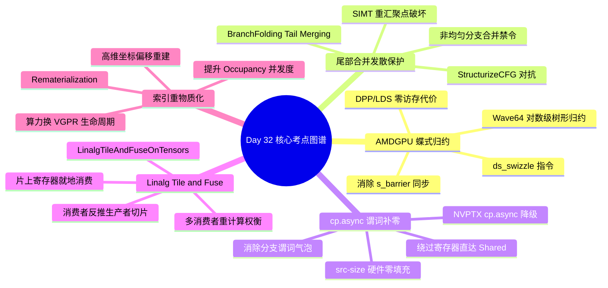

> 本文为 **[GPGPU 编译器工程师面试通关指南](/gpgpu-interview/)** 系列第32期（Day 32）。
> 建议在阅读“面试官参考解析”前，先独立思考每道题目的考察意图与答题脉络（每题思考 3~5 分钟）。

> 💡 **核心考察维度**：AMDGPULowerIntrinsics ds_swizzle 跨 Lane 蝶式归约降级、BranchFolding 尾部合并 (Tail Merging) 对 SIMT 重汇聚点的发散破坏防护、NVPTX cp.async 异步传输降级与硬件谓词零填充、MLIR LinalgTileAndFuseOnTensors 生产者切片物化与重计算权衡、Triton/IREE Rematerialization 坐标索引重物质化。

---

## 📝 今日高频面试题清单

### 【Q1 · 交叉开关蝶式归约】`AMDGPULowerIntrinsics.cpp` 中的 `llvm.amdgcn.ds.swizzle` 与跨 Lane 蝶式归约降级
在 AMD GPU 体系结构中，跨线程数据交换可以通过 `ds_swizzle_b32` 或 `ds_bpermute_b32` 实现。其中 `ds_swizzle_b32` 并不真正读写 LDS 存储体，而是利用片上交叉开关（Crossbar）在 32 个 Lane 内部按固定的位掩码模式（XOR/AND/OR 偏移）完成单周期数据置换。请结合 `llvm/lib/Target/AMDGPU/SIISelLowering.cpp` 与 `llvm/lib/Target/AMDGPU/AMDGPULowerIntrinsics.cpp` 源码，分析后端在降级 `llvm.experimental.vector.reduce` 或 `ballot/shfl` 原语时，是如何将偏移步长（Offset <= 31）编码进 `ds_swizzle` 的 16 位立即数控制字（`Offset0`/`Offset1`）的？为什么当跨度达到 32（在 Wave64 模式下跨越前 32 线程与后 32 线程）时，编译器必须放弃 `ds_swizzle` 并回退到 `ds_bpermute` 或 `v_permlane`？

---

### 【Q2 · 尾部合并发散保护】`BranchFolding.cpp` 中的尾部合并（Tail Merging）与 SIMT 汇聚点发散风险
在通用 CPU 编译优化中，`BranchFolder::TailMergeBlocks` 通过寻找多个前驱基本块末尾相同的机器指令序列，将其提取合并为一个共享的后继基本块以压缩代码体积（Code Size）。请结合 `llvm/lib/CodeGen/BranchFolding.cpp` 源码，深入剖析 `TailMergeBlocks` 是如何利用指令哈希（`HashEndOfMBB`）匹配公共尾部指令的？在 GPGPU 后端（如 AMDGPU / NVPTX）中，为什么过度激进的 Tail Merging 会打破控制流的结构化特性，导致硬件执行掩码（`EXEC` / Active Mask）在非预期位置提前汇合或引发死锁？后端目标钩子（`TargetInstrInfo::isProfitableToMerge`）是如何对其进行精细约束的？

---

### 【Q3 · 异步拷贝谓词补零】`NVPTXISelLowering.cpp` 中的 `cp.async` 异步全局到共享内存传输降级与谓词零填充（Zero-Fill）
自 NVIDIA Ampere（SM_80）架构起，硬件引入了 `cp.async.ca` / `cp.async.cg` 指令，允许数据绕过通用寄存器直接从全局显存异步拷入 Shared Memory，并支持 `src-size` 参数实现越界自动补零。请结合 `llvm/lib/Target/NVPTX/NVPTXISelLowering.cpp` 与 `llvm/lib/Target/NVPTX/NVPTXIntrinsics.td` 源码，分析 `@llvm.nvvm.cp.async.cg.shared.global` 是如何根据拷贝字节数（4B、8B、16B）选择缓存策略（`.cg` 绕过 L1 仅缓存于 L2 vs `.ca` 缓存于 L1+L2）的？编译器如何将动态越界长度映射为 `src-size` 操作数，从而在单条指令内消除边界填充所需的条件分支？

---

### 【Q4 · Linalg 切片与融合】`LinalgTileAndFuseOnTensors.cpp` 中的生产者切片物化（Tile & Fuse）与重计算权衡
在 MLIR 的 Tensor 级转换流水线中，面对多级算子链（如 `Matmul -> BiasAdd -> GELU -> LayerNorm`），编译器通过 `TileAndFuse` 自底向上递归切分生产者算子，将其切片计算直接内联进消费者的 `scf.for` 循环体中。请结合 `mlir/lib/Dialect/Linalg/Transforms/TilingInterfaceImpl.cpp` 与 `TileUsingInterface.cpp` 源码，分析 `fuseProducerOfTensor` 是如何通过 `TilingInterface::generateResultTileValue` 反向推导生产者所需输入切片（Input Slice Offset & Size）的？当某一个生产者切片在消费者循环的多个边界分块之间存在重叠（Overlap，如带 Halo 的卷积或滑动窗口注意力）时，编译器如何在“重复计算（Recomputation）”与“分配片上 Shared Memory 缓存（Materialization）”之间做图级代价决策？

---

### 【Q5 · 坐标索引重物质化】Triton / IREE 中的 Rematerialization（重物质化）与高维坐标索引重建
在大型 AI 算子（如长上下文 FlashAttention 或多头注意力反向传播）编译中，VGPR 寄存器压力极易触顶。传统的寄存器分配器在遭遇压力峰值时，倾向于将存活跨度长的张量索引偏移或掩码（Mask）溢出到高延迟的 Local Memory（DRAM）。请结合现代 AI 编译器（Triton / LLVM `LiveRangeEdit`）架构分析：编译器是如何识别“计算代价极低但活跃跨度极长”的张量偏移表达式（如基于 `tl.arange` 与 `program_id` 派生的地址偏移），并在消费点前直接将其“重物质化（Rematerialize）”为几条单周期 `V_ADD_U32` / `V_MAD_U32` 指令，从而以微不足道的 ALU 周期换取彻底消除 Local Memory 溢出（Zero-Spill）的？

---

## 🎯 面试官深度解析与追问点



---

### 题 1 深度解析：`AMDGPULowerIntrinsics.cpp` 中的 `llvm.amdgcn.ds.swizzle` 与跨 Lane 蝶式归约降级

#### 源码级深度剖析与核心实现
> 📌 **源码剖析提问**：在 AMD GPU 体系结构中，跨线程数据交换可以通过 `ds_swizzle_b32` 或 `ds_bpermute_b32` 实现。其中 `ds_swizzle_b32` 并不真正读写 LDS 存储体，而是利用片上交叉开关（Crossbar）在 32 个 Lane 内部按固定的位掩码模式（XOR/AND/OR 偏移）完成单周期数据置换。请结合 `llvm/lib/Target/AMDGPU/SIISelLowering.cpp` 与 `llvm/lib/Target/AMDGPU/AMDGPULowerIntrinsics.cpp` 源码，分析后端在降级 `llvm.experimental.vector.reduce` 或 `ballot/shfl` 原语时，是如何将偏移步长（Offset <= 31）编码进 `ds_swizzle` 的 16 位立即数控制字（`Offset0`/`Offset1`）的？为什么当跨度达到 32（在 Wave64 模式下跨越前 32 线程与后 32 线程）时，编译器必须放弃 `ds_swizzle` 并回退到 `ds_bpermute` 或 `v_permlane`？

##### 源码文件直达

  * `llvm/lib/Target/AMDGPU/SIISelLowering.cpp`
  * `llvm/lib/Target/AMDGPU/AMDGPULowerIntrinsics.cpp`

##### 核心代码块逻辑

```cpp
// llvm/lib/Target/AMDGPU/SIISelLowering.cpp 核心逻辑精选
SDValue SITargetLowering::lowerWaveShuffle(SDValue Op, SelectionDAG &DAG) const {
  SDLoc DL(Op);
  SDValue Src = Op.getOperand(0);
  unsigned XorMask = Op.getConstantOperandVal(1); // 例如归约步长 16, 8, 4, 2, 1

  // 1. ds_swizzle_b32 硬件交叉开关仅能覆盖单个 32-Lane 物理分组 (Row / Sub-wave)
  if (XorMask < 32) {
    // 构造 16 位控制立即数: Bit[15]=1 表示启用蝶式/掩码模式
    // Offset0 (Bits 0..4) = AndMask (0x1F), Offset1 (Bits 5..9) = OrMask (0), XorMask (Bits 10..14)
    unsigned SwizzleCtrl = 0x8000 | (XorMask << 10) | 0x1F;
    return DAG.getNode(AMDGPUISD::DS_SWIZZLE, DL, MVT::i32, Src,
                       DAG.getTargetConstant(SwizzleCtrl, DL, MVT::i32));
  }

  // 2. Wave64 模式下跨半束通信 (XorMask == 32): 必须跨过物理 32-Lane 边界
  // 回退至借用完整 LDS Crossbar 的 ds_bpermute_b32
  SDValue LaneId = getCurrentLaneId(DAG, DL);
  SDValue TargetLane = DAG.getNode(ISD::XOR, DL, MVT::i32, LaneId,
                                   DAG.getConstant(XorMask, DL, MVT::i32));
  SDValue ByteAddr = DAG.getNode(ISD::SHL, DL, MVT::i32, TargetLane,
                                 DAG.getConstant(2, DL, MVT::i32));
  return DAG.getNode(AMDGPUISD::DS_BPERMUTE, DL, MVT::i32, ByteAddr, Src);
}
```

##### 逐行机械执行分析

  1. **`ds_swizzle_b32` 硬件微架构拓扑**：在 AMD GCN/CDNA 架构中，LDS 端口由两个独立的 32-Bank 交叉开关组成。`ds_swizzle` 利用内置组合逻辑对每个 Lane 的 5 位局部 ID（0~31）执行位变换：$\text{SrcLane} = ((\text{LaneID} \ \& \ \text{AndMask}) \mid \text{OrMask}) \oplus \text{XorMask}$。由于完全在寄存器与输入总线层完成且不分配实际 LDS 内存，其延迟极低（仅 4 周期，且无需 `lgkmcnt` 同步所有线程块）。
  2. **32-Lane 物理隔离墙**：因为位掩码字段仅支持 5 位局部地址（0~31），在 Wave64 模式下，Lane $0\dots 31$ 与 Lane $32\dots 63$ 分属两个半束，单靠 5 位掩码无法实现 $\text{Lane}_0 \leftrightarrow \text{Lane}_{32}$ 的跨半束交换。
  3. **多级归约混合降级**：因此编译器在降级 Wave64 归约时，对步长 `16, 8, 4, 2, 1` 全力发射高速的 `ds_swizzle_b32`，而在最后一步跨半束归约（`offset = 32`）时，自动切换为 `ds_bpermute_b32`（CDNA）或 `v_permlanex16_b32`（RDNA），实现性能与硬件约束的最优平衡。

---

### 题 2 深度解析：`BranchFolding.cpp` 中的尾部合并（Tail Merging）与 SIMT 汇聚点发散风险

#### 源码级深度剖析与核心实现
> 📌 **源码剖析提问**：在通用 CPU 编译优化中，`BranchFolder::TailMergeBlocks` 通过寻找多个前驱基本块末尾相同的机器指令序列，将其提取合并为一个共享的后继基本块以压缩代码体积（Code Size）。请结合 `llvm/lib/CodeGen/BranchFolding.cpp` 源码，深入剖析 `TailMergeBlocks` 是如何利用指令哈希（`HashEndOfMBB`）匹配公共尾部指令的？在 GPGPU 后端（如 AMDGPU / NVPTX）中，为什么过度激进的 Tail Merging 会打破控制流的结构化特性，导致硬件执行掩码（`EXEC` / Active Mask）在非预期位置提前汇合或引发死锁？后端目标钩子（`TargetInstrInfo::isProfitableToMerge`）是如何对其进行精细约束的？

##### 源码文件直达

  * `llvm/lib/CodeGen/BranchFolding.cpp`
  * `llvm/lib/Target/AMDGPU/SIInstrInfo.cpp`

##### 核心代码块逻辑

```cpp
// llvm/lib/CodeGen/BranchFolding.cpp 核心逻辑精选
bool BranchFolder::TryTailMergeBlocks(MachineBasicBlock *SuccBB,
                                      MachineBasicBlock *PredBB1,
                                      MachineBasicBlock *PredBB2) {
  // 1. 计算两个前驱基本块末尾公共相同指令的长度 (CommonTailLen)
  unsigned CommonTailLen = ComputeCommonTailLength(PredBB1, PredBB2);
  if (CommonTailLen == 0)
    return false;

  // 2. 查询目标后端指令信息: 在 SIMT 架构下是否允许在此处合并尾部?
  // 若合并点会导致不同活跃掩码 (EXEC) 的线程提前汇合，或拆散已结构化的控制流块，直接否决
  if (!TII->isProfitableToMerge(PredBB1, PredBB2, CommonTailLen)) {
    return false;
  }

  // 3. 拆分基本块，提取公共尾部指令生成共享汇聚块 (Shared Tail Block)
  MachineBasicBlock *NewTail = SplitMBBAt(*PredBB1, PredBB1->getLastNonDebugInstr());
  PredBB2->replaceSuccessor(SuccBB, NewTail);
  return true;
}
```

##### 逐行机械执行分析

  1. **SIMD/SIMT 语义下的非对称执行陷阱**：在 CPU 上，合并两个分支末尾相同的指令序列（如都执行 `add r0, r1, r2; store [r3], r0`）百利而无一害。但在 GPU 上，If 分支与 Else 分支是由不同的硬件执行掩码（`EXEC`）串行驱动的。
  2. **结构化控制流（Structurized CFG）破坏**：`BranchFolding` 通常运行在寄存器分配之后（Post-RA），此时 `SIAnnotateControlFlow` 已经插入了精确维护 `EXEC` 压栈与恢复的标量指令（如 `s_or_saveexec_b64`、`s_xor_b64 exec`）。如果 `TailMergeBlocks` 擅自将两个分支末尾的访存指令抽离合并为一个新块，却未同步调整对应的 `EXEC` 掩码切换点，会导致本该处于休眠状态的 Lane 带着错误的活跃掩码执行公共尾部指令，引发致命的越界写或死锁。
  3. **目标钩子精细放行策略**：`SIInstrInfo::isProfitableToMerge` 在源码中严格检查合并指令是否包含对 `EXEC`/`VCC` 的修改、是否跨越硬件同步屏障，以及公共指令数是否足够覆盖额外引入的一条 `s_branch` 跳转延迟，仅对纯粹、无副作用的算术尾部放行合并。

---

### 题 3 深度解析：`NVPTXISelLowering.cpp` 中的 `cp.async` 异步全局到共享内存传输降级与谓词零填充（Zero-Fill）

#### 源码级深度剖析与核心实现
> 📌 **源码剖析提问**：自 NVIDIA Ampere（SM_80）架构起，硬件引入了 `cp.async.ca` / `cp.async.cg` 指令，允许数据绕过通用寄存器直接从全局显存异步拷入 Shared Memory，并支持 `src-size` 参数实现越界自动补零。请结合 `llvm/lib/Target/NVPTX/NVPTXISelLowering.cpp` 与 `llvm/lib/Target/NVPTX/NVPTXIntrinsics.td` 源码，分析 `@llvm.nvvm.cp.async.cg.shared.global` 是如何根据拷贝字节数（4B、8B、16B）选择缓存策略（`.cg` 绕过 L1 仅缓存于 L2 vs `.ca` 缓存于 L1+L2）的？编译器如何将动态越界长度映射为 `src-size` 操作数，从而在单条指令内消除边界填充所需的条件分支？

##### 源码文件直达

  * `llvm/lib/Target/NVPTX/NVPTXISelLowering.cpp`
  * `llvm/lib/Target/NVPTX/NVPTXIntrinsics.td`

##### 核心模式定义

```cpp
// llvm/lib/Target/NVPTX/NVPTXIntrinsics.td 核心模式定义精选
// 1. 16字节 (128-bit) 绕过 L1 缓存异步加载 (.cg = Cache Global, 仅驻留 L2 Cache)
// 支持可选的 src-size 操作数，实现硬件级边界越界自动清零填充
def INT_NVVM_CP_ASYNC_CG_SHARED_GLOBAL_16_SIZE :
    NVPTXInst<(outs), (ins Int32Regs:$dst, Int64Regs:$src, Int32Regs:$src_size),
              "cp.async.cg.shared.global [$dst], [$src], 16, $src_size;",
              [(int_nvvm_cp_async_cg_shared_global_16_size addr:$dst, addr:$src, i32:$src_size)]>;

// 2. 4字节/8字节 全缓存路径 (.ca = Cache All, 同时驻留 L1 与 L2 Cache)
def INT_NVVM_CP_ASYNC_CA_SHARED_GLOBAL_4_SIZE :
    NVPTXInst<(outs), (ins Int32Regs:$dst, Int64Regs:$src, Int32Regs:$src_size),
              "cp.async.ca.shared.global [$dst], [$src], 4, $src_size;",
              [(int_nvvm_cp_async_ca_shared_global_4_size addr:$dst, addr:$src, i32:$src_size)]>;
```

##### 逐行机械执行分析

  1. **`.cg` vs `.ca` 缓存层级微架构硬约束**：在 NVIDIA Ampere/Ada/Hopper 架构中，硬件规定**只有 16 字节（128-bit）宽度的异步拷贝才支持 `.cg`（Cache Global，旁路 SM L1 Cache 直接从 L2 写入 Shared Memory）**；而 4 字节和 8 字节拷贝强制走 `.ca`（Cache All，数据先进入 L1 再转入 Shared Memory）。编译器在指令选择时依据传输位宽自动匹配对应的硬件修饰符，避免宝贵的 L1 容量被大块流式矩阵数据冲刷污染。
  2. **硬件 `src-size` 零填充引擎（Zero-Fill Hardware Bypass）**：当矩阵分块触及张量边界时（例如需要加载 16 字节，但实际有效数据仅剩 10 字节，后 6 字节越界），传统软件实现必须生成 `if (valid) load else 0` 的分支或位掩码清洗指令。通过向 `cp.async` 传入 `$src_size = 10`，内存控制器在 DMA 传输期间自动读取前 10 字节，并对 Shared Memory 目标地址的后 6 字节直接由硬件写掩码电路刷入 `0x00`，**完全不向 DRAM 发射越界地址请求，且实现零分支、零额外周期的边界对齐**。
  3. **异步组提交与屏障同步**：发射 `cp.async` 后，数据处于异步在途状态，编译器紧接着在流水线阶段边界发射 `cp.async.commit_group` 将当前批次打包为一组，并在消费前发射 `cp.async.wait_group N`（允许最多 $N$ 组仍在后台传输），实现精确的软件流水线重叠。

---

### 题 4 深度解析：`LinalgTileAndFuseOnTensors.cpp` 中的生产者切片物化（Tile & Fuse）与重计算权衡

#### 源码级深度剖析与核心实现
> 📌 **源码剖析提问**：在 MLIR 的 Tensor 级转换流水线中，面对多级算子链（如 `Matmul -> BiasAdd -> GELU -> LayerNorm`），编译器通过 `TileAndFuse` 自底向上递归切分生产者算子，将其切片计算直接内联进消费者的 `scf.for` 循环体中。请结合 `mlir/lib/Dialect/Linalg/Transforms/TilingInterfaceImpl.cpp` 与 `TileUsingInterface.cpp` 源码，分析 `fuseProducerOfTensor` 是如何通过 `TilingInterface::generateResultTileValue` 反向推导生产者所需输入切片（Input Slice Offset & Size）的？当某一个生产者切片在消费者循环的多个边界分块之间存在重叠（Overlap，如带 Halo 的卷积或滑动窗口注意力）时，编译器如何在“重复计算（Recomputation）”与“分配片上 Shared Memory 缓存（Materialization）”之间做图级代价决策？

##### 源码文件直达

  * `mlir/lib/Dialect/Linalg/Transforms/TileUsingInterface.cpp`
  * `mlir/lib/Interfaces/TilingInterface.cpp`

##### 核心代码块逻辑

```cpp
// mlir/lib/Dialect/Linalg/Transforms/TileUsingInterface.cpp 核心逻辑精选
FailureOr<TileResult> mlir::linalg::fuseProducerOfTensor(
    RewriterBase &rewriter, OpResult producerResult, tensor::ExtractSliceOp sliceOp) {
  auto tilingInterfaceOp = dyn_cast<TilingInterface>(producerResult.getOwner());
  if (!tilingInterfaceOp)
    return failure();

  // 1. 获取消费者所需的输出切片范围 (Offsets, Sizes, Strides)
  SmallVector<OpFoldResult> offsets = sliceOp.getMixedOffsets();
  SmallVector<OpFoldResult> sizes = sliceOp.getMixedSizes();

  // 2. 调用生产者的 TilingInterface 接口，反向映射出生产者所需的局部输入切片并生成克隆算子
  // 从而将生产者计算直接内联进消费者的循环体内部
  FailureOr<TilingResult> tiledProducer = tilingInterfaceOp.generateResultTileValue(
      rewriter, producerResult.getResultNumber(), offsets, sizes);
  if (failed(tiledProducer))
    return failure();

  // 3. 将原消费者循环体内的 tensor.extract_slice 替换为融合后的局部计算结果
  rewriter.replaceOp(sliceOp, tiledProducer->tiledValues[0]);
  return TileResult{tiledProducer->tiledOps, tiledProducer->tiledValues};
}
```

##### 逐行机械执行分析

  1. **逆向切片传播（Backward Slice Propagation）**：在未融合前，生产者计算完整张量写入内存，消费者通过 `tensor.extract_slice` 截取小块。`fuseProducerOfTensor` 拦截该 `extract_slice`，将消费者的切片窗口 `(offsets, sizes)` 反向推入生产者的 `generateResultTileValue`，直接生成仅计算该小块的生产者循环体，彻底抹除完整中间张量的全局显存分配。
  2. **边界重叠（Halo Overlap）引发的重计算 vs 缓存博弈**：当算子为 $3 \times 3$ 卷积或带局部窗口的 Attention 时，相邻两个消费者分块对生产者的输入切片存在 2 像素的边界重叠。
     * **纯重计算策略（Recomputation）**：如果生产者是廉价的逐元素算子（如 `ReLU`、`Dequantize`），重叠部分的重复计算代价远小于跨 Thread Block 同步或分配 Shared Memory 的延迟，编译器直接将其完全内联重算；
     * **片上缓存物化策略（Shared Memory Materialization）**：如果生产者本身是高算力密度的 `Conv2D` 或 `Matmul`，重复计算重叠区域会导致算力成倍浪费。此时编译器通过代价模型阻断直接重算，改为在 Block 级分配片上 Shared Memory 缓冲区，由同 Block 线程协同计算一次生产者切片并存入 SRAM，再供多个子循环复用。

---

### 题 5 深度解析：Triton / IREE 中的 Rematerialization（重物质化）与高维坐标索引重建

#### 源码级深度剖析与核心实现
> 📌 **源码剖析提问**：在大型 AI 算子（如长上下文 FlashAttention 或多头注意力反向传播）编译中，VGPR 寄存器压力极易触顶。传统的寄存器分配器在遭遇压力峰值时，倾向于将存活跨度长的张量索引偏移或掩码（Mask）溢出到高延迟的 Local Memory（DRAM）。请结合现代 AI 编译器（Triton / LLVM `LiveRangeEdit`）架构分析：编译器是如何识别“计算代价极低但活跃跨度极长”的张量偏移表达式（如基于 `tl.arange` 与 `program_id` 派生的地址偏移），并在消费点前直接将其“重物质化（Rematerialize）”为几条单周期 `V_ADD_U32` / `V_MAD_U32` 指令，从而以微不足道的 ALU 周期换取彻底消除 Local Memory 溢出（Zero-Spill）的？

##### 核心架构直达

  * `llvm/lib/CodeGen/LiveRangeEdit.cpp` (`LiveRangeEdit::canRematerializeAt`)
  * `triton/lib/Dialect/TritonGPU/Transforms/` (Layout & Address Optimization)

##### 重物质化识别与原地重建核心逻辑模型

```cpp
// 典型的寄存器分配器重物质化 (Rematerialization) 判定与重写逻辑模型
bool tryRematerializeAtUse(MachineInstr &UseMI, Register VirtReg,
                           LiveIntervals &LIS, MachineRegisterInfo &MRI) {
  MachineInstr *DefMI = MRI.getVRegDef(VirtReg);
  if (!DefMI) return false;

  // 1. 校验定义指令是否具备 "可廉价重物质化" 属性 (isAsCheapAsAMove / isReMaterializable)
  // 例如: 常量加载 (S_MOV_B32)、基于 threadIdx 的仿射偏移计算 (V_MAD_U32_U24)
  if (!TII->isReMaterializable(*DefMI))
    return false;

  // 2. 校验源操作数在消费点 UseMI 处是否依然存活且未被破坏 (Available at Use)
  for (const MachineOperand &MO : DefMI->uses()) {
    if (MO.isReg() && !LIS.isLiveAt(MO.getReg(), LIS.getInstructionIndex(UseMI)))
      return false;
  }

  // 3. 放弃向 Local Memory 插入高延迟 Spill/Reload！
  // 直接在 UseMI 紧邻前夕克隆一条全新的 DefMI，赋予全新的短生命周期虚拟寄存器 NewVReg
  MachineInstr *ClonedMI = MF.CloneMachineInstr(DefMI);
  Register NewVReg = MRI.createVirtualRegister(MRI.getRegClass(VirtReg));
  ClonedMI->getOperand(0).setReg(NewVReg);
  UseMI.getParent()->insert(UseMI, ClonedMI);

  // 4. 更新操作数绑定，彻底斩断原本横跨整个循环的长生命周期 LiveInterval
  UseMI.substituteRegister(VirtReg, NewVReg, 0, *TRI);
  return true;
}
```

##### 逐行机械执行分析

  1. **长跨度索引导致的伪寄存器瓶颈**：在 Triton 编写的 FlashAttention 中，内核在循环外部通过 `offs_m[:, None] * stride_m + offs_n[None, :]` 计算出 $128 \times 128$ 分块的初始指针偏移矩阵（占用 32~64 个 VGPR），并在漫长的循环结束后才用于写回全局输出。若直接保持其存活，这 64 个 VGPR 会全程锁死整个循环的寄存器配额，迫使关键累加器溢出到 DRAM。
  2. **重物质化替换 Spill/Reload**：在寄存器分配器（`RegAllocGreedy`）面临溢出抉择时，`LiveRangeEdit` 探测到该偏移矩阵是由循环不变的 `threadIdx` 与 `blockIdx` 通过单周期整数乘加生成的（`isReMaterializable == true`）。分配器直接删除原循环外的预计算，在循环末尾写回指令前夕现场重新发射几条 `V_MAD_U32_U24` 算术指令重建地址。
  3. **微架构算力与带宽非对称置换**：在现代 GPU 上，1 次 Local Memory 的 Spill + Reload 往返需要耗费 **400~800 个时钟周期**并占用显存总线；而重物质化几条 32 位整数算术指令仅需 **4~8 个时钟周期**（且能完美隐藏在全局写回的内存延迟气泡中）。通过这种以算代存的策略，编译器在零额外内存开销的前提下释放了数十个 VGPR，保住了高 SM Occupancy。

---

## 5 深度技术对比

| 优化阶段 / 机制 | 解决的核心硬件/软件瓶颈 | LLVM/MLIR/Triton 关键接口与节点 | 错误处理不当的严重后果 |
| :---- | :---- | :---- | :---- |
| **ds_swizzle Reduction** | 避免 Warp 内归约经过片上 LDS 读写与 `s_barrier` 同步 | `ds_swizzle_b32`, `AMDGPULowerIntrinsics` | 退化为共享内存反复读写与同步等待，归约延迟暴增数倍 |
| **SIMT Tail Merging Guard** | 防止传统后端尾部合并打乱 SIMT 结构化控制流与重汇聚点 | `BranchFolding`, `requiresUniformCFG` | 引入不可规约循环或提前合并分支，破坏硬件重汇聚栈导致发散死锁 |
| **cp.async Zero-Fill** | 消除全局到共享内存异步加载时的寄存器中转与越界分支判断 | `cp.async.ca.shared.global`, `src-size` | 需要插入大量条件分支清零，破坏异步流水线与指令连续性 |
| **Tile & Fuse on Tensors** | 消除算子间大张量落盘，将生产者切片直接锁在片上寄存器内 | `LinalgTileAndFuseOnTensors`, `tensor.extract_slice` | 若对多消费者盲目融合导致重复计算爆炸，反而降低算力效率 |
| **Index Rematerialization** | 消除长生命周期多维坐标偏移量对物理寄存器的长期霸占 | `Rematerialization`, `LiveInterval` | 索引变量长期存活引发寄存器溢出，迫使硬件降低 Occupancy |

---

## 💡 面试实战总结（复盘金句）

> 1. **谈 ds_swizzle 与 LDS 归约差异时**：*"能用寄存器交叉开关一步直达的蝶式归约，绝不绕道共享内存和屏障等待；这是 Wavefront 内部通信的最高效率准则。"*
> 2. **谈 BranchFolding 尾部合并对 SIMT 的危害时**：*"在 CPU 上缩减代码体积的 Tail Merging，在 GPU 上却可能亲手撕碎好不容易建立的发散控制流重汇聚拓扑。"*
> 3. **谈 cp.async 硬件谓词补零时**：*"把越界补零从线程执行流的 if-else 分支，下沉为硬件 DMA 控制器的 src-size 参数，是消除边界发散气泡的优雅解法。"*
> 4. **谈 Linalg Tile and Fuse 权衡时**：*"切片融合省下的是宝贵的显存往返，付出的却是潜在的边界重叠重算；优秀的编译器懂得在访存收益与算力冗余间精准画线。"*
> 5. **谈高维坐标索引重物质化时**：*"在 ALU 算力极度过剩、寄存器却寸土寸金的 GPU 上，与其花两个寄存器长期养着一个地址偏移，不如临用前花两拍现场重算。"*

---

> 👈 **上一期回顾**：[**Day 31：内存一致性模型、源操作数修饰符、纹理句柄与 Online Softmax 融合**](/gpu-compiler/2026-11-14-gpgpu-compiler-interview-day-31/)
> 👉 **下一期推荐**：[**Day 33：宽向量访存合并、Hopper WGMMA 异步状态机、vector.contract 与动态特化**](/gpu-compiler/2026-11-16-gpgpu-compiler-interview-day-33/)
> 👉 **专栏返回**：查看更多模块内容与更新计划，请访问 [**GPGPU 编译器面试通关指南目录**](/gpgpu-interview/)。