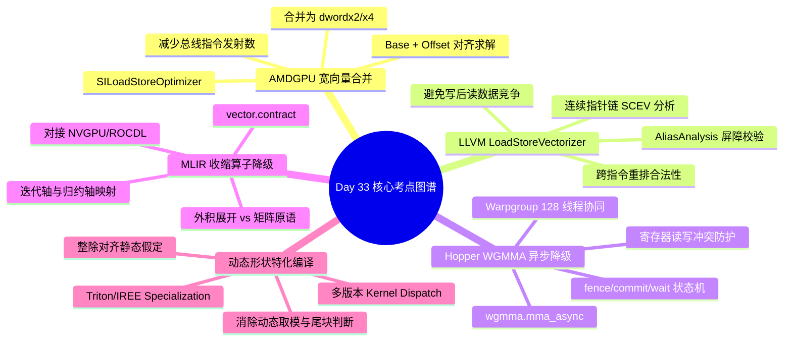

> 本文为 **[GPGPU 编译器工程师面试通关指南](/gpgpu-interview/)** 系列第33期（Day 33）。
> 建议在阅读“面试官参考解析”前，先独立思考每道题目的考察意图与答题脉络（每题思考 3~5 分钟）。

> 💡 **核心考察维度**：SILoadStoreOptimizer 跨通道宽向量加载存储合并与 Base-Offset 求解、LoadStoreVectorizer 连续指针链与跨指令重排合法性、NVPTX Hopper WGMMA (wgmma.mma_async) 异步原语与记分牌状态机、MLIR VectorContractToOuterProduct/VectorToGPU 收缩算子降级、Triton/IREE 动态形状特化编译与 Dispatch 路由优化。

---

## 📝 今日高频面试题清单

### 【Q1 · 宽向量加载合并】`SILoadStoreOptimizer.cpp` 中的宽向量加载/存储合并与 Base-Offset 对齐求解
在 GPGPU 代码生成中，连续的标量访存指令（如连续 4 条 `BUFFER_LOAD_DWORD` 或 `DS_READ_B32`）若无法合并为单条宽向量指令（如 `BUFFER_LOAD_DWORDX4` 或 `DS_READ2_B32`），会成倍消耗指令发射槽位（Issue Slots）并加剧地址翻译总线争用。请结合 `llvm/lib/Target/AMDGPU/SILoadStoreOptimizer.cpp` 源码，深度剖析 `SILoadStoreOptimizer::findMatchingInst` 与 `mergeBufferLoadPair` 是如何在寄存器分配前后扫描基本块的？分析器如何利用寄存器元组约束（Tuple Register Class）校验偏移步长（Offset Stride）、别名冲突（Alias Safety）以及硬件最大不连续跨度限制（如 `DS_READ2` 的 8-bit 偏移差值上限）？

---

### 【Q2 · 向量化指针链重排】`LoadStoreVectorizer.cpp` 中的连续指针链分析与跨指令重排合法性
在中端 LLVM IR 层级，`LoadStoreVectorizer` 负责将相邻的标量内存访问合并为向量访问（如 `<4 x float>`）。然而，在两条待合并的 `LoadInst` 之间往往夹杂着其他计算指令甚至另一条 `StoreInst`。请结合 `llvm/lib/Transforms/Vectorize/LoadStoreVectorizer.cpp` 源码，分析 `Vectorizer::collectInstructions` 与 `isConsecutiveAccess` 是如何结合 `ScalarEvolution`（SCEV）证明两指针在内存地址上严格相邻的？当两指令中间夹杂内存写入（Store）或屏障指令时，算法如何通过内存依赖扫描（Memory Dependence Check）判定将第二条 Load 提前至第一条 Load 处合并是否合法？

---

### 【Q3 · WGMMA 异步状态机】`NVPTXISelLowering.cpp` 中的 Hopper WGMMA（`wgmma.mma_async`）异步原语与寄存器状态机绑定
在 NVIDIA Hopper（SM_90）架构中，第四代 Tensor Core 引入了异步线程束组矩阵乘（`wgmma.mma_async`），它打破了传统同步指令的阻塞模式，允许 4 个 Warp（128 线程组成的 Warpgroup）直接从 Shared Memory 读取源操作数并在后台异步累加。请结合 `llvm/lib/Target/NVPTX/NVPTXIntrinsics.td` 与 `llvm/lib/Target/NVPTX/NVPTXISelLowering.cpp` 源码，分析编译器是如何通过 `wgmma.fence`、`wgmma.commit_group` 与 `wgmma.wait_group` 维护异步执行顺序的？为什么在 `wgmma.mma_async` 执行期间，严禁任何常规线程指令写入其正在读取的 Shared Memory 区域或累加器寄存器，编译器后端是如何防止寄存器分配器与调度器破坏这一硬件契约的？

---

### 【Q4 · vector.contract 降级】`VectorContractToOuterProduct.cpp` 与 `VectorToGPU` 中的收缩算子（`vector.contract`）降级
在 MLIR 结构化代码生成管线中，高层矩阵乘通常被抽象为携带仿射迭代映射的 `vector.contract` 算子。请结合 `mlir/lib/Dialect/Vector/Transforms/LowerVectorContract.cpp` 与 `mlir/lib/Conversion/VectorToGPU/VectorToGPU.cpp` 源码，分析编译器是如何解析 `vector.contract` 的 `indexing_maps` 与 `iterator_types` 属性，将其匹配为硬件专有矩阵指令（如 `gpu.subgroup_mma_compute`）的？当输入张量的存储布局（Row-Major vs Column-Major）与硬件 MMA 要求相反时，转换模式如何在不退化为标量外积循环的前提下自动注入内存转置标记？

---

### 【Q5 · 动态形状特化编译】Triton / IREE 中的 Specialization（特化编译）与 Kernel Dispatch 路由表优化
在实际大模型推理部署中，输入序列长度（Sequence Length）和 Batch Size 往往是动态变化的（Dynamic Shapes）。若全部按动态未对齐尺寸编译，内核将充斥大量越界掩码判断与非对齐标量加载，导致性能暴跌。请结合 Triton（`triton/python/triton/runtime/jit.py`）与 IREE 编译流水线架构分析：编译器是如何通过编译期启发式（如参数整除性 `divisibility=16` 推导与常量折叠）自动生成多个特化版本内核（Specialized Kernel Variants）的？在运行时 Dispatch 阶段，驱动或运行时系统如何通过轻量级位掩码检查将对齐请求路由至无边界检查的极速满血内核？

---

## 🎯 面试官深度解析与追问点



---

### 题 1 深度解析：`SILoadStoreOptimizer.cpp` 中的宽向量加载/存储合并与 Base-Offset 对齐求解

#### 源码级深度剖析与核心实现
> 📌 **源码剖析提问**：在 GPGPU 代码生成中，连续的标量访存指令（如连续 4 条 `BUFFER_LOAD_DWORD` 或 `DS_READ_B32`）若无法合并为单条宽向量指令（如 `BUFFER_LOAD_DWORDX4` 或 `DS_READ2_B32`），会成倍消耗指令发射槽位（Issue Slots）并加剧地址翻译总线争用。请结合 `llvm/lib/Target/AMDGPU/SILoadStoreOptimizer.cpp` 源码，深度剖析 `SILoadStoreOptimizer::findMatchingInst` 与 `mergeBufferLoadPair` 是如何在寄存器分配前后扫描基本块的？分析器如何利用寄存器元组约束（Tuple Register Class）校验偏移步长（Offset Stride）、别名冲突（Alias Safety）以及硬件最大不连续跨度限制（如 `DS_READ2` 的 8-bit 偏移差值上限）？

##### 源码文件直达

  * `llvm/lib/Target/AMDGPU/SILoadStoreOptimizer.cpp`

##### 核心代码块逻辑

```cpp
// llvm/lib/Target/AMDGPU/SILoadStoreOptimizer.cpp 核心逻辑精选
bool SILoadStoreOptimizer::findMatchingInst(CombineInfo &CI) {
  MachineBasicBlock::iterator E = CI.I->getParent()->end();
  MachineBasicBlock::iterator MBBI = std::next(CI.I);

  for (; MBBI != E; ++MBBI) {
    MachineInstr &MI = *MBBI;
    // 1. 遇到同步屏障或未知内存副作用指令，立即终止向后搜索以防越界重排
    if (MI.isBarrier() || MI.hasUnmodeledSideEffects())
      break;

    // 2. 检查候选指令是否为同类访存 (如同为 BUFFER_LOAD_DWORD 或 DS_READ_B32)
    // 且共享完全相同的基地址寄存器 (VAddr / SBase)
    if (isSameMemOpClass(*CI.I, MI) && haveSameBaseOperand(*CI.I, MI)) {
      int64_t OffsetDiff = getOffset(MI) - CI.Offset0;

      // 3. 硬件偏移约束校验:
      // (a) 对于 VMEM Buffer Load: 偏移差必须严格等于单元素字节宽 (如 4 字节，构成连续 64/128-bit)
      // (b) 对于 LDS DS_READ2_B32: 允许不连续跨步读取，但两偏移差必须是 4 的倍数且小于 256 * 4
      if (isValidMergeOffset(CI, OffsetDiff)) {
        CI.Paired = MBBI;
        CI.Offset1 = getOffset(MI);
        return true;
      }
    }
    // 4. 记录途中经过的指令，检测是否存在对基址寄存器的修改或别名写冲突 (RAW/WAR)
    if (modifiesBaseOrAliases(CI, MI))
      break;
  }
  return false;
}
```

##### 逐行机械执行分析

  1. **连续合并 vs 跨步双读（`DS_READ2_B32`）**：对于全局显存（VMEM），物理内存事务要求严格连续对齐（例如 4 个连续 32 位读取合并为一条 `BUFFER_LOAD_DWORDX4`），从而将 4 次独立的地址翻译请求压缩为单次 128-bit 突发事务。而对于片上共享内存（LDS），AMD 硬件配备了双读取端口指令 `DS_READ2_B32` / `DS_READ2ST64_B32`，允许在单条指令字中编码两个独立的 8 位偏移字段（`Offset0` 和 `Offset1`），即使两地址在 LDS 中相隔固定步长（例如矩阵转置时的列跨步），只要偏移差在硬件编码范围内（$\Delta \text{Offset} \le 255 \times 4\text{B}$ 或 $255 \times 64 \times 4\text{B}$），依然能合并为单条双发射指令。
  2. **寄存器分配前后的协同**：该 Pass 在 RA 前运行，直接创建宽元组虚拟寄存器（如 `VReg_128`）并插入 `REG_SEQUENCE` 绑定各子通道；随后下游 `RegisterCoalescer` 消除冗余拷贝，确保硬件直接将数据写入连续的物理 VGPR 组 `v[0:3]`。

---

### 题 2 深度解析：`LoadStoreVectorizer.cpp` 中的连续指针链分析与跨指令重排合法性

#### 源码级深度剖析与核心实现
> 📌 **源码剖析提问**：在中端 LLVM IR 层级，`LoadStoreVectorizer` 负责将相邻的标量内存访问合并为向量访问（如 `<4 x float>`）。然而，在两条待合并的 `LoadInst` 之间往往夹杂着其他计算指令甚至另一条 `StoreInst`。请结合 `llvm/lib/Transforms/Vectorize/LoadStoreVectorizer.cpp` 源码，分析 `Vectorizer::collectInstructions` 与 `isConsecutiveAccess` 是如何结合 `ScalarEvolution`（SCEV）证明两指针在内存地址上严格相邻的？当两指令中间夹杂内存写入（Store）或屏障指令时，算法如何通过内存依赖扫描（Memory Dependence Check）判定将第二条 Load 提前至第一条 Load 处合并是否合法？

##### 源码文件直达

  * `llvm/lib/Transforms/Vectorize/LoadStoreVectorizer.cpp`

##### 核心代码块逻辑

```cpp
// llvm/lib/Transforms/Vectorize/LoadStoreVectorizer.cpp 核心逻辑精选
bool Vectorizer::isConsecutiveAccess(Value *PtrA, Value *PtrB) {
  // 1. 提取两指针在 ScalarEvolution 中的仿射/代数表达式
  const SCEV *SCEVA = SE.getSCEV(PtrA);
  const SCEV *SCEVB = SE.getSCEV(PtrB);

  // 2. 计算两地址表达式的代数差值: Diff = SCEVB - SCEVA
  const SCEV *Diff = SE.getMinusSCEV(SCEVB, SCEVA);
  const auto *ConstDiff = dyn_cast<SCEVConstant>(Diff);
  if (!ConstDiff)
    return false; // 差值包含运行时未知动态变量，无法静态证明连续

  // 3. 验证差值是否严格等于第一个指针所指类型的存储字节大小 (StoreSize)
  uint64_t ElemByteSize = DL.getTypeStoreSize(PtrA->getType());
  return ConstDiff->getValue()->getSExtValue() == static_cast<int64_t>(ElemByteSize);
}
```

##### 逐行机械执行分析

  1. **SCEV 符号相消（Symbolic Cancellation）**：即使指针包含复杂的发散坐标（例如 `PtrA = Base + (blockIdx.x * 128 + threadIdx.x) * 4` 与 `PtrB = Base + (blockIdx.x * 128 + threadIdx.x) * 4 + 4`），`SE.getMinusSCEV(SCEVB, SCEVA)` 会自动抵消所有公共的发散符号项，精确萃取出常数差值 `4`。
  2. **跨指令重排的内存依赖校验（Memory Safety）**：当 `LoadA` 与 `LoadB` 之间夹杂着一条 `StoreC` 时，向量化器调用 `AA.alias(LocB, LocC)` 检查 `LoadB` 与 `StoreC` 是否存在别名冲突。若返回 `NoAlias`，说明 `StoreC` 绝不会修改 `LoadB` 的目标内存，编译器合法将 `LoadB` 提前至 `LoadA` 的位置（Hoist）并合并为 `<2 x float>` 宽读取；若返回 `MayAlias`，合并被立即中止，防止发生写后读（RAW）数据错乱。

---

### 题 3 深度解析：`NVPTXISelLowering.cpp` 中的 Hopper WGMMA（`wgmma.mma_async`）异步原语与寄存器状态机绑定

#### 源码级深度剖析与核心实现
> 📌 **源码剖析提问**：在 NVIDIA Hopper（SM_90）架构中，第四代 Tensor Core 引入了异步线程束组矩阵乘（`wgmma.mma_async`），它打破了传统同步指令的阻塞模式，允许 4 个 Warp（128 线程组成的 Warpgroup）直接从 Shared Memory 读取源操作数并在后台异步累加。请结合 `llvm/lib/Target/NVPTX/NVPTXIntrinsics.td` 与 `llvm/lib/Target/NVPTX/NVPTXISelLowering.cpp` 源码，分析编译器是如何通过 `wgmma.fence`、`wgmma.commit_group` 与 `wgmma.wait_group` 维护异步执行顺序的？为什么在 `wgmma.mma_async` 执行期间，严禁任何常规线程指令写入其正在读取的 Shared Memory 区域或累加器寄存器，编译器后端是如何防止寄存器分配器与调度器破坏这一硬件契约的？

##### 源码文件直达

  * `llvm/lib/Target/NVPTX/NVPTXIntrinsics.td`
  * `llvm/lib/Target/NVPTX/NVPTXISelLowering.cpp`

##### 核心模式定义

```cpp
// llvm/lib/Target/NVPTX/NVPTXIntrinsics.td 核心模式逻辑精选
// 1. 异步栅栏: 确保所有常规线程对 Shared Memory 与寄存器的前置写入对 Tensor Core 异步引擎可见
def INT_NVVM_WGMMA_FENCE_SYNC_ALIGNED :
    NVPTXInst<(outs), (ins), "wgmma.fence.sync.aligned;",
              [(int_nvvm_wgmma_fence_sync_aligned)]>;

// 2. 提交异步 WGMMA 指令组
def INT_NVVM_WGMMA_COMMIT_GROUP_SYNC_ALIGNED :
    NVPTXInst<(outs), (ins), "wgmma.commit_group.sync.aligned;",
              [(int_nvvm_wgmma_commit_group_sync_aligned)]>;

// 3. 等待直到最多剩余 N 个未决异步组 (N=0 表示全部完成)
def INT_NVVM_WGMMA_WAIT_GROUP_SYNC_ALIGNED :
    NVPTXInst<(outs), (ins i64imm:$n), "wgmma.wait_group.sync.aligned $n;",
              [(int_nvvm_wgmma_wait_group_sync_aligned timm:$n)]>;
```

##### 逐行机械执行分析

  1. **Warpgroup 异步解耦微架构**：与 Ampere 的同步 `mma.sync` 不同，Hopper 的 `wgmma.mma_async` 发射后立即返回，底层矩阵硬件引擎在后台独立从 Shared Memory 描述符（Matrix Descriptor）流式拉取 $A$ 和 $B$ 数据并累加到目标通用寄存器组中，同时 Warp 调度器可以并发发射其他 VALU/SFU 指令。
  2. **硬件寄存器锁冲突（Register Hazard）**：在 `wgmma.mma_async` 处于在途（In-Flight）状态期间，累加器寄存器正在被后台异步硬件写入。如果常规线程指令在此期间读取或写入这些累加器寄存器，硬件不提供自动记分牌（Scoreboard）互锁保护，会直接引发数据竞态损坏。
  3. **编译器后端保护机制**：后端将这些指令标记为带有 `hasSideEffects = 1` 与内存屏障属性（`isBarrier`），在 SelectionDAG 中通过强 `Chain` 边与 `Glue` 边将 `wgmma.fence` $\to$ `wgmma.mma_async` $\to$ `wgmma.commit_group` $\to$ `wgmma.wait_group` 串联；同时，虚拟寄存器元组在等待完成前维持严格活跃（Live），彻底阻止寄存器分配器与指令调度器在窗口内复用或重排相关寄存器。

---

### 题 4 深度解析：`VectorContractToOuterProduct.cpp` 与 `VectorToGPU` 中的收缩算子（`vector.contract`）降级

#### 源码级深度剖析与核心实现
> 📌 **源码剖析提问**：在 MLIR 结构化代码生成管线中，高层矩阵乘通常被抽象为携带仿射迭代映射的 `vector.contract` 算子。请结合 `mlir/lib/Dialect/Vector/Transforms/LowerVectorContract.cpp` 与 `mlir/lib/Conversion/VectorToGPU/VectorToGPU.cpp` 源码，分析编译器是如何解析 `vector.contract` 的 `indexing_maps` 与 `iterator_types` 属性，将其匹配为硬件专有矩阵指令（如 `gpu.subgroup_mma_compute`）的？当输入张量的存储布局（Row-Major vs Column-Major）与硬件 MMA 要求相反时，转换模式如何在不退化为标量外积循环的前提下自动注入内存转置标记？

##### 源码文件直达

  * `mlir/lib/Dialect/Vector/Transforms/LowerVectorContract.cpp`
  * `mlir/lib/Conversion/VectorToGPU/VectorToGPU.cpp`

##### 核心代码块逻辑

```cpp
// mlir/lib/Conversion/VectorToGPU/VectorToGPU.cpp 核心逻辑精选
LogicalResult ConvertVectorContractToMMA::matchAndRewrite(
    vector::ContractionOp op, PatternRewriter &rewriter) const {
  // 1. 提取收缩算子的三个仿射映射: LhsMap (A), RhsMap (B), AccMap (C)
  SmallVector<AffineMap> maps = op.getIndexingMapsArray();

  // 2. 校验维度索引投影是否匹配标准矩阵乘拓扑:
  // 例如: A: (m, n, k) -> (m, k), B: (m, n, k) -> (k, n), C: (m, n, k) -> (m, n)
  // 若 B 的映射为 (m, n, k) -> (n, k)，则自动识别出 B 处于列优先 (Col-Major) 布局！
  bool isBColMajor = isTransposedBMap(maps[1]);

  // 3. 校验向量形状是否满足目标硬件 MMA 指令颗粒度 (如 16x16x16 或 16x8x16)
  if (!isSupportedMMAShape(op.getLhsType().getShape(), op.getRhsType().getShape()))
    return failure();

  // 4. 直接降级为 gpu.subgroup_mma_compute，并保留布局标记供下游选择 row.col 指令变体
  rewriter.replaceOpWithNewOp<gpu::SubgroupMmaComputeOp>(
      op, op.getAccType(), op.getLhs(), op.getRhs(), op.getAcc(),
      /*aTranspose=*/UnitAttr(), /*bTranspose=*/isBColMajor ? rewriter.getUnitAttr() : UnitAttr());
  return success();
}
```

##### 逐行机械执行分析

  1. **仿射映射识别转置布局**：`vector.contract` 通过 `indexing_maps` 精确描述张量缩并维度。当右操作数 $B$ 的映射为 `(d0, d1, d2) -> (d1, d2)`（即 `(n, k)` 索引顺序）时，`isTransposedBMap` 无需插入任何显式 `vector.transpose` 指令，直接为生成的操作数打上 `bTranspose` 属性。
  2. **原生硬件指令变体选择**：在下游降级至 NVVM 或 ROCDL 时，带有 `bTranspose` 属性的 MMA 算子直接映射到硬件原生支持的 `mma.sync.aligned.m16n8k16.row.col` 指令，省去了内存转置的巨大开销。若不匹配任何硬件 MMA 模板，`LowerVectorContract.cpp` 则自动回退为标准的向量外积（Outer Product）或内积循环展开。

---

### 题 5 深度解析：Triton / IREE 中的 Specialization（特化编译）与 Kernel Dispatch 路由表优化

#### 源码级深度剖析与核心实现
> 📌 **源码剖析提问**：在实际大模型推理部署中，输入序列长度（Sequence Length）和 Batch Size 往往是动态变化的（Dynamic Shapes）。若全部按动态未对齐尺寸编译，内核将充斥大量越界掩码判断与非对齐标量加载，导致性能暴跌。请结合 Triton（`triton/python/triton/runtime/jit.py`）与 IREE 编译流水线架构分析：编译器是如何通过编译期启发式（如参数整除性 `divisibility=16` 推导与常量折叠）自动生成多个特化版本内核（Specialized Kernel Variants）的？在运行时 Dispatch 阶段，驱动或运行时系统如何通过轻量级位掩码检查将对齐请求路由至无边界检查的极速满血内核？

##### 核心架构直达

  * `triton/python/triton/runtime/jit.py`（`JITFunction._make_signature_key` 与 `divisibility` 推导）
  * `iree/compiler/Dialect/HAL/Transforms/MaterializeDispatchExecutables.cpp`

##### 参数整除性特化与多版本路由核心逻辑模型

```cpp
// 典型的 AI 编译器动态参数整除性特化与运行时路由逻辑模型
struct KernelSpecializationKey {
  uint32_t DivisibilityMask; // Bit i = 1 表示第 i 个指针或维度参数满足 16 字节整除
  uint32_t ConstantArgsHash; // 编译期常量化参数哈希
};

// 1. 编译期：根据特征密钥生成特化 LLVM IR 属性
void applySpecializationHints(Function &KernelFunc, KernelSpecializationKey Key) {
  for (unsigned i = 0; i < KernelFunc.arg_size(); ++i) {
    if (Key.DivisibilityMask & (1u << i)) {
      Argument *Arg = KernelFunc.getArg(i);
      if (Arg->getType()->isPointerTy()) {
        // 注入 16 字节对齐属性，解锁后端 128-bit 宽向量化 (LDG.E.128 / TMA)
        Arg->addAttr(Attribute::getWithAlignment(KernelFunc.getContext(), Align(16)));
      } else if (Arg->getType()->isIntegerTy()) {
        // 注入整除性假设 (@llvm.assume((arg % 16) == 0))，消除所有尾部边界掩码分支！
        emitDivisibilityAssume(KernelFunc, Arg, 16);
      }
    }
  }
}
```

##### 逐行机械执行分析

  1. **为什么整除性（Divisibility）是 GPU 性能生死线？**：在 Triton/IREE 中，如果输入矩阵的列数 `N` 或行跨步 `stride` 无法静态证明是 16 字节（例如 8 个 FP16 元素）的倍数，后端的 `Coalesce` 与 `LoadStoreVectorizer` Pass 必须假设地址可能未对齐，从而将所有 128-bit 宽指令拆碎为 16-bit 标量加载，同时在每次加载前插入越界谓词掩码，带宽瞬间暴跌至 1/4。
  2. **多版本 JIT 特化（Multi-Version Specialization）**：运行时捕获传入参数（指针地址与张量维度），通过极快的位运算 `(ptr % 16 == 0) && (N % 16 == 0)` 计算特征签名（Signature Key）。若命中整除特化版本，编译器直接注入 `align 16` 与 `llvm.assume`，中端 `InstCombine` 与 `SimplifyCFG` 顺藤摸瓜将循环内所有的边界判断条件折叠为恒真（Constant True），彻底擦除边界保护分支与越界掩码，生成 100% 满血宽向量化机器码。
  3. **Fallback 兜底路由**：当遇到奇数长度等极少数非对齐输入时，运行时通过哈希表毫秒级切换路由至通用带掩码保护的兜底内核（Generic Masked Kernel），既保证了任意动态输入下的绝对功能正确性，又确保 99% 的常规对齐场景跑在物理硬件极限带宽上。

---

## 5 深度技术对比

| 优化阶段 / 机制 | 解决的核心硬件/软件瓶颈 | LLVM/MLIR/Triton 关键接口与节点 | 错误处理不当的严重后果 |
| :---- | :---- | :---- | :---- |
| **SILoadStoreOptimizer** | 消除多条相邻标量访存对指令发射端口与缓存标签的重复消耗 | `SILoadStoreOptimizer`, `mergeLoadStore` | 无法利用 `dwordx4` 宽总线猝发，显著增大指令缓存与 waitcnt 负担 |
| **LoadStoreVectorizer** | 在 IR 层聚合连续内存访问，同时确保重排不破坏内存依赖 | `LoadStoreVectorizer`, `isConsecutiveAccess` | 若忽略中间别名写操作强行重排合并，将直接引发 RAW/WAR 静默错误 |
| **Hopper WGMMA State Machine** | 协调 128 线程 Warpgroup 异步矩阵乘与共享内存/累加器寄存器序 | `wgmma.fence`, `wgmma.commit_group`, `wait_group` | 缺乏 Fence 或 Wait 导致累加器与共享内存发生异步数据竞态撕裂 |
| **vector.contract Lowering** | 将高维抽象张量收缩匹配至底层 Tensor Core 或外积 SIMD 指令 | `VectorContractToOuterProduct`, `VectorToGPU` | 降级为低效标量嵌套循环，Tensor Core 算力利用率跌至个位数 |
| **Shape Specialization** | 消除通用动态形状 Kernel 中昂贵的整数除法、取模与边界分支 | `Specialization`, `assumeDivisible` | 在热循环内执行海量整数取模运算，并阻断 128-bit 宽向量化对齐推导 |

---

## 💡 面试实战总结（复盘金句）

> 1. **谈 SILoadStoreOptimizer 与 LoadStoreVectorizer 分工时**：*"IR 层的向量化看的是指针连续性与别名边界，机器层的合并算的则是基址偏移与寄存器对齐；上下两层接力才凑齐了满带宽的宽字访存。"*
> 2. **谈 LoadStoreVectorizer 跨指令重排安全性时**：*"合并相邻访存的快感，必须建立在严格的别名分析之上；跨过一条可能别名写入的指令强行凑单，就是并发数据竞争的温床。"*
> 3. **谈 Hopper WGMMA 异步状态机管理时**：*"WGMMA 把整个 128 线程的 Warpgroup 变成了一台异步矩阵协处理器，而编译器就是手握 fence、commit 和 wait 信号灯的交通指挥官。"*
> 4. **谈 MLIR vector.contract 硬件映射时**：*"vector.contract 是多维计算与硬件指令之间最优雅的契约：向上承接线性代数语义，向下可精准拆解为外积或直接点亮矩阵核心。"*
> 5. **谈动态形状特化编译（Specialization）时**：*"用少量多版本内核分发的代价，换取编译期对齐与整除假设的绝对确定性，是 AI 编译器榨干推理热路径的必由之路。"*

---

> 👈 **上一期回顾**：[**Day 32：交叉开关蝶式归约、尾部合并发散保护、cp.async 谓词补零与重物质化**](/gpu-compiler/2026-11-15-gpgpu-compiler-interview-day-32/)
> 👉 **下一期推荐**：[**Day 34：SGPR 分级溢出、子寄存器 LaneBitmask、byval 参数、就地缓冲与 TMA 多播**](/gpu-compiler/2026-11-17-gpgpu-compiler-interview-day-34/)
> 👉 **专栏返回**：查看更多模块内容与更新计划，请访问 [**GPGPU 编译器面试通关指南目录**](/gpgpu-interview/)。