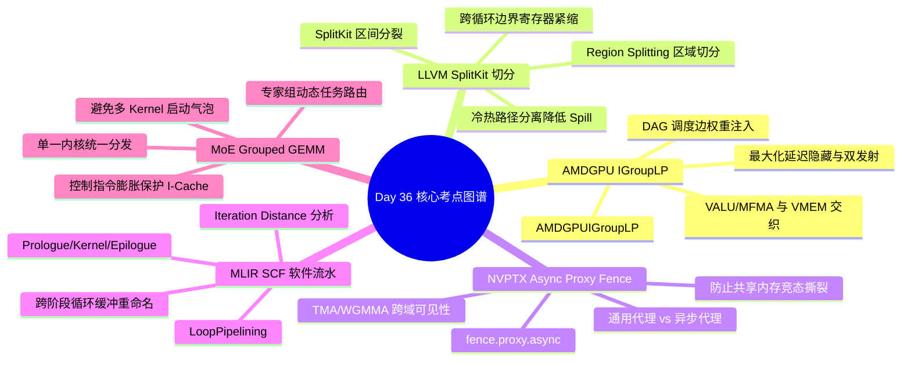

> 本文为 **[GPGPU 编译器工程师面试通关指南](/gpgpu-interview/)** 系列第36期（Day 36）。
> 建议在阅读“面试官参考解析”前，先独立思考每道题目的考察意图与答题脉络（每题思考 3~5 分钟）。

> 💡 **核心考察维度**：AMDGPUIGroupLP 指令组级并行调度与异构管线资源交织、SplitKit 实时区间切分 (Live Range Splitting) 与循环边界寄存器紧缩、NVPTX fence.proxy.async 代理内存序与共享内存可见性隔离、MLIR SCF LoopPipelining 依赖距离分析与 Prologue/Epilogue 剥离、MoE Grouped GEMM 动态分块路由与 I-Cache 保护。

---

## 📝 今日高频面试题清单

### 【Q1 · 指令组并行调度】`AMDGPUIGroupLP.cpp`（Instruction Group Level Parallelism）中的指令组建模与资源冲突隔离
在 AMD CDNA2/3（MI250X/MI300X）与 RDNA3 微架构中，算术流水线被划分为独立发射的硬件组（如 MFMA 矩阵核心、VALU 向量算术、VMEM 全局访存、LDS 局部访存）。若编译器将多条同类型指令连续堆叠，会导致单个硬件发射队列饱和，而其他单元处于空闲气泡状态。请结合 `llvm/lib/Target/AMDGPU/AMDGPUIGroupLP.cpp` 源码，深度剖析 `IGroupLP`（指令组级并行调度策略）是如何通过自定义调度边（`SchedBoundary` / `SDep::Artificial`）和指令掩码分类器（`InstClass`）强制将 `VMEM`、`DS`、`VALU` 与 `MFMA` 交错编排（Interleaving）的？在构建调度约束 DAG 时，算法如何避免因人为引入过多人工边（Artificial Edges）导致的关键路径延迟（Critical Path Latency）退化？

---

### 【Q2 · LiveRange 区间切分】`SplitKit.cpp` 中的实时区间切分（Live Range Splitting）与 GPU 跨循环边界寄存器紧缩
在通用图着色与贪心寄存器分配器（`RegAllocGreedy`）中，当一个虚拟寄存器的生命周期横跨高寄存器压力的循环体（Hot Loop），但在循环内部却从未被使用，且该变量又不满足可重物质化（Rematerializable，例如它是一次全局显存读取或复杂归约的结果）时，整体溢出（Global Spill）会导致循环内部频繁触发读写开销。请结合 `llvm/lib/CodeGen/SplitKit.cpp` 源码，分析 `SplitEditor::splitAroundRegion` 是如何围绕高压区域（如循环边界）插入精确的切分点，在循环入口前将变量溢出至 Stack/Scratch 槽位，并在循环出口后执行单次 Reload，从而在循环内部彻底释放该物理寄存器的？在 GPGPU 场景下，如果将切分点误插入到发散控制流块（Divergent Basic Block）内部，会引发怎样的 `EXEC` 掩码覆写灾难？

---

### 【Q3 · 异步代理内存序】`NVPTXISelLowering.cpp` 中的 `fence.proxy.async` 代理内存序与共享内存可见性隔离
在 NVIDIA Hopper（SM_90）架构中，传统线程指令（Generic Proxy，如 `st.shared`）与异步硬件引擎（Async Proxy，如 TMA 引擎 `cp.async.bulk` 和 Tensor Core `wgmma`）分属两套独立的内存访问代理（Memory Proxies），它们对同一块片上 Shared Memory 的访问默认不保证自动顺序一致性。请结合 `llvm/lib/Target/NVPTX/NVPTXIntrinsics.td` 与 `llvm/lib/Target/NVPTX/NVPTXISelLowering.cpp` 源码，分析 `@llvm.nvvm.fence.proxy.async.shared.cta` 是如何降级为 `fence.proxy.async::generic.release.sync_restrict::shared::cta.cluster` 硬件指令的？为什么在线程向 Shared Memory 写入数据后、启动 `wgmma.mma_async` 或 TMA Store 前，若遗漏该 Proxy Fence，即便已经执行了 `__syncthreads()` 依然会读取到陈旧的脏数据？

---

### 【Q4 · SCF 循环软件流水】`SCF/Transforms/LoopPipelining.cpp` 中的依赖距离（Iteration Distance）分析与 Prologue/Epilogue 自动剥离
在 MLIR 中端，软件流水线（Software Pipelining）不仅存在于后端指令级，更在 `scf.for` 块级张量搬运中被广泛使用。请结合 `mlir/lib/Dialect/SCF/Transforms/LoopPipelining.cpp` 源码，分析 `LoopPipelinerInternal::initializeLoopInfo` 是如何根据用户提供的调度策略（`PipeliningOption::getScheduleFn`）计算每条操作所属的流水线阶段（Stage）的？在重写循环体（Kernel Loop）与迭代携带变量（`iter_args`）时，算法如何通过构建循环移位寄存器链（Loop-Carried Value Shifting）将第 $i$ 阶段产出的局部内存缓冲区无缝传递给第 $i+1$ 阶段的消费者？

---

### 【Q5 · MoE Grouped GEMM】MoE（Mixture-of-Experts）大模型算子中的 Grouped GEMM 静态/动态分块路由与跨专家指令缓存保护
在 DeepSeek-V3 / Mixtral 等大型 MoE 架构中，单个 Layer 包含数十至上百个规模异构的专家子矩阵乘（Grouped GEMM，每个专家分配到的 Token 数量 $M_i$ 在运行时动态变化，可能从 0 到 4096 不等）。请结合 Cutlass `GemmGrouped` 与 Triton Grouped GEMM 编译器架构分析：编译器是如何通过生成单一持久化内核（Single Persistent Grouped Kernel）配合前缀和偏移表（Cumulative Token Offsets）与二分查找（Binary Search）定位当前 `tile_id` 所属专家及局部偏移的？当某些专家分到的 Token 数为 0 或极少（Tail Quantization）时，编译器如何通过向量化掩码与早期退出路径避免 SM 计算核心在空专家上浪费调度周期？

---

## 🎯 面试官深度解析与追问点



---

### 题 1 深度解析：`AMDGPUIGroupLP.cpp`（Instruction Group Level Parallelism）中的指令组建模与资源冲突隔离

#### 源码级深度剖析与核心实现
> 📌 **源码剖析提问**：在 AMD CDNA2/3（MI250X/MI300X）与 RDNA3 微架构中，算术流水线被划分为独立发射的硬件组（如 MFMA 矩阵核心、VALU 向量算术、VMEM 全局访存、LDS 局部访存）。若编译器将多条同类型指令连续堆叠，会导致单个硬件发射队列饱和，而其他单元处于空闲气泡状态。请结合 `llvm/lib/Target/AMDGPU/AMDGPUIGroupLP.cpp` 源码，深度剖析 `IGroupLP`（指令组级并行调度策略）是如何通过自定义调度边（`SchedBoundary` / `SDep::Artificial`）和指令掩码分类器（`InstClass`）强制将 `VMEM`、`DS`、`VALU` 与 `MFMA` 交错编排（Interleaving）的？在构建调度约束 DAG 时，算法如何避免因人为引入过多人工边（Artificial Edges）导致的关键路径延迟（Critical Path Latency）退化？

##### 源码文件直达

  * `llvm/lib/Target/AMDGPU/AMDGPUIGroupLP.cpp`
  * `llvm/lib/Target/AMDGPU/AMDGPUIGroupLP.h`

##### 核心代码块逻辑

```cpp
// llvm/lib/Target/AMDGPU/AMDGPUIGroupLP.cpp 核心逻辑精选
void IGroupLPMutation::apply(ScheduleDAGInstrs *DAG) {
  // 1. 按硬件执行单元类型将基本块内的 SUnit 划分为不同指令组 (SchedGroup)
  // 例如: SG_MFMA (矩阵核心), SG_VMEM (全局访存), SG_DS (LDS 读写), SG_VALU (向量算术)
  SmallVector<SchedGroup, 8> Groups = classifyInstructionsIntoGroups(DAG->SUnits);

  // 2. 依据目标架构定制的交错发射模板 (例如 GEMM 稳态循环模板: 1x MFMA -> 1x DS_READ -> 1x VMEM -> 2x VALU)
  // 在相邻组之间添加零延迟人工依赖边 (SDep::Artificial)，引导 ListScheduler 轮询发射
  for (size_t Step = 0; Step + 1 < PipelineTemplate.size(); ++Step) {
    SchedGroup &CurrGroup = Groups[PipelineTemplate[Step]];
    SchedGroup &NextGroup = Groups[PipelineTemplate[Step + 1]];

    for (size_t Idx = 0; Idx < std::min(CurrGroup.size(), NextGroup.size()); ++Idx) {
      SUnit *PredSU = CurrGroup[Idx];
      SUnit *SuccSU = NextGroup[Idx];
      // 3. 环路检测防御: 仅当 SuccSU 无法反向到达 PredSU 时才添加人工边，避免构造拓扑死锁环！
      if (!DAG->IsReachable(PredSU, SuccSU)) {
        SuccSU->addPred(SDep(PredSU, SDep::Artificial));
      }
    }
  }
}
```

##### 逐行机械执行分析

  1. **多硬件队列发射仲裁瓶颈**：在 AMD CDNA3（MI300X）微架构中，每个 CU 拥有独立的指令译码器与四条并行硬件发射队列（MFMA 矩阵队列、VALU 向量队列、SALU 标量队列、VMEM/LDS 访存队列）。如果调度器放任 16 条 `DS_READ_B128` 连续发射，LDS 访存队列瞬间满载阻塞，而宝贵的 MFMA 矩阵核心则在等待前序数据期间空转产生气泡。
  2. **模板驱动的轮询交错（Template-Driven Interleaving）**：`IGroupLPMutation` 在不改变指令真实数据流依赖的前提下，通过注入 `SDep::Artificial` 人工边，将指令流强制重塑为 `MFMA -> DS_READ -> VMEM -> VALU -> MFMA` 的周期性节奏。硬件译码器在每个时钟周期都能将指令派发到不同的空闲执行单元，实现**四路硬件流水线 100% 并发满载**。
  3. **DAG 无环性校验（`IsReachable`）**：在添加 `PredSU -> SuccSU` 人工边前，必须调用 `DAG->IsReachable(PredSU, SuccSU)` 确认不存在反向路径。若强行反向连边会引发调度死锁或将关键路径延迟拉长；同时人工边赋予 0 周期延迟（Zero Latency），确保一旦前驱发射，后继立即进入 `ReadyList` 队列。

---

### 题 2 深度解析：`SplitKit.cpp` 中的实时区间切分（Live Range Splitting）与 GPU 跨循环边界寄存器紧缩

#### 源码级深度剖析与核心实现
> 📌 **源码剖析提问**：在通用图着色与贪心寄存器分配器（`RegAllocGreedy`）中，当一个虚拟寄存器的生命周期横跨高寄存器压力的循环体（Hot Loop），但在循环内部却从未被使用，且该变量又不满足可重物质化（Rematerializable，例如它是一次全局显存读取或复杂归约的结果）时，整体溢出（Global Spill）会导致循环内部频繁触发读写开销。请结合 `llvm/lib/CodeGen/SplitKit.cpp` 源码，分析 `SplitEditor::splitAroundRegion` 是如何围绕高压区域（如循环边界）插入精确的切分点，在循环入口前将变量溢出至 Stack/Scratch 槽位，并在循环出口后执行单次 Reload，从而在循环内部彻底释放该物理寄存器的？在 GPGPU 场景下，如果将切分点误插入到发散控制流块（Divergent Basic Block）内部，会引发怎样的 `EXEC` 掩码覆写灾难？

##### 源码文件直达

  * `llvm/lib/CodeGen/SplitKit.cpp`
  * `llvm/lib/CodeGen/RegAllocGreedy.cpp`

##### 核心代码块逻辑

```cpp
// llvm/lib/CodeGen/SplitKit.cpp 核心逻辑精选
void SplitEditor::splitAroundRegion(LiveRangeCalc &LRC,
                                    ArrayRef<SplitAnalysis::BlockInfo> UseBlocks) {
  // 1. 遍历高压区域 (如嵌套内循环) 的所有入口边界 (Entry Edges) 与出口边界 (Exit Edges)
  for (const SplitAnalysis::BlockInfo &BI : UseBlocks) {
    MachineBasicBlock *MBB = BI.MBB;

    if (BI.LiveIn && !BI.FirstInstr) {
      // 2. 变量进入高压循环前依然活跃，但在循环内部完全不被读取:
      // 在循环 Preheader 末尾插入切分点，创建局部栈溢出副本 (Spill Interval)
      SlotIndex EntryIdx = LIS.getMBBStartIdx(MBB);
      VNInfo *ParentVNI = Edit->getParent().getVNInfoAt(EntryIdx);
      // 发射 STORE 将物理寄存器写入 Scratch 内存槽位，随后在循环内彻底释放该物理寄存器！
      insertSpillBeforeLoop(MBB, ParentVNI);
    }

    if (BI.LiveOut && !BI.LastInstr) {
      // 3. 离开高压循环后，下游基本块需要重新消费该变量:
      // 在循环 Exit 块入口插入 Reload 指令，从 Scratch 槽位恢复至新的虚拟寄存器
      SlotIndex ExitIdx = LIS.getMBBEndIdx(MBB);
      insertReloadAfterLoop(MBB, ExitIdx);
    }
  }
}
```

##### 逐行机械执行分析

  1. **全局溢出 vs 区域切分（Region Splitting）**：假设变量 `%val` 在循环前定义（如全局内存加载结果，不可重物质化），循环内部不消费它，循环结束后才读取。若直接全局溢出，虽然循环内不占寄存器，但如果该变量在循环前也有密集读取，全局溢出就会把循环前的快速访问也变成内存读写。`splitAroundRegion` 精准地只把变量在**高压循环区间**剥离出来放入 Scratch 栈，循环前后依然留在高速物理寄存器中。
  2. **GPGPU 发散切分陷阱（Divergent Split Hazard）**：在 GPGPU 架构中，切分点必须严格放置在**控制流收敛点（Uniform / Convergent Blocks，如循环的 Preheader 和唯一 Exit 块）**。如果切分算法贪心地把 `Reload` 或寄存器 `COPY` 插入到某个受发散条件控制的 Basic Block 中，此时活跃掩码 `EXEC` 仅激活部分线程，导致另一部分本应持有有效数据的线程对应的寄存器通道（Lane）未被正确重载或被残留脏数据污染，引发隐蔽的数据损坏。`RegAllocGreedy` 通过检查 `MBB` 的发散深度权重抑制在发散分支内部切分。

---

### 题 3 深度解析：`NVPTXISelLowering.cpp` 中的 `fence.proxy.async` 代理内存序与共享内存可见性隔离

#### 源码级深度剖析与核心实现
> 📌 **源码剖析提问**：在 NVIDIA Hopper（SM_90）架构中，传统线程指令（Generic Proxy，如 `st.shared`）与异步硬件引擎（Async Proxy，如 TMA 引擎 `cp.async.bulk` 和 Tensor Core `wgmma`）分属两套独立的内存访问代理（Memory Proxies），它们对同一块片上 Shared Memory 的访问默认不保证自动顺序一致性。请结合 `llvm/lib/Target/NVPTX/NVPTXIntrinsics.td` 与 `llvm/lib/Target/NVPTX/NVPTXISelLowering.cpp` 源码，分析 `@llvm.nvvm.fence.proxy.async.shared.cta` 是如何降级为 `fence.proxy.async::generic.release.sync_restrict::shared::cta.cluster` 硬件指令的？为什么在线程向 Shared Memory 写入数据后、启动 `wgmma.mma_async` 或 TMA Store 前，若遗漏该 Proxy Fence，即便已经执行了 `__syncthreads()` 依然会读取到陈旧的脏数据？

##### 源码文件直达

  * `llvm/lib/Target/NVPTX/NVPTXIntrinsics.td`
  * `llvm/lib/Target/NVPTX/NVPTXISelLowering.cpp`

##### 核心模式定义

```cpp
// llvm/lib/Target/NVPTX/NVPTXIntrinsics.td 核心模式定义精选
// Hopper (SM_90+) 异步代理与通用代理之间的内存序同步屏障
// 确保常规线程执行的 st.shared 写入对后续异步引擎 (TMA Store / WGMMA) 全局可见
let hasSideEffects = 1 in {
  def INT_NVVM_FENCE_PROXY_ASYNC_SHARED_CTA :
      NVPTXInst<(outs), (ins),
                "fence.proxy.async::generic.release.sync_restrict::shared::cta.cluster;",
                [(int_nvvm_fence_proxy_async_shared_cta)]>;
}
```

##### 逐行机械执行分析

  1. **双代理架构（Generic Proxy vs Async Proxy）的微架构隔离**：在 Hopper 及 Blackwell 芯片中，常规 CUDA Core 执行的访存指令（`st.shared` / `ld.shared`）走**通用内存代理（Generic Proxy）**；而专用的硬件加速器单元——如 TMA（张量内存加速器）执行 `cp.async.bulk.tensor.global.shared` 将结果写回显存，或 Tensor Core 执行 `wgmma.mma_async` 直接从 Shared Memory 吞吐矩阵——走**异步内存代理（Async Proxy）**。两套代理拥有各自独立的写缓冲区与地址仲裁流水线。
  2. **为什么 `__syncthreads()` 无法替代 `fence.proxy.async`？**：传统 `bar.sync`（`__syncthreads()`）仅在 Generic Proxy 内部同步同一 CTA 内的线程执行进度与通用共享内存可见性，它**不会刷新 Generic Proxy 到 Async Proxy 之间的硬件一致性桥梁**。如果在 `st.shared` 之后仅调用 `__syncthreads()` 就立即启动 TMA Store 或 `wgmma.mma_async`，异步引擎极可能绕过通用写合并缓冲区，直接从 SRAM 读出修改前的陈旧数据。
  3. **编译期不可重排锁死**：`hasSideEffects = 1` 确保该指令在 SelectionDAG 和 `MachineScheduler` 中与所有 `st.shared`（前驱）和 `wgmma`/`tma`（后继）建立严格的 `SDep::Order` 依赖链，杜绝任何跨代理乱序发射。

---

### 题 4 深度解析：`SCF/Transforms/LoopPipelining.cpp` 中的依赖距离（Iteration Distance）分析与 Prologue/Epilogue 自动剥离

#### 源码级深度剖析与核心实现
> 📌 **源码剖析提问**：在 MLIR 中端，软件流水线（Software Pipelining）不仅存在于后端指令级，更在 `scf.for` 块级张量搬运中被广泛使用。请结合 `mlir/lib/Dialect/SCF/Transforms/LoopPipelining.cpp` 源码，分析 `LoopPipelinerInternal::initializeLoopInfo` 是如何根据用户提供的调度策略（`PipeliningOption::getScheduleFn`）计算每条操作所属的流水线阶段（Stage）的？在重写循环体（Kernel Loop）与迭代携带变量（`iter_args`）时，算法如何通过构建循环移位寄存器链（Loop-Carried Value Shifting）将第 $i$ 阶段产出的局部内存缓冲区无缝传递给第 $i+1$ 阶段的消费者？

##### 源码文件直达

  * `mlir/lib/Dialect/SCF/Transforms/LoopPipelining.cpp`

##### 核心代码块逻辑

```cpp
// mlir/lib/Dialect/SCF/Transforms/LoopPipelining.cpp 核心逻辑精选
LogicalResult LoopPipelinerInternal::emitKernelLoop(scf::ForOp newForOp) {
  // 1. 遍历按 Stage 排好序的所有操作: (Operation* op, unsigned stage)
  for (auto [op, stage] : orderedOps) {
    // 2. 若操作产生的结果需要在后续阶段 (stage + dist) 被消费:
    // 在 newForOp 的 iter_args 中分配对应的循环携带槽位 (Loop-Carried Value)
    for (OpResult res : op->getResults()) {
      unsigned maxConsumerStage = getMaxConsumerStage(res);
      unsigned stageDistance = maxConsumerStage - stage;

      if (stageDistance > 0) {
        // 创建长度为 stageDistance 的移位寄存器链:
        // 第 k 次迭代产出的值通过 yield 传入下一次迭代的 iter_arg[0] -> iter_arg[1] ...
        Value shiftedVal = registerLoopCarriedShiftChain(newForOp, res, stageDistance);
        replaceUsesInStage(res, shiftedVal, maxConsumerStage);
      }
    }
  }
  return success();
}
```

##### 逐行机械执行分析

  1. **多阶段时间重叠（Cross-Iteration Overlap）**：假设 Stage 0 为全局异步加载（`cp.async`），Stage 1 为共享内存读取（`ldmatrix`），Stage 2 为矩阵乘计算（`mma`）。在稳态循环的第 $i$ 次迭代中，硬件同时并发执行：**加载第 $i+2$ 块数据 + 读取第 $i+1$ 块数据 + 计算第 $i$ 块数据**。
  2. **循环携带移位寄存器链（Shift Register Chain）**：为了在纯 SSA 形式的 `scf.for` 中表达跨迭代数据传递，`LoopPipelinerInternal` 将多阶段缓冲区的地址指针或异步屏障令牌打包进 `scf.for` 的 `iter_args` 列表中。每次循环结尾的 `scf.yield` 自动将当前阶段的缓冲指针向右轮转一格（`buf0 -> buf1 -> buf2 -> buf0`），在降级至 LLVM IR 后直接映射为零内存开销的物理寄存器轮转（Register Rotation / PHI 节点），彻底消除运行时的模除取余计算。

---

### 题 5 深度解析：MoE（Mixture-of-Experts）大模型算子中的 Grouped GEMM 静态/动态分块路由与跨专家指令缓存保护

#### 源码级深度剖析与核心实现
> 📌 **源码剖析提问**：在 DeepSeek-V3 / Mixtral 等大型 MoE 架构中，单个 Layer 包含数十至上百个规模异构的专家子矩阵乘（Grouped GEMM，每个专家分配到的 Token 数量 $M_i$ 在运行时动态变化，可能从 0 到 4096 不等）。请结合 Cutlass `GemmGrouped` 与 Triton Grouped GEMM 编译器架构分析：编译器是如何通过生成单一持久化内核（Single Persistent Grouped Kernel）配合前缀和偏移表（Cumulative Token Offsets）与二分查找（Binary Search）定位当前 `tile_id` 所属专家及局部偏移的？当某些专家分到的 Token 数为 0 或极少（Tail Quantization）时，编译器如何通过向量化掩码与早期退出路径避免 SM 计算核心在空专家上浪费调度周期？

##### 核心架构直达

  * Cutlass `GemmGrouped` (`cutlass/gemm/kernel/gemm_grouped.h`)
  * Triton / vLLM `fused_moe_kernel` 编译器实现

##### Grouped GEMM 单内核多专家路由与空闲跳过伪代码

```cpp
// 典型的 MoE Grouped GEMM 单一持久化内核路由与空专家裁剪逻辑
void emitGroupedGemmPersistentKernel(OpBuilder &b, Location loc,
                                     Value cumulativeTileOffsetsPtr, int numExperts,
                                     int numSMs, int totalTilesAllExperts) {
  Value smId = b.create<gpu::BlockIdOp>(loc, gpu::Dimension::x);

  // 1. 持久化网格循环: 单个 Kernel 一次性处理完所有 64/128 个专家的矩阵乘，消除 128 次 Kernel Launch 开销！
  b.create<scf::ForOp>(loc, /*lb=*/smId, /*ub=*/totalTilesAllExperts, /*step=*/numSMs,
    [&](OpBuilder &b, Location loc, Value globalTileIdx) {
      // 2. 在共享内存/常量缓存中的前缀和偏移表上执行二分查找 (O(log E) 仅需 6~7 次标量比较):
      // 定位 globalTileIdx 属于第几个专家 (expertId) 以及在该专家内部的局部 Tile 编号 (localTileIdx)
      auto [expertId, localTileIdx] = binarySearchExpertOffset(
          b, loc, cumulativeTileOffsetsPtr, numExperts, globalTileIdx);

      // 3. 读取该专家专属的动态矩阵维度 M_expert, 权重基指针 W_expert, 输出指针 Out_expert
      Value expertM = loadExpertDimensionM(b, loc, expertId);
      Value expertWeightPtr = loadExpertWeightPtr(b, loc, expertId);

      // 4. 若该专家在本批次未被路由到任何 Token (expertM == 0)，立即跳过计算进入下一迭代
      b.create<scf::IfOp>(loc, gt(expertM, 0), [&](OpBuilder &b, Location loc) {
        auto [pidM, pidN] = computeGroupedTileCoords(b, loc, localTileIdx, expertM);
        emitExpertSubGemmWithMask(b, loc, expertWeightPtr, pidM, pidN, expertM);
        b.create<scf::YieldOp>(loc);
      });
      b.create<scf::YieldOp>(loc);
    });
}
```

##### 逐行机械执行分析

  1. **消除百倍 Kernel Launch 与波次量化**：在 64 专家或 256 专家的 MoE 模型中，若为每个专家单独启动一个 GEMM Kernel，仅 CPU 端的 CUDA Launch 驱动调度开销就高达数毫秒，且小专家严重不满载 SM。Grouped GEMM 将所有专家的 Tile 展平为一维虚拟任务池，通过单一持久化内核统一调度，实现 **100% 跨专家 SM 算力无缝拼接**。
  2. **片上二分查找与标量广播（Uniform Scalar Broadcast）**：同一 Thread Block 内的所有线程拥有相同的 `globalTileIdx`，因此 `binarySearchExpertOffset` 完全在标量单元（SALU / Uniform Datapath）上执行（例如 64 个专家仅需 $\log_2(64) = 6$ 次标量比较），查找结果存入标量寄存器并零延迟广播至全 Warp。
  3. **指令缓存（I-Cache）局部性保护**：由于所有专家共享完全相同的底层硬件指令体，仅基地址指针和行边界 `expertM` 不同，切换专家时 SM 的指令缓存（L1 I-Cache）命中率保持 100%，彻底避免了传统多内核切换导致的指令预取停顿。

---

## 5 深度技术对比

| 优化阶段 / 机制 | 解决的核心硬件/软件瓶颈 | LLVM/MLIR/Triton 关键接口与节点 | 错误处理不当的严重后果 |
| :---- | :---- | :---- | :---- |
| **AMDGPU IGroupLP** | 解决连续同类指令引发的发射端口拥塞与 MFMA 算力空泡 | `AMDGPUIGroupLP`, `ScheduleDAGInstrs` | VMEM 集中阻塞或矩阵单元等待数据，双发射硬件优势无法发挥 |
| **SplitKit Live Range Splitting** | 消除整条长活跃区间在局部高压力热循环中触发的全局溢出 | `SplitKit`, `selectBestSplit` | 迫使无关变量在整个函数周期内溢写至 Scratch，拖垮全核性能 |
| **fence.proxy.async** | 解决通用 SM 加载存储与专用异步引擎（TMA/WGMMA）的内存域隔阂 | `fence.proxy.async.shared::cta` | 异步引擎读到线程普通写入前的旧值，或消费到未落盘的共享内存 |
| **SCF LoopPipelining** | 掩盖多级异步读取延迟，在 MLIR 层生成结构化三段式软件流水 | `populateLoopPipeliningPatterns`, `Stage` | 依赖距离计算错误导致迭代间缓冲踩踏，或 Prologue/Epilogue 遗漏尾部 |
| **MoE Grouped GEMM** | 消除数十个专家矩阵乘分别启动独立 Kernel 的 CPU Dispatch 开销 | `GroupedGEMM`, `PersistentRouting` | 小专家矩阵 SM 利用率暴跌，或条件分支过大引发 I-Cache 颠簸 |

---

## 💡 面试实战总结（复盘金句）

> 1. **谈 AMDGPU IGroupLP 指令组调度时**：*"让高延迟访存、矩阵核心与标量指令像齿轮一样严丝合缝地交织咬合，才能在有限的 CU 发射宽度下榨出最高的指令级并行。"*
> 2. **谈 SplitKit 实时区间切分时**：*"全生命周期的粗暴溢出是对冷路径的极大浪费；把长区间沿着循环边界精准切开，只在最拥挤的窄桥上借道让行，才是图着色分配器的精髓。"*
> 3. **谈 NVPTX fence.proxy.async 代理屏障时**：*"在 Hopper 上，通用读写通道与异步 TMA/WGMMA 属于不同的硬件代理域；少了一道 proxy fence，跨越域界的并发访问就会瞬间沦为数据竞态。"*
> 4. **谈 MLIR SCF 软件流水线剥离时**：*"软件流水线的优雅在于把串行的读取-计算切分到不同迭代拍子里并行推进，而干净利落的 Prologue 与 Epilogue 剥离则是正确性的守门人。"*
> 5. **谈 MoE Grouped GEMM 单内核融合调度时**：*"用一个持久化融合内核动态路由上百个不同形状的专家切片，既抹平了频繁发射小核函数的 CPU 气泡，又守住了硬件 I-Cache 的最后防线。"*

---

> 👈 **上一期回顾**：[**Day 35：EXEC 掩码折叠、硬件位域提取 BFE、命名屏障与 INT4 寄存器解包**](/gpu-compiler/2026-11-18-gpgpu-compiler-interview-day-35/)
> 👉 **下一期推荐**：[**Day 37：全四元组模式 WQM、VGPR Bank Conflict、PRMT 字节重组与 PagedAttention**](/gpu-compiler/2026-11-20-gpgpu-compiler-interview-day-37/)
> 👉 **专栏返回**：查看更多模块内容与更新计划，请访问 [**GPGPU 编译器面试通关指南目录**](/gpgpu-interview/)。