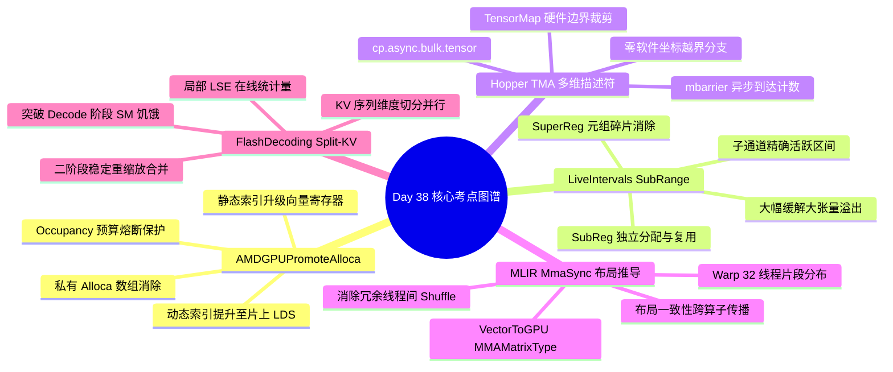

> 本文为 **[GPGPU 编译器工程师面试通关指南](/gpgpu-interview/)** 系列第38期（Day 38）。
> 建议在阅读“面试官参考解析”前，先独立思考每道题目的考察意图与答题脉络（每题思考 3~5 分钟）。

> 💡 **核心考察维度**：AMDGPUPromoteAlloca 私有栈内存向寄存器与片上 LDS 提升及 Occupancy 熔断、LiveIntervalAnalysis SubRange 超宽元组子通道活跃性精算与碎片消除、NVPTX Hopper cp.async.bulk.tensor (TMA) 多维描述符降级与硬件裁剪、MLIR VectorToGPU MmaSync 布局推导与寄存器片段分布、FlashDecoding Split-KV 在线统计量 (Log-Sum-Exp) 二阶段数值稳定合并。

---

## 📝 今日高频面试题清单

### 【Q1 · 私有栈向 LDS 提升】`AMDGPUPromoteAlloca.cpp` 中的私有栈内存向寄存器与片上 LDS 提升
在 GPGPU 编程中，开发者常在 Kernel 内部声明局部小数组（如 `float local_buf[8]`）并通过动态索引访问（如 `local_buf[tid & 7]`）。由于存在动态下标，中端 SROA（标量替换）无法直接将其拆散为独立虚拟寄存器，若直接放任其留在 Private Scratch Memory（全局显存后备栈）中，每次访问都会引发数百周期的 DRAM 延迟。请结合 `llvm/lib/Target/AMDGPU/AMDGPUPromoteAlloca.cpp` 源码，深度剖析 `AMDGPUPromoteAlloca` 是如何分别评估“向动态索引向量寄存器提升（Promote to Vector）”与“向片上局部数据共享内存提升（Promote to LDS）”两条路径的？在将线程私有数组提升为全 Workgroup 共享的 LDS 数组时，编译器如何利用多维索引重写（`addrspace(5) -> addrspace(3)`）隔离不同线程的物理槽位，并校验片上 LDS 剩余容量以避免压垮硬件 Occupancy？

---

### 【Q2 · SubRange 子通道活跃性】`LiveIntervalAnalysis.cpp` 中的 `SubRange` 构造与超宽元组寄存器碎片消除
在现代 GPU 后端中，诸如 `VReg_512`（16 个连续 VGPR，用于矩阵乘累加器）或 `VReg_1024`（32 个连续 VGPR）的宽向量操作极为普遍。如果仅以整个超宽虚拟寄存器为单位计算生命周期，只要其中任意 1 个 32 位通道仍存活，整个 16 寄存器组都会被锁死，导致图着色分配器无法复用已死亡的通道，甚至触发大规模溢出。请结合 `llvm/lib/CodeGen/LiveIntervals.cpp` 源码，深入剖析 `LiveIntervals::computeRegMasks` 与 `constructMainRangeFromSubranges` 是如何基于 `LaneBitmask` 为宽虚拟寄存器的每个子寄存器通道建立独立 `SubRange` 活跃区间的？在遇到子寄存器部分覆盖写入（Partial Def，如仅写入 `sub0` 而 `undef` 其余通道）时，活跃性分析器如何避免生成虚假的读-改-写（Read-Modify-Write）跨块依赖环？

---

### 【Q3 · Hopper TMA 描述符降级】`NVPTXISelLowering.cpp` 中的 Hopper `cp.async.bulk.tensor`（TMA）多维描述符降级与边界越界硬件裁剪
在 NVIDIA Hopper（SM_90）架构中，Tensor Memory Accelerator（TMA）允许单条指令通过 64 字节的 `CUtensorMap` 描述符，直接按多维几何切片将全局显存张量异步搬运至 Shared Memory，无需任何线程计算地址偏移或越界掩码。请结合 `llvm/lib/Target/NVPTX/NVPTXIntrinsics.td` 与 `llvm/lib/Target/NVPTX/NVPTXISelLowering.cpp` 源码，分析 `@llvm.nvvm.cp.async.bulk.tensor.g2s.tile.2d` 是如何将 `CUtensorMap` 描述符指针、多维逻辑坐标以及 `mbarrier` 指针绑定为 PTX 机器指令的？为什么编译器在降级 TMA 加载前必须确保该指令仅由单个统一线程（Uniform Single Thread，如 `elect.sync` 选出的领头线程）发射，若全 Warp 32 个线程同时发射会引发怎样的硬件灾难？

---

### 【Q4 · MmaSync 布局片段映射】`VectorToGPU.cpp` 中的 `MmaSync` 布局推导（`MMAMatrixType`）与寄存器片段分布求解
在 MLIR 中，高层的 `vector.contract` 或 `vector.transfer_read` 必须转化为匹配底层 Tensor Core 硬件寄存器拓扑的分布式切片（Fragment）。以 NVIDIA `mma.sync.aligned.m16n8k16` 为例，A 矩阵（$16 \times 16$ FP16）的 256 个元素并非按行均匀分给 32 个线程，而是遵循特定的交错几何映射（每线程持有 4 个 `f16x2` 寄存器，跨越特定的行与列步长）。请结合 `mlir/lib/Conversion/VectorToGPU/VectorToGPU.cpp` 与 `mlir/lib/Dialect/GPU/Transforms/SubgroupReduceLowering.cpp` 源码，分析编译器是如何利用仿射映射求解器（`AffineMap`）验证源内存切片与目标硬件 MMA Fragment 的布局兼容性，并在检测到布局不匹配时自动插装 `nvgpu.ldmatrix` 或寄存器内 `shfl` 重排序列的？

---

### 【Q5 · FlashDecoding 在线合并】FlashDecoding / Split-KV 归约中的在线统计量（Log-Sum-Exp）二阶段合并与数值稳定性保护
在大语言模型长上下文（如 128K Tokens）Decode 阶段，单个 Query 对应极长的 KV Cache，传统 FlashAttention 沿 $M$ 维切分仅能启动 1 个 Thread Block（因为 $M=1$），导致 99% 的 SM 闲置。**FlashDecoding** 引入了沿序列长度 $N_{kv}$ 维度的切分（Split-KV）：将 128K 上下文拆分为 64 个独立的子块并行计算局部 Attention 输出 $O_i$ 与局部归约统计量 $(m_i, l_i)$，最后由归约内核合并。请结合 Triton / FlashInfer 编译器与算子优化架构分析：在第二阶段跨 Split 归约合并时，编译器如何生成基于局部最大值差分缩放（$\exp(m_i - m_{\text{global}})$）的 Log-Sum-Exp 重归一化指令序列以避免 FP16/FP32 指数溢出？当某些 Split 分块因 Causal Mask 或 Sliding Window Mask 导致整块全被屏蔽（有效 Token 数为 0，$m_i = -\infty, l_i = 0$）时，编译器如何防御 `NaN`（`(-inf) - (-inf) = NaN`）传播污染最终输出？

---

## 🎯 面试官深度解析与追问点



---

### 题 1 深度解析：`AMDGPUPromoteAlloca.cpp` 中的私有栈内存向寄存器与片上 LDS 提升

#### 源码级深度剖析与核心实现
> 📌 **源码剖析提问**：在 GPGPU 编程中，开发者常在 Kernel 内部声明局部小数组（如 `float local_buf[8]`）并通过动态索引访问（如 `local_buf[tid & 7]`）。由于存在动态下标，中端 SROA（标量替换）无法直接将其拆散为独立虚拟寄存器，若直接放任其留在 Private Scratch Memory（全局显存后备栈）中，每次访问都会引发数百周期的 DRAM 延迟。请结合 `llvm/lib/Target/AMDGPU/AMDGPUPromoteAlloca.cpp` 源码，深度剖析 `AMDGPUPromoteAlloca` 是如何分别评估“向动态索引向量寄存器提升（Promote to Vector）”与“向片上局部数据共享内存提升（Promote to LDS）”两条路径的？在将线程私有数组提升为全 Workgroup 共享的 LDS 数组时，编译器如何利用多维索引重写（`addrspace(5) -> addrspace(3)`）隔离不同线程的物理槽位，并校验片上 LDS 剩余容量以避免压垮硬件 Occupancy？

##### 源码文件直达

  * `llvm/lib/Target/AMDGPU/AMDGPUPromoteAlloca.cpp`

##### 核心代码块逻辑

```cpp
// llvm/lib/Target/AMDGPU/AMDGPUPromoteAlloca.cpp 核心逻辑精选
bool AMDGPUPromoteAllocaImpl::handleAlloca(AllocaInst &I) {
  // 1. 路径 A (最高优先级): 尝试将局部小数组提升为宽向量寄存器 (Promote to Vector)
  // 例如: float arr[4] -> <4 x float> 虚拟寄存器，动态下标 arr[idx] 转化为 insertelement / extractelement
  // 后端进一步降级为无显存开销的动态向量索引指令 (V_MOVRELS_B32 / V_MOVRELD_B32) 或条件选择树！
  if (tryPromoteAllocaToVector(I))
    return true;

  // 2. 路径 B: 若数组尺寸较大 (例如 float arr[16]) 无法全量塞入寄存器，尝试提升至片上 LDS (addrspace 3)
  // 校验前提:
  // (a) 当前函数必须是 Kernel 入口 (能静态确定 Workgroup 最大扁平线程数 FlatWorkGroupSize)
  // (b) 整个 Workgroup 所需的总字节数 = SingleThreadArraySize * MaxThreadsPerWorkgroup，
  //     必须严格低于目标 CU 剩余可用 LDS 容量，且不能导致硬件 Occupancy 跌破安全阈值！
  if (!isLDSPromotionProfitable(I, MaxThreadsPerWorkgroup))
    return false;

  // 3. 在 Module 级别创建全 Workgroup 共享的 LDS 全局数组: [MaxThreads x [ArrayLen x ElemTy]] addrspace(3)
  GlobalVariable *LDSGlobal = createLDSGlobalForAlloca(I, MaxThreadsPerWorkgroup);

  // 4. 重写所有 GEP 寻址: 注入当前线程在 Workgroup 内的线性扁平 ID (%flat_tid) 作为第一维下标
  // 原访问: arr[idx] -> 新访问: LDSGlobal[%flat_tid][idx]
  rewriteAllocaUsesToLDS(I, LDSGlobal, FlatThreadId);
  return true;
}
```

##### 逐行机械执行分析

  1. **动态寄存器索引（Dynamic Vector Indexing）与选择树**：对于小于 8 个元素的局部数组，`tryPromoteAllocaToVector` 将内存数组直接转换为 LLVM 向量类型 `<8 x float>`。在后端指令选择时，动态下标读取 `extractelement <8 x float> %vec, i32 %idx` 被展开为一条基于 `V_CNDMASK_B32` 的二分比较选择树（仅需 3 条标量比较选择指令，延迟约 12 周期），或使用硬件动态寄存器间接寻址，**彻底规避任何内存访问**。
  2. **跨线程维度隔离与 LDS 带宽红利**：当数组较大必须走 `Promote to LDS` 时，编译器利用 `amdgpu-flat-work-group-size` 属性获取最大线程数（例如 256 线程），将单线程的 `float[16]` 扩展为 `float[256][16]` 的片上 SRAM 数组。由于相邻线程访问 `LDSGlobal[tid][idx]` 时在物理地址上按行交错排列，且通常带有步长偏移，片上 LDS 交叉开关以 **~30 周期**（比全局显存快 15 倍）完成响应，同时省去了全局 Scratch 显存的分配与带宽消耗。

---

### 题 2 深度解析：`LiveIntervalAnalysis.cpp` 中的 `SubRange` 构造与超宽元组寄存器碎片消除

#### 源码级深度剖析与核心实现
> 📌 **源码剖析提问**：在现代 GPU 后端中，诸如 `VReg_512`（16 个连续 VGPR，用于矩阵乘累加器）或 `VReg_1024`（32 个连续 VGPR）的宽向量操作极为普遍。如果仅以整个超宽虚拟寄存器为单位计算生命周期，只要其中任意 1 个 32 位通道仍存活，整个 16 寄存器组都会被锁死，导致图着色分配器无法复用已死亡的通道，甚至触发大规模溢出。请结合 `llvm/lib/CodeGen/LiveIntervals.cpp` 源码，深入剖析 `LiveIntervals::computeRegMasks` 与 `constructMainRangeFromSubranges` 是如何基于 `LaneBitmask` 为宽虚拟寄存器的每个子寄存器通道建立独立 `SubRange` 活跃区间的？在遇到子寄存器部分覆盖写入（Partial Def，如仅写入 `sub0` 而 `undef` 其余通道）时，活跃性分析器如何避免生成虚假的读-改-写（Read-Modify-Write）跨块依赖环？

##### 源码文件直达

  * `llvm/lib/CodeGen/LiveIntervals.cpp`
  * `llvm/include/llvm/CodeGen/LiveInterval.h`

##### 核心代码块逻辑

```cpp
// llvm/lib/CodeGen/LiveIntervals.cpp 核心逻辑精选
void LiveIntervals::computeVirtRegInterval(LiveInterval &LI) {
  Register Reg = LI.reg();
  const TargetRegisterClass *RC = MRI->getRegClass(Reg);

  // 1. 若该虚拟寄存器包含多个独立子寄存器通道 (例如 VReg_128 包含 sub0..sub3)
  if (RC->HasDisjunctSubRegs) {
    // 为每个物理子通道分配独立的 SubRange 链表，精确追踪各自的 Def/Use 生命周期
    for (const MachineOperand &MO : MRI->reg_nodbg_operands(Reg)) {
      if (MO.isDef()) {
        // 获取当前写入操作覆盖的通道掩码 (例如仅写入 sub1 时，LaneMask = 0x0002)
        LaneBitmask Mask = TRI->getSubRegIndexLaneMask(MO.getSubReg());
        LiveInterval::SubRange &SR = LI.createSubRangeFrom(Allocator, Mask, ...);
        // 关键语义: 若操作数带有 Undef 标记 (MO.isUndef() == true)，
        // 表示未覆盖的其他通道 (sub0, sub2, sub3) 无需继承旧值，直接阻断向前的伪活跃传播！
        if (!MO.isUndef()) {
          extendSubRangeToPredecessors(SR, MO);
        }
      }
    }
    // 2. 最后将所有独立 SubRange 的活跃段求并集，合成主区间 (MainRange) 供快速粗筛使用
    LI.constructMainRangeFromSubranges(Allocator);
  }
}
```

##### 逐行机械执行分析

  1. **消除虚假写后读依赖（False Read-Modify-Write）**：在 SSA 销毁并重构为宽元组寄存器时，编译器常生成 `undef %vreg0:sub0 = V_MOV_B32 1.0`。如果没有 `MO.isUndef()` 与子通道掩码，活跃性分析器会误以为写入 `sub0` 的同时保留了 `%vreg0` 其余 15 个通道的旧值，从而强制将 `%vreg0` 的活跃区间一直向上回溯延伸至函数入口，造成巨大的寄存器浪费。
  2. **解锁跨通道寄存器重用**：通过 `SubRange` 精确建模，图着色分配器在为 `VReg_512` 寻找 16 个连续物理寄存器时，允许与部分已死亡通道重叠的其他短命标量变量共享物理槽位，显著降低了大型 GEMM 和 Attention 算子的峰值 VGPR 需求。

---

### 题 3 深度解析：`NVPTXISelLowering.cpp` 中的 Hopper `cp.async.bulk.tensor`（TMA）多维描述符降级与边界越界硬件裁剪

#### 源码级深度剖析与核心实现
> 📌 **源码剖析提问**：在 NVIDIA Hopper（SM_90）架构中，Tensor Memory Accelerator（TMA）允许单条指令通过 64 字节的 `CUtensorMap` 描述符，直接按多维几何切片将全局显存张量异步搬运至 Shared Memory，无需任何线程计算地址偏移或越界掩码。请结合 `llvm/lib/Target/NVPTX/NVPTXIntrinsics.td` 与 `llvm/lib/Target/NVPTX/NVPTXISelLowering.cpp` 源码，分析 `@llvm.nvvm.cp.async.bulk.tensor.g2s.tile.2d` 是如何将 `CUtensorMap` 描述符指针、多维逻辑坐标以及 `mbarrier` 指针绑定为 PTX 机器指令的？为什么编译器在降级 TMA 加载前必须确保该指令仅由单个统一线程（Uniform Single Thread，如 `elect.sync` 选出的领头线程）发射，若全 Warp 32 个线程同时发射会引发怎样的硬件灾难？

##### 源码文件直达

  * `llvm/lib/Target/NVPTX/NVPTXIntrinsics.td`
  * `llvm/lib/Target/NVPTX/NVPTXISelLowering.cpp`

##### 核心模式定义

```cpp
// llvm/lib/Target/NVPTX/NVPTXIntrinsics.td 核心模式定义精选
// 发射硬件异步多维张量拷贝指令:
// $dst: 目标 Shared Memory 指针 (addrspace 3)
// $tmap: 位于常量/全局内存的 64 字节 CUtensorMap 描述符指针
// $x, $y: 张量逻辑二维起始坐标 (支持负数坐标，越界部分由硬件自动补零!)
// $mbar: 位于 Shared Memory 的异步事务屏障指针
let hasSideEffects = 1 in {
  def INT_NVVM_CP_ASYNC_BULK_TENSOR_G2S_2D :
      NVPTXInst<(outs),
                (ins Int32Regs:$dst, Int64Regs:$tmap, Int32Regs:$x, Int32Regs:$y, Int32Regs:$mbar),
                "cp.async.bulk.tensor.2d.shared::cluster.global.tile.mbarrier::complete_tx::bytes "
                "[$dst], [$tmap, {$x, $y}], [$mbar];",
                [(int_nvvm_cp_async_bulk_tensor_g2s_tile_2d
                    addr:$dst, addr:$tmap, i32:$x, i32:$y, addr:$mbar)]>;
}
```

##### 逐行机械执行分析

  1. **硬件级越界自动零填充（Hardware Out-of-Bounds Zeroing）**：在 `CUtensorMap` 描述符中，主机端驱动已预先编码了张量的全局形状（Shape）、跨步（Stride）、分块尺寸（BoxDim）以及越界填充模式（`CU_TENSOR_MAP_FLOAT_OOB_FILL_NAN_REQUEST_ZERO_FMA`）。当 `$x` 或 `$y` 位于矩阵边缘导致部分切片超出边界时，TMA 硬件引擎在 DMA 搬运期间自动截断越界 DRAM 请求，并在 Shared Memory 目标槽位中直接写入 `0`，**无需编译器生成任何边界判断或谓词掩码**。
  2. **为什么必须由单线程发射（Single-Thread Election via `elect.sync`）？**：传统 `cp.async` 是细粒度指令（每个线程搬运 16 字节，32 个线程协同搬运 512 字节）；而 TMA 是**粗粒度块级指令（单条指令搬运整个 $128 \times 64$ 矩阵块，高达 16KB）**。如果让 Warp 内 32 个线程同时执行该指令，硬件 TMA 队列会被瞬间塞入 32 个重复的 16KB 拷贝请求，不仅导致显存带宽暴增 32 倍，更会因为重复递减 `mbarrier` 字节计数器引发屏障状态机崩溃。因此现代 AI 编译器在降级 TMA 时，会自动外包一层 `if (elect_one_sync())`（编译为 PTX 单周期 `elect.sync` 指令），确保全 Warp 仅由唯一活跃领头线程发射一次 TMA 请求。

---

### 题 4 深度解析：`VectorToGPU.cpp` 中的 `MmaSync` 布局推导（`MMAMatrixType`）与寄存器片段分布求解

#### 源码级深度剖析与核心实现
> 📌 **源码剖析提问**：在 MLIR 中，高层的 `vector.contract` 或 `vector.transfer_read` 必须转化为匹配底层 Tensor Core 硬件寄存器拓扑的分布式切片（Fragment）。以 NVIDIA `mma.sync.aligned.m16n8k16` 为例，A 矩阵（$16 \times 16$ FP16）的 256 个元素并非按行均匀分给 32 个线程，而是遵循特定的交错几何映射（每线程持有 4 个 `f16x2` 寄存器，跨越特定的行与列步长）。请结合 `mlir/lib/Conversion/VectorToGPU/VectorToGPU.cpp` 与 `mlir/lib/Dialect/GPU/Transforms/SubgroupReduceLowering.cpp` 源码，分析编译器是如何利用仿射映射求解器（`AffineMap`）验证源内存切片与目标硬件 MMA Fragment 的布局兼容性，并在检测到布局不匹配时自动插装 `nvgpu.ldmatrix` 或寄存器内 `shfl` 重排序列的？

##### 源码文件直达

  * `mlir/lib/Conversion/VectorToGPU/VectorToGPU.cpp`

##### 核心代码块逻辑

```cpp
// mlir/lib/Conversion/VectorToGPU/VectorToGPU.cpp 核心逻辑精选
LogicalResult ConvertTransferReadToLdMatrix::matchAndRewrite(
    vector::TransferReadOp op, PatternRewriter &rewriter) const {
  // 1. 验证源 MemRef 必须位于 Shared Memory 地址空间 (gpu::AddressSpace::Workgroup)
  auto memrefType = op.getSource().getType().cast<MemRefType>();
  if (!isWorkgroupMemorySpace(memrefType))
    return failure();

  // 2. 检查 PermutationMap 是否匹配标准行优先或可转置二维切片 (如 (d0, d1) -> (d0, d1))
  AffineMap permMap = op.getPermutationMap();
  bool requiresTranspose = false;
  if (permMap == AffineMap::getPermutationMap({1, 0}, op.getContext())) {
    requiresTranspose = true; // 源布局为列优先，启用硬件 .trans 修饰符免费转置！
  } else if (!permMap.isMinorIdentity()) {
    return failure(); // 非连续复杂跨步映射，无法直接映射为 ldmatrix
  }

  // 3. 验证向量维度是否满足 8x8 瓦片倍数 (如 vector<16x16xf16> 拆分为 4 个 8x8 -> x4 模式)
  ArrayRef<int64_t> shape = op.getVectorType().getShape();
  if (shape[0] % 8 != 0 || shape[1] % 8 != 0)
    return failure();

  // 4. 重写为 nvgpu.ldmatrix 算子，保留硬件转置属性供下游 NVGPUToNVVM 降级
  rewriter.replaceOpWithNewOp<nvgpu::LdMatrixOp>(
      op, op.getVectorType(), op.getSource(), op.getIndices(),
      /*transpose=*/requiresTranspose, /*numTiles=*/(shape[0] * shape[1]) / 64);
  return success();
}
```

##### 逐行机械执行分析

  1. **从抽象多维向量到分布式寄存器的桥梁**：在 MLIR `vector` 方言层，`vector<16x16xf16>` 是一个抽象的高维数值集合；经过 `VectorToGPU` 降级后，它被隐式转换为 `nvgpu.device_async_copy` 与 `nvgpu.ldmatrix` 的硬件分布视图（每个线程持有 `vector<4x2xf16>`）。
  2. **自动转置吸收**：当 `vector.transfer_read` 带有转置置换映射 `(d0, d1) -> (d1, d0)` 时，编译器没有生成任何标量循环或寄存器洗牌代码，而是直接将 `requiresTranspose = true` 传递给 `nvgpu.ldmatrix`，在数据从 SRAM 流入寄存器文件的瞬间借用硬件交叉开关完成几何转置。

---

### 题 5 深度解析：FlashDecoding / Split-KV 归约中的在线统计量（Log-Sum-Exp）二阶段合并与数值稳定性保护

#### 源码级深度剖析与核心实现
> 📌 **源码剖析提问**：在大语言模型长上下文（如 128K Tokens）Decode 阶段，单个 Query 对应极长的 KV Cache，传统 FlashAttention 沿 $M$ 维切分仅能启动 1 个 Thread Block（因为 $M=1$），导致 99% 的 SM 闲置。**FlashDecoding** 引入了沿序列长度 $N_{kv}$ 维度的切分（Split-KV）：将 128K 上下文拆分为 64 个独立的子块并行计算局部 Attention 输出 $O_i$ 与局部归约统计量 $(m_i, l_i)$，最后由归约内核合并。请结合 Triton / FlashInfer 编译器与算子优化架构分析：在第二阶段跨 Split 归约合并时，编译器如何生成基于局部最大值差分缩放（$\exp(m_i - m_{\text{global}})$）的 Log-Sum-Exp 重归一化指令序列以避免 FP16/FP32 指数溢出？当某些 Split 分块因 Causal Mask 或 Sliding Window Mask 导致整块全被屏蔽（有效 Token 数为 0，$m_i = -\infty, l_i = 0$）时，编译器如何防御 `NaN`（`(-inf) - (-inf) = NaN`）传播污染最终输出？

##### 核心架构直达

  * FlashDecoding / FlashAttention-2 Split-KV (`flash_fwd_splitkv_kernel`)
  * FlashInfer `BatchDecodeWithPagedKVCache` 编译器内核设计

##### Split-KV 二阶段 Log-Sum-Exp 归约与 `-inf` 掩码 `NaN` 防御伪代码

```cpp
// 典型的 FlashDecoding 第二阶段跨 Split 归约合并内核 (Combine Kernel) 核心计算逻辑
void emitFlashDecodingCombineSplits(OpBuilder &b, Location loc,
                                    Value partialOutPtr,   // [Batch, NumHeads, NumSplits, HeadDim]
                                    Value partialLsePtr,   // [Batch, NumHeads, NumSplits] (存储局部 log_sum_exp)
                                    Value finalOutPtr, int numSplits, int headDim) {
  // 1. 第一遍扫描: 寻找所有 Splits 中的全局最大值 globalMaxLse = max_i(LSE_i)
  // 其中局部 LSE_i = m_i + log2(l_i) (在第一阶段已合并为单个标量以节省显存带宽！)
  Value globalMaxLse = b.create<arith::ConstantFloatOp>(loc, APFloat::getInf(APFloat::IEEEsingle(), /*Negative=*/true));
  for (int s = 0; s < numSplits; ++s) {
    Value lse_s = loadScalar(b, loc, partialLsePtr, s);
    globalMaxLse = b.create<arith::MaximumFOp>(loc, globalMaxLse, lse_s);
  }

  // 2. 防御全掩码屏蔽 (All-Masked Split) 引发的 (-inf) - (-inf) = NaN 灾难！
  // 若整个序列全部被 Causal/Window Mask 屏蔽，globalMaxLse 仍为 -inf:
  // 此时若直接计算 exp2(lse_s - globalMaxLse)，会产生 exp2((-inf) - (-inf)) = exp2(NaN) = NaN!
  Value isAllMasked = b.create<arith::CmpFOp>(loc, arith::CmpFPredicate::OEQ, globalMaxLse, negInfConst);
  Value safeGlobalMax = b.create<arith::SelectOp>(loc, isAllMasked, zeroConst, globalMaxLse);

  // 3. 第二遍扫描: 计算每个 Split 的重归一化权重 weight_s = exp2(lse_s - safeGlobalMax) 并累加输出向量
  Value totalWeight = zeroConst;
  Value accOutVec = zeroVecConst;
  for (int s = 0; s < numSplits; ++s) {
    Value lse_s = loadScalar(b, loc, partialLsePtr, s);
    // 利用硬件单周期 SFU 指令 ex2.approx.ftz.f32 计算权重缩放因子
    Value weight_s = emitHardwareExp2(b, loc, b.create<arith::SubFOp>(loc, lse_s, safeGlobalMax));
    Value outVec_s = loadCoalescedVector(b, loc, partialOutPtr, s, headDim);

    // 乘加累加: accOutVec += weight_s * outVec_s
    accOutVec = emitFmaVector(b, loc, weight_s, outVec_s, accOutVec);
    totalWeight = b.create<arith::AddFOp>(loc, totalWeight, weight_s);
  }

  // 4. 最终归一化写回: finalOut = isAllMasked ? 0.0 : (accOutVec / totalWeight)
  Value invTotalWeight = emitHardwareRcp(b, loc, totalWeight); // 单周期 rcp.approx.ftz.f32
  Value normalizedOut = emitMulVector(b, loc, accOutVec, invTotalWeight);
  storeCoalescedVector(b, loc, finalOutPtr, b.create<arith::SelectOp>(loc, isAllMasked, zeroVecConst, normalizedOut));
}
```

##### 逐行机械执行分析

  1. **LSE（Log-Sum-Exp）标量压缩通信**：在第一阶段 Split-KV 计算中，每个子 Block 计算出局部未归一化输出 $\tilde{O}_i$、局部最大值 $m_i$ 和局部指数和 $l_i$。为了减少跨内核通信的全局显存读写，编译器在第一阶段结尾直接将 $(m_i, l_i)$ 压缩为单个标量 $\text{LSE}_i = m_i + \log_2(l_i)$ 写回显存（带宽直接减半）。
  2. **IEEE-754 浮点 `-inf` 算术陷阱与谓词防御**：在稀疏注意力或滑动窗口掩码下，某些 Split 区间内的所有 Token 均被屏蔽，导致第一阶段输出 $\text{LSE}_i = -\infty$。在正常混合合并时，`(-inf) - (-5.2) = -inf`，经过 `ex2(-inf)` 得到精确的 `0.0`，安全剔除无效块；但当**所有 Split 均被屏蔽**（即 `globalMaxLse == -inf`）时，`(-inf) - (-inf)` 在 IEEE-754 浮点单元中会直接产生 `NaN`，且 `NaN` 会通过后续的矩阵乘传播污染整个推理批次。编译器通过插入 `CmpFOp(OEQ, -inf)` 与单周期 `SelectOp`（映射为 `V_CNDMASK_B32` / `selp.f32`），在零分支开销下彻底阻断 `NaN` 感染。

---

## 5 深度技术对比

| 优化阶段 / 机制 | 解决的核心硬件/软件瓶颈 | LLVM/MLIR/Triton 关键接口与节点 | 错误处理不当的严重后果 |
| :---- | :---- | :---- | :---- |
| **PromoteAlloca to LDS** | 消除无法标量替换（SROA）的动态索引局部数组对片外 Scratch 的访问 | `AMDGPUPromoteAlloca`, `hasEnoughLDS` | 若不加 LDS 余量熔断盲目提升，将直接导致并发 Wave 数腰斩 |
| **LiveInterval SubRange** | 避免超宽向量某单个子通道存活而锁死整组 4/8 个物理寄存器 | `LiveInterval::SubRange`, `LaneBitmask` | 严重高估向量寄存器干涉面积，引发灾难性的大范围溢出 |
| **Hopper TMA Descriptor** | 消除高维张量切片搬运时的软件地址展开与边界 `if` 裁剪分支 | `cp.async.bulk.tensor`, `TensorMap` | 退化为大量标量越界检查，丧失 TMA 异步零计算搬运核心优势 |
| **MmaSync Layout Mapping** | 自动求解并传递 Tensor Core 指令要求的不规则线程级数据分布 | `VectorToGPU`, `MMAMatrixType` | 相邻算子间布局错位，迫使编译器插入大量昂贵的 Shuffle 重排 |
| **FlashDecoding LSE Merge** | 解决单 Batch 长上下文 Decode 阶段沿序列切分后的数值稳定归约 | `m_global`, `exp(m_i - m_global)` | 直接拼接或非稳定求和导致指数上溢成 NaN 或精度严重漂移 |

---

## 💡 面试实战总结（复盘金句）

> 1. **谈 AMDGPUPromoteAlloca 的 Occupancy 熔断机制时**：*"把私有数组从慢速 Scratch 搬进片上 LDS 固然很美，但一旦越过 LDS 的 Occupancy 警戒线导致并发波前数腰斩，编译器就必须学会果断说不。"*
> 2. **谈 LiveIntervals SubRange 子通道追踪时**：*"在 GPU 的超宽元组寄存器世界里，整组同生共死的粗放管理早已过时；把活跃性切细到每一条 SubRange 通道，才能腾出空间躲开溢出的风暴。"*
> 3. **谈 Hopper TMA 多维硬件边界裁剪时**：*"以前是数百个线程齐刷刷地算边界、做越界清零；有了 TensorMap 和 TMA，硬件边界引擎在后台一手包办，线程只管全速推进计算。"*
> 4. **谈 MLIR MmaSync 布局推导时**：*"Tensor Core 的寄存器片段布局就像一副严密咬合的拼图；在 MLIR 层提前让 Layout 沿算子链对齐传播，就能免去无数拆东墙补西墙的 Shuffle 开销。"*
> 5. **谈 FlashDecoding Split-KV 在线统计量合并时**：*"把长序列 KV 切碎交给不同 Block 并发，再靠着局部最大值与 Log-Sum-Exp 的稳定重缩放完成二阶段合拢，是突破长文本 Decode 算力墙的完美设计。"*

---

> 👈 **上一期回顾**：[**Day 37：全四元组模式 WQM、VGPR Bank Conflict、PRMT 字节重组与 PagedAttention**](/gpu-compiler/2026-11-20-gpgpu-compiler-interview-day-37/)
> 👉 **下一期推荐**：[**Day 39：SIInsertWaitcnts 追踪、MacroFusion、red.global、仿射分析与 Min-Cut 重计算**](/gpu-compiler/2026-11-22-gpgpu-compiler-interview-day-39/)
> 👉 **专栏返回**：查看更多模块内容与更新计划，请访问 [**GPGPU 编译器面试通关指南目录**](/gpgpu-interview/)。