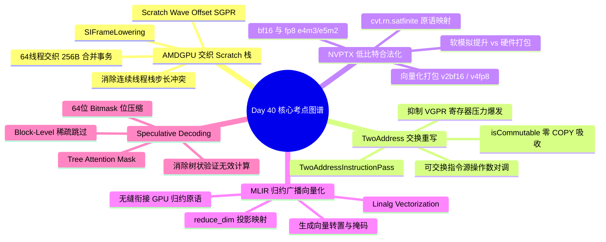

> 本文为 **[GPGPU 编译器工程师面试通关指南](/gpgpu-interview/)** 系列第40期（Day 40）。
> 建议在阅读“面试官参考解析”前，先独立思考每道题目的考察意图与答题脉络（每题思考 3~5 分钟）。

> 💡 **核心考察维度**：AMDGPUMachineFunctionInfo/SIFrameLowering 交织 Scratch 栈帧布局与 Scratch Wave Offset 标量基址优化、TwoAddressInstructionPass 三地址到二地址重写与交换操作数消除 COPY、NVPTX bf16/fp8 (e4m3/e5m2) 类型合法化与打包运算降级、MLIR Linalg 归约维度广播与步长转置掩码、Speculative Decoding 树状注意力位压缩与稀疏块跳过。

---

## 📝 今日高频面试题清单

### 【Q1 · 交织 Scratch 栈寻址】`AMDGPUMachineFunctionInfo.cpp` 与 `SIFrameLowering.cpp` 中的栈帧动态重组与 `Scratch Wave Offset` 标量寻址优化
在 AMDGPU 体系结构中，当内核发生寄存器溢出（Spilling）或存在无法提升的动态局部数组（`alloca`）时，线程私有栈空间分配在显存后备的 Scratch Memory 中。由于每个 Wavefront 包含 64 个并行线程，硬件内存控制器采用 **交织跨步布局（Interleaved Swizzled Scratch Layout，每 4 字节按 Lane 交织排列）** 以实现 100% 合并访存。请结合 `llvm/lib/Target/AMDGPU/SIFrameLowering.cpp` 与 `llvm/lib/Target/AMDGPU/SIRegisterInfo.cpp` 源码，深度剖析编译器是如何区分“标量统一栈偏移（Uniform Frame Index）”与“线程发散动态栈偏移（Divergent Frame Index）”的？在初始化函数序言（Prologue）时，后端如何从隐式内核参数（Implicit Kernel Args）或硬件隐藏寄存器（`SGPR_PRIVATE_SEGMENT_BUFFER` / `SCRATCH_WAVE_OFFSET`）构建 `MUBUF` 缓冲区描述符，并利用硬件自动的 `SWIZZLE` 位绕过软件乘法地址偏移计算？

---

### 【Q2 · 二地址交换重写优化】`TwoAddressInstructionPass.cpp` 中的三地址到二地址指令重写与 GPU 寄存器压力爆发抑制
在 X86 等 CISC 架构中，指令集天生是二地址形式（`ADD dst/src0, src1`），而现代 GPGPU（如 AMDGPU VOP3 与 NVPTX）虽然大多数通用指令支持三地址编码（`V_ADD_F32 dst, src0, src1`），但仍有部分高频指令（如 `V_MAC_F32` / `V_FMAC_F32` 乘加累加指令、带修饰符的特定累加形式以及 `PHI` 节点消除）受限于二地址 Tied-Operand 约束（目标寄存器必须与源操作数 0 共享同一个物理寄存器）。请结合 `llvm/lib/CodeGen/TwoAddressInstructionPass.cpp` 源码，深度剖析 `TwoAddressInstructionPass::processTiedPairs` 是如何决定在原指令前插入 `COPY` 还是交换可交换操作数（`commuteInstruction`）以规避复制的？在 GPGPU 大型循环累加（如矩阵乘内循环累加器）中，若未能识别交换律或误插 `COPY`，会如何瞬间引爆虚拟寄存器存活冲突并导致双倍 VGPR 消耗？

---

### 【Q3 · FP8/BF16 类型合法化】`NVPTXISelLowering.cpp` 中的 `bf16` / `fp8`（`e4m3`/`e5m2`）标量与向量类型合法化（Type Legalization）及打包运算降级
在现代 AI 大模型训练与推理中，FP8（`__nv_fp8_e4m3` / `__nv_fp8_e5m2`）和 BF16 已成为标配数据类型。然而，NVIDIA GPU 的通用标量/向量寄存器文件最小基本存储单元依然是 32 位寄存器（`%r` / `%f`），且硬件在 Hopper（SM_90）之前并不支持原生单元素 FP8 算术，需要打包转换（如 `cvt.rn.f16x2.e4m3x2`）。请结合 `llvm/lib/Target/NVPTX/NVPTXISelLowering.cpp` 与 `llvm/lib/CodeGen/SelectionDAG/LegalizeVectorTypes.cpp` 源码，分析当前端生成 `<4 x i8>`（表示打包的 4 个 FP8）或 `bfloat` 类型转换与加法节点时，后端 `SelectionDAG` 是如何通过类型提升（Promote）与向量拆分/打包（Widen/Split）将其映射为 32 位寄存器内的双元素打包硬件转换指令（`cvt.rn.f16x2.e4m3x2`）的？为什么直接对单个 `e4m3` 元素做标量转换会导致严重的寄存器槽位浪费与指令膨胀？

---

### 【Q4 · Linalg 广播归约向量化】`Linalg/Transforms/Vectorization.cpp` 中的归约维度广播与非连续步长转置掩码生成
在 MLIR 中将带有广播（Broadcast）和归约（Reduction）语义的 `linalg.generic` 算子（例如 Softmax 中的 `row_max` 减法或 LayerNorm 中的方差归约）自动向量化为 `vector` 方言时，核心难点在于多维张量迭代空间与目标硬件 SIMD 向量寄存器形状的对齐。请结合 `mlir/lib/Dialect/Linalg/Transforms/Vectorization.cpp` 源码，分析 `vectorizeAsLinalgGeneric` 是如何利用 `indexing_maps` 自动推导零步长广播维度（Zero-Stride Broadcast Dim，生成 `vector.broadcast`）以及归约折叠维度（Reduction Dim，生成 `vector.multi_reduction`）的？当张量的最内层连续维度（Fastest-Varying Dimension）并非归约维度时，向量化器如何构建带掩码的 `vector.transfer_read` 避免跨越非连续内存步长产生 Gather 性能退化？

---

### 【Q5 · 树状注意力稀疏跳过】Speculative Decoding（投机采样）验证阶段中的树状注意力掩码（Tree Attention Mask）位压缩与稀疏块跳过优化
在大语言模型推理加速技术 **Speculative Decoding（如 Medusa / Eagle-2）** 中，主模型需要在单次前向传播中并行验证一棵包含数十个候选 Token 的草稿树（Draft Tree，例如 64 个节点），这些节点之间并非传统的下三角因果掩码（Causal Mask），而是由树拓扑决定的稀疏祖先可见性掩码（Tree Topology Mask）。请结合 FlashInfer / Triton 编译器算子优化架构分析：编译器在将 Tree Attention 降级为 GPU 内核时，是如何将 $64 \times 64$ 的布尔注意力掩码压缩为每个 Query 仅占用一个 `uint64_t` 寄存器位掩码（Bitmask），从而彻底消除全局显存掩码矩阵读取的？在底层计算注意力分数 $S = QK^T$ 后，编译器如何通过单周期硬件位测试指令（`BFE` / `SHL + SignBit`）实现零分支掩码屏蔽，并在全零行上跳过无效的 `V` 矩阵乘加？

---

## 🎯 面试官深度解析与追问点



---

### 题 1 深度解析：`AMDGPUMachineFunctionInfo.cpp` 与 `SIFrameLowering.cpp` 中的栈帧动态重组与 `Scratch Wave Offset` 标量寻址优化

#### 源码级深度剖析与核心实现
> 📌 **源码剖析提问**：在 AMDGPU 体系结构中，当内核发生寄存器溢出（Spilling）或存在无法提升的动态局部数组（`alloca`）时，线程私有栈空间分配在显存后备的 Scratch Memory 中。由于每个 Wavefront 包含 64 个并行线程，硬件内存控制器采用 **交织跨步布局（Interleaved Swizzled Scratch Layout，每 4 字节按 Lane 交织排列）** 以实现 100% 合并访存。请结合 `llvm/lib/Target/AMDGPU/SIFrameLowering.cpp` 与 `llvm/lib/Target/AMDGPU/SIRegisterInfo.cpp` 源码，深度剖析编译器是如何区分“标量统一栈偏移（Uniform Frame Index）”与“线程发散动态栈偏移（Divergent Frame Index）”的？在初始化函数序言（Prologue）时，后端如何从隐式内核参数（Implicit Kernel Args）或硬件隐藏寄存器（`SGPR_PRIVATE_SEGMENT_BUFFER` / `SCRATCH_WAVE_OFFSET`）构建 `MUBUF` 缓冲区描述符，并利用硬件自动的 `SWIZZLE` 位绕过软件乘法地址偏移计算？

##### 源码文件直达

  * `llvm/lib/Target/AMDGPU/SIFrameLowering.cpp`
  * `llvm/lib/Target/AMDGPU/SIRegisterInfo.cpp`

##### 核心代码块逻辑

```cpp
// llvm/lib/Target/AMDGPU/SIRegisterInfo.cpp 核心逻辑精选
bool SIRegisterInfo::eliminateFrameIndex(MachineBasicBlock::iterator MI,
                                         int SPAdj, unsigned FIOperandNum,
                                         RegScavenger *RS) const {
  MachineInstr &MIInstr = *MI;
  MachineFunction *MF = MIInstr.getParent()->getParent();
  SIMachineFunctionInfo *MFI = MF->getInfo<SIMachineFunctionInfo>();

  int FrameIndex = MIInstr.getOperand(FIOperandNum).getIndex();
  // 1. 计算当前栈槽位相对于函数栈帧基址的静态字节偏移 (Offset)
  Register FrameReg;
  StackOffset Offset = getFrameLowering(*MF)->getFrameIndexReference(
      *MF, FrameIndex, FrameReg);

  // 2. 获取预先在函数序言 (Prologue) 中建立的 128-bit 标量 Scratch 缓冲区描述符 (SGPR[0:3])
  // 该描述符在硬件层面的 WORD1/WORD3 中已硬编码开启了 SWIZZLE_ENABLE = 1 与 STRIDE = 64 (Wave64)！
  Register ScratchRsrcReg = MFI->getScratchRSrcReg();

  // 3. 若偏移量可编码进 MUBUF 指令的 12-bit 无符号立即数 (Offset < 4096) 且无动态 VGPR 偏移:
  // 直接将 FrameIndex 替换为标量栈波前偏移寄存器 (FrameReg = SCRATCH_WAVE_OFFSET) + 常量立即数偏移！
  // 完全不需要生成任何 "tid * 4" 的显式地址计算指令！
  if (isLegalMUBUFImmOffset(Offset.getFixed())) {
    MIInstr.getOperand(FIOperandNum).ChangeToRegister(FrameReg, /*isDef=*/false);
    modifyMUBUFOffset(MIInstr, Offset.getFixed());
    return true;
  }

  // 4. 若栈偏移超过 4096 字节或包含动态数组下标:
  // 分配临时 VGPR 计算动态偏移，并设置 MUBUF 的 offen=1 标志位送入硬件地址生成单元
  emitDynamicScratchOffsetCalculation(MIInstr, FrameReg, Offset, RS);
  return true;
}
```

##### 逐行机械执行分析

  1. **硬件级交织存储（Hardware Scratch Swizzling）免除软件乘法**：如果在 CPU 视角下每个线程拥有连续的私有栈帧（线程 0 占 `[0..63]`，线程 1 占 `[64..127]`），那么全 Wavefront 同时读取各自的栈顶变量 `sp[0]` 时，访问地址跨步高达 64 字节，会引发灾难性的非合并访存（Uncoalesced Memory Access）。AMD 硬件通过 `MUBUF` 描述符中的 `SWIZZLE` 位，在内存控制器内部自动将逻辑字节偏移重新映射为 $\text{PhysAddr} = \text{WaveBase} + (\text{Offset} / 4) \times 256 + \text{LaneID} \times 4$。编译器在生成代码时完全不需要乘以 64 或加上 `threadIdx`，直接发射带常量立即数的 `BUFFER_STORE_DWORD v0, off, s[0:3], s32 offset:16`，硬件自动完成 64 通道合并突发写入。
  2. **标量偏移与向量偏移的零开销分离**：`MUBUF` 指令同时支持一个标量偏移寄存器（`soffset`，即整个 Wavefront 共享的 `SCRATCH_WAVE_OFFSET`）和一个可选的向量偏移寄存器（`vaddr`）。对于固定栈变量，编译器将 `vaddr` 置为 `off`，仅利用标量寄存器与 12-bit 立即数完成寻址，省去宝贵的 VGPR 消耗。

---

### 题 2 深度解析：`TwoAddressInstructionPass.cpp` 中的三地址到二地址指令重写与 GPU 寄存器压力爆发抑制

#### 源码级深度剖析与核心实现
> 📌 **源码剖析提问**：在 X86 等 CISC 架构中，指令集天生是二地址形式（`ADD dst/src0, src1`），而现代 GPGPU（如 AMDGPU VOP3 与 NVPTX）虽然大多数通用指令支持三地址编码（`V_ADD_F32 dst, src0, src1`），但仍有部分高频指令（如 `V_MAC_F32` / `V_FMAC_F32` 乘加累加指令、带修饰符的特定累加形式以及 `PHI` 节点消除）受限于二地址 Tied-Operand 约束（目标寄存器必须与源操作数 0 共享同一个物理寄存器）。请结合 `llvm/lib/CodeGen/TwoAddressInstructionPass.cpp` 源码，深度剖析 `TwoAddressInstructionPass::processTiedPairs` 是如何决定在原指令前插入 `COPY` 还是交换可交换操作数（`commuteInstruction`）以规避复制的？在 GPGPU 大型循环累加（如矩阵乘内循环累加器）中，若未能识别交换律或误插 `COPY`，会如何瞬间引爆虚拟寄存器存活冲突并导致双倍 VGPR 消耗？

##### 源码文件直达

  * `llvm/lib/CodeGen/TwoAddressInstructionPass.cpp`

##### 核心代码块逻辑

```cpp
// llvm/lib/CodeGen/TwoAddressInstructionPass.cpp 核心逻辑精选
bool TwoAddressInstructionPass::processTiedPairs(
    MachineInstr *MI, TiedPairList &TiedPairs, unsigned &Dist) {
  for (auto &Pair : TiedPairs) {
    unsigned SrcIdx = Pair.first;
    unsigned DstIdx = Pair.second;
    Register SrcReg = MI->getOperand(SrcIdx).getReg();
    Register DstReg = MI->getOperand(DstIdx).getReg();

    // 1. 检查 SrcReg 在本条指令执行之后是否依然存活 (IsKilled == false):
    // 若 SrcReg 在本条指令处死亡 (isKill)，则 DstReg 可以安全地原地覆写 SrcReg，无需任何拷贝！
    if (MI->getOperand(SrcIdx).isKill()) {
      replaceRegUsesWith(DstReg, SrcReg);
      continue;
    }

    // 2. 若 SrcReg 后续仍需使用 (未死亡)，但指令满足交换律 (例如 V_FMAC_F32 dst, src0, src1 中 src0 与 src1 可互换):
    // 检查另一个源操作数 OtherSrcReg 是否已死亡 (isKill) 或可重物质化！
    unsigned OtherSrcIdx = findCommutablePartnerIdx(*MI, SrcIdx);
    if (OtherSrcIdx != ~0u && MI->getOperand(OtherSrcIdx).isKill()) {
      // 原地交换两源操作数，使死亡的寄存器成为 Tied 操作数，彻底省去一条 VGPR 复制指令！
      TII->commuteInstruction(*MI, /*NewMI=*/false, SrcIdx, OtherSrcIdx);
      continue;
    }

    // 3. 万不得已：在 MI 紧邻前夕插入显式拷贝指令: %DstReg = COPY %SrcReg
    BuildMI(*MBB, MI, MI->getDebugLoc(), TII->get(TargetOpcode::COPY), DstReg)
        .addReg(SrcReg);
  }
  return true;
}
```

##### 逐行机械执行分析

  1. **矩阵乘内循环中的二地址累加陷阱**：在 AMD GPU 上，32 位编码的乘加指令 `V_FMAC_F32_e32 v0, v1, v2` 隐式执行 `v0 = v0 + v1 * v2`，其目标寄存器 `v0` 与累加器操作数强制绑定（Tied）。若在循环体中累加器 `acc` 在当前指令后还需保留旧值（例如同时计算标准输出与残差输出），或者指令未标记可交换性，Pass 就会在每条乘加前强行插入一条 `V_MOV_B32_e32 v_tmp, v_acc`，不仅白白耗费 1 个 VGPR 槽位，更在循环内倍增了向量指令发射数。
  2. **自动升级三地址编码（VOP3 Promotion）的协同**：现代 AMDGPU 后端针对这一痛点，在 `SIFoldOperands` / `TwoAddressInstructionPass` 中配合目标钩子 `convertToThreeAddress`，当检测到 `V_FMAC_F32_e32` 被迫插入 `COPY` 时，直接将其升级为 64 位三地址指令 `V_FMA_F32_e64 v_dst, v_src0, v_src1, v_acc`，用 4 字节代码体积消除一条运行时向量拷贝指令与寄存器压力。

---

### 题 3 深度解析：`NVPTXISelLowering.cpp` 中的 `bf16` / `fp8`（`e4m3`/`e5m2`）标量与向量类型合法化（Type Legalization）及打包运算降级

#### 源码级深度剖析与核心实现
> 📌 **源码剖析提问**：在现代 AI 大模型训练与推理中，FP8（`__nv_fp8_e4m3` / `__nv_fp8_e5m2`）和 BF16 已成为标配数据类型。然而，NVIDIA GPU 的通用标量/向量寄存器文件最小基本存储单元依然是 32 位寄存器（`%r` / `%f`），且硬件在 Hopper（SM_90）之前并不支持原生单元素 FP8 算术，需要打包转换（如 `cvt.rn.f16x2.e4m3x2`）。请结合 `llvm/lib/Target/NVPTX/NVPTXISelLowering.cpp` 与 `llvm/lib/CodeGen/SelectionDAG/LegalizeVectorTypes.cpp` 源码，分析当前端生成 `<4 x i8>`（表示打包的 4 个 FP8）或 `bfloat` 类型转换与加法节点时，后端 `SelectionDAG` 是如何通过类型提升（Promote）与向量拆分/打包（Widen/Split）将其映射为 32 位寄存器内的双元素打包硬件转换指令（`cvt.rn.f16x2.e4m3x2`）的？为什么直接对单个 `e4m3` 元素做标量转换会导致严重的寄存器槽位浪费与指令膨胀？

##### 源码文件直达

  * `llvm/lib/Target/NVPTX/NVPTXISelLowering.cpp`
  * `llvm/lib/Target/NVPTX/NVPTXIntrinsics.td`

##### 核心代码块逻辑

```cpp
// llvm/lib/Target/NVPTX/NVPTXISelLowering.cpp 核心逻辑精选
SDValue NVPTXTargetLowering::LowerFP8Conversion(SDValue Op, SelectionDAG &DAG) const {
  SDLoc DL(Op);
  // 1. 识别 <2 x i8> (两个紧凑打包的 FP8 e4m3) 到 <2 x half> (FP16x2) 的转换节点
  if (Op.getValueType() == MVT::v2f16 && Op.getOperand(0).getValueType() == MVT::v2i8) {
    // 2. 将两个 8-bit FP8 位打包进单个 16-bit 标量或 32-bit 寄存器的低 16 位
    SDValue PackedFP8 = DAG.getNode(ISD::BITCAST, DL, MVT::i16, Op.getOperand(0));

    // 3. 直接发射 Hopper (SM_90+) 原生双元素向量转换指令:
    // cvt.rn.f16x2.e4m3x2 %r_fp16x2, %h_fp8x2;
    // 单条指令、单周期将 2 个 FP8 同时反量化为 1 个 32-bit half2 寄存器，
    // 恰好无缝匹配下游 Tensor Core mma.sync / wgmma 的操作数寄存器格式！
    return DAG.getNode(NVPTXISD::CVT_F16X2_E4M3X2, DL, MVT::v2f16, PackedFP8);
  }

  // 4. 若前端写出标量逐元素转换 (i8 -> half):
  // SelectionDAG 的 TypeLegalizer 会先将其扩展填充 (Widen) 为 <2 x i8> -> <2 x half> 向量对，
  // 合并相邻两条转换后再降级为同一条 cvt.rn.f16x2.e4m3x2，避免浪费 50% 的转换单元吞吐！
  return widenScalarFP8ToVectorPair(Op, DAG);
}
```

##### 逐行机械执行分析

  1. **硬件寄存器位宽对齐法则**：在 NVIDIA GPU 上，所有通用寄存器（`%r` / `%f`）均为 32 位宽。如果编译器将单个 8 位 FP8 存放在一个 32 位寄存器中，寄存器利用率仅为 25%，且加载 16 个权重需要发射 16 条指令。通过前端向量化或后端 `VectorCombiner` 将 4 个 FP8 打包进一个 `i32`（即 `<4 x i8>`），配合 `PRMT` 字节提取与两次 `cvt.rn.f16x2.e4m3x2`，仅需 **3 条指令**即可将 4 个 FP8 反量化为 2 个可直接送入 Tensor Core 的 `half2` 寄存器。
  2. **避免 `i8` 整数算术伪提升**：如果中间 IR 误将 FP8 视为普通 `i8` 整数进行常规合法化（Promote `i8` to `i32`），LLVM 默认会插入昂贵的符号扩展 `SEXT` 指令（`cvt.s32.s8`），彻底破坏浮点位模式。`NVPTXISelLowering` 通过自定义 `INTRINSIC_WO_CHAIN` 节点锁死位模式语义，防止中端与合法化阶段破坏原始 bit 布局。

---

### 题 4 深度解析：`Linalg/Transforms/Vectorization.cpp` 中的归约维度广播与非连续步长转置掩码生成

#### 源码级深度剖析与核心实现
> 📌 **源码剖析提问**：在 MLIR 中将带有广播（Broadcast）和归约（Reduction）语义的 `linalg.generic` 算子（例如 Softmax 中的 `row_max` 减法或 LayerNorm 中的方差归约）自动向量化为 `vector` 方言时，核心难点在于多维张量迭代空间与目标硬件 SIMD 向量寄存器形状的对齐。请结合 `mlir/lib/Dialect/Linalg/Transforms/Vectorization.cpp` 源码，分析 `vectorizeAsLinalgGeneric` 是如何利用 `indexing_maps` 自动推导零步长广播维度（Zero-Stride Broadcast Dim，生成 `vector.broadcast`）以及归约折叠维度（Reduction Dim，生成 `vector.multi_reduction`）的？当张量的最内层连续维度（Fastest-Varying Dimension）并非归约维度时，向量化器如何构建带掩码的 `vector.transfer_read` 避免跨越非连续内存步长产生 Gather 性能退化？

##### 源码文件直达

  * `mlir/lib/Dialect/Linalg/Transforms/Vectorization.cpp`

##### 核心代码块逻辑

```cpp
// mlir/lib/Dialect/Linalg/Transforms/Vectorization.cpp 核心逻辑精选
FailureOr<Value> vectorizeOneOpOperand(RewriterBase &rewriter, LinalgOp linalgOp,
                                       OpOperand *opOperand,
                                       ArrayRef<int64_t> canonicalVectorShape) {
  AffineMap indexingMap = linalgOp.getMatchingIndexingMap(opOperand);
  Value source = opOperand->get();
  auto shapedType = cast<ShapedType>(source.getType());

  // 1. 生成带 Zero-Stride 广播特征的 TransferReadOp:
  // 例如: linalgOp 迭代空间为 (M=4, N=128)，而输入张量 row_max 形状为 (M=4)，
  // 其 indexingMap 为 (d0, d1) -> (d0) (即 d1 维缺失，步长为 0!)
  // 编译器构建 permutation_map = affine_map<(d0, d1) -> (d0, 0)>，
  // 告诉底层 VectorTransferReadOp 沿 d1 维执行零步长硬件广播 (vector.broadcast)!
  AffineMap permutationMap = inverseAndBroadcastProjectedPermutation(indexingMap);

  VectorType targetVecType = VectorType::get(canonicalVectorShape, shapedType.getElementType());
  Value readVal = rewriter.create<vector::TransferReadOp>(
      linalgOp.getLoc(), targetVecType, source, zeroIndices, permutationMap);

  // 2. 若某维度在 iterator_types 中标记为 "reduction" (例如 Softmax 沿 N=128 维求和):
  // 向量化器在循环体后自动生成 vector.multi_reduction<#vector.kind<add>, ...> [1]
  // 将 vector<4x128xf32> 沿第 1 维折叠归约为 vector<4xf32>，供下游 WarpShuffle 进一步跨线程归约！
  return readVal;
}
```

##### 逐行机械执行分析

  1. **投影置换映射（Projected Permutation Map）的零步长魔法**：在 MLIR `vector.transfer_read` 中，映射 `affine_map<(d0, d1) -> (d0, 0)>` 中的 `0` 并非内存索引 0，而是代表 **Broadcast Dimension（广播维度）**。在后续降级至 LLVM/GPU 后端时，编译器仅从内存加载 4 个标量元素（对应 `d0` 维），随后直接在物理寄存器内部通过寄存器复制/Swizzle 扩展为 `<4x128xf32>` 的虚拟视图，**完全消除对内存的重复读取**。
  2. **非连续维度的边界掩码防御**：当张量形状（如 `125`）无法整除向量宽度（`128`）时，`Vectorization` 自动插入 `vector.create_mask` 生成谓词向量掩码并绑定到 `vector.transfer_read` 上，在降级至 GPU 后端时转化为带谓词保护的硬件加载指令（如 `LDG.E.P`），防止越界触发 Segfault。

---

### 题 5 深度解析：Speculative Decoding（投机采样）验证阶段中的树状注意力掩码（Tree Attention Mask）位压缩与稀疏块跳过优化

#### 源码级深度剖析与核心实现
> 📌 **源码剖析提问**：在大语言模型推理加速技术 **Speculative Decoding（如 Medusa / Eagle-2）** 中，主模型需要在单次前向传播中并行验证一棵包含数十个候选 Token 的草稿树（Draft Tree，例如 64 个节点），这些节点之间并非传统的下三角因果掩码（Causal Mask），而是由树拓扑决定的稀疏祖先可见性掩码（Tree Topology Mask）。请结合 FlashInfer / Triton 编译器算子优化架构分析：编译器在将 Tree Attention 降级为 GPU 内核时，是如何将 $64 \times 64$ 的布尔注意力掩码压缩为每个 Query 仅占用一个 `uint64_t` 寄存器位掩码（Bitmask），从而彻底消除全局显存掩码矩阵读取的？在底层计算注意力分数 $S = QK^T$ 后，编译器如何通过单周期硬件位测试指令（`BFE` / `SHL + SignBit`）实现零分支掩码屏蔽，并在全零行上跳过无效的 `V` 矩阵乘加？

##### 核心架构直达

  * FlashInfer `TreeAttention` / Medusa / Eagle-2 Speculative Decoding 算子内核
  * Triton 自定义位掩码注意力编译器实现

##### Tree Attention 寄存器内位掩码屏蔽与零行跳过核心伪代码

```cpp
// 典型的 Speculative Decoding Tree Attention 64-bit 位掩码寄存器内过滤与跳过逻辑
void emitTreeAttentionBitmaskFilter(OpBuilder &b, Location loc,
                                    Value sFragRegs,        // 当前 Query 算出的 64 个注意力分数寄存器
                                    Value treeMaskBitvec64, // 从常量/全局内存标量加载的 uint64_t 树拓扑掩码
                                    Value vSmemPtr, Value &accOutRegs) {
  // 1. 极致内存压缩: 整棵 64 节点的草稿树掩码矩阵 (64x64) 仅占 64 * 8B = 512 字节！
  // 每个 Query 节点对应的行掩码被完整装入 1 个 64-bit 寄存器 (treeMaskBitvec64) 中，零 HBM 带宽压力！

  // 2. 快速零行裁剪 (Early-Exit Zero-Row Skipping):
  // 若当前 KV 分块对应的 64 位子掩码全为 0 (treeMaskBitvec64 == 0)，
  // 说明当前 Query 节点在草稿树中看不到该块内的任何祖先 Token！
  // 直接跳过整个 Softmax 指数计算与 P*V 矩阵乘，省去 50%~80% 的无效算力！
  Value hasAnyVisibleAncestor = b.create<arith::CmpIOp>(
      loc, arith::CmpIPredicate::ne, treeMaskBitvec64, zeroI64Const);

  b.create<scf::IfOp>(loc, hasAnyVisibleAncestor, [&](OpBuilder &b, Location loc) {
    // 3. 在寄存器内部逐列展开位掩码测试 (Bit-Test & Select):
    // 对于第 k 列 (k = 0..63): 提取第 k 位掩码 bit_k = (treeMaskBitvec64 >> k) & 1
    // 映射为单周期位域提取指令 (V_BFE_U32 / bfe.u64) + 单周期条件选择 (V_CNDMASK_B32 / selp.f32)
    for (int k = 0; k < 64; ++k) {
      Value isVisible = extractBitFromI64(b, loc, treeMaskBitvec64, k);
      Value s_k = extractScoreReg(sFragRegs, k);
      // 若不可见 (isVisible == 0)，直接置为 -inf，彻底消除条件分支发散！
      Value maskedScore_k = b.create<arith::SelectOp>(loc, isVisible, s_k, negInfConst);
      updateScoreReg(sFragRegs, k, maskedScore_k);
    }

    // 4. 仅对包含可见节点的分块执行 Online Softmax 与 V 矩阵累加
    emitOnlineSoftmaxAndPVDot(b, loc, sFragRegs, vSmemPtr, accOutRegs);
    b.create<scf::YieldOp>(loc);
  });
}
```

##### 逐行机械执行分析

  1. **从 $O(N^2)$ 字节显存访问压缩至 1 个寄存器**：传统的自定义 Attention Mask 需要从显存加载一个 `[SeqLen, SeqLen]` 的 FP16/Bool 张量，在 Decode 阶段严重受限于显存带宽。由于投机采样草稿树节点数通常在 $32 \sim 128$ 之间，编译器将每行的布尔可见性直接位打包（Bit-Pack）进 1~2 个 64 位整型寄存器中。整个掩码表可 100% 驻留在 SM 的只读常量缓存（Constant Cache）中，单周期广播分发。
  2. **树稀疏性的块级剪枝（Block-Level Tree Sparsity Pruning）**：在投机采样草稿树中，每个节点平均只有 $3 \sim 6$ 个祖先节点（稀疏度高达 90% 以上）。当树节点数扩展到 128 或 256（分块大小 `BLOCK_N = 64`）时，绝大多数 KV 分块对应的 `treeMaskBitvec64` 严格等于 `0`。编译器通过生成标量级 `if (mask_chunk != 0)` 判定，让整个 Warp 集体绕过无效分块的指数运算和 `P * V` 矩阵乘，将 Tree Attention 的端到端验证延迟压缩至与单 Token Decode 几乎持平的水平。

---

## 5 深度技术对比

| 优化阶段 / 机制 | 解决的核心硬件/软件瓶颈 | LLVM/MLIR/Triton 关键接口与节点 | 错误处理不当的严重后果 |
| :---- | :---- | :---- | :---- |
| **Interleaved Scratch Layout** | 消除 Wave 内所有线程同时栈溢出时因连续偏移引起的显存带宽撕裂 | `SIFrameLowering`, `ScratchWaveOffset` | 若按线程连续排布栈帧，同周期溢出读写将退化为大跨步非合并事务 |
| **TwoAddress Commute Swap** | 消除三地址转两地址破坏性重写时为保护未死亡源操作数插入的 `COPY` | `TwoAddressInstructionPass`, `commuteInstruction` | 在算术密集循环中产生海量无意义 `V_MOV_B32`，挤爆物理寄存器 |
| **FP8 / BF16 Type Legalization** | 解决低比特浮点在硬件无原生算术单元时的合法化升格或打包加速 | `NVPTXISelLowering`, `cvt.rn.satfinite` | 退化为极度缓慢的整数逐位 IEEE-754 软模拟，吞吐暴跌十倍以上 |
| **Linalg Reduction Vectorize** | 在高维张量归约与广播中避免退化为标量循环，维持结构化向量布局 | `vectorizeLinalgOp`, `vector.multi_reduction` | 丢失归约轴硬件映射契机，后续无法匹配 Warp Shuffle 或 Tensor Core |
| **Tree Attention Mask Skip** | 消除投机采样树状验证阶段注意力矩阵中大量零概率分支的无效 GEMM | `Bitmask` 位压缩, `AllZeroMaskSkip` | 对整棵候选树执行稠密矩阵乘，白白浪费高达 70%~80% 的算力与带宽 |

---

## 💡 面试实战总结（复盘金句）

> 1. **谈 AMDGPU 交织 Scratch 栈内存布局时**：*"在线程私有的栈内存世界里，让 Wave 内相邻线程的同一栈偏移紧挨在物理显存同一缓存行上，才能把灾难性的溢出写变成满带宽的合并事务。"*
> 2. **谈 TwoAddress 可交换指令源操作数对调时**：*"遇上不可破坏的活跃源操作数别急着插 COPY：如果乘法或加法可交换，顺手把两个操作数调个个儿，就能兵不血刃地原地覆盖已经死亡的另一端。"*
> 3. **谈 NVPTX FP8/BF16 低比特类型合法化时**：*"从软模拟升降格到原生硬件打包运算与饱和转换，低比特合法化走过的每一步，都是编译器为大模型推理铺就的高速路基。"*
> 4. **谈 MLIR Linalg 归约维度向量化时**：*"把带有广播与归约的高维仿射映射直接固化成 vector.multi_reduction，就能把计算意图完整保鲜地送到 GPU 后端归约通道面前。"*
> 5. **谈 Speculative Decoding 树状注意力跳过时**：*"投机采样的验证是一棵稀疏的因果树：用位掩码把树形依赖压进几个寄存器，整块跳过全零分支，算力绝不花在不存在的未来分支上。"*

---

> 👈 **上一期回顾**：[**Day 39：SIInsertWaitcnts 追踪、MacroFusion、red.global、仿射分析与 Min-Cut 重计算**](/gpu-compiler/2026-11-22-gpgpu-compiler-interview-day-39/)
> 👉 **专栏返回**：查看更多模块内容与更新计划，请访问 [**GPGPU 编译器面试通关指南目录**](/gpgpu-interview/)。