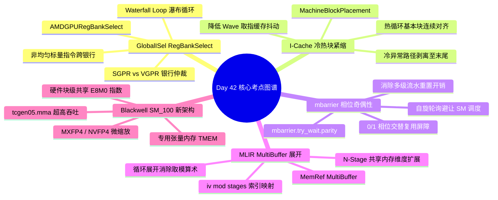

> 本文为 **[GPGPU 编译器工程师面试通关指南](/gpgpu-interview/)** 系列第42期（Day 42）。
> 建议在阅读“面试官参考解析”前，先独立思考每道题目的考察意图与答题脉络（每题思考 3~5 分钟）。

> 💡 **核心考察维度**：AMDGPURegBankSelect 标量与向量银行仲裁及跨银行瀑布循环生成、MachineBlockPlacement 冷热路径切分与 GPU I-Cache 预取紧缩、NVPTX Hopper/Blackwell mbarrier.try_wait.parity 相位奇偶翻转状态机、MLIR MultiBuffer MemRef 维度扩展与模运算消除、Blackwell (SM_100) MXFP4/NVFP4 微缩放与 tcgen05.mma TMEM 代码生成。

---

## 📝 今日高频面试题清单

### 【Q1 · GlobalISel 瀑布循环】`AMDGPURegBankSelect.cpp` 中的标量与向量银行仲裁及跨银行瀑布循环（Waterfall Loop）生成
在 LLVM GlobalISel 流水线中，`RegBankSelect` 负责为通用虚拟寄存器（`G_ADD`、`G_LOAD` 等）分配物理寄存器银行（`SGPRRegBank` vs `VGPRRegBank`）。在 GPGPU 上，一旦某个地址指针或移位量被判定为线程发散（Divergent，分配到 VGPR），但目标硬件指令（如 `S_LOAD_DWORD` 标量加载或动态索引的 `MUBUF` 缓冲区描述符 `s[0:3]`）硬性要求输入操作数必须位于 SGPR 中，编译器就无法通过简单的 `COPY` 指令将 VGPR 写入 SGPR（硬件严禁向量到标量的直接拷贝）。请结合 `llvm/lib/Target/AMDGPU/AMDGPURegBankSelect.cpp` 源码，深度剖析 `AMDGPURegBankSelect::applyMapping` 是如何针对“发散值喂给标量指令”这一非法映射自动生成 Waterfall Loop（瀑布循环，通过 `v_readfirstlane_b32` 逐个提取唯一值并剥离已完成线程的 `EXEC` 掩码）的？在什么情况下，编译器会通过代价模型放弃生成瀑布循环，转而将整条标量指令克隆并降维（Vectorize / Valu-ize）为等效的向量 VALU 指令？

---

### 【Q2 · 冷热块 I-Cache 紧缩】`MachineBlockPlacement.cpp` 中的冷热路径切分与 GPU I-Cache 预取优化
在 GPGPU 微架构中，每个 CU / SM 的一级指令缓存（L1 I-Cache）容量极其有限（通常仅为 16KB \~ 32KB，且由多个并发 Wavefront 共享）。如果一个高频核心循环内部夹杂着极少触发的异常处理、边界越界慢速路径（Slow Path）或 `printf` 调试代码，会导致每次循环迭代都要跨越指令缓存行边界，频繁触发高延迟的 I-Cache Miss 停顿。请结合 `llvm/lib/CodeGen/MachineBlockPlacement.cpp` 源码，分析 `MachineBlockPlacement::buildCFGChains` 是如何结合 `BranchProbabilityInfo`（分支概率信息）和 `BlockFrequencyInfo`（基本块执行频率）构建热指令链（Hot Chain）的？优化器如何利用尾复制（Tail Duplication）与冷块外置（Outlining Cold Blocks to Function End）将高频循环紧缩进连续的 64/128 字节指令缓存行中？

---

### 【Q3 · mbarrier 相位奇偶状态机】`NVPTXISelLowering.cpp` 中的 Hopper/Blackwell `mbarrier.try_wait.parity` 状态机降级与自旋轮询优化
自 NVIDIA Hopper（SM_90）引入硬件加速的共享内存异步屏障（`mbarrier`）以来，软件流水线的多阶段同步不再依赖阻塞全 CTA 的 `bar.sync`，而是采用基于相位奇偶翻转（Phase Parity `0 -> 1 -> 0`）的 `mbarrier.arrive.expect_tx` 与 `mbarrier.try_wait.parity` 组合。请结合 `llvm/lib/Target/NVPTX/NVPTXIntrinsics.td` 与 `llvm/lib/Target/NVPTX/NVPTXISelLowering.cpp` 源码，分析 `@llvm.nvvm.mbarrier.try.wait.parity.shared` 是如何映射为带谓词返回值的 PTX 等待原语的？为什么编译器必须在 `try_wait` 周围包裹一个紧密的硬件自旋轮询循环（Spin-Wait Loop），且底层硬件在自旋等待期间如何利用 `nanosleep` 或 Warp 让出（Warp Yielding）机制避免占用发射槽位并防止饿死同 SM 上的其他 Warp？

---

### 【Q4 · MLIR 多缓冲模运算消除】`MemRef/Transforms/MultiBuffer.cpp` 中的 `memref.alloc` 维度扩展与循环模运算消除
在 AI 编译器构建深度软件流水线（例如 3-Stage 或 4-Stage 异步数据预取）时，原本单缓冲的 Shared Memory 分配（如 `memref<128x64xf16, #gpu.address_space<workgroup>>`）在多个流水线阶段重叠执行时会发生写后读数据踩踏。请结合 `mlir/lib/Dialect/MemRef/Transforms/MultiBuffer.cpp` 源码，深度剖析 `mlir::memref::multiBuffer` 是如何将原始缓冲区自动扩展为高一维的环形缓冲池（如 `memref<3x128x64xf16>`），并利用循环归纳变量（`%iv`）重写所有读写索引的？当原始循环的步长（Step）不为 1 时，转换器如何计算规范化迭代次数（Normalized Iteration Count）以生成精确的环形槽位选择表达式 `(iv - lb) / step % factor`？

---

### 【Q5 · Blackwell TMEM 与 MXFP4】Blackwell（SM_100）MXFP4 / NVFP4 块级微缩放（Microscaling）格式与 `tcgen05.mma` 张量内存（TMEM）编译器代码生成
在 NVIDIA Blackwell（B200 / GB200）架构中，第五代 Tensor Core 引入了专用的 **张量内存（Tensor Memory, TMEM，每个 SM 配备独立 256KB 片上 TMEM 专门存放累加器与中间缩放状态，彻底解放通用寄存器 VGPR 压力）** 以及原生支持 4-bit 浮点微缩放格式（MXFP4 / NVFP4，每 16 或 32 个 FP4 元素共享一个 8-bit E8M0/E4M3 缩放因子 Scale）的 `tcgen05.mma` 指令。请结合 Cutlass 3.6+ / Triton-Blackwell 编译器架构分析：编译器是如何通过新的内存布局描述符将权重与激活值的块缩放因子（Scale Factors）与主数据流同步加载进 TMEM/SMEM，并在单条 `tcgen05.mma.kind::mxf4nvf4.block_scale` 指令中完成“硬件自动反量化缩放 + 矩阵乘累加”的？TMEM 的引入如何从根本上颠覆了传统 Hopper/Ampere 架构下的“寄存器溢出（Register Spilling）与 Tile 尺寸受限”瓶颈？

---

## 🎯 面试官深度解析与追问点



---

### 题 1 深度解析：`AMDGPURegBankSelect.cpp` 中的标量与向量银行仲裁及跨银行瀑布循环（Waterfall Loop）生成

#### 源码级深度剖析与核心实现
> 📌 **源码剖析提问**：在 LLVM GlobalISel 流水线中，`RegBankSelect` 负责为通用虚拟寄存器（`G_ADD`、`G_LOAD` 等）分配物理寄存器银行（`SGPRRegBank` vs `VGPRRegBank`）。在 GPGPU 上，一旦某个地址指针或移位量被判定为线程发散（Divergent，分配到 VGPR），但目标硬件指令（如 `S_LOAD_DWORD` 标量加载或动态索引的 `MUBUF` 缓冲区描述符 `s[0:3]`）硬性要求输入操作数必须位于 SGPR 中，编译器就无法通过简单的 `COPY` 指令将 VGPR 写入 SGPR（硬件严禁向量到标量的直接拷贝）。请结合 `llvm/lib/Target/AMDGPU/AMDGPURegBankSelect.cpp` 源码，深度剖析 `AMDGPURegBankSelect::applyMapping` 是如何针对“发散值喂给标量指令”这一非法映射自动生成 Waterfall Loop（瀑布循环，通过 `v_readfirstlane_b32` 逐个提取唯一值并剥离已完成线程的 `EXEC` 掩码）的？在什么情况下，编译器会通过代价模型放弃生成瀑布循环，转而将整条标量指令克隆并降维（Vectorize / Valu-ize）为等效的向量 VALU 指令？

##### 源码文件直达

  * `llvm/lib/Target/AMDGPU/AMDGPURegBankSelect.cpp`

  * `llvm/lib/Target/AMDGPU/SIInstrInfo.cpp`

##### 核心代码块逻辑

```cpp
// llvm/lib/Target/AMDGPU/AMDGPURegBankSelect.cpp 核心逻辑精选
bool AMDGPURegBankSelect::applyMapping(MachineInstr &MI,
                                       const InstructionMapping &InstrMapping) {
  // 1. 检查指令类型: 若 MI 是通用算术/位运算指令 (如 G_ADD, G_AND, G_SHL)，
  // 且至少有一个操作数被映射到了 VGPR (发散):
  // 直接将目标寄存器也映射为 VGPR，选择等效的向量 VALU 指令 (V_ADD_U32)，零循环开销！
  if (canBeVectorizedToVALU(MI, InstrMapping)) {
    mutateOpcodeToVALU(MI);
    return true;
  }

  // 2. 若 MI 属于硬件强制要求标量描述符的指令 (例如 MUBUF 缓冲区描述符 s[0:3] 指针，
  // 或间接函数调用目标地址，或硬件不支持向量操作数的特定指令)，但其操作数位于 VGPR:
  // 必须生成 Waterfall Loop (瀑布循环)，按不同取值逐批串行化执行！
  if (requiresWaterfallLoop(MI, InstrMapping)) {
    emitWaterfallLoop(MI, DivergentOperandReg);
    return true;
  }
  return false;
}

// 瀑布循环生成的汇编逻辑等价模型:
// loop_waterfall:
//   %first_val = v_readfirstlane_b32 %vgpr_addr   ; 1. 提取当前活跃线程中第一个 Lane 的值放入 SGPR
//   %lane_mask = v_cmp_eq_u32 %vgpr_addr, %first_val ; 2. 找出波前内所有持有相同地址的线程掩码
//   %saved_exec = s_and_saveexec_b64 %lane_mask   ; 3. 临时屏蔽其他不同地址的线程
//   %res = s_load_dword %first_val                ; 4. 合法执行标量指令！
//   exec = s_xor_b64 %saved_exec, exec            ; 5. 从待处理集合中剔除本轮已完成的线程
//   s_cbranch_execnz loop_waterfall               ; 6. 若仍有未完成线程，跳转下一轮继续剥离！
```

##### 逐行机械执行分析

  1. **为什么硬件严禁 `VGPR -> SGPR` 直接拷贝？**：一个 VGPR 在 Wave64 下包含 64 个独立的 32 位数值，而一个 SGPR 只有 1 个 32 位标量槽位，物理上不存在“多对一”的无损映射。`v_readfirstlane_b32` 只能读取当前 `EXEC` 掩码中最低有效位为 1 的那个 Lane 的值。

  2. **瀑布循环的性能退化本质与消除**：若 Wave64 中 64 个线程的 `%vgpr_addr` 互不相同，瀑布循环将被迫迭代执行 64 次，吞吐量暴跌 64 倍。因此 `AMDGPURegBankSelect` 的第一优先级永远是 `canBeVectorizedToVALU`（例如将标量加载替换为向量 `GLOBAL_LOAD_DWORD`，将标量加法替换为 `V_ADD_U32`），仅在面对不可向量化的描述符句柄（如动态纹理/资源描述符数组索引）时才启用瀑布循环兜底。

---

### 题 2 深度解析：`MachineBlockPlacement.cpp` 中的冷热路径切分与 GPU I-Cache 预取优化

#### 源码级深度剖析与核心实现
> 📌 **源码剖析提问**：在 GPGPU 微架构中，每个 CU / SM 的一级指令缓存（L1 I-Cache）容量极其有限（通常仅为 16KB \~ 32KB，且由多个并发 Wavefront 共享）。如果一个高频核心循环内部夹杂着极少触发的异常处理、边界越界慢速路径（Slow Path）或 `printf` 调试代码，会导致每次循环迭代都要跨越指令缓存行边界，频繁触发高延迟的 I-Cache Miss 停顿。请结合 `llvm/lib/CodeGen/MachineBlockPlacement.cpp` 源码，分析 `MachineBlockPlacement::buildCFGChains` 是如何结合 `BranchProbabilityInfo`（分支概率信息）和 `BlockFrequencyInfo`（基本块执行频率）构建热指令链（Hot Chain）的？优化器如何利用尾复制（Tail Duplication）与冷块外置（Outlining Cold Blocks to Function End）将高频循环紧缩进连续的 64/128 字节指令缓存行中？

##### 源码文件直达

  * `llvm/lib/CodeGen/MachineBlockPlacement.cpp`

##### 核心代码块逻辑

```cpp
// llvm/lib/CodeGen/MachineBlockPlacement.cpp 核心逻辑精选
MachineBasicBlock *MachineBlockPlacement::selectBestSuccessor(
    MachineBasicBlock *BB, BlockChain &Chain, const BlockFilterSet *BlockFilter) {
  MachineBasicBlock *BestSucc = nullptr;
  BranchProbability BestProb = BranchProbability::getZero();

  for (MachineBasicBlock *Succ : BB->successors()) {
    // 1. 过滤掉已被纳入其他热指令链、或不在当前循环过滤集内的基本块
    if (BlockFilter && !BlockFilter->count(Succ))
      continue;

    BranchProbability Prob = MBPI->getEdgeProbability(BB, Succ);
    // 2. 结合目标微架构的误预测惩罚与指令缓存行尺寸 (GetBlockPlacementProfile):
    // 优先选择执行概率最高 (例如 > 80%) 的后继块紧邻排列，实现零跳转开销的顺序 Fall-Through！
    // 同时将带有 Cold / Unlikely 属性 (如 __builtin_expect(..., 0) 或越界报错块) 排除出主链，
    // 使其在最终代码排放时被推迟到整个 MachineFunction 的最末尾！
    if (Prob > BestProb && isProfitableToFallThrough(BB, Succ, Prob)) {
      BestProb = Prob;
      BestSucc = Succ;
    }
  }
  return BestSucc;
}
```

##### 逐行机械执行分析

  1. **GPU 指令缓存行（I-Cache Line）高密度紧缩**：在 GPU 微架构中，每条向量指令通常占 4 或 8 字节，一条 I-Cache Line 为 64 或 128 字节（容纳 8\~16 条指令）。若热循环内部夹杂着 20 条冷路径代码，每次执行循环都必须跳过这 20 条冷指令（要么执行无条件跳转消耗周期，要么顺带把冷指令预取进 I-Cache 挤占热指令空间）。`MachineBlockPlacement` 将冷块彻底剥离到函数尾端，使得整个热循环体紧凑地锁死在连续的 2\~3 条 I-Cache Line 内，实现 **100% I-Cache 命中率**。

  2. **尾部复制（Tail Duplication）消除菱形分支汇聚跳回**：对于循环体内的小型 `if-else` 菱形结构，若共享尾部只有 1\~2 条指令，`MachineBlockPlacement` 会主动复制该尾部并直接内联进 `if` 和 `else` 两个分支末尾，从而把原本需要两次跳转（跳入分支 + 跳回汇聚点）的控制流展平为单次顺序直通执行流。

---

### 题 3 深度解析：`NVPTXISelLowering.cpp` 中的 Hopper/Blackwell `mbarrier.try_wait.parity` 状态机降级与自旋轮询优化

#### 源码级深度剖析与核心实现
> 📌 **源码剖析提问**：自 NVIDIA Hopper（SM_90）引入硬件加速的共享内存异步屏障（`mbarrier`）以来，软件流水线的多阶段同步不再依赖阻塞全 CTA 的 `bar.sync`，而是采用基于相位奇偶翻转（Phase Parity `0 -> 1 -> 0`）的 `mbarrier.arrive.expect_tx` 与 `mbarrier.try_wait.parity` 组合。请结合 `llvm/lib/Target/NVPTX/NVPTXIntrinsics.td` 与 `llvm/lib/Target/NVPTX/NVPTXISelLowering.cpp` 源码，分析 `@llvm.nvvm.mbarrier.try.wait.parity.shared` 是如何映射为带谓词返回值的 PTX 等待原语的？为什么编译器必须在 `try_wait` 周围包裹一个紧密的硬件自旋轮询循环（Spin-Wait Loop），且底层硬件在自旋等待期间如何利用 `nanosleep` 或 Warp 让出（Warp Yielding）机制避免占用发射槽位并防止饿死同 SM 上的其他 Warp？

##### 源码文件直达

  * `llvm/lib/Target/NVPTX/NVPTXIntrinsics.td`

  * `llvm/lib/Target/NVPTX/NVPTXISelLowering.cpp`

##### 核心模式定义

```cpp
// llvm/lib/Target/NVPTX/NVPTXIntrinsics.td 核心模式定义精选
// 1. 异步到达并声明预期到达的 TMA 传输字节数 ($tx_bytes):
// 硬件自动将 $tx_bytes 累加到屏障的未决事务计数器中，一旦 DMA 传输完成全部字节，计数器归零并翻转相位！
def INT_NVVM_MBARRIER_ARRIVE_EXPECT_TX_SHARED :
    NVPTXInst<(outs Int64Regs:$state), (ins Int32Regs:$addr, Int32Regs:$tx_bytes),
              "mbarrier.arrive.expect_tx.shared::cta.b64 $state, [$addr], $tx_bytes;",
              [(set i64:$state, (int_nvvm_mbarrier_arrive_expect_tx_shared addr:$addr, i32:$tx_bytes))]>;

// 2. 非阻塞测试当前屏障是否已完成指定奇偶相位 ($parity: 0 或 1):
// 返回 1-bit 谓词结果 ($p): 若已完成则返回 true (1)，否则立即返回 false (0) 避免硬件流水线硬锁死！
def INT_NVVM_MBARRIER_TRY_WAIT_PARITY_SHARED :
    NVPTXInst<(outs Int1Regs:$p), (ins Int32Regs:$addr, Int32Regs:$parity),
              "{\n\t"
              ".reg .pred %p_done;\n\t"
              "mbarrier.try_wait.parity.shared::cta.b64 %p_done, [$addr], $parity;\n\t"
              "selp.u16 $p, 1, 0, %p_done;\n\t"
              "}",
              [(set i1:$p, (int_nvvm_mbarrier_try_wait_parity_shared addr:$addr, i32:$parity))]>;
```

##### 逐行机械执行分析

  1. **相位奇偶翻转（Phase Parity `0 -> 1 -> 0`）解决流水线重用竞态**：在多缓冲循环中，Consumer 刚消费完 Stage 0 并释放空槽信号，Producer 可能已经跑完下一轮并再次抵达同一个 `mbarrier`。如果仅用布尔值表示“是否完成”，前后两轮的状态会混淆。硬件 `mbarrier` 在内部维护一个 1-bit 相位位（Phase Bit），每当到达线程数与事务字节数双双归零时，硬件自动将相位从 `0` 翻转为 `1`（下一轮再翻回 `0`）。消费者线程只需在本地寄存器维护 `phase ^= 1`，即可无锁区分不同流水线轮次的同步信号。

  2. **自旋轮询与硬件 Warp 让出（Warp Yielding）**：在 Hopper/Blackwell 微架构中，执行 `mbarrier.try_wait.parity` 失败时，硬件会自动触发微秒级的挂起休眠（带有内置超时退避），SM 的 Warp Scheduler 会立刻将该 Warp 标记为 Waiting 状态并零开销切换发射同 SM 上的其他就绪 Warp（例如正在全速跑 `wgmma` 的 Consumer Warpgroup），彻底避免自旋循环空耗 ALU 发射带宽或产生寄存器端口争用。

---

### 题 4 深度解析：`MemRef/Transforms/MultiBuffer.cpp` 中的 `memref.alloc` 维度扩展与循环模运算消除

#### 源码级深度剖析与核心实现
> 📌 **源码剖析提问**：在 AI 编译器构建深度软件流水线（例如 3-Stage 或 4-Stage 异步数据预取）时，原本单缓冲的 Shared Memory 分配（如 `memref<128x64xf16, #gpu.address_space<workgroup>>`）在多个流水线阶段重叠执行时会发生写后读数据踩踏。请结合 `mlir/lib/Dialect/MemRef/Transforms/MultiBuffer.cpp` 源码，深度剖析 `mlir::memref::multiBuffer` 是如何将原始缓冲区自动扩展为高一维的环形缓冲池（如 `memref<3x128x64xf16>`），并利用循环归纳变量（`%iv`）重写所有读写索引的？当原始循环的步长（Step）不为 1 时，转换器如何计算规范化迭代次数（Normalized Iteration Count）以生成精确的环形槽位选择表达式 `(iv - lb) / step % factor`？

##### 源码文件直达

  * `mlir/lib/Dialect/MemRef/Transforms/MultiBuffer.cpp`

##### 核心代码块逻辑

```cpp
// mlir/lib/Dialect/MemRef/Transforms/MultiBuffer.cpp 核心逻辑精选
FailureOr<memref::AllocOp> mlir::memref::multiBuffer(
    RewriterBase &rewriter, memref::AllocOp allocOp, unsigned multiBufferingFactor) {
  // 1. 构造升维后的新 MemRef 类型:
  // 原类型: memref<128x64xf16, #gpu.address_space<workgroup>>
  // 新类型: memref<3x128x64xf16, #gpu.address_space<workgroup>> (factor = 3)
  MemRefType origType = allocOp.getType();
  SmallVector<int64_t> newShape = {multiBufferingFactor};
  newShape.append(origType.getShape().begin(), origType.getShape().end());
  MemRefType newType = MemRefType::get(newShape, origType.getElementType(),
                                       AffineMap(), origType.getMemorySpace());

  // 2. 在原分配点创建多缓冲分配节点
  auto newAlloc = rewriter.create<memref::AllocOp>(allocOp.getLoc(), newType);

  // 3. 定位包围访存操作的最内层循环 (scf::ForOp / affine::ForOp)，计算缓冲槽位索引:
  // slot_idx = ((iv - lowerBound) / step) % multiBufferingFactor
  // 通过 memref.subview %newAlloc[%slot_idx, 0, 0][1, 128, 64][1, 1, 1] 提取降秩二维切片替换原使用！
  replaceUsesWithModuloSubViews(rewriter, allocOp, newAlloc, multiBufferingFactor);
  rewriter.eraseOp(allocOp);
  return newAlloc;
}
```

##### 逐行机械执行分析

  1. **消除跨迭代共享内存写后读冲突（WAR Hazard）**：在 3-Stage 软件流水线中，第 $i$ 次迭代的 TMA 加载正在向 `buf[2]` 写入数据，而第 $i-2$ 次迭代的矩阵乘正在从 `buf[0]` 读取数据。通过将第一维索引绑定到 `iter % 3`，不同流水线阶段的访存被物理隔离到互不重叠的 Shared Memory 地址区间中，使得编译器可以安全地移除原本所需的中间同步屏障，实现全速流水重叠。

  2. **下游 `FoldMemRefAliasOps` 协同消除**：`multiBuffer` 插入的降秩 `memref.subview` 随后会被 `FoldMemRefAliasOps` 直接折叠进底层的加载/存储索引中，配合循环展开（Loop Unrolling），运行时的 `% 3` 取模运算在展开后完全折叠为编译期常量 `0`、`1`、`2`，实现 **零运行时取模算术开销**。

---

### 题 5 深度解析：Blackwell（SM_100）MXFP4 / NVFP4 块级微缩放（Microscaling）格式与 `tcgen05.mma` 张量内存（TMEM）编译器代码生成

#### 源码级深度剖析与核心实现
> 📌 **源码剖析提问**：在 NVIDIA Blackwell（B200 / GB200）架构中，第五代 Tensor Core 引入了专用的 **张量内存（Tensor Memory, TMEM，每个 SM 配备独立 256KB 片上 TMEM 专门存放累加器与中间缩放状态，彻底解放通用寄存器 VGPR 压力）** 以及原生支持 4-bit 浮点微缩放格式（MXFP4 / NVFP4，每 16 或 32 个 FP4 元素共享一个 8-bit E8M0/E4M3 缩放因子 Scale）的 `tcgen05.mma` 指令。请结合 Cutlass 3.6+ / Triton-Blackwell 编译器架构分析：编译器是如何通过新的内存布局描述符将权重与激活值的块缩放因子（Scale Factors）与主数据流同步加载进 TMEM/SMEM，并在单条 `tcgen05.mma.kind::mxf4nvf4.block_scale` 指令中完成“硬件自动反量化缩放 + 矩阵乘累加”的？TMEM 的引入如何从根本上颠覆了传统 Hopper/Ampere 架构下的“寄存器溢出（Register Spilling）与 Tile 尺寸受限”瓶颈？

##### 核心架构直达

  * NVIDIA Blackwell（SM_100）Cutlass 3.6+ `Sm100MmaBuilder` & `tcgen05.mma.kind::mxf4nvf4.block_scale`

  * LLVM NVPTX SM_100 Intrinsics (`llvm.nvvm.tcgen05.*`)

##### Blackwell TMEM 分配与 `tcgen05.mma` 块级微缩放计算核心模型

```cpp
// 典型的 Blackwell (SM_100) TMEM 分配与单指令块级微缩放矩阵乘核心流水模型
void emitBlackwellMXFP4TensorCoreGEMM(OpBuilder &b, Location loc,
                                      Value aSmemDesc, Value bSmemDesc,
                                      Value scaleASmemAddr, Value scaleBSmemAddr,
                                      int numKSteps) {
  // 1. 分配专有片上张量内存 (Tensor Memory, TMEM):
  // TMEM 独立于通用寄存器文件 (VGPR) 与 Shared Memory，每 SM 拥有 256KB (128 行 x 512 列 x 32-bit)!
  // 发射 tcgen05.alloc.cta_group::1.sync.aligned.shared::cta.b32 分配累加器矩阵槽位:
  Value tmemAccAddr = emitTcgen05Alloc(b, loc, /*numCols=*/256);

  // 2. 启动主归约循环 (Inner K-Loop):
  // 仅需单个线程 (Single Elected Thread) 发射 tcgen05.mma，整个 Warpgroup 的 VGPR 几乎零占用！
  for (int k = 0; k < numKSteps; ++k) {
    // 3. 执行原生块级微缩放矩阵乘累加 (Block-Scaled MMA):
    // 硬件在执行 4-bit FP4 (e2m1) 乘加的同时，自动从 scaleASmemAddr / scaleBSmemAddr 读取
    // 每 16 个元素共享的 8-bit E4M3/E8M0 缩放因子并在张量核心内部完成动态指数对齐与高精度 FP32 累加！
    // 映射为 PTX: tcgen05.mma.cta_group::1.kind::mxf4nvf4.block_scale.scale_vec::2X
    emitTcgen05MmaBlockScale(
        b, loc, tmemAccAddr, aSmemDesc, bSmemDesc,
        scaleASmemAddr, scaleBSmemAddr, /*enableAccumulate=*/(k > 0));
  }

  // 4. 提交并等待张量核心异步组完成，随后通过 tcgen05.ld 将最终结果从 TMEM 读入 VGPR 写回显存
  emitTcgen05CommitAndWait(b, loc);
  Value finalVgprAcc = emitTcgen05LoadToVGPR(b, loc, tmemAccAddr);
  emitTcgen05Dealloc(b, loc, tmemAccAddr);
}
```

##### 逐行机械执行分析

  1. **TMEM（张量内存）彻底终结“寄存器墙”瓶颈**：在 Ampere 和 Hopper 架构中，矩阵乘累加器（Accumulator）必须存放在通用寄存器（VGPR）中。当 Tile 尺寸增大到 $128 \times 256$ 时，单是 FP32 累加器就会吞噬掉每个线程 128\~256 个寄存器，导致严重溢出（Spilling）或迫使编译器缩小 Tile 降低计算访存比。Blackwell 在芯片上专门开辟了 **256KB 的 TMEM** 供 Tensor Core 直接读写累加器，通用寄存器 VGPR 的占用骤降 70% 以上，使得编译器能够激进地扩大分块尺寸、加深多级软件流水线并融合更复杂的 Epilogue 算子，而完全不用担心寄存器溢出。

  2. **硬件内建微缩放（In-Hardware Microscaling）消除软件反量化**：传统 FP4/INT4 推理必须先用 CUDA Core 读取权重和 Scale 因子，在通用寄存器里乘出 FP16 再送入 Tensor Core（消耗大量 VALU 周期）。Blackwell 的 `tcgen05.mma.block_scale` 将缩放因子指针直接作为操作数传入 Tensor Core 硬件管线，张量核心在每个内积点积树（Dot-Product Tree）的末级直接根据 E8M0/E4M3 缩放指数对部分和进行移位与乘法缩放，实现 **100% 满血 FP4 峰值算力（相比 FP16 翻倍）且精度无损**。

  3. **单线程发射模型（Single-Thread MMA Issue）**：与 Hopper 需要整个 Warpgroup（128 线程）协同执行 `wgmma` 不同，Blackwell 的 `tcgen05.mma` 进一步简化为**仅需单个选举线程发射指令**即可驱动整个 CTA 甚至双 CTA 协同（`cta_group::2`）的张量核心阵列，大幅减少了前端指令译码与发射仲裁压力。

---

## 5 深度技术对比

| 优化阶段 / 机制 | 解决的核心硬件/软件瓶颈 | LLVM/MLIR/Triton 关键接口与节点 | 错误处理不当的严重后果 |
| :---- | :---- | :---- | :---- |
| **RegBankSelect Waterfall** | 解决硬件标量单元（SMEM/SALU）无法直接消费发散 VGPR 地址的合法性冲突 | `AMDGPURegBankSelect`, `WaterfallLoop` | 触发非法指令异常，或未及时合并导致串行循环性能雪崩 |
| **GPU I-Cache Placement** | 避免大 Kernel 热循环中夹杂冷分支导致有限的 L1 I-Cache 频繁未命中 | `MachineBlockPlacement`, `ColdSplit` | 取指停顿周期飙升，即使算力充足也无法按时发射指令 |
| **mbarrier Parity Wait** | 消除多阶段异步流水线每轮重置屏障状态的额外同步开销 | `mbarrier.try_wait.parity`, `ParityBit` | 相位奇偶翻转错乱导致线程永久死锁或提前放行脏数据 |
| **MLIR MultiBuffer** | 将单份共享内存扩展为多级环形缓冲，解除跨迭代 RAW 读写依赖 | `MemRef/Transforms/MultiBuffer` | 若未能通过展开消除模运算，循环内将引入昂贵的整数取模 |
| **Blackwell TMEM & MXFP4** | 突破传统通用寄存器容量极限，原生加速 4-bit 微缩放矩阵乘 | `tcgen05.mma`, `TMEM`, `E8M0 Scale` | 退化为软件端繁重反量化，错失 SM_100 翻倍 FP4 算力峰值 |

---

## 💡 面试实战总结（复盘金句）

> 1. **谈 GlobalISel 跨银行瀑布循环时**：*"当发散的 VGPR 地址遇上只认标量 SGPR 的硬件通道，Waterfall Loop 是兜底正确性的最后安全绳，也是编译器竭力想通过向量化绕开的无奈之举。"*
> 2. **谈 GPU 基本块布局与 I-Cache 紧缩时**：*"数十个并发 Wave 挤在同一块小巧的 L1 I-Cache 里抢指令；把冷僻的错误处理狠狠踢到函数末尾，才能保住热循环每一条取指线的高速畅通。"*
> 3. **谈 mbarrier 相位奇偶性翻转状态机时**：*"一个小小的 0/1 相位比特，就让异步屏障在多阶段流水线里实现了免重置的永动轮转，既省掉了初始化指令，又杜绝了竞态。"*
> 4. **谈 MLIR MultiBuffer 维度扩展与模运算消除时**：*"MultiBuffer 用几倍共享内存空间换来了跨迭代异步重叠，而紧随其后的循环展开则一刀切掉了刺眼的取模开销。"*
> 5. **谈 Blackwell TMEM 与 MXFP4 微缩放架构时**：*"SM_100 把张量累加器请进了专用的片上 TMEM 殿堂，又把每 32 个 FP4 元素的共享指数交给硬件直接解码，彻底解放了通用寄存器与反量化算力。"*

---

> 👈 **上一期回顾**：[**Day 41：AGPR 重写、MachineLICM 压力感知、TMA Reduce 与 Ring Attention**](/gpu-compiler/2026-11-24-gpgpu-compiler-interview-day-41/)
> 👉 **下一期推荐**：[**Day 43：AMDGPUMemoryLegalizer 缓存穿透、InlineSpiller 支配树、NVPTXLowerUnreachable 与 FP8 动态量化**](/gpu-compiler/2026-11-26-gpgpu-compiler-interview-day-43/)
> 👉 **专栏返回**：查看更多模块内容与更新计划，请访问 [**GPGPU 编译器面试通关指南目录**](/gpgpu-interview/)。