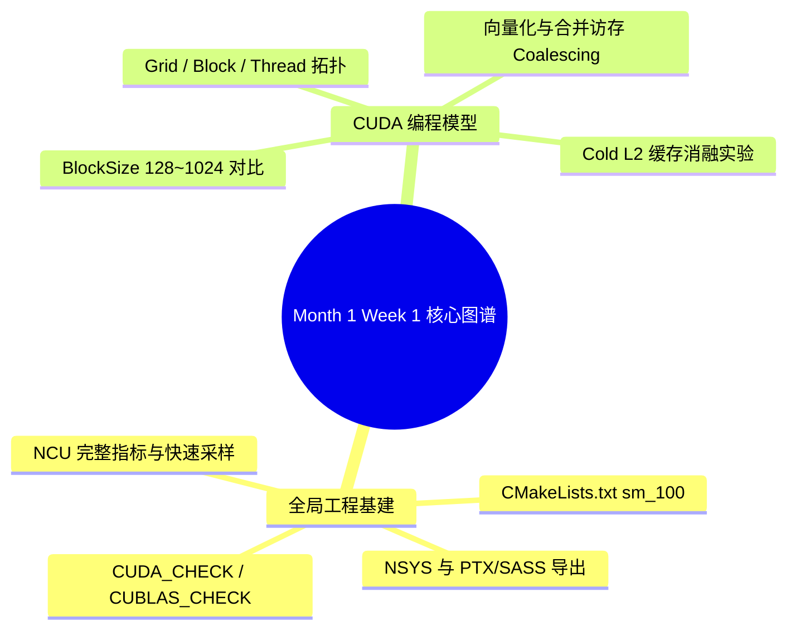

> 本文为 **GPU Kernel 实战（Month 1）** 系列第 1 周（Week 1），涵盖 **B200（`sm_100`）工程脚手架、CMake/NCU/NSYS/SASS 工具链速查**，以及 `vector_add.cu` 合并访存与 Cold L2 缓存性能分析实战。
> **硬件目标平台**：NVIDIA B200（Blackwell `sm_100`, 148 SMs, 126.5 MB L2 Cache）｜**工程目录**：`~/workspace/llm-gpu-compute-lab`



---

## 0. 全局工程配置与通用工具（`CMakeLists.txt` & `cuda_check.h`）

### 0.1 `CMakeLists.txt`（全月通用编译配置）
```cmake
cmake_minimum_required(VERSION 3.24)
project(llm_gpu_compute_lab VERSION 0.1.0 LANGUAGES CXX CUDA)

set(CMAKE_CXX_STANDARD 17)
set(CMAKE_CXX_STANDARD_REQUIRED ON)
set(CMAKE_CUDA_STANDARD 17)
set(CMAKE_CUDA_STANDARD_REQUIRED ON)

# B200 设置为 100；若在 H100 上运行可改为 90
set(CMAKE_CUDA_ARCHITECTURES 100)
set(CMAKE_EXPORT_COMPILE_COMMANDS ON)

find_package(CUDAToolkit REQUIRED)

add_library(cuda_common INTERFACE)
target_include_directories(cuda_common INTERFACE ${PROJECT_SOURCE_DIR}/include)
target_link_libraries(cuda_common INTERFACE CUDA::cudart CUDA::cublas)

foreach(TARGET_NAME vector_add gemm norm_softmax attention_kv)
    if(TARGET_NAME STREQUAL "vector_add")
        set(SRC_FILE src/week01/vector_add.cu)
    elseif(TARGET_NAME STREQUAL "gemm")
        set(SRC_FILE src/week02/gemm.cu)
    elseif(TARGET_NAME STREQUAL "norm_softmax")
        set(SRC_FILE src/week03/norm_softmax.cu)
    elseif(TARGET_NAME STREQUAL "attention_kv")
        set(SRC_FILE src/week04/attention_kv.cu)
    endif()

    if(EXISTS "${PROJECT_SOURCE_DIR}/${SRC_FILE}")
        add_executable(${TARGET_NAME} ${SRC_FILE})
        target_link_libraries(${TARGET_NAME} PRIVATE cuda_common)
        target_compile_options(${TARGET_NAME} PRIVATE
            $<$<COMPILE_LANGUAGE:CUDA>:-lineinfo --expt-relaxed-constexpr>
            $<$<AND:$<COMPILE_LANGUAGE:CUDA>,$<CONFIG:Debug>>:-G>
        )
    endif()
endforeach()
```

### 0.2 `include/cuda_check.h`
```cpp
#pragma once
#include <cstdio>
#include <cstdlib>
#include <cuda_runtime.h>
#include <cublas_v2.h>

#define CUDA_CHECK(call)                                                       \
    do {                                                                       \
        cudaError_t err = (call);                                              \
        if (err != cudaSuccess) {                                              \
            std::fprintf(stderr, "CUDA Error at %s:%d - %s (%s)\n",            \
                         __FILE__, __LINE__, #call, cudaGetErrorString(err));  \
            std::exit(EXIT_FAILURE);                                           \
        }                                                                      \
    } while (0)

#define CUBLAS_CHECK(call)                                                     \
    do {                                                                       \
        cublasStatus_t status = (call);                                        \
        if (status != CUBLAS_STATUS_SUCCESS) {                                 \
            std::fprintf(stderr, "cuBLAS Error at %s:%d - %s (code %d)\n",     \
                         __FILE__, __LINE__, #call, static_cast<int>(status)); \
            std::exit(EXIT_FAILURE);                                           \
        }                                                                      \
    } while (0)
```

### 0.3 全月通用编译、Profiling 与汇编导出命令行速查
```bash
# 1. CMake + Ninja Release 编译
cmake -S . -B build -G Ninja -DCMAKE_BUILD_TYPE=Release
cmake --build build -j$(nproc)

# 2. 检查目标架构是否生效
grep -n "gpu-architecture" build/build.ninja

# 3. Nsight Compute (NCU) 导出包含源码的完整报告（配合代码内 cudaProfilerStart/Stop）
mkdir -p reports
ncu --set full --import-source yes --profile-from-start off -f -o reports/<report_name> ./build/<target> [args]

# 4. 日常快速调优采样（仅 4~12 Passes，速度极快）
ncu --set detailed --profile-from-start off ./build/<target> [args]

# 5. Nsight Systems (NSYS) 采集时间线与 Kernel Launch 开销
nsys profile --trace=cuda,nvtx,osrt -f true -o reports/<timeline_name> ./build/<target> [args]
nsys stats reports/<timeline_name>.nsys-rep

# 6. 导出 PTX 与 SASS 汇编分析指令调度与寄存器分配
cuobjdump --dump-ptx  build/<target> > reports/<target>.ptx
cuobjdump --dump-sass build/<target> > reports/<target>.sass
```

---

## Week 1：CUDA 编程模型、合并访存与性能分析

### 1.1 核心代码（`src/week01/vector_add.cu` 核心算子）
```cuda
#include "cuda_check.h"
#include <cuda_profiler_api.h>

// 1. 合并访存 (Coalesced): 相邻线程访问连续 32B Sector，100% 总线利用率
__global__ void vector_add_coalesced_kernel(
    const float* __restrict__ A,
    const float* __restrict__ B,
    float* __restrict__ C,
    size_t N) {
    size_t tid = static_cast<size_t>(blockIdx.x) * blockDim.x + threadIdx.x;
    if (tid < N) {
        C[tid] = A[tid] + B[tid];
    }
}

// 2. 跨步访存 (Strided, stride=32): 同一 Warp 跨 32 个 Cache Line，有效带宽衰减约 8x
__global__ void vector_add_strided_kernel(
    const float* __restrict__ A,
    const float* __restrict__ B,
    float* __restrict__ C,
    size_t N,
    size_t stride) {
    size_t tid = static_cast<size_t>(blockIdx.x) * blockDim.x + threadIdx.x;
    if (tid < N) {
        size_t idx = (tid * stride) % N + (tid * stride) / N;
        C[idx] = A[idx] + B[idx];
    }
}

// 3. 向量化访存 (float4 / LDG.E.128): 提升单指令字节吞吐，缓解 B200 HBM3e 延迟停顿
__global__ void vector_add_float4_kernel(
    const float* __restrict__ A,
    const float* __restrict__ B,
    float* __restrict__ C,
    size_t N) {
    size_t tid = static_cast<size_t>(blockIdx.x) * blockDim.x + threadIdx.x;
    size_t idx4 = tid * 4;
    if (idx4 + 3 < N) {
        float4 a = reinterpret_cast<const float4*>(A)[tid];
        float4 b = reinterpret_cast<const float4*>(B)[tid];
        float4 c;
        c.x = a.x + b.x; c.y = a.y + b.y; c.z = a.z + b.z; c.w = a.w + b.w;
        reinterpret_cast<float4*>(C)[tid] = c;
    } else {
        for (size_t i = idx4; i < N; ++i) C[i] = A[i] + B[i];
    }
}
```

### 1.2 Week 1 实战命令行
```bash
# 跑全套 4 种规模 N (1024 ~ 16777216) x 4 种 BlockSize (128 ~ 1024)
./build/vector_add

# 对比 Cold L2 Cache 模式（消除片上 L2 缓存命中假象）
./build/vector_add --cold-l2

# 抓取 N=16777216, BS=256 的 NCU 报告（跳过 50 次设备级预热 + 20 次 Case 预热）
ncu --set full --import-source yes -f -o reports/b200_vecadd_coal --launch-skip 70 --launch-count 1 ./build/vector_add 16777216 256
ncu --set full --import-source yes -f -o reports/b200_vecadd_stride -k regex:strided --launch-skip 20 --launch-count 1 ./build/vector_add 16777216 256

# 观察小尺寸 N=1024 下的 Host Enqueue / Kernel Launch 开销
nsys profile --trace=cuda,osrt -f true -o reports/vecadd_launch_overhead ./build/vector_add 1024 256
```

---

> 👉 **下一周推荐**：[**Week 2：GEMM 分级存储优化（Global → Shared → Register）**](/gpu-kernel/2026-11-26-gpu-kernel-month-1-week-2/)
> 🏷️ **专题合集**：查看全部实战笔记，请访问 [**GPU Kernel 实战标签页**](/tags/GPU-Kernel-实战/)。
