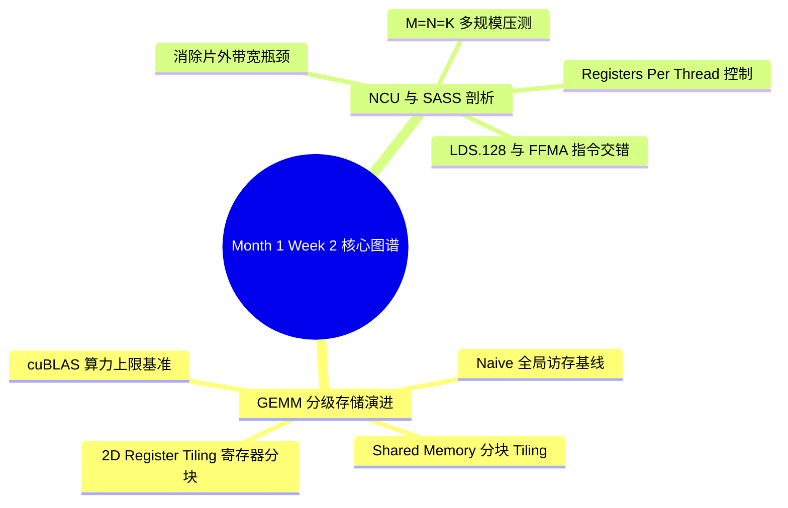

> 本文为 **GPU Kernel 实战（Month 1）** 系列第 2 周（Week 2），聚焦矩阵乘（GEMM）从 **Naive 全局访存 → Shared Memory 分块 → 2D Register Tiling** 的三级存储优化演进，并与 `cuBLAS` 硬件上限对标。
> **硬件目标平台**：NVIDIA B200（Blackwell `sm_100`, 148 SMs, 126.5 MB L2 Cache）｜**工程目录**：`~/workspace/llm-gpu-compute-lab`



---

## Week 2：GEMM 分级存储优化（Global → Shared → Register）

### 2.1 核心代码（`src/week02/gemm.cu` 核心算子）
```cuda
// 1. Naive GEMM: 算术强度 0.25 FLOP/Byte，严重受限于 Global Memory 带宽
__global__ void gemm_naive_kernel(
    const float* __restrict__ A, const float* __restrict__ B, float* __restrict__ C,
    int M, int N, int K) {
    int col = blockIdx.x * blockDim.x + threadIdx.x;
    int row = blockIdx.y * blockDim.y + threadIdx.y;
    if (row < M && col < N) {
        float sum = 0.0f;
        for (int k = 0; k < K; ++k) sum += A[row * K + k] * B[k * N + col];
        C[row * N + col] = sum;
    }
}

// 2. Shared Memory Tiling (32x32): 减少 32 倍 Global Memory 访问
template <int TILE_SIZE = 32>
__global__ void gemm_smem_tiled_kernel(
    const float* __restrict__ A, const float* __restrict__ B, float* __restrict__ C,
    int M, int N, int K) {
    __shared__ float As[TILE_SIZE][TILE_SIZE];
    __shared__ float Bs[TILE_SIZE][TILE_SIZE];
    int tx = threadIdx.x, ty = threadIdx.y;
    int row = blockIdx.y * TILE_SIZE + ty;
    int col = blockIdx.x * TILE_SIZE + tx;
    float sum = 0.0f;

    for (int t = 0; t < K; t += TILE_SIZE) {
        As[ty][tx] = (row < M && (t + tx) < K) ? A[row * K + t + tx] : 0.0f;
        Bs[ty][tx] = ((t + ty) < K && col < N) ? B[(t + ty) * N + col] : 0.0f;
        __syncthreads();
        #pragma unroll
        for (int k = 0; k < TILE_SIZE; ++k) sum += As[ty][k] * Bs[k][tx];
        __syncthreads();
    }
    if (row < M && col < N) C[row * N + col] = sum;
}

// 3. 2D Register Blocking + float4 (BM=128, BN=128, BK=8, TM=8, TN=8)
// 单线程维护 8x8=64 个累加寄存器，每 16 次 LDS 驱动 64 次 FFMA
template <int BM = 128, int BN = 128, int BK = 8, int TM = 8, int TN = 8>
__global__ void gemm_reg_tiled_float4_kernel(
    const float* __restrict__ A, const float* __restrict__ B, float* __restrict__ C,
    int M, int N, int K) {
    __shared__ float As[BK][BM + 4]; // +4 Padding 消除转置写 Bank Conflict
    __shared__ float Bs[BK][BN];

    int tid = threadIdx.x;
    int ty = tid / (BN / TN), tx = tid % (BN / TN);
    int load_a_row = tid / 2, load_a_col = (tid % 2) * 4;
    int load_b_row = tid / 32, load_b_col = (tid % 32) * 4;

    float accum[TM][TN] = {0.0f};
    float frag_a[TM], frag_b[TN];

    const float* A_base = A + blockIdx.y * BM * K;
    const float* B_base = B + blockIdx.x * BN;

    for (int k_tile = 0; k_tile < K; k_tile += BK) {
        float4 tmp_a = reinterpret_cast<const float4*>(&A_base[load_a_row * K + k_tile + load_a_col])[0];
        As[load_a_col + 0][load_a_row] = tmp_a.x;
        As[load_a_col + 1][load_a_row] = tmp_a.y;
        As[load_a_col + 2][load_a_row] = tmp_a.z;
        As[load_a_col + 3][load_a_row] = tmp_a.w;

        reinterpret_cast<float4*>(&Bs[load_b_row][load_b_col])[0] =
            reinterpret_cast<const float4*>(&B_base[(k_tile + load_b_row) * N + load_b_col])[0];
        __syncthreads();

        #pragma unroll
        for (int k = 0; k < BK; ++k) {
            #pragma unroll
            for (int i = 0; i < TM; ++i) frag_a[i] = As[k][ty * TM + i];
            #pragma unroll
            for (int j = 0; j < TN; ++j) frag_b[j] = Bs[k][tx * TN + j];
            #pragma unroll
            for (int i = 0; i < TM; ++i)
                #pragma unroll
                for (int j = 0; j < TN; ++j)
                    accum[i][j] += frag_a[i] * frag_b[j];
        }
        __syncthreads();
    }

    #pragma unroll
    for (int i = 0; i < TM; ++i) {
        int c_row = blockIdx.y * BM + ty * TM + i;
        #pragma unroll
        for (int j = 0; j < TN; j += 4) {
            int c_col = blockIdx.x * BN + tx * TN + j;
            float4 res = {accum[i][j], accum[i][j + 1], accum[i][j + 2], accum[i][j + 3]};
            reinterpret_cast<float4*>(&C[c_row * N + c_col])[0] = res;
        }
    }
}
```

### 2.2 Week 2 实战命令行
```bash
# 运行 M=N=K in {512, 1024, 2048, 4096} 全套对比（含 cuBLAS 基准）
./build/gemm

# 一次性将 cuBLAS、Naive、Smem Tiling、2D Reg Tiling 4 个 Kernel 抓入同一份报告
ncu --set full --import-source yes --profile-from-start off -f -o reports/b200_gemm_4096 ./build/gemm 4096

# 导出 SASS 检查 LDS.128 与 FFMA 指令交错排布及 Registers Per Thread
cuobjdump --dump-sass build/gemm > reports/gemm.sass
```

---

> 👈 **上一周回顾**：[**Week 1：CUDA 编程模型、合并访存与性能分析**](/gpu-kernel/2026-11-25-gpu-kernel-month-1-week-1/)
> 👉 **下一周推荐**：[**Week 3：Softmax 与 LayerNorm / RMSNorm 算子融合**](/gpu-kernel/2026-11-27-gpu-kernel-month-1-week-3/)
> 🏷️ **专题合集**：查看全部实战笔记，请访问 [**GPU Kernel 实战标签页**](/tags/GPU-Kernel-实战/)。
