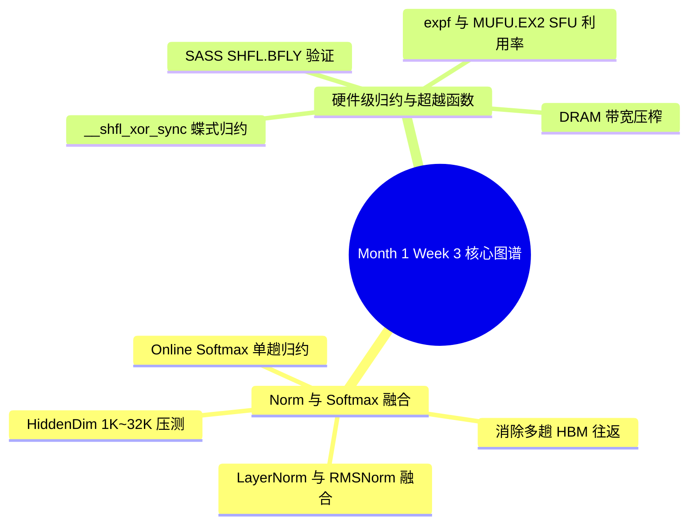

> 本文为 **GPU Kernel 实战（Month 1）** 系列第 3 周（Week 3），深入 **Online Softmax 单趟融合、LayerNorm / RMSNorm 归约核函数**，并分析 `__shfl_xor_sync`（`SHFL.BFLY`）与 `MUFU.EX2` 硬件指令生成。
> **硬件目标平台**：NVIDIA B200（Blackwell `sm_100`, 148 SMs, 126.5 MB L2 Cache）｜**工程目录**：`~/workspace/llm-gpu-compute-lab`



---

## Week 3：Softmax 与 LayerNorm / RMSNorm 算子融合

### 3.1 核心代码（`src/week03/norm_softmax.cu` 核心归约与融合算子）
```cuda
#include "cuda_check.h"
#include <cfloat>
#include <cmath>

// ============================================================================
// 1. Warp & Block 级并行归约原语 (基于 __shfl_xor_sync 寄存器直连交换)
// ============================================================================
__inline__ __device__ float warp_reduce_max(float val) {
    #pragma unroll
    for (int offset = 16; offset > 0; offset >>= 1) {
        val = fmaxf(val, __shfl_xor_sync(0xffffffff, val, offset));
    }
    return val;
}

__inline__ __device__ float warp_reduce_sum(float val) {
    #pragma unroll
    for (int offset = 16; offset > 0; offset >>= 1) {
        val += __shfl_xor_sync(0xffffffff, val, offset);
    }
    return val;
}

template <int BLOCK_SIZE>
__inline__ __device__ float block_reduce_max(float val) {
    static __shared__ float shared[32]; // 最多 1024 / 32 = 32 个 Warp
    int lane = threadIdx.x & 31;
    int wid  = threadIdx.x >> 5;

    val = warp_reduce_max(val);
    if (lane == 0) shared[wid] = val;
    __syncthreads();

    val = (threadIdx.x < (BLOCK_SIZE >> 5)) ? shared[lane] : -FLT_MAX;
    if (wid == 0) val = warp_reduce_max(val);
    return val;
}

template <int BLOCK_SIZE>
__inline__ __device__ float block_reduce_sum(float val) {
    static __shared__ float shared[32];
    int lane = threadIdx.x & 31;
    int wid  = threadIdx.x >> 5;

    val = warp_reduce_sum(val);
    if (lane == 0) shared[wid] = val;
    __syncthreads();

    val = (threadIdx.x < (BLOCK_SIZE >> 5)) ? shared[lane] : 0.0f;
    if (wid == 0) val = warp_reduce_sum(val);
    return val;
}

// ============================================================================
// 2. Online Softmax Kernel (单趟遍历完成 Max + Sum 归约，支持任意超大词表/长序列)
// ============================================================================
struct __align__(8) MD {
    float m; // 当前局部最大值
    float d; // 修正后的局部指数和
};

__inline__ __device__ MD reduce_md_op(MD a, MD b) {
    bool a_bigger = (a.m > b.m);
    MD bigger  = a_bigger ? a : b;
    MD smaller = a_bigger ? b : a;
    MD res;
    res.m = bigger.m;
    res.d = bigger.d + smaller.d * expf(smaller.m - bigger.m);
    return res;
}

template <int BLOCK_SIZE = 256>
__global__ void online_softmax_kernel(
    const float* __restrict__ x,
    float* __restrict__ y,
    int rows, int cols) {
    int row = blockIdx.x;
    if (row >= rows) return;

    const float* row_in  = x + static_cast<size_t>(row) * cols;
    float*       row_out = y + static_cast<size_t>(row) * cols;

    // Pass 1: 单次遍历计算线程局部 (m, d)
    MD thread_md = {-FLT_MAX, 0.0f};
    for (int col = threadIdx.x; col < cols; col += BLOCK_SIZE) {
        MD curr = {row_in[col], 1.0f};
        thread_md = reduce_md_op(thread_md, curr);
    }

    // Warp 内合并 (m, d)
    #pragma unroll
    for (int offset = 16; offset > 0; offset >>= 1) {
        MD other;
        other.m = __shfl_xor_sync(0xffffffff, thread_md.m, offset);
        other.d = __shfl_xor_sync(0xffffffff, thread_md.d, offset);
        thread_md = reduce_md_op(thread_md, other);
    }

    // 跨 Warp 合并
    __shared__ MD smem_md[32];
    int lane = threadIdx.x & 31;
    int wid  = threadIdx.x >> 5;
    if (lane == 0) smem_md[wid] = thread_md;
    __syncthreads();

    if (wid == 0) {
        thread_md = (lane < (BLOCK_SIZE >> 5)) ? smem_md[lane] : MD{-FLT_MAX, 0.0f};
        #pragma unroll
        for (int offset = 16; offset > 0; offset >>= 1) {
            MD other;
            other.m = __shfl_xor_sync(0xffffffff, thread_md.m, offset);
            other.d = __shfl_xor_sync(0xffffffff, thread_md.d, offset);
            thread_md = reduce_md_op(thread_md, other);
        }
        if (lane == 0) smem_md[0] = thread_md;
    }
    __syncthreads();

    MD final_md = smem_md[0];
    float inv_d = 1.0f / final_md.d;

    // Pass 2: 写回归一化结果
    for (int col = threadIdx.x; col < cols; col += BLOCK_SIZE) {
        row_out[col] = expf(row_in[col] - final_md.m) * inv_d;
    }
}

// ============================================================================
// 3. Fused RMSNorm Kernel (LLM 主流归一化算子，支持 float4 向量化)
// ============================================================================
template <int BLOCK_SIZE = 256>
__global__ void fused_rmsnorm_kernel(
    const float* __restrict__ x,
    const float* __restrict__ weight,
    float* __restrict__ y,
    int rows, int cols, float eps) {
    int row = blockIdx.x;
    if (row >= rows) return;

    const float* row_in  = x + static_cast<size_t>(row) * cols;
    float*       row_out = y + static_cast<size_t>(row) * cols;

    float sum_sq = 0.0f;
    for (int col = threadIdx.x; col < cols; col += BLOCK_SIZE) {
        float v = row_in[col];
        sum_sq += v * v;
    }

    sum_sq = block_reduce_sum<BLOCK_SIZE>(sum_sq);

    __shared__ float s_inv_rms;
    if (threadIdx.x == 0) {
        s_inv_rms = rsqrtf(sum_sq / static_cast<float>(cols) + eps);
    }
    __syncthreads();

    float inv_rms = s_inv_rms;
    for (int col = threadIdx.x; col < cols; col += BLOCK_SIZE) {
        row_out[col] = row_in[col] * inv_rms * weight[col];
    }
}
```

### 3.2 Week 3 实战命令行
```bash
# 运行 Rows=4096, HiddenDim in {1024, 4096, 8192, 32768} 性能对比
./build/norm_softmax

# 抓取 Online Softmax 与 RMSNorm 的 NCU 报告（重点看 SFU 利用率与 DRAM 带宽）
ncu --set full --import-source yes --profile-from-start off -f -o reports/b200_norm_softmax ./build/norm_softmax 4096 8192

# 检查 __shfl_xor_sync (SHFL.BFLY) 与 expf (MUFU.EX2) 的硬件指令生成
cuobjdump --dump-sass build/norm_softmax | grep -E "SHFL|MUFU" -C 3
```

---

> 👈 **上一周回顾**：[**Week 2：GEMM 分级存储优化（Global → Shared → Register）**](/gpu-kernel/2026-11-26-gpu-kernel-month-1-week-2/)
> 👉 **下一周推荐**：[**Week 4：IO-aware 简化版 FlashAttention 与 KV Cache**](/gpu-kernel/2026-11-28-gpu-kernel-month-1-week-4/)
> 🏷️ **专题合集**：查看全部实战笔记，请访问 [**GPU Kernel 实战标签页**](/tags/GPU-Kernel-实战/)。
