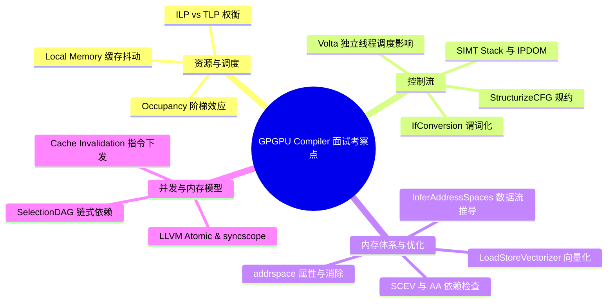
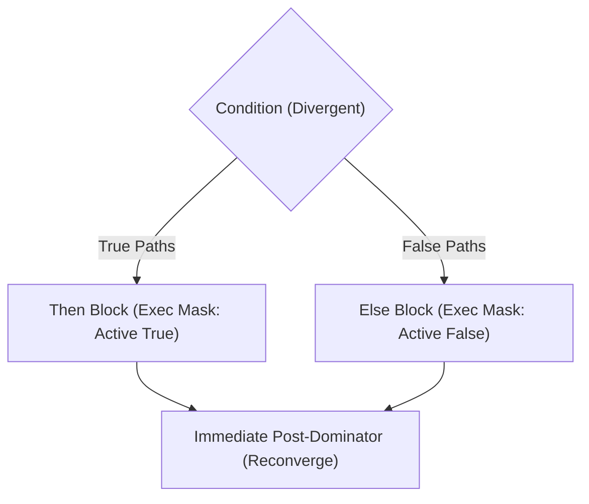
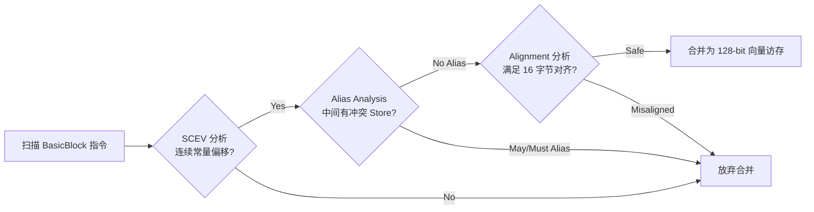

> 本文为 **[GPGPU 编译器工程师面试通关指南](/gpgpu-interview/)** 系列第一期（Day 1）。
> 建议在阅读“面试官参考解析”前，先独立思考每道题目的考察意图与答题脉络（每题思考 3~5 分钟）。

> 💡 **核心考察维度**：硬件资源约束（Occupancy & Spilling）、SIMT 执行模型与控制流结构化、LLVM 异构地址空间体系、中后端访存合并与向量化安全分析、细粒度 GPU 内存模型及调度约束。

---

## 📝 今日高频面试题清单

### 【Q1 · GPGPU 体系结构与编译优化】寄存器压力与 Occupancy（占用率）的权衡
在 GPGPU 架构中，SM（Streaming Multiprocessor）的寄存器文件总量是固定的。编译器在进行指令调度（Instruction Scheduling）和循环展开（Loop Unrolling）时，往往会增加单线程的寄存器使用量。请解释：
1. 单线程寄存器增加如何影响 Occupancy？
2. 编译器在 Backend 阶段通常如何权衡 Instruction-Level Parallelism (ILP) 与 Thread-Level Parallelism (TLP)？
3. 如果发生 Register Spilling，在 GPU 上它的底层代价具体是什么？

---

### 【Q2 · SIMT 控制流】Branch Divergence（分支发散）与重汇聚（Reconvergence）机制
GPGPU 采用 SIMT（单指令多线程）执行模型。当一个 Warp/Wavefront 内的线程遇到条件分支（如 if-else 或复杂的循环嵌套）发生分歧时：
1. 编译器是如何配合硬件生成谓词指令（Predication）或控制流指令来保证正确性的？
2. 请结合 LLVM IR 到目标 ISA 的转换，谈谈 Structurization（控制流结构化）的作用。
3. Volta 架构引入 Independent Thread Scheduling 后，对编译器分析与优化产生了什么深远影响？

---

### 【Q3 · LLVM 核心机制】Address Space（地址空间）在 GPGPU Backend 中的作用
不同于 CPU 的平坦内存模型（Flat Memory Model），GPGPU 拥有复杂的存储层次（Global, Shared/LDS, Local, Constant, Private）。
1. 在 LLVM IR 中是如何表征这些不同存储空间的？
2. 一个 Generic Pointer（通用指针）是如何通过 LLVM Pass 优化并降级（Lower）为特定地址空间指令的？
3. 如果编译器无法静态推导出地址空间，会产生什么底层性能损耗？

---

### 【Q4 · LLVM 向量化与访存优化】Memory Coalescing（访存合并）与 Vectorization
在 GPU 中，将标量访存合并为宽向量访存（例如将 4 个 `ld.global.f32` 合并为 `ld.global.v4.f32`）能显著提升带宽利用率。
1. LLVM 中的 `LoadStoreVectorizer` Pass 是如何工作的？
2. 它依赖哪些前置分析（Analysis Passes）来证明合并的安全性（如 Alias Analysis、Alignment Analysis 等）？

---

### 【Q5 · 计算机底层原理与并发】GPU Memory Model（内存模型）与 Fence 指令编译
现代 GPGPU 支持细粒度的内存一致性模型（如 PTX 中的 `.cta`, `.gpu`, `.sys` 作用域以及 acquire/release 语义）。
1. 从编译器角度看，一个带有 `memory_order_acquire` 的原子操作在 LLVM IR 中如何表示？
2. 编译器在指令选择（Instruction Selection）和指令调度（Instruction Scheduling）阶段，必须遵守哪些约束以防止破坏内存序？

---

## 🎯 面试官深度解析与追问点



---

### 题 1 深度解析：寄存器压力、Occupancy 与 Spilling

#### 1. Occupancy 影响与“阶梯效应”（Cliff Effect）
* **硬件约束原理**：每个 SM 的物理寄存器总数是固定的（例如 NVIDIA SM 通常为 64K 个 32-bit 寄存器，AMD Compute Unit 则有 64KB/128KB VGPR 文件）。
* **量化关系**：
  $$\text{Max Active Warps} = \min\left(\text{Max Warps per SM}, \left\lfloor \frac{\text{SM Total Registers}}{\text{Registers per Thread} \times \text{Threads per Warp}} \right\rfloor\right)$$
* **阶梯效应（Cliff Effect）**：硬件在分配寄存器时存在颗粒度限制（例如以 256/512 个寄存器或一定数量的 Register Block 为步进）。单线程仅仅多使用 **1 个寄存器**，就可能触发分配块跨级，导致 SM 能同时容纳的 Active Warps 数量瞬间**断崖式下跌**（例如从 32 个 Warp 骤降到 16 个），造成 Occupancy 减半。

#### 2. ILP vs TLP 的编译器权衡策略
* **ILP 激进调度的代价**：Pre-RA Scheduler（寄存器分配前调度）为了掩盖长延迟算术或访存指令，往往采用激进的**列表调度（List Scheduling）**将独立指令拉开。但这会大幅拉长变量的 **Live Range（生命周期）**，导致并发活跃的虚拟寄存器数量激增。
* **编译器的应对机制**：
  * **压力感知调度（Pressure-Aware Scheduling）**：如 LLVM 的 `GCNIterativeScheduler` 或 NVPTX 相关策略，实时跟踪当前的 Register Pressure（RP）。当 RP 接近设定的阈值或 `__launch_bounds__` 上限时，调度算法从“最大化 ILP”退化为“最小化生命周期的 DFS/Topological 优先调度”。
  * **重计算（Rematerialization）**：如果某个变量的生成代价极低（如常数载入、基地址偏移计算、小跨度位移），编译器会在其被使用的地方重新生成一份指令，而不是为其保留一个物理寄存器。以微小的算力为代价，换取关键路径上的寄存器释放。

#### 3. Register Spilling 的真正代价
* **本质真相**：在 CPU 上，Spill 是写入栈帧，由于 CPU 拥有超大的私有 L1/L2 Cache，多数溢出仅命中片上缓存。而在 GPU 上，**Local Memory 在物理上位于 Global Memory（外部 DRAM/HBM）中**。
* **灾难性后果**：
  1. **吞吐断崖与高延迟**：尽管 Local Memory 会经过 L1/L2 Cache 过滤，但海量并发线程同时发生 Spill 会瞬间冲垮 L1/L2，引发严重的 **Cache Thrashing（缓存抖动）**。
  2. **数百周期延迟暴露**：一旦未命中片上缓存，单次 Spill 涉及 200~800 个时钟周期的访存等待，完全摧毁吞吐。
  *(注：部分现代架构支持将未用尽的片上 Shared Memory/LDS 作为 Spill 溢出区，以缓解访存延迟灾难。)*

---

### 题 2 深度解析：SIMT 分支发散与控制流结构化

#### 1. SIMT 硬件执行模型与重汇聚（Reconvergence）
* **Active Mask / EXEC 掩码**：同一 Warp 内的 32/64 个线程共享同一个 PC。当执行条件分支时，硬件通过掩码标记当前处于活动状态的线程。
* **SIMT Stack 机制**：硬件维护分支执行栈。遇到 Divergence 时：
  1. 压入 False 分支的目标 PC、掩码以及**重汇聚点（Reconvergence Point）**。
  2. 掩码切换为 True 线程集合，继续向下执行。
  3. 执行完 True 分支后，弹出栈顶恢复 False 路径。
  4. 到达重汇聚点时，恢复分支前的完整掩码。
* **IPDOM 原则**：最优重汇聚点在理论上通常是控制流图中的 **Immediate Post-Dominator（紧邻后支配节点）**。如果重汇聚点选错或下移，会导致线程无谓地串行化执行更长时间。



#### 2. Predication vs Jump（IfConversion）
* **短分支谓词化**：对于代码行数极少、无副作用的分支（如 `y = (x > 0) ? a : b`），编译器通过 `IfConversion` Pass 将控制依赖转化为数据依赖，生成带谓词的指令（如 PTX `@p0 mov.b32`，AMDGPU `v_cndmask_b32`），完全消除硬件分支跳转和压栈开销。

#### 3. LLVM StructurizeCFG 的核心使命
* **硬件要求**：GPU 硬件在处理底层掩码保存/恢复（如 AMDGPU 的 `s_and_saveexec_b64` / `s_or_b64 exec`）时，严格依赖结构化（Reducible）的循环与分支拓扑。
* **处理不可约流图（Irreducible CFG）**：若源码中包含复杂的 `goto` 或跨循环层级的跳转，CFG 会呈现不可约形态。LLVM 的 `StructurizeCFG` Pass 会识别这些结构，**显式插入 Flow 块、引入状态变量（State Variable）与循环重整**，将复杂 CFG 规整为单一出口/入口的标准循环与分支，保证后端能够正确插入 EXEC 掩码操作指令。

#### 4. Volta Independent Thread Scheduling (ITS) 的冲击
* **架构变革**：Volta 及后续架构为每个线程配备了独立的 PC 和 Call Stack，允许 Warp 内线程以细粒度交错执行，甚至支持 Warp 内线程之间的锁与交互。
* **编译器影响**：
  * **Warp-Synchronous 隐式同步失效**：以前开发者认为同一 Warp 在同一个基本块内天然锁步执行，编译器也可以放心地跨指令做公共子表达式消除（CSE）。在 ITS 下，隐式锁步假设彻底打破，必须依赖显式屏障指令（如 PTX `bar.warp.sync` 或 `__syncwarp()`）。
  * **内存序与死锁分析**：编译器在移动含有同步/自旋依赖的代码时，必须严格遵守屏障范围，严禁将代码外提（Hoist）越过同步点。

---

### 题 3 深度解析：Address Space 与指针优化

#### 1. LLVM IR 中的地址空间表示
在 LLVM 中，不同硬件存储体由指针类型的 `addrspace(N)` 属性区分（即便是 LLVM 15+ 的 Opaque Pointers 时代，类型依然写作 `ptr addrspace(N)`）。
常见映射关系对照表：

| 语义概念 | NVIDIA (NVPTX) | AMD (AMDGPU) | 硬件特性与延迟 |
| :--- | :---: | :---: | :--- |
| **Generic / Flat** | `addrspace(0)` | `addrspace(0)` | 包含所有地址空间，由硬件动态解码路由（开销最大） |
| **Global** | `addrspace(1)` | `addrspace(1)` | 全局显存（DRAM/HBM），经过 L1/L2 Cache（~200-800 cycles） |
| **Shared / LDS** | `addrspace(3)` | `addrspace(3)` | 片上片内 SRAM，极低延迟（~20 cycles），支持原子操作 |
| **Constant** | `addrspace(4)` | `addrspace(4)` | 只读常量内存，配备专用 Constant Cache 广播机制 |
| **Local / Private**| `addrspace(5)` | `addrspace(5)` | 线程私有内存，溢出栈（物理映射在 Global Memory） |

#### 2. 为什么必须消除 Generic Pointer？
* **指令差异显著**：
  * 访问明确的 Shared 内存：指令为 `ld.shared`（NVPTX）或 `ds_read`（AMDGPU）。地址只需 32 位，硬件直接走片内互联总线，消耗寄存器少、发射延迟极低。
  * 访问 Generic 内存：指令为通用的 `ld` 或 `flat_load`。由于地址可能指向 Shared 也可能指向 Global，硬件必须使用 64 位宽地址，且硬件执行流水线必须**在运行时提取高位 Address Bits 进行动态分支判断与路由**，不仅多占一倍地址寄存器，还会引入额外的译码延迟与能耗。

#### 3. InferAddressSpaces Pass 原理
* **推导机制**：
  1. **定位 Source**：寻找具有确定地址空间的源头指针（例如全局变量 `@shared_buf` 天然携带 `addrspace(3)`，内核入参指针通过属性标记为 `addrspace(1)`）。
  2. **数据流图传播**：沿着 Def-Use 链向后传播（遍历 `getelementptr`, `bitcast`, `phi`, `select` 等操作）。
  3. **Rewrite & Eliminate**：将中间不必要的 `addrspacecast (ptr addrspace(3) to ptr)` 逆向消除，并将终端的 `load ptr` 重写为 `load ptr addrspace(3)`。
* **推导失败的惩罚**：如果因为复杂跨模块函数调用、动态指针别名导致推导中断，编译器只能在后端生成保底的 `Flat/Generic Load`，直接带来 15%~30% 的寻址性能开销。

---

### 题 4 深度解析：访存合并（Memory Coalescing）与向量化

#### 1. LoadStoreVectorizer 的工作原理
* **目标**：将连续的标量 Load/Store（如 4 个连续的 32-bit `float` 读写）提升为宽向量访存（如 128-bit 的 `float4` 对应 `ld.global.v4.f32` 或 `global_load_dwordx4`）。
* **优势**：
  * 减少发往 MIO/LSU（加载存储单元）的指令条数，降低指令发射队列拥塞。
  * 充分发挥 GPU 内存总线单次请求的突发带宽（Burst Transfer）。

#### 2. 核心前置依赖分析（Safety & Legality）



1. **ScalarEvolution (SCEV)**：
   * 判定两个指针表达式的差值：$\text{Ptr}_2 - \text{Ptr}_1 = \text{Constant Offset}$。
   * 必须确保偏移量刚好等于上一个访存类型的字节大小（如 $+4, +8, +12$）。
2. **AliasAnalysis (AA) 与 MemorySSA 依赖检验**：
   * 假设有序列：`L1 = Load ptr; Store ptr_x; L2 = Load ptr+4;`。
   * 要将 `L1` 与 `L2` 合并，必须将 `L2` 提升移动到 `Store` 之前（或者将 `L1` 下沉）。
   * 编译器必须通过 `AA->isNoAlias(ptr+4, ptr_x)` 证明该移动**绝对不会越过任何存在别名依赖的写操作**，否则会导致读写乱序，违背 RAW（Read-After-Write）规则。
3. **Alignment（对齐分析）**：
   * 硬件向量指令（如 128-bit 向量访存）通常**强制要求自然对齐（16-byte alignment）**。
   * 编译器必须通过 `getOrEnforceKnownAlignment`、`KnownBits` 或用户假设（`__builtin_assume_aligned`）确信基地址在运行时满足 16 字节对齐。如果基址对齐不足，强行合并会导致运行时直接抛出硬件非法访存异常（Hardware Misaligned Exception）。

---

### 题 5 深度解析：GPU 内存模型与 Fence 编译

#### 1. LLVM IR 内存模型规范
LLVM 原生支持多层次并发语义模型：
* **Memory Ordering**：`monotonic`, `acquire`, `release`, `acq_rel`, `seq_cst`。
* **Synchronization Scope (`syncscope`)**：
  * `"workgroup"`（OpenCL）/ `"cta"`（CUDA）：作用域仅限于同一个线程块。
  * `"agent"` / `"gpu"`：作用域涵盖整颗 GPU 设备内部所有核心。
  * `"system"`：作用域跨越 PCIe/CXL 总线，与 Host CPU 保持统一视图。

示例 LLVM IR 片段：
```llvm
; 线程块内 Release 语义的原子写
store atomic i32 %val, ptr addrspace(1) %ptr release, syncscope("workgroup"), align 4

; GPU 全局 Acquire 语义的原子读
%res = load atomic i32, ptr addrspace(1) %ptr acquire, syncscope("gpu"), align 4
```

#### 2. 指令选择（ISel）与 Cache 控制指令下发
GPU 的各级 Cache 架构（如 L1/Texture Cache）默认通常是**弱一致性甚至是只读/非全相联硬件失效**的。不同于 CPU 自动的 MESI 硬件缓存一致性嗅探总线，GPU 强依赖编译器下发显式指令维护缓存可见性：
* **Acquire 编译**：
  * 目标是将全局最新数据拉入本地。
  * 编译器在下发读取指令时，不仅生成带 `.acquire` 修饰符的硬件操作，对于 AMDGPU 还需设置指令属性位（如 `glc` 全局连贯位、`slc` 系统级连贯位），甚至在必要时插入 `buffer_wbinvl1_vol`（无效化本地 L1 Cache，强制穿透到 L2/全局拉取最新值）并插入 `s_waitcnt vmcnt(0)` 等待访存回包。
* **Release 编译**：
  * 目标是保证之前的写操作对其他线程全部可见。
  * 编译器会先插入写屏障指令（Drain Pending Writes），确保所有数据由本地 Store Buffer 刷入 L2 或全局内存，再发射释放锁的 Store。

#### 3. 指令调度器（Instruction Scheduler）的约束
* **SelectionDAG / MachineScheduler 规则**：
  * 带有 `Acquire` 属性的节点，在 DAG 中会被赋予类似 `MayLoad` 以及特殊的 **Order Dependency / Chain 依赖边**。
  * 调度器在拓扑排序和计算就绪列表（Ready Queue）时，**严格禁止把依赖图位于 Acquire 之后的所有指令提升到 Acquire 之前**（单向屏障 One-way Barrier）。
  * 同样，对于 `Release` 指令，严格禁止把其前面的读写指令下沉重排到其后，从而在编译期确保了语言规范级内存序不被乱序优化破坏。

---

## 💡 面试实战总结（复盘金句）

> 1. **谈 Occupancy 时**：*"不要一味追求 100% 的理论占用率；在具备足够 ILP 能够隐藏访存延迟的前提下，适度降低 Occupancy 换取更大的单线程寄存器配额，往往能获得更好的真实吞吐。"*
> 2. **谈控制流时**：*"GPU 控制流优化的终极目标是减少 Active Mask 切换与串行化开销；短分支用 IfConversion 数据依赖替代控制依赖，复杂分支必须经由 StructurizeCFG 规整以保证掩码栈操作的正确性。"*
> 3. **谈指针优化时**：*"Generic Pointer 是 GPGPU 性能隐形杀手；中端必须穷尽 InferAddressSpaces 的数据流推导，消除动态地址路由。"*
> 4. **谈向量化时**：*"LoadStoreVectorizer 并不是简单的指令打包，它本质是 SCEV 跨步推导、AA 别名无依赖证明与硬件 Strict Alignment 的三位一体。"*

---

{: .notice--success}
👉 **下一期推荐**：**[Day 2：标量优化、Bank Conflict、软流水与指令发射](/gpu-compiler/gpgpu-compiler-interview-day-2/)**
👉 **专栏返回**：查看更多模块内容与更新计划，请访问 **[GPGPU 编译器面试通关指南目录](/gpgpu-interview/)**。
